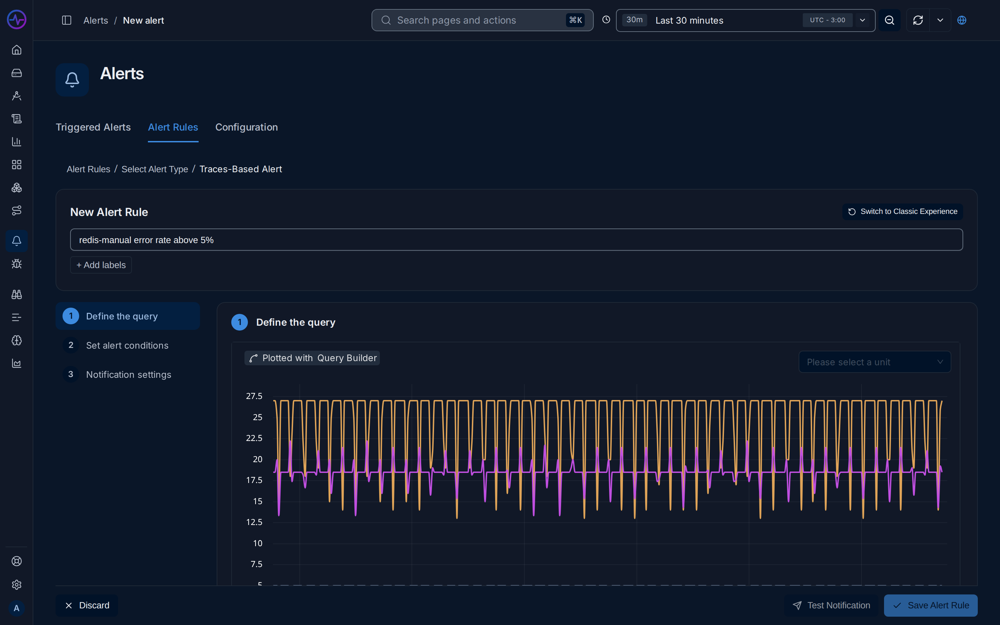
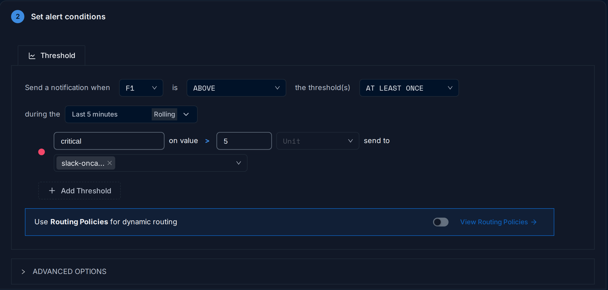

import { Aside, Steps } from "@astrojs/starlight/components";

An alert rule runs a query on a schedule, compares the result with one or more thresholds
and sends a notification when a condition holds. Rules live under *Alerts → Alert Rules*.
Admins and editors can create, edit and delete rules; viewers can read them.


## Create a rule

<Steps>

1. Go to *Alerts → Alert Rules*, click **New Alert** and choose a type:

   | Type | Data | Query editors |
   |---|---|---|
   | Metric based Alert | Metrics | Query Builder, ClickHouse Query, PromQL |
   | Log-based Alert | Logs | Query Builder, ClickHouse Query |
   | Trace-based Alert | Spans | Query Builder, ClickHouse Query |
   | Exceptions-based Alert | Exceptions | Query Builder, ClickHouse Query (default) |

2. **Define the query.** Build the query and check the preview chart. Group by
   attributes, such as `service.name`, to get one alert per group.
3. **Set alert conditions**: the comparison, the thresholds and the evaluation window.
4. **Notification settings**: channels or routing policies, grouping, repeat interval
   and message.
5. Name the rule in the header, add labels, then click **Save Alert Rule**.

</Steps>



**Test Notification** evaluates the rule once and sends the result to its channels without
saving it. When no series matches, FuseScope reports that no alerts were found; adjust the
threshold and retry.

<Aside>
  The header has a **Switch to Classic Experience** button that opens the previous form.
  It offers the same rule types with a single threshold and a *Severity* field.
</Aside>

## Conditions

The condition reads as a sentence:
*Send a notification when* **A** *is* **ABOVE** *the threshold(s)* **AT LEAST ONCE**
*during the* **Last 5 minutes**.



| Operator | API value |
|---|---|
| ABOVE | `above` |
| BELOW | `below` |
| EQUAL TO | `equal` |
| NOT EQUAL TO | `not_equal` |
| ABOVE OR EQUAL TO | `above_or_equal` |
| BELOW OR EQUAL TO | `below_or_equal` |

The match type decides which points of the evaluation window count:

| Match type | API value | Fires when |
|---|---|---|
| AT LEAST ONCE | `at_least_once` | any point meets the condition |
| ALL THE TIME | `all_the_times` | every point meets it |
| ON AVERAGE | `on_average` | the average of the points meets it |
| IN TOTAL | `in_total` | the sum of the points meets it |
| LAST | `last` | the most recent point meets it |

With several queries or a formula, pick which one the condition uses in the first
drop-down.

## Thresholds and severity

A rule can have several thresholds. Each one has a name, a value, an optional unit and
its own notification channels. The first is named `critical`; **Add Threshold** adds
`warning`, then `info`. All thresholds share the operator and match type.

Each alert carries the labels `threshold.name` and `severity`, both set to the name of the
threshold it crossed, in lower case. When several thresholds fire for the same series, only
the most severe one notifies: the highest value for *above* conditions, the lowest for
*below*.

## Evaluation window and frequency

| Window | Options |
|---|---|
| Rolling | Last 5, 10, 15 or 30 minutes, Last 1, 2 or 4 hours, or Custom. Default: Last 5 minutes. |
| Cumulative | Current hour, Current day or Current month, from a starting minute, hour or day in a chosen timezone. |

A rolling window moves forward with every check. A cumulative window starts at a fixed
point and grows until it resets, for example for a daily error budget.

*Advanced options → How often to check* sets the frequency: every 1 minute by default, in
seconds, minutes or hours.

## Missing data

Also under *Advanced options*:

| Option | Effect |
|---|---|
| Alert when data stops coming | Notify when the query returns no data for the given number of minutes (default 15). The alert is named `[No data] <rule name>` and labelled `nodata=true`. |
| Minimum data required | Skip groups that have fewer data points than the given number in the window. |

## Notification settings

| Setting | Description |
|---|---|
| Channels | Per threshold, under *send to*. |
| Use Routing Policies for dynamic routing | Route by alert labels with [routing policies](/fusescope-docs/alerts/routing-and-downtime/#routing-policies) instead of per-threshold channels. |
| Group alerts by | Combine alerts with the same values of these fields into one notification. Empty combines all alerts of the rule; **All** disables grouping. |
| Repeat notifications | Notify again every *n* minutes or hours while the alert is *Firing* or in *No Data*. Off by default. |
| Notification message | Text of the alert description. |

## Message templates

The notification message and label values are Go templates. These variables are
available:

| Variable | Value |
|---|---|
| `{{$value}}` | Observed value, formatted with the rule unit. |
| `{{$threshold}}` | Threshold value, formatted with the rule unit. |
| `$service.name`, `{{$service.name}}` or `{{.Labels.service.name}}` | Value of a label of the series, such as a group-by attribute. |

The default message is:

```text
This alert is fired when the defined metric (current value: {{$value}}) crosses the threshold ({{$threshold}})
```

Go template functions such as `toUpper`, `toLower`, `title`, `humanize` and
`humanizeDuration` are available. Templates are checked when the rule is saved.

## States and history

| State | Meaning |
|---|---|
| `inactive` | Shown as **OK**: the condition does not hold. |
| `firing` | The condition holds and notifications are sent. |
| `nodata` | No data for the configured time. |
| `disabled` | The rule is turned off, shown as **Muted** on the rule page. |

*Alerts → Triggered Alerts* lists alerts that are firing now, with their severity, start
time and labels. On a rule, the **History** tab shows the total triggers, average
resolution time, top contributing series and a timeline of state changes, with links to
the related logs or traces.

Rules can be enabled, disabled, cloned and deleted from the rule list or the rule page.
