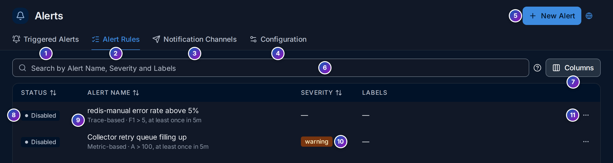
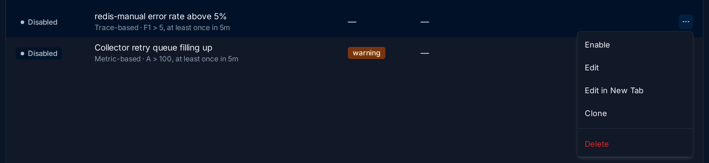
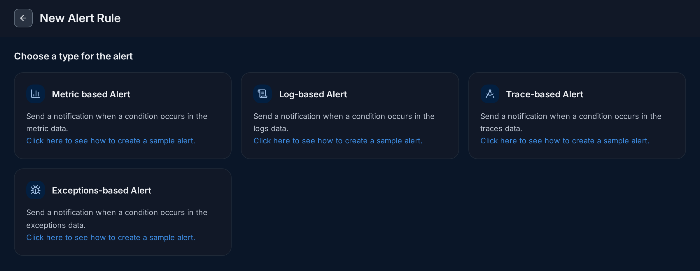
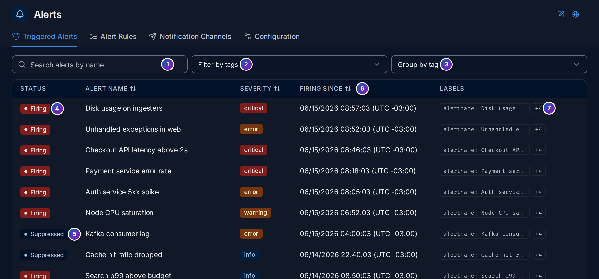

import { Aside, Steps } from "@astrojs/starlight/components";

An [alert rule](/fusescope-docs/reference/glossary/#alert-rule) runs a query on a
schedule, compares the result with one or more thresholds and sends a notification
when a condition holds. Rules live on the **Alerts** page, under **Respond** in the
sidebar. Creating, editing and deleting rules needs the Editor or Admin
[role](/fusescope-docs/administration/users-and-roles/#roles); viewers can read them.

**Use this page when** you want to be told about a problem instead of watching for it,
for example when a service's error rate goes above 5%, or when you open a rule someone
else wrote and want to know what it does. For a step-by-step first rule with Slack,
see [Set up your first alert](/fusescope-docs/guides/first-alert/).

## Alerts in plain words

- A **rule** is a question FuseScope asks every minute or so: *is the error rate of
  `redis-manual` above 5%?*
- A **threshold** is the line the answer is compared with, such as `5`. A rule can
  have several, from `critical` down to `info`.
- The **evaluation window** is how much recent data each check looks at, such as the
  last 5 minutes.
- When the condition holds, the rule **fires**: it creates an **alert** and sends a
  **notification** to one or more
  [notification channels](/fusescope-docs/alerts/notification-channels/), such as Slack
  or email. When the condition stops holding, the alert **resolves**.
- **Labels** are `key: value` pairs on a rule and its alerts, such as `team: payments`.
  They decide how alerts are grouped and, with
  [routing policies](/fusescope-docs/alerts/routing-and-downtime/#routing-policies),
  where they are sent.

## The Alerts page

Click **Alerts** in the sidebar (`/alerts`). It has four tabs:



1. **Triggered Alerts**: the alerts firing now. See [Triggered alerts](#triggered-alerts).
2. **Alert Rules**: every rule, the default tab. See [The rule list](#the-rule-list).
3. **Notification Channels**: where alerts are sent. See
   [Notification channels](/fusescope-docs/alerts/notification-channels/).
4. **Configuration**: **Planned Downtime** and **Routing Policies**. See
   [Routing and planned downtime](/fusescope-docs/alerts/routing-and-downtime/).
5. **New Alert** creates a rule. The button follows the tab: on Configuration it
   becomes **New downtime** or **New routing policy**, on Notification Channels
   **New Alert Channel**.

The tab is part of the address (`?tab=AlertRules`, `?tab=TriggeredAlerts`,
`?tab=Channels`, `?tab=Configuration`), so you can link to it.

### The rule list

6. **Search by Alert Name, Severity and Labels**: type part of any of them. The
   **?** next to it links to this page.
7. **Columns**: show or hide **Severity**, **Labels**, **Created At**,
   **Created By**, **Updated At** and **Updated By**.
8. **Status**: the rule's current [state](#states), such as **Firing**, **OK** or
   **Disabled**.
9. **Alert name**, and under it a one-line summary of the rule: its type, the
   condition and the window, such as `Trace-based · F1 > 5, at least once in 5m`.
10. **Severity**: the `severity` label, such as `warning`, coloured by level.
11. **Row menu** (**⋯**):



| Item | Does |
|---|---|
| **Enable** / **Disable** | Turns the rule on or off. A disabled rule is not evaluated |
| **Edit** | Opens the rule (**Edit in New Tab** in a new browser tab) |
| **Clone** | Creates a copy you can change |
| **Delete** | Deletes the rule, after you confirm |

Click **Status**, **Alert name** or **Severity** to sort. Click a row to open the
[rule page](#the-rule-page). With no rules yet, the tab shows ready-made examples and
a **New Alert Rule** button instead of the table.

## Create a rule

<Steps>

1. Click **New Alert** and choose what the rule watches:

   

   | Type | Watches | Query editors |
   |---|---|---|
   | **Metric based Alert** | Metrics, such as CPU or a request counter | Query Builder, ClickHouse Query, PromQL |
   | **Log-based Alert** | Logs, such as a count of `ERROR` lines | Query Builder, ClickHouse Query |
   | **Trace-based Alert** | Spans, such as error rate or p99 latency | Query Builder, ClickHouse Query |
   | **Exceptions-based Alert** | Recorded exceptions | Query Builder, ClickHouse Query (default) |

2. The editor opens with three steps: [Define the query](#step-1-define-the-query),
   [Set alert conditions](#conditions) and
   [Notification settings](#notification-settings).
3. Give the rule a name and labels at the top, then click **Save Alert Rule**.

</Steps>

<Aside>
  A new rule's header has **Switch to Classic Experience**, which opens the previous
  form. It offers the same rule types with a single threshold and a *Severity* field.
</Aside>

You can also start a rule from elsewhere: **Create alert** on a
[service chart](/fusescope-docs/apm/services/#the-charts), or from the explorers and
dashboard panels, opens the editor with the query already filled in.

## The rule editor

The editor is the same when you create a rule and when you open an existing one. Here
it shows the demo rule `redis-manual error rate above 5%`:


### The header

1. **Status**: the rule's [state](#states), here **Disabled**.
2. **Enable switch**: turns the rule on or off, as the row menu does.
3. **Copy link**: copies the rule's address.
4. **⋯**: **Clone** and **Delete**.
5. **Rule name**: what notifications and the list show. Make it say what is wrong,
   such as `redis-manual error rate above 5%`.
6. **Add labels**: add `key: value` labels, such as `team: platform`. Every alert of
   the rule carries them, so routing policies and grouping can use them.
7. **Overview** (the editor) and **History** (see [History](#history)).
8. **Time range** of the preview chart. It doesn't change what the rule checks; that
   is the [evaluation window](#evaluation-window-and-frequency).

### Step 1: define the query

9. **Define the query**: what number the rule watches.
10. **Data source**: **Metrics**, **Logs**, **Traces** or **Exceptions**.
11. **Query Builder** or **ClickHouse Query** (and **PromQL** for metrics). The query
    builder works as in the explorers; see
    [Query builder](/fusescope-docs/querying/query-builder/).
12. **Run Query** draws the preview.
13. **Queries and formulas**. Each query (**A**, **B**…) gives one series per group;
    **Add Formula** combines them, such as `B / A * 100` for an error percentage.
    **Group By** gives one alert per value, for example one per `service.name`.
14. **Preview**: the result over the time range, with each threshold as a dashed
    line, such as `critical`. Use it to check that the threshold sits where you
    expect.

## Conditions

**Set alert conditions** reads as a sentence: *Send a notification when* **F1** *is*
**ABOVE** *the threshold(s)* **AT LEAST ONCE** *during the* **Last 5 minutes**.


1. **Threshold**: the kind of condition: a fixed value.
2. **Operator**: **ABOVE**, **BELOW**, **EQUAL TO**, **NOT EQUAL TO**,
   **ABOVE OR EQUAL TO** or **BELOW OR EQUAL TO**. The drop-down before it, here
   **F1**, picks which query or formula the condition uses.
3. **Match type**: which points of the window must meet the condition:

| Match type | Fires when | Good for |
|---|---|---|
| **AT LEAST ONCE** | any point meets the condition | catching every spike |
| **ALL THE TIME** | every point meets it | ignoring short spikes |
| **ON AVERAGE** | the average of the points meets it | noisy values |
| **IN TOTAL** | the sum of the points meets it | counts, such as errors in the window |
| **LAST** | the most recent point meets it | the current state |

4. **Evaluation window**: see [Evaluation window and frequency](#evaluation-window-and-frequency).

<details>
<summary>Values in the alert rules API</summary>

| In the editor | API value |
|---|---|
| ABOVE | `above` |
| BELOW | `below` |
| EQUAL TO | `equal` |
| NOT EQUAL TO | `not_equal` |
| ABOVE OR EQUAL TO | `above_or_equal` |
| BELOW OR EQUAL TO | `below_or_equal` |
| AT LEAST ONCE | `at_least_once` |
| ALL THE TIME | `all_the_times` |
| ON AVERAGE | `on_average` |
| IN TOTAL | `in_total` |
| LAST | `last` |

</details>

## Thresholds and severity

5. to 7. Each threshold row has a **name**, an **on value**, an optional **Unit** and
   its own channels under **send to**. The first is named `critical`.
8. **Add Threshold** adds `warning`, then `info`. All thresholds share the operator
   and match type.
9. **Use Routing Policies for dynamic routing**: send alerts by their labels with
   [routing policies](/fusescope-docs/alerts/routing-and-downtime/#routing-policies)
   instead of per-threshold channels. The **send to** pickers disappear when it is on;
   **View Routing Policies** opens the policies. Each threshold needs a channel unless
   this is on.

Each alert carries the labels `threshold.name` and `severity`, both set to the name of
the threshold it crossed, in lower case. When several thresholds fire for the same
series, only the most severe one notifies: the highest value for *above* conditions,
the lowest for *below*.

## Evaluation window and frequency

The evaluation window is how much data each check looks at.

| Window | Options |
|---|---|
| **Rolling** | Last 5, 10, 15 or 30 minutes, Last 1, 2 or 4 hours, or a custom duration. Default: Last 5 minutes. |
| **Cumulative** | **Current hour**, **Current day** or **Current month**, from a starting minute, hour or day, in a chosen timezone. |

A rolling window moves forward with every check. A cumulative window starts at a fixed
point and grows until it resets, for example for a daily error budget.

## Advanced options

Open **Advanced options** under the thresholds:

| Option | Effect |
|---|---|
| 10. **How often to check** | How often the rule runs. Default: every 1 minute; 1 to 5 minutes suits most rules. |
| 11. **Alert when data stops coming** | Notify when the query returns no data for the given number of minutes. The alert is named `[No data] <rule name>` and labelled `nodata=true`. Good for pipelines that should never go quiet. |
| 12. **Minimum data required** | Only decide when the window has at least this many data points, to avoid alerts on too little data. |

### Missing data

**Alert when data stops coming** is the only way to be told that something stopped
sending. A rule that only compares values never fires when there are no values at all.

## Notification settings

13. **Notification Message**: the text of the alert. It can use
    [template variables](#message-templates).
14. **Group alerts by**: combine alerts with the same values of these fields into one
    notification. Leave it empty to combine all alerts of the rule; choose **All** to
    send one notification per alert. The fields offered are the query's group-by
    keys, so a rule with no **Group By** says `No grouping fields available`.
15. **Repeat notifications**: notify again every *n* minutes or hours while the alert
    is firing or has no data. Off by default.

### Message templates

The notification message and label values are Go templates. These variables are
available:

| Variable | Value |
|---|---|
| `{{$value}}` | Observed value, formatted with the rule unit. |
| `{{$threshold}}` | Threshold value, formatted with the rule unit. |
| `$service.name`, `{{$service.name}}` or `{{.Labels.service.name}}` | Value of a label of the series, such as a group-by attribute. |

The default message is:

```text
This alert is fired when the defined metric (current value: {{$value}}) crosses the threshold ({{$threshold}})
```

Go template functions such as `toUpper`, `toLower`, `title`, `humanize` and
`humanizeDuration` are available. Templates are checked when the rule is saved.

### Test and save

16. **Test Notification** evaluates the rule once and sends the result to its
    channels, without saving it. When no series crosses a threshold, FuseScope says no
    alerts were found; lower the threshold to see a real message, then put it back.
    The message reaches real people, so warn the channel first.
17. **Save Alert Rule** saves the rule. **Discard** drops your changes.

## The rule page

Click a rule in the list to open it (`/alerts/overview?ruleId=…`). **Overview** is the
[rule editor](#the-rule-editor) with the saved values; change anything and click
**Save Alert Rule**. **History** shows what the rule did.

### History

The **History** tab (`/alerts/history?ruleId=…`) answers "how often does this rule
fire, and for how long?" over the time range at the top:


*Sample data: this image is a Storybook story, not the demo.*

1. **Total triggered**: how many times the rule fired, against the same stretch of
   time before.
2. **Avg. resolution time**: how long its alerts lasted on average, from firing to
   resolved. A long time means problems stay unfixed; a very short one often means a
   noisy rule.
3. **Top contributors**: the label combinations that fired most, with their share,
   such as `service.name:checkout` in 24 of 48 triggers. **View all** lists them all.
4. **Timeline**: the rule's state over time: red while firing, green while OK.
5. **Overall Status** is the rule as a whole. (**Top 5 Contributors** is not
   available yet.)
6. **All**, **Fired** or **Resolved** filters the list below.
7. The count of triggers in the range, such as `48 triggers in 6h`.
8. **Filter**: narrow the list by labels, such as `service.name = 'frontend'`, then
   **Run Query**.
9. **State changes**: one row per change, **Firing** or **Resolved** (also
   **No Data** and **Muted**), with the alert's labels and when it happened.
10. **⋮** on a row links to **View Logs** or **View Traces** for that alert, when the
    rule has a query those signals can follow.

A rule that never fired reads `None Triggered.` and
`No state changes in this time range.`

## Triggered alerts

**Triggered Alerts** lists every alert that is active now, across all rules.



*Sample data: this image is a Storybook story, not the demo.*

1. **Search alerts by name**.
2. **Filter by tags**: keep alerts with given labels, such as `severity:critical`.
3. **Group by tag**: group alerts by a label, such as `service`, with a count per
   group. Expand a group to see its alerts.
4. **Firing**: the alert is active and notifications go out.
5. **Suppressed**: the alert is active, but a
   [planned downtime](/fusescope-docs/alerts/routing-and-downtime/#planned-downtime)
   silences its notifications.
6. **Firing since**: when it started.
7. **Labels**: the first label and a `+N` chip; hover it for the rest.

With nothing active, the tab says `No alerts firing` and
`All systems are healthy. No alerts are currently triggered.`

## States

| State | Meaning |
|---|---|
| **OK** | The condition does not hold (`inactive` in the API). |
| **Pending** | The condition holds, but not yet for as long as the rule requires. |
| **Firing** | The condition holds and notifications are sent. |
| **Recovering** | The value is heading back to normal but hasn't crossed the rule's recovery threshold yet. Only rules with a recovery threshold, which is set through the API, use it. |
| **No data** | No data for the configured time (`nodata`). |
| **Disabled** | The rule is turned off. History shows it as **Muted**. |

## Example: what would the demo rule do?

The demo has a rule, `redis-manual error rate above 5%`, that is **Disabled**. Before
turning a rule on, read it to see what it would do. The numbers are from the HotROD
demo.

<Steps>

1. **Find it.** In **Alert Rules**, the row reads **Disabled**,
   `redis-manual error rate above 5%` and `Trace-based · F1 > 5, at least once in 5m`.
   So it watches spans and fires when a formula goes above 5.

2. **Read the query.** Click the row. **Define the query** has three parts:
   **A** counts all spans of `redis-manual`
   (`service.name = 'redis-manual'`, `count()`), **B** counts the failed ones
   (`... AND has_error = true`), and **F1** is `B / A * 100`, the error percentage.

3. **Look at the preview.** The chart shows **A** at around 300 spans per step and
   **B** far lower, with the `critical` line at 5. F1, the error percentage of the
   cache, is about 18.5%, as on the
   [service page](/fusescope-docs/apm/services/#example-what-does-driver-depend-on-and-is-it-healthy):
   well above the line, all the time.

4. **Read the conditions.** *F1 is ABOVE the threshold AT LEAST ONCE during the Last
   5 minutes*, with one threshold, `critical` at `5`, sent to `slack-oncall`. Routing
   policies are off, and the rule is checked every minute.

5. **Conclude.** If you turned it on now, it would start firing within a minute and
   post to `slack-oncall` every time its alerts change. The cache has failed at
   18.5% for hours, so either fix the timeouts first or raise the threshold, and
   consider **ON AVERAGE** so a single bad minute doesn't page anyone.

</Steps>

**What you learn**: the one-line summary in the list, the query and the preview tell
you what a rule will do before you switch it on, without sending anything.

## Related

- [Set up your first alert](/fusescope-docs/guides/first-alert/): a rule and a Slack
  channel, step by step.
- [Notification channels](/fusescope-docs/alerts/notification-channels/): where
  alerts are sent.
- [Routing and planned downtime](/fusescope-docs/alerts/routing-and-downtime/): route
  by label, silence during maintenance.
