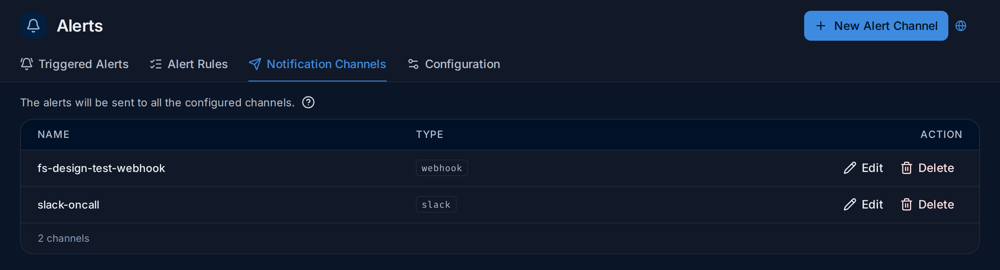
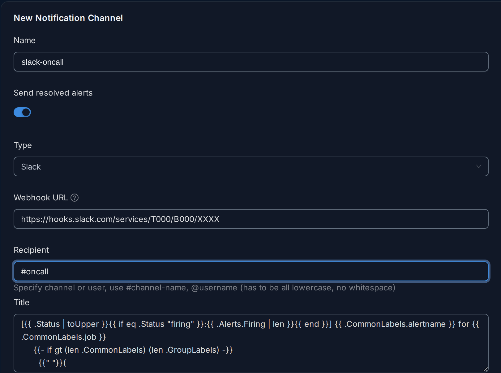

import { Aside, Steps } from "@astrojs/starlight/components";

A [notification channel](/reference/glossary/#notification-channel) is a
destination for alerts. Alert rules pick channels per threshold, or through
[routing policies](/alerts/routing-and-downtime/#routing-policies).
Creating, editing and deleting channels needs the Admin
[role](/administration/users-and-roles/#roles); the Editor role can send
test notifications.

**Use this page when** you connect FuseScope to Slack, email, PagerDuty or another tool,
before creating alert rules. An example with Slack is in
[Set up your first alert](/guides/first-alert/).

## The channels list

Open *Alerts → Notification Channels* (also under *Settings*). The list shows each
channel's **Name** and **Type**, with **Edit** and **Delete**.



A channel does nothing on its own: a rule sends to it only when the channel is picked
under **send to** on one of the rule's thresholds, or when a
[routing policy](/alerts/routing-and-downtime/#routing-policies)
matching the alert lists it.

## Create a channel

<Steps>

1. Click **New Alert Channel**.
2. Fill in the form below and click **Save**.

</Steps>



1. **Name**: how rules and policies refer to the channel, such as `slack-oncall`. It
   can't be changed later.
2. **Send resolved alerts**: also notify when an alert resolves. On by default.
3. **Type**: Slack, Webhook, PagerDuty and the others in
   [Channel types](#channel-types). It can't be changed later.
4. to 6. The fields of the type, here the Slack **Webhook URL**, the **Recipient**
   (`#channel-name` or `@username`, in lower case, without spaces) and the **Title**
   and **Description** templates.
7. **Test** sends a sample alert to the channel without saving it, to check the
   address and credentials. It reaches real people, so warn them first.
8. **Save** creates the channel. **Back** leaves without saving.

The test alert is named `Test Alert (<channel name>)`, has severity `critical` and the text
"Test alert fired from FuseScope". Nothing is saved by a test.

## Channel types

Fields in bold are required. Title and description fields come prefilled with templates
that list the firing alerts, their labels and links to related logs and traces.

| Type | Fields |
|---|---|
| Slack | **Webhook URL** (an incoming webhook), Recipient (`#channel` or `@user`), Title, Description |
| Webhook | **Webhook URL**, User Name and Password for basic auth, or only Password to send it as a bearer token |
| Pagerduty | **Routing Key**, Description, Severity, Additional Information (JSON), Component, Group, Class, Client, Client URL |
| Opsgenie | **API Key**, Message, Description, Priority |
| Email | **To**: comma-separated addresses. Needs [SMTP](#email-and-smtp). |
| Microsoft Teams | **Webhook URL**, Title, Description |
| Google Chat | **Webhook URL** (`https://chat.googleapis.com/...`), Title, Description |
| Jira | **Site URL** (`https://<site>.atlassian.net`), **Email**, **API token**, **Project key**, **Issue type** (default `Task`), Summary, Description; advanced: Priority, Labels, Resolve transition, Reopen transition, Won't-fix resolution, Reopen window (default `3d`) |
| Jira Service Management Ops | **API key**, Message, Description; advanced: Priority, Tags (default `signoz-alert`) |
| incident.io | **Alert source URL** (`https://.../v2/alert_events/http/<id>`), **Token**, Title, Description, Additional metadata |

PagerDuty severity defaults to the alert's `severity` label. Opsgenie priority maps
`critical` to P1, `warning` to P2, `info` to P3 and anything else to P4.

<Aside type="caution">
  Opsgenie channels ignore the **Send resolved alerts** switch.
</Aside>

## Templates

Titles and descriptions use
[Alertmanager notification templates](https://prometheus.io/docs/alerting/latest/notifications/),
for example:

```text
[{{ .Status | toUpper }}{{ if eq .Status "firing" }}:{{ .Alerts.Firing | len }}{{ end }}] {{ .CommonLabels.alertname }}
```

`.Alerts`, `.CommonLabels`, `.CommonAnnotations` and each alert's `.Labels` and
`.Annotations` are available. The rule's message is the `description` annotation.

Links in notifications point to `alertmanager.signoz.external_url`
(default `http://localhost:8080`); set it to the public URL of FuseScope.

## Email and SMTP

Email channels send through the SMTP settings under `alertmanager.signoz.global` in the
[configuration file](/configuration/config-file/). These are separate from
the `emailing` section, which only sends invitations and password resets.

```yaml
alertmanager:
  signoz:
    external_url: https://fusescope.example.com
    global:
      smtp_smarthost: smtp.example.com:587
      smtp_from: fusescope@example.com
      smtp_auth_username: fusescope@example.com
      smtp_require_tls: true
```

| Key | Default | Variable |
|---|---|---|
| `smtp_smarthost` | `localhost:25` | `SIGNOZ_ALERTMANAGER_SIGNOZ_GLOBAL_SMTP__SMARTHOST` |
| `smtp_from` | `alertmanager@signoz.io` | `SIGNOZ_ALERTMANAGER_SIGNOZ_GLOBAL_SMTP__FROM` |
| `smtp_hello` | `localhost` | `SIGNOZ_ALERTMANAGER_SIGNOZ_GLOBAL_SMTP__HELLO` |
| `smtp_auth_username` | none | `SIGNOZ_ALERTMANAGER_SIGNOZ_GLOBAL_SMTP__AUTH__USERNAME` |
| `smtp_auth_password` | none | `SIGNOZ_ALERTMANAGER_SIGNOZ_GLOBAL_SMTP__AUTH__PASSWORD` |
| `smtp_require_tls` | `true` | `SIGNOZ_ALERTMANAGER_SIGNOZ_GLOBAL_SMTP__REQUIRE__TLS` |

Pass the password as an environment variable rather than in the file. The
`alertmanager@signoz.io` default and the `SIGNOZ_` prefix are [internal name](/configuration/config-file/#internal-names)s.

## Grouping and repeats

Alertmanager settings under `alertmanager.signoz.route` apply to every rule:

| Key | `conf/example.yaml` | Description |
|---|---|---|
| `group_by` | `[alertname]` | Labels alerts are grouped by. |
| `group_wait` | `1m` | Wait before the first notification of a new group. |
| `group_interval` | `1m` | Wait before notifying about changes to a group. |
| `repeat_interval` | `1h` | Wait before repeating a notification. |

A rule's own *Group alerts by* and *Repeat notifications* settings override these for its
alerts. See [alert rules](/alerts/alert-rules/#notification-settings).
