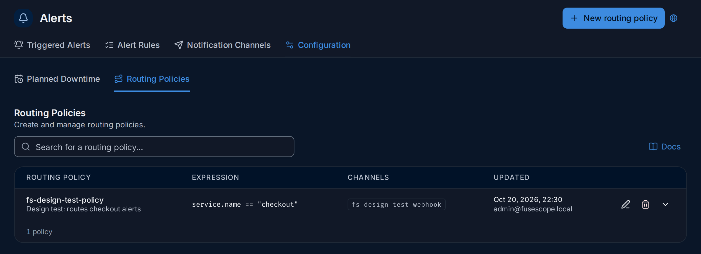
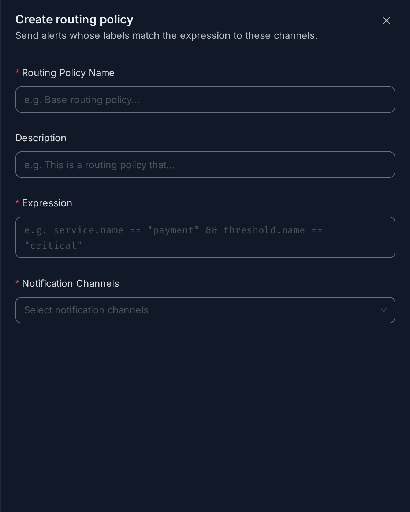

import { Aside, Steps } from "@astrojs/starlight/components";

Both live under *Alerts → Configuration*, in the **Planned Downtime** and
**Routing Policies** tabs (`/alerts?tab=Configuration&subTab=planned-downtime` and
`…&subTab=routing-policies`). Each opens its form in a panel on the right, so the
list stays in view.

**Use this page when** different teams should get different alerts, or when you plan
maintenance and don't want alerts to wake anyone up while it runs.

## Routing policies

A routing policy sends every alert whose labels match an expression to a set of
[notification channels](/alerts/notification-channels/). It lets one
rule notify different teams, for example by `service.name` or environment, without
listing channels on each threshold.



The list shows each policy's name and description, its **Expression**, its
**Channels** and when and by whom it was **Updated**. The pencil edits a policy, the
bin deletes it, and the arrow expands the row for who created it and when. **Docs**
links to this page; the search box finds a policy by name.

### Create a routing policy

<Steps>

1. Click **New routing policy**. The **Create routing policy** panel opens on the
   right.

   

2. Fill in **Routing Policy Name**, an optional **Description**, the **Expression**
   and one or more **Notification Channels**, then click **Save Routing Policy**.
3. In each alert rule that should use policies, turn on
   **Use Routing Policies for dynamic routing** in the
   [conditions step](/alerts/alert-rules/#thresholds-and-severity). The
   rule's per-threshold channel pickers are then hidden.

</Steps>

Expressions compare alert labels: the rule's group-by attributes and labels, plus
`alertname`, `ruleId`, `severity` and `threshold.name`.

```text
service.name == "payment" && threshold.name == "critical"
```

Every policy is evaluated against each alert, and the channels of all matching
policies are notified. Creating, editing and deleting
routing policies needs the Admin
[role](/administration/users-and-roles/#roles).

## Planned downtime

A planned downtime silences alerts during a maintenance window. Alerts are still
evaluated and recorded, and they show as **Suppressed** on
[Triggered Alerts](/alerts/alert-rules/#triggered-alerts); only the
notifications are held back. Managing downtimes needs the Editor or Admin
[role](/administration/users-and-roles/#roles).


1. **New downtime** opens the form.
2. **Search for a planned downtime** by name.
3. Under the name, the downtime's **scope**, when it has one, such as `env = "dev"`.
4. **Status**: **Scheduled** (in the future), **Active** (silencing now) or
   **Ended**. Next to it, the **Timeframe**, whether it **Repeats**, the **Duration**
   and the **Silenced alerts**.
5. Edit, delete, and expand the row.
6. The expanded row: who created and last updated it, the full timeframe, the timezone,
   the recurrence and the alert rules it silences.

### Create a planned downtime

Click **New downtime**. The **New planned downtime** panel opens on the right:


| Field | Description |
|---|---|
| 1. **Name** | For example `Upgrade downtime`. |
| 2. **Starts from** | Start date and time. |
| 3. **Repeats every** | **Does not repeat**, **Daily**, **Weekly** or **Monthly**. |
| 4. **Weekly occurrence** | The days of the week, for a weekly downtime. |
| 5. **Duration** | Length of each window of a recurring downtime, in minutes or hours. |
| 6. **Timezone** | Timezone of the start and end times. |
| 7. **Ends on** | End of the window. Required for a downtime that doesn't repeat; for a recurring one, the date it stops repeating (optional). |
| 8. **Silence Alerts** | **All alert rules**, or **Specific alert rules** picked from the list. |
| 9. **Scope** | Optional label expression; only alerts whose labels match are silenced. |

Click **Add downtime schedule** to save, or **Cancel**.

Scope expressions support `=`, `AND`, `OR` and `in`:

```text
env = "prod" AND region = "us-east-1"
env in ["production", "staging"]
```

<Aside type="tip">
  Use a recurring downtime for routine maintenance, such as every Sunday from 02:00
  for 2 hours (**Weekly**, **Sunday**, **Duration** `2` hours), instead of creating a
  new one each week.
</Aside>

## Example: the demo's downtime and policy

The demo workspace has one of each, to show how they fit together.

<Steps>

1. **Read the downtime.** Open *Alerts → Configuration → Planned Downtime*.
   `fs-design-test-downtime` is **Scheduled** for Oct 27, 2026, 10:00 to 12:00 UTC,
   does not repeat (2 hours), and silences one rule, `Collector retry queue filling up`,
   only for alerts labelled `env = "dev"`. During those two hours that rule would
   still be evaluated and could show as **Suppressed**, but nobody would be
   notified.

2. **Read the policy.** Open **Routing Policies**. `fs-design-test-policy` sends every
   alert whose `service.name` is `checkout` to the channel `fs-design-test-webhook`.

3. **Check who uses it.** A rule only follows policies when its
   **Use Routing Policies for dynamic routing** switch is on. The demo's
   `redis-manual` rule has it off and sends straight to `slack-oncall`, so this policy
   doesn't affect it, and the demo has no `checkout` service anyway.

</Steps>

**What you learn**: a downtime silences notifications for chosen rules and labels for
a while; a policy chooses channels by labels, but only for rules that opt in.
