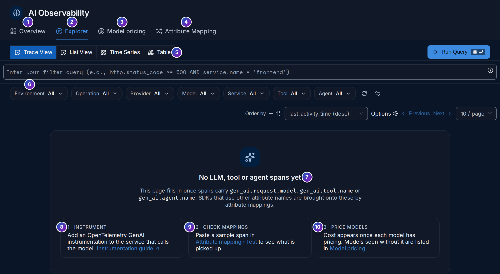
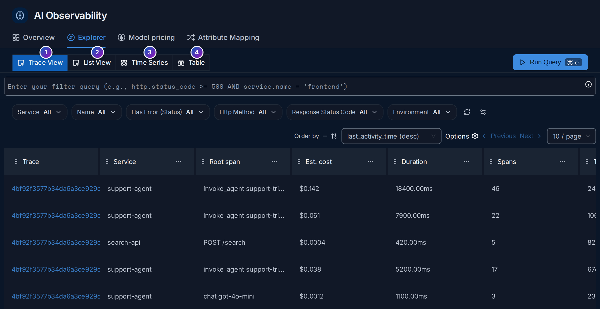
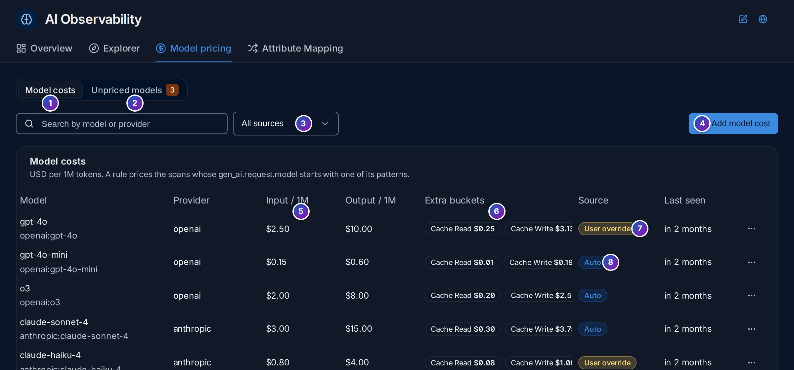

import { Aside, Steps } from "@astrojs/starlight/components";

**AI Observability** (`/ai-observability`, under **Analyze** in the sidebar, marked
**Beta**) shows the calls your applications make to large language models (LLMs),
such as OpenAI, Anthropic or Gemini models, and to the tools and agents built on
them: what they cost, how many tokens they use, how fast they answer and how often
they fail. It has four tabs: **Overview**, **Explorer**, **Model pricing** and
**Attribute Mapping**.

**Use this page when** your LLM bill grows and you want to know which model or service
spends it, when an AI feature feels slow, or when you want to follow one agent run
through every model and tool call it made.

## LLM calls in plain words

- **Tokens** are the pieces of text a model reads and writes; a token is roughly
  three quarters of an English word. Providers charge per million tokens, with
  **input** (prompt) tokens cheaper than **output** (response) tokens.
- **Cached tokens**: many providers reuse a prompt prefix they have seen recently and
  charge less for it (**cache read**), sometimes more for storing it (**cache
  write**). The **prompt cache hit ratio** says how much of your input came from the
  cache.
- **Cost** is tokens × price. FuseScope computes it for each call from the token
  counts on the span and the price you set under [Model pricing](#model-pricing).
- **Latency** is how long a call took in total. **TTFT** (time to first token) is how
  long until the first words arrived; with streaming, that is what a user waits for
  before text starts to appear.
- An **agent** is code that lets a model decide which **tools** (functions) to call,
  in a loop, to finish a task. One agent run is one trace with several LLM and tool
  calls.

FuseScope reads all this from spans that follow the OpenTelemetry **GenAI semantic
conventions**: `gen_ai.request.model`, `gen_ai.provider.name`,
`gen_ai.usage.input_tokens`, `gen_ai.usage.output_tokens` and, for tools and agents,
`gen_ai.tool.name` and `gen_ai.agent.name`. See
[LLM tokens](/fusescope-docs/reference/glossary/#llm-tokens) and
[TTFT](/fusescope-docs/reference/glossary/#ttft).

<Aside>
  The demo stack makes no LLM calls, so the populated images on this page are
  Storybook stories with sample data, marked as such. The empty states are live.
</Aside>

## Get started

Until spans with GenAI attributes arrive, the **Explorer** shows what to do:

<Steps>

1. **Instrument** (8): add an OpenTelemetry GenAI instrumentation to the service that
   calls the model, such as the OpenAI, Anthropic, Bedrock, LangChain or LlamaIndex
   instrumentations for Python and Node.js, or OpenLIT, which covers many of them and
   also reports TTFT. They export to FuseScope over OTLP like any other span; see
   [Instrument applications](/fusescope-docs/sending-data/instrumentation/).

2. **Check mappings** (9): if your library writes other attribute names, such as
   `llm.model_name` instead of `gen_ai.request.model`,
   [attribute mappings](#attribute-mapping) translate them. Paste a sample span in
   **Attribute Mapping › Test** to see what is picked up.

3. **Price models** (10): cost appears once each model has a price. See
   [Model pricing](#model-pricing).

</Steps>

The Overview shows `0` and **No data in this time range** in the meantime.

## Overview

**Overview** is a ready-made dashboard over your LLM, tool and agent spans.

*Sample data: this image is a Storybook story, not the demo.*

1. **Variables**: `$model`, `$provider`, `$environment` and `$service_name` narrow
   every panel, like [dashboard variables](/fusescope-docs/dashboards/variables/).
2. to 7. **KPIs**: **Total cost**, **Total tokens** (input plus output), **LLM calls**
   (spans with `gen_ai.request.model`), **LLM latency (p95)**, **LLM error rate** and
   **TTFT (p95)**. TTFT reads `gen_ai.server.ttft`, in seconds. From the release after
   v0.153.0, attribute mapping fills it from `gen_ai.server.time_to_first_token`
   (OpenLIT) and `gen_ai.response.time_to_first_chunk` (OpenTelemetry conventions); on
   older versions, map those keys onto it yourself.
8. Sections you can fold:

| Section | Panels |
|---|---|
| **Cost & tokens** | Cost over time by model, token usage over time, cost breakdown (input, output, cache read, cache write), cost per LLM call, prompt cache hit ratio, cost by service, cost by provider |
| **Per-trace usage** | AI traces over time, calls per AI trace, cost per AI trace, tokens per AI trace |
| **LLM latency & errors** | Latency by model, latency over time, slowest LLM call per trace, time to first token, errors over time, error rate by model, finish reasons |
| **Tool calls** | Tool call rate, tool error rate, tool duration, top tools, top span names |

**Finish reasons** counts why each response ended; a growing share of `length` or
`max_tokens` means answers are cut off.

## Explorer

**Explorer** searches LLM, tool and agent spans, with the same tools as the
[Traces explorer](/fusescope-docs/explore/traces/).

*Sample data: this image is a Storybook story, not the demo.*

1. **Trace View**: one row per trace that has LLM, tool or agent activity, with
   **Est. cost**, **Duration**, **Spans**, **Tokens** and **Tokens in / out**,
   **Distinct tools**, **LLM calls**, **Tool calls**, **Errors**, the first
   **Input** and last **Output**, and the **Slowest LLM call**. Click a trace ID to
   open it in [Trace details](/fusescope-docs/explore/trace-details/).
2. **List View**: one row per span.
3. **Time Series**: a chart of any aggregation, such as cost per model.
4. **Table**: aggregated numbers grouped by attributes.

The quick filters above the list (**Environment**, **Operation**, **Provider**,
**Model**, **Service**, **Tool**, **Agent**) narrow it with one click. From the release
after v0.153.0, **Environment** reads `deployment.environment.name`, and
**Environment (legacy)** reads `deployment.environment` for older SDKs.

## Model pricing

**Model pricing** holds the price of each model, in US dollars per million tokens.

*Sample data: this image is a Storybook story, not the demo.*

1. **Model costs**: one row per pricing rule, with its **Provider**,
   **Input / 1M** and **Output / 1M** prices (5), **Extra buckets** such as cache read
   and cache write (6), its **Source** and when a matching model was **Last seen**.
2. **Unpriced models**: models seen in your spans that no rule prices. Their cost is
   `0` until you price them. **Map to billing model** points one at an existing rule,
   for example a dated model version at the rule of its family.
3. **All sources**, **User override** or **Auto** filters the list.
4. **Add model cost** creates a rule.
7. **User override**: a price you set. It takes precedence.
8. **Auto**: a default price FuseScope ships.

A rule prices every span whose `gen_ai.request.model` **starts with** one of its
patterns: a rule for `gpt-4o` also prices `gpt-4o-2024-08-06`. Click **⋯** on a row
to edit it:

*Sample data: this image is a Storybook story, not the demo.*

**Cache mode** tells FuseScope how the provider counts cached tokens:

| Cache mode | Meaning |
|---|---|
| **Subtract (OpenAI style)** | Cached tokens are already included in the input tokens; they are priced at the cache rate and taken out of the input count |
| **Additive (Anthropic style)** | Cached tokens are reported separately from the input tokens and priced on top |

Pricing is applied by the FuseScope collector as spans arrive: it writes the cost of
each call to `signoz.gen_ai.usage.tokens.cost` (and one attribute per bucket), which
the Overview and Explorer read. A new price applies to new spans only. Creating, changing and
deleting rules needs the Admin
[role](/fusescope-docs/administration/users-and-roles/#roles).

## Attribute mapping

Not every library uses the GenAI attribute names. **Attribute Mapping** copies the
attributes it finds onto the standard names, in the collector, before the spans are
stored.

1. **Attribute Mappings**: the mapping groups. FuseScope ships three, `gen_ai.tool`,
   `gen_ai.llm` and `gen_ai.agent`.
2. **Test**: paste a sample span as JSON and click **Run Test** to see which standard
   attributes get filled in, and from which of your keys.
3. **Add a new group**.
4. A **group** runs on spans whose attribute keys (or resource keys) contain one of
   its conditions, such as `model`. Expand it to see its mappings: each one fills a
   target attribute, such as `gen_ai.request.model`, from the first of a list of
   source keys that exists, such as `llm.model_name`. The switch turns a group off.

Add a group when an instrumentation you use writes its own names, for example
`langchain.model`, so its spans show up in the Overview and get a cost.

## Example: which model costs the most?

On the sample data of the Overview image, over the last 30 minutes:

<Steps>

1. **Read the KPIs.** About 813 LLM calls used 48.22 million tokens. The p95 latency
   is 2.84 s and the error rate 0.02%.

2. **Split the cost.** **Cost over time** has one line per model: `gpt-4o`,
   `claude-sonnet-4`, `gemini-2.5-pro` and `llama-3.1-70b`. **Cost by provider** ranks
   them: `gpt-4o` first at $4.18K, then `claude-sonnet-4` at $3.56K.

3. **Check the cache.** **Prompt cache hit ratio** shows how much input came from the
   cache. A low ratio on a model with long, repeated system prompts is money left on
   the table: put the fixed part of the prompt first so the provider can cache it.

4. **Find the expensive runs.** In **Explorer › Trace View**, look at
   **Est. cost**. The top `support-agent` run, `invoke_agent support-triage`, cost
   $0.142 over 18.4 s, with 9 LLM calls and 14 tool calls. Open it to see which call
   used the most tokens.

</Steps>

**What you learn**: cost is driven by one model and a few long agent runs; the cache
ratio and the costliest traces tell you where to cut first.

## Related

- [Trace details](/fusescope-docs/explore/trace-details/): one agent run, call by
  call.
- [Dashboards](/fusescope-docs/dashboards/dashboards/): build your own panels on the
  same attributes.
- [Alert rules](/fusescope-docs/alerts/alert-rules/): be told when LLM cost or error
  rate goes up.
