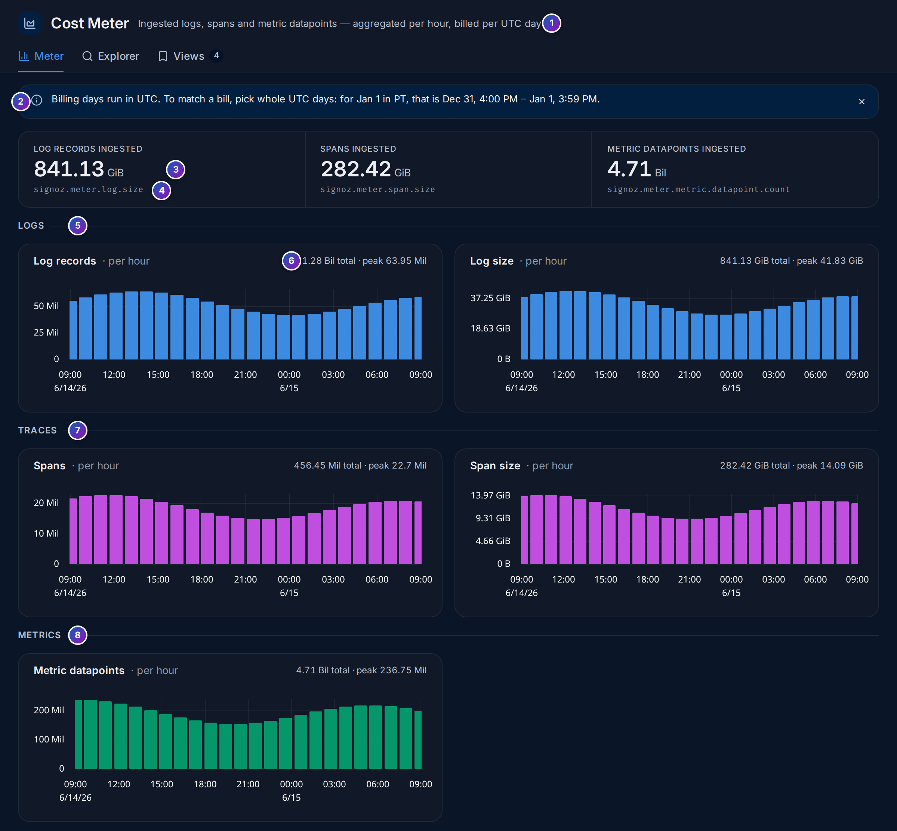
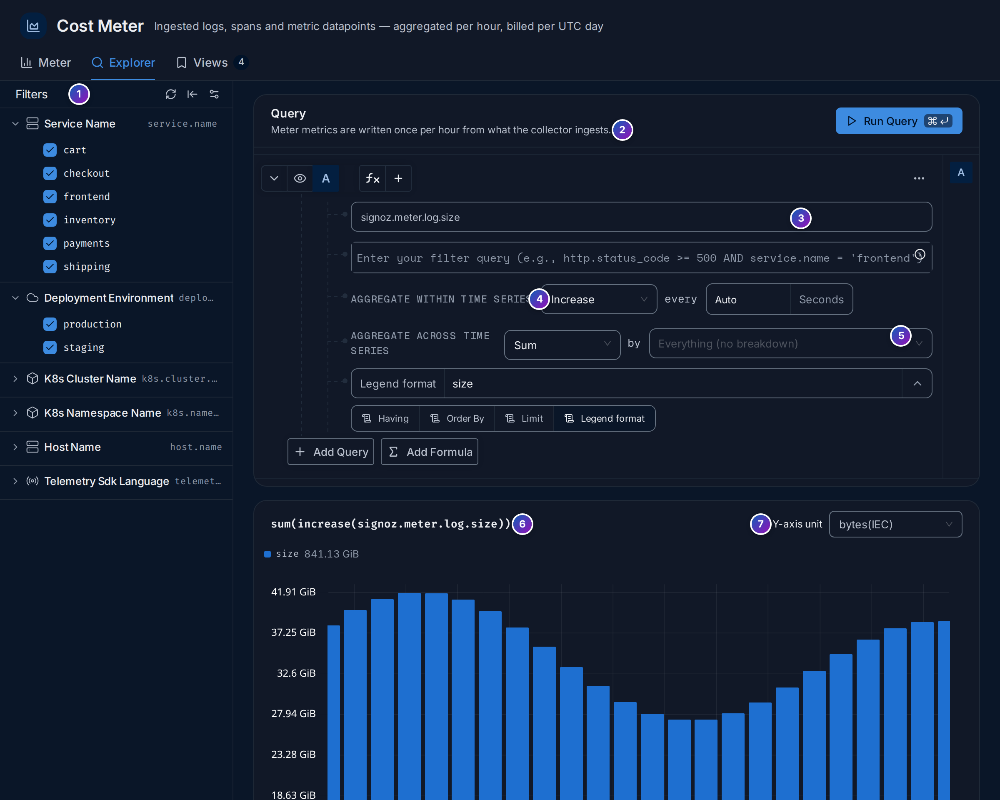
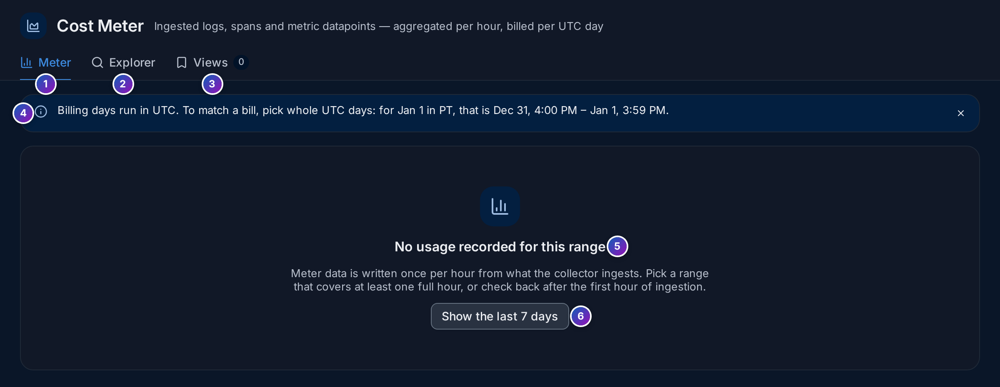

import { Aside, Steps } from "@astrojs/starlight/components";

**Cost Meter** (`/meter`, under **Analyze** in the sidebar) counts what your workspace
takes in: how many log records, spans and metric data points arrive, and how big they
are. Storage, and on a hosted plan the bill, grows with these numbers, so this is the
page to watch when you want to keep costs in check.

**Use this page when** you want to know which signal or service sends the most data,
when you check whether a change (more logs, a new service) increased your volume, or
when you want to compare your usage with a bill.

## Meter signals in plain words

- A **meter signal** is a count of what was ingested. FuseScope keeps five, as metrics
  named `signoz.meter.*`:

  | Metric | Counts |
  |---|---|
  | `signoz.meter.log.count` | Log records |
  | `signoz.meter.log.size` | Size of log records, in bytes |
  | `signoz.meter.span.count` | Spans |
  | `signoz.meter.span.size` | Size of spans, in bytes |
  | `signoz.meter.metric.datapoint.count` | Metric data points |

- They are counted by the **collector** as data passes through it, and written **once
  per hour**. A range shorter than an hour, or the first hour after you turn the meter
  on, shows nothing.
- Each count carries the `service.name`, `deployment.environment` and `host.name` of
  what was sent, so you can split usage by service, environment or host.
- **Billing days run in UTC.** To compare with a bill, pick whole UTC days, even if
  your browser shows another timezone.

See [meter signal](/reference/glossary/#meter-signal).

## The Meter tab



*Sample data: this image is a Storybook story, not the demo.*

1. **Subtitle**: what is counted, and how often.
2. **Billing note**: how to pick a range that matches a bill. Click **×** to hide it;
   FuseScope remembers this in your browser.
3. **Totals** for the time range: **Log records ingested** and **Spans ingested** (in
   bytes) and **Metric datapoints ingested** (a count).
4. Under each total, the meter metric it comes from.
5. **Logs**: **Log records** and **Log size**, one bar per hour.
6. Each chart's **total** and its **peak** hour, such as `1.28 Bil total · peak 63.95 Mil`.
7. **Traces**: **Spans** and **Span size**.
8. **Metrics**: **Metric datapoints**.

Drag across a chart to zoom into those hours. The bars follow the daily rhythm of your
traffic; a bar much higher than its neighbours is worth a look, for example a service
that started logging at debug level.

<Aside type="caution">
  With a range shorter than an hour, a warning says
  `Meter data is aggregated per hour. Pick a range of at least one hour.`
</Aside>

## The Explorer tab

**Explorer** charts any meter metric, split the way you want, with the
[query builder](/querying/query-builder/).



*Sample data: this image is a Storybook story, not the demo.*

1. **Filters**: tick or untick **Service Name**, **Deployment Environment**,
   **K8s Cluster Name**, **K8s Namespace Name**, **Host Name** or
   **Telemetry Sdk Language** values.
2. A reminder that meter metrics are written once per hour.
3. **The meter metric** to chart, such as `signoz.meter.log.size`.
4. **Aggregate within time series**: **Increase** adds up what arrived in each
   interval, which is what you want for usage.
5. **Aggregate across time series** … **by**: **Sum**, and the attribute to split by,
   such as `service.name`. **Everything (no breakdown)** gives one total.
6. The query, written out, such as `sum(increase(signoz.meter.log.size))`, above its
   chart.
7. **Y-axis unit**, such as **bytes(IEC)** for sizes.

Use the bar at the bottom to **Save this view**, add the chart to a dashboard, or create
an alert, for example when log volume per hour goes above a budget.

## Views

**Views** lists the explorer queries saved with **Save this view**, with who created
them and when. Click one to open it in **Explorer**. The count next to the tab says how
many there are.

## Turn on the Cost Meter

When the page says **No usage recorded for this range**, no meter data has been
written for the range:



<Steps>

1. **Widen the range.** Click **Show the last 7 days** (6). Meter data is hourly, so a
   short range, or the first hour after you start, has nothing yet.

2. **Check the collector pipeline.** The meter is counted by the `signozmeter`
   connector in the FuseScope collector and written to the `signoz_meter` database by
   the `signozclickhousemeter` exporter. The FuseScope Helm chart turns both on by
   default, with this shape:

   ```yaml
   connectors:
     signozmeter:
       metrics_flush_interval: 1h
       dimensions:
         - name: service.name
         - name: deployment.environment
         - name: host.name
   service:
     pipelines:
       traces:
         exporters: [clickhousetraces, metadataexporter, signozmeter]
       metrics:
         exporters: [metadataexporter, signozclickhousemetrics, signozmeter]
       logs:
         exporters: [clickhouselogsexporter, metadataexporter, signozmeter]
       metrics/meter:
         receivers: [signozmeter]
         processors: [batch/meter]
         exporters: [signozclickhousemeter]
   ```

   If you replaced the collector configuration, add `signozmeter` back to the
   exporters of each pipeline and keep the `metrics/meter` pipeline. See
   [Install with Helm](/install/helm/) and
   [Architecture](/reference/architecture/).

3. **Wait an hour.** With `metrics_flush_interval: 1h`, the first bars appear about an
   hour after data starts flowing.

</Steps>

The local demo stack runs a collector without the meter pipeline, which is why its
Cost Meter is empty.

## Example: which signal costs the most?

On the sample data above, over one day:

<Steps>

1. **Read the totals.** Logs are 841.13 GiB, spans 282.42 GiB, and there are 4.71
   billion metric data points. Logs are three times the size of spans.

2. **Find the peak.** **Log records** peaks at 63.95 million records in one hour, and
   the bars are highest from 09:00 to 15:00, during business hours.

3. **Split by service.** Open **Explorer**, keep `signoz.meter.log.size`, and set
   **by** to `service.name`. One line per service shows which ones send the most logs.

4. **Act.** For a service that logs far more than the others, lower its log level, or
   drop noisy logs with a [log pipeline](/sending-data/log-pipelines/).
   Then save the query as a view and check it again next week.

</Steps>

**What you learn**: logs are the biggest share of this workspace's volume, and the
Explorer shows which service to talk to first.

## Related

- [Data retention](/administration/retention/): how long data is kept,
  the other half of storage cost.
- [Log pipelines](/sending-data/log-pipelines/): filter logs before they
  are stored.
- [Metrics explorer](/explore/metrics/#chart-a-metric): the same query
  builder for any metric.
