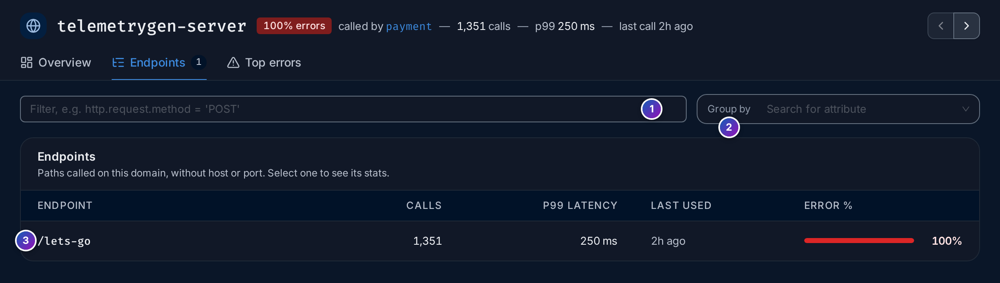
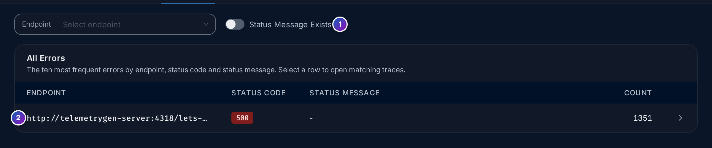
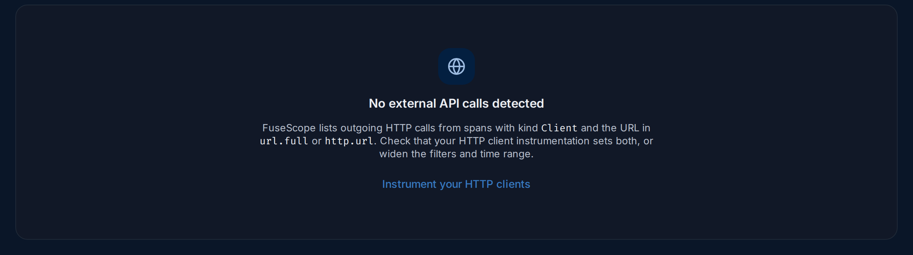

import { Aside, Steps } from "@astrojs/starlight/components";

**External APIs** (`/api-monitoring/explorer`, under **Analyze** in the sidebar) shows
the HTTP APIs your services call, seen from your side: how often you call each one,
how long it takes to answer and how often it fails. It works for APIs that send no
telemetry to you, such as a payment provider, a maps API or another team's service.

**Use this page when** a third-party API might be slowing you down or failing, when
you want to know which of your services depend on an API before it changes, or when
you are asked "how many calls do we make to X?".

## External APIs in plain words

- An **external domain** is a host your services call over HTTP, such as
  `api.stripe.com`, `telemetrygen-server` or `10.0.4.11`. FuseScope takes it from the
  URL of each outgoing call. See
  [external domain](/reference/glossary/#external-domain).
- An **endpoint** is one path on that domain, such as `/v1/charges`, without the host
  or port.
- The numbers come from your services' **client spans**, the spans an HTTP client
  library records for each request it sends. The other side doesn't need to be
  instrumented: you see the call as your code saw it, including network time.

A call counts when its span has kind `Client` and carries the URL in `url.full` (or
the older `http.url`). Most OpenTelemetry HTTP client instrumentations set both.

## The domain list

1. **Count line**: how many domains your services called in the range and, in red,
   how many fail 50% of their calls or more, such as
   `3 domains called from client spans — 2 failing most calls`.
2. **Filter**: any span attribute, such as
   `deployment.environment = 'dev' AND service.name = 'frontend'`. **Run Query**
   applies it.
3. **Environment**: keep calls from one `deployment.environment`.
4. **Calling service**: keep calls made by one service.
5. **Search domains** by name.
6. **Show IP addresses**: on by default. Turn it off to hide domains that are bare IP
   addresses, which are often internal or misconfigured calls.
7. **Domain**: click it to open the [domain page](#a-domain-page).
8. **IP**: the domain is an IP address, not a host name.
9. **from …**: the services that make these calls (two names, then `+N`).
10. **Endpoints**: how many different paths were called.
11. **Last used**: when the latest call happened.
12. **Rate** and **Error %**: calls per second, and the share of calls whose span
    status is error. The bar turns amber above 0% and red at 5% or more.
13. **P99 latency**: 99 calls in 100 were faster than this.
14. A reminder of what **Error %** counts. A `4xx` answer is only an error when the
    client instrumentation sets the span status to error for it.

Click a column title to sort; the list starts with the highest **Error %**.

## A domain page

Click a domain to open it (`/api-monitoring/domains/<domain>`).

1. **Error badge**: the domain's error rate, red at 5% or more.
2. **Summary**: which services call it, the number of calls, p99 latency and the last
   call.
3. **‹ ›** move to the previous or next domain of the list, without going back.
4. to 6. The tabs: **Overview**, [Endpoints](#endpoints) (with their count) and
   [Top errors](#top-errors).

### Overview

7. **Endpoint**: pick one endpoint to narrow every chart to it. The page then shows
   its full URL, such as `http_url = http://telemetrygen-server:4318/lets-go`, and the
   port.
8. **Filter** by any attribute, such as `service.name = 'payment'`.
9. **KPIs**: **Endpoints**, **Rate**, **P99 latency**, **Error rate** and
   **Last used**.
10. **Call response status**: calls over time, coloured by HTTP status class:
    **2xx** (success), **3xx** (redirects), **4xx** (your request was refused, such as
    a bad parameter or a missing token), **5xx** (the API failed) and **Other**.
11. **Calls** or **Latency**: show the count of calls or their latency per status
    class.
12. **Status codes**: calls, rate and p99 per exact code, such as `200` or `500`.
13. **Rate over time** and **Latency over time**.
14. **Dependent services**: the services that call this domain, with their share of
    the calls, p99 latency, error rate and rate. Click one to open its
    [service page](/apm/services/).

### Endpoints

1. **Filter**, such as `http.request.method = 'POST'`.
2. **Group by**: split each endpoint by an attribute, such as
   `http.request.method` or `service.name`.
3. One row per path, with **Calls**, **P99 latency**, **Last used** and **Error %**.
   Click a row to open the **Overview** for that endpoint.

<Aside type="caution">
  A very high endpoint count usually means IDs or query strings ended up in the path,
  so every call looks like a new endpoint. In the demo, `frontend` calls `0.0.0.0`
  with paths such as `/customer?customer=567` and `/route?dropoff=…&pickup=…`, so
  every pickup and drop-off pair counts as a new endpoint: hundreds of thousands in a
  day. Use the HTTP client instrumentation's route or template option,
  if it has one, to report `/route` instead.
</Aside>

### Top errors

The ten most frequent failures, by **Endpoint**, **Status code** and
**Status message**, with their **Count**. Click a row to open the matching spans in
the [Traces explorer](/explore/traces/).

1. **Status Message Exists** is on by default, and then only errors that carry a
   status message are listed. Many HTTP clients record a `500` without a message;
   turn it off to see all errors.

## When no domains appear

*Sample data: this image is a Storybook story.*

**No external API calls detected** means no client span in the range had a URL. Check,
in this order:

<Steps>

1. **Widen the time range and clear the filters.** Calls may be older, or filtered
   out.
2. **Instrument the HTTP client, not only the server.** Server instrumentation records
   the requests your service *receives*. Outgoing calls need the instrumentation for
   your HTTP client library, such as `requests` in Python, `net/http` in Go or OkHttp
   in Java. Zero-code agents include most of them; see
   [Instrument applications](/sending-data/instrumentation/).
3. **Check the attributes.** Open a trace with an outgoing call in
   [Trace details](/explore/trace-details/) and look at the client
   span: it must have kind `Client` and an attribute `url.full` or `http.url` with the
   full URL. Spans that only have `server.address` show on the
   [Service Map](/apm/service-map/) but not here.

</Steps>

## Example: why does payment fail?

The [Services](/apm/services/#example-why-is-payment-failing) page found
that `payment` fails every request and that its outgoing calls fail too. Here is the
other side. The numbers are from the HotROD demo over the last day.

<Steps>

1. **Open the list.** Open **External APIs** and set the range to **Last 1 day**. The
   count line reads `3 domains called from client spans — 2 failing most calls`.
   `telemetrygen-server` and `1.2.3.4`, both `from payment`, are at `100%` errors,
   with a p99 of `250 ms`. `0.0.0.0`, called by `frontend`, is healthy.

2. **Open telemetrygen-server.** The header reads `100% errors`, `called by payment`,
   `1,351 calls` and `last call 2h ago`. **Call response status** is all red **5xx**,
   and **Status codes** has a single row: `500`, 1,351 calls.

3. **Find the endpoint.** **Endpoints** lists one path, `/lets-go`, with 1,351 calls
   at 100% errors.

4. **Read the errors.** In **Top errors**, the list is empty until you turn off
   **Status Message Exists**: the failures carry no message. Then one row appears:
   `http://telemetrygen-server:4318/lets-go`, `500`, 1351 times. Click it to open
   those spans.

5. **Check who is affected.** **Dependent services** lists only `payment`, with
   all 1,351 calls.

</Steps>

**What you learn**: the API at `telemetrygen-server:4318` answers every `/lets-go`
call from `payment` with a server error, `500`. The problem is on the API's side, and
`payment` is its only caller.

## Related

- [Services](/apm/services/#external): the **External** tab of a
  service charts its calls by address.
- [Service Map](/apm/service-map/): external addresses as dashed nodes.
- [Trace details](/explore/trace-details/): one call in its request.
