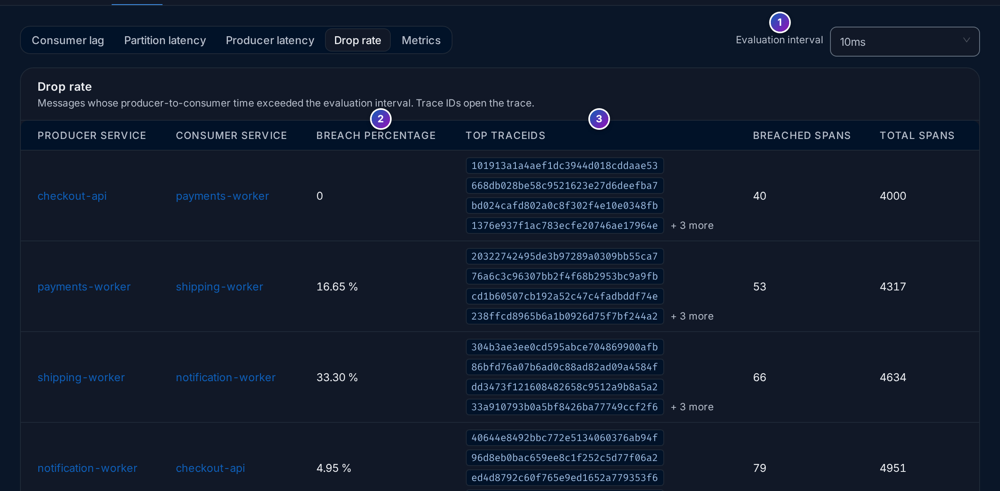
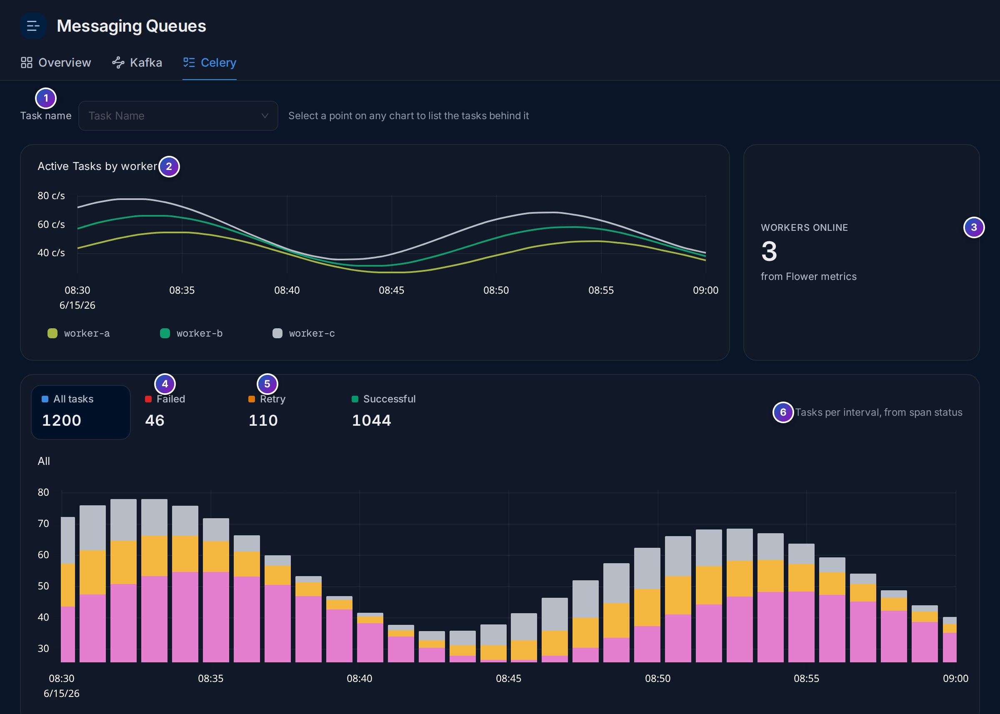

import { Aside, Steps } from "@astrojs/starlight/components";

**Messaging Queues** (`/messaging-queues`, under **Analyze** in the sidebar) shows
the work your services hand to each other through a queue instead of a direct call:
Kafka topics and Celery tasks. It has three tabs: **Overview**, **Kafka** and
**Celery**.

**Use this page when** messages pile up or arrive late, when a consumer falls behind,
when background tasks fail or retry, or when you want to see which services produce
and consume which topics.

## Queues in plain words

- A **producer** is a service that sends a message, such as `checkout-api` publishing
  "order created". A **consumer** reads it later and does the work, such as
  `payments-worker`. The queue between them, a **topic** in Kafka, keeps the messages
  until they are read.
- A Kafka topic is split into **partitions**, numbered `0`, `1`, `2`…, so several
  consumers can read it in parallel. Each partition keeps its messages in order. See
  [partition](/fusescope-docs/reference/glossary/#partition).
- Consumers that share the work of a topic form a **consumer group**.
- **Consumer lag** is how many messages a consumer group still has to read in a
  partition: the newest message's position (offset) minus the group's position. Lag
  that keeps growing means the consumers can't keep up. See
  [consumer lag](/fusescope-docs/reference/glossary/#consumer-lag).
- **Celery** is a Python task queue. Your code queues a **task**; **Celery workers**,
  separate processes, pick tasks up and run them. A task can succeed, fail, or be
  retried. See [Celery worker](/fusescope-docs/reference/glossary/#celery-worker).

The views read two kinds of data: **spans** from your producers and consumers (the
SDK records one per message sent or processed), and **metrics** from the brokers and
workers.

<Aside>
  The demo stack has no Kafka or Celery, so the populated images on this page are
  Storybook stories with sample data, marked as such. The setup screen is live.
</Aside>

## Overview

**Overview** lists every producer and consumer operation found in your spans, from any
messaging system: Kafka, Celery, RabbitMQ and others.


*Sample data: this image is a Storybook story, not the demo.*

1. **Search across all columns**.
2. **Filters**: **Service Name**, **Span Name**, **Msg System**, **Destination** and
   **Kind**.
3. **Producer and consumer operations**: one row per service, span name, system and
   destination, from spans that have `messaging.system` set, the most failing first.
4. **System**: the value of `messaging.system`, such as `kafka` or `celery`.
5. **Kind**: **Producer** (sends) or **Consumer** (receives).
6. **Error %**, then **P95 latency** and **Throughput** in operations per second.

Click a row for its rate, errors and latency over time. With no messaging spans in the
range, the table says `No producer or consumer operations in this time range.`

## Kafka

### Set up Kafka monitoring

The **Kafka** tab first checks that the data its views need is arriving. Until it is,
the tab shows the setup steps and the **Kafka configuration** panel opens on the right:


1. **Set up Kafka monitoring**: three steps, with how many are done (`0 of 3 done`).
   A step reads **Receiving data** when its data arrives.
2. **Instrument producers** and **Instrument consumers**: see
   [Instrument Kafka producers and consumers](#instrument-kafka-producers-and-consumers).
3. **Collect Kafka metrics**: see [Collect Kafka metrics](#collect-kafka-metrics).
4. **Kafka views**: the five views, as cards. Click one to open it.
5. Under each card, what it needs, such as **Needs Kafka receiver metrics**, or
   **Ready**.
6. **Kafka configuration**: every attribute and metric the views read, checked over
   the last 15 minutes. **All**, **Missing** and **Found** filter the list. The button
   **Kafka configuration** at the top of the tab reopens it.
7. The checks are grouped by **Producers**, **Consumers** and **Kafka**, each with how
   many are missing.
8. **Fix** opens the instructions for that item.

The checks are:

| Group | Checked |
|---|---|
| **Producers** | Spans with kind Producer (`kind=4`), `messaging.system = kafka`, `messaging.destination.name`, `messaging.destination.partition.id` |
| **Consumers** | Spans with kind Consumer (`kind=5`), `messaging.system = kafka`, `messaging.destination.name`, `messaging.destination.partition.id`, `messaging.kafka.consumer.group`, `messaging.client_id`, `messaging.message.body.size`, and the resource attribute `service.instance.id` |
| **Kafka** | The metrics `kafka.consumer_group.lag` and `kafka.consumer.fetch_latency_avg` |

### Instrument Kafka producers and consumers

The span checks pass when your producers and consumers are traced with an
OpenTelemetry Kafka client instrumentation, which records a span for each message
sent and each message processed, with the attributes above:

<Steps>

1. **Add the instrumentation for your Kafka client.** The zero-code agents for Java,
   Python, Node.js and .NET include instrumentations for the common Kafka clients,
   such as `kafka-clients` (Java), `confluent-kafka` and `kafka-python` (Python) and
   `kafkajs` (Node.js). For Go, wrap the client with an OpenTelemetry instrumentation
   library. See [Instrument applications](/fusescope-docs/sending-data/instrumentation/).

2. **Set `service.instance.id`** on consumers, one value per process, such as the pod
   name, so the views can tell the consumers of a group apart:

   ```bash
   OTEL_RESOURCE_ATTRIBUTES=service.instance.id=$(HOSTNAME)
   ```

3. **Propagate the trace context through the message headers.** The instrumentations do
   this by default; it is what links a consumer span to the producer span of the same
   message, for [drop rate](#drop-rate) and for following a message in
   [Trace details](/fusescope-docs/explore/trace-details/).

4. **Check.** Open the **Kafka configuration** panel and choose **Missing**. Attributes
   still listed there are not set by your instrumentation; older instrumentations may
   use older attribute names, so update them first.

</Steps>

### Collect Kafka metrics

The **Kafka** checks need metrics, which no application span carries:

- `kafka.consumer_group.lag` comes from the brokers. Add the collector's
  `kafkametrics` receiver, which FuseScope's collector includes, pointed at your
  brokers, and add it to a metrics pipeline:

  ```yaml
  receivers:
    kafkametrics:
      brokers: ["kafka-0.kafka:9092"]
      protocol_version: 2.0.0
      scrapers: [brokers, topics, consumers]
      collection_interval: 30s

  service:
    pipelines:
      metrics:
        receivers: [otlp, kafkametrics]
  ```

  Run it in any collector that can reach the brokers, and send its data to FuseScope
  as in [From another collector](/fusescope-docs/sending-data/otlp/#from-another-collector).
- `kafka.consumer.fetch_latency_avg` is a metric of the Kafka consumer client itself.
  The OpenTelemetry Java agent reports the Kafka client metrics under these names when
  it instruments `kafka-clients`; for other languages, export the client's metrics
  through OpenTelemetry.

The **Metrics** view also reads broker and JVM metrics, such as the ones the
collector's `jmx` receiver gathers from the brokers.

### The Kafka views

Click a view card to open the Kafka detail (`/messaging-queues/kafka/detail`). The
tabs at the top switch between the views; each keeps its own filters in the address,
so **Copy link** shares exactly what you see.


*Sample data: this image is a Storybook story, not the demo.*

| View | Shows | Needs |
|---|---|---|
| **Consumer lag** | Lag over time, one line per consumer group, topic and partition | Kafka metrics |
| **Partition latency** | p99, error rate and throughput per topic partition, for producers and consumer groups | Producer and consumer spans |
| **Producer latency** | Latency, error rate and throughput per producer or consumer service and topic | Producer spans |
| **Drop rate** | Messages that took too long from producer to consumer | Producer and consumer spans |
| **Metrics** | Broker, producer, consumer, JVM and partition metrics | Kafka metrics |

On **Consumer lag**, click a point on a line to see who produced and consumed that
partition at that time (7). The panel on the right (8) names the group, topic,
partition and window, and has three tabs: **Producer Details**,
**Consumer Groups Details** and **Network Latency** (9, 10), each with **P99**,
**Error rate** and **Throughput** per service. The window is ±5 minutes around the
point.

On **Partition latency** and **Producer latency**, select a row of the table for the
same kind of detail for that service, topic and partition.

### Drop rate



*Sample data: this image is a Storybook story, not the demo.*

**Drop rate** compares, for each producer and consumer pair, the time between a
message being sent and being processed with the **Evaluation interval** (1), from
10 ms to 500 ms or a custom value. **Breach percentage** (2) is the share of messages
slower than that; **Breached spans** and **Total spans** give the counts. **Top
trace IDs** (3) lists examples; click one to open the trace. A high breach percentage
means messages wait in the queue, or consumers are slow to pick them up.

### Metrics

**Metrics** groups charts into sections you can fold:

| Section | Charts |
|---|---|
| **Broker metrics** | Request times, broker count, purgatory, network throughput, I/O wait |
| **Producer metrics** | Request and response rate, request latency, byte rate |
| **Consumer metrics** | Bytes and messages consumed, offsets, group members, lag by group, fetch rate |
| **Broker JVM metrics** | Garbage collection, CPU and heap of the broker JVMs (needs `new_gc_metrics` enabled in the JMX collection) |
| **Partition metrics** | Partitions per topic, current and oldest offsets, in-sync replicas |

## Celery

**Celery** shows your Celery workers and tasks.



*Sample data: this image is a Storybook story, not the demo.*

1. **Task name**: narrow every chart to one task, such as
   `billing.tasks.charge_customer`.
2. **Active Tasks by worker**: tasks running on each worker over time.
3. **Workers online**: how many workers report in.
4. and 5. **All tasks**, **Failed**, **Retry** and **Successful**: task counts in the
   range. Click one to chart only those.
6. **Tasks per interval**, coloured by outcome.

Below them: **Task Latency** (**P99**, **P95** or **P90** per task), and
**Tasks/s**, **Error%** and **Latency** **by worker**. Click a point on any chart to
list the tasks behind it.

### Send Celery data

<Steps>

1. **Trace the workers and the code that queues tasks** with the OpenTelemetry Celery
   instrumentation for Python (`opentelemetry-instrumentation-celery`, included in
   `opentelemetry-bootstrap`). Its spans carry `celery.task_name`, `celery.state` and
   `celery.hostname`, which the task charts read. See
   [Instrument applications](/fusescope-docs/sending-data/instrumentation/).

2. **Collect Flower metrics** for **Active Tasks by worker** and **Workers online**.
   Run [Flower](https://flower.readthedocs.io/), Celery's monitoring tool, and scrape
   its `/metrics` endpoint with the collector's `prometheus` receiver:

   ```yaml
   receivers:
     prometheus:
       config:
         scrape_configs:
           - job_name: celery-flower
             scrape_interval: 30s
             static_configs:
               - targets: ["flower:5555"]
   ```

   The charts read `flower_worker_number_of_currently_executing_tasks` and
   `flower_task_runtime_seconds_sum`.

</Steps>

Without Flower metrics, the worker charts say **No Data** and **Workers online** is
`0`, while the task charts still work from spans.

## Example: why is shipment processing late?

On the sample data of the Overview image:

<Steps>

1. **Find the failing operation.** **Overview** puts `notification-worker` /
   `shipment-events process` at the top: a Kafka **Consumer** with 77.6% errors and a
   p95 of 476 ms.

2. **Check the backlog.** Open **Kafka → Consumer lag**. If the line for the
   notification consumer group on `shipment-events` keeps rising, messages arrive
   faster than they are processed: failures and retries slow the consumer down.

3. **See who was involved.** Click the highest point of the line. The panel lists the
   producers of that partition and the consumers of the group in that window, with
   their error rate and p99.

4. **Measure the delay.** In **Drop rate**, set the evaluation interval to what your
   users can accept, such as 500 ms, and read the breach percentage for the producer
   and `notification-worker` pair. Open a top trace ID to follow one late message from
   producer to consumer.

</Steps>

**What you learn**: Overview finds the failing side, consumer lag shows whether a
backlog builds, and drop rate turns "late" into a number you can alert on.

## Related

- [Instrument applications](/fusescope-docs/sending-data/instrumentation/): the SDKs
  and agents.
- [OTLP endpoints](/fusescope-docs/sending-data/otlp/#from-another-collector): send
  metrics from your own collector.
- [Trace details](/fusescope-docs/explore/trace-details/): follow one message from
  producer to consumer.
