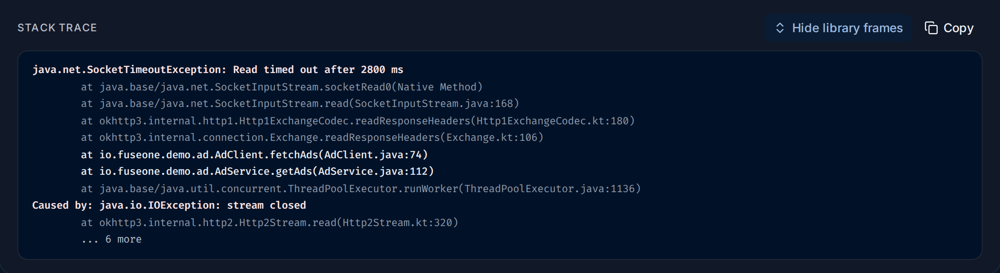

import { Aside, Steps } from "@astrojs/starlight/components";

**Exceptions** (`/exceptions`, under **Respond** in the sidebar) collects every
[exception](/fusescope-docs/reference/glossary/#exception) your services recorded,
across all services, and groups identical ones together. Each group shows how often it
happened and when; each occurrence has its stack trace.

**Use this page when** an error shows up in a service and you want to know exactly
where in the code it comes from, when you want to see which errors are new, or when
you are about to fix a bug and want to find every place it happens.

## Exceptions in plain words

- An **exception** is an error your program raised, such as a timeout or a refused
  connection. When an OpenTelemetry SDK sees one, it records it on the current
  [span](/fusescope-docs/reference/glossary/#span) as an `exception` event with three
  parts: the **type** (`java.net.SocketTimeoutException`), the **message**
  (`Read timed out after 2800 ms`) and the **stack trace**.
- A **stack trace** is the list of function calls that were running when the error
  happened, innermost first. It tells you which line of which file failed, and how the
  program got there.
- An **exception group** is all the occurrences with the same type, message and
  service. A timeout that happened 4 times is one group with 4 **events**.

Only errors that the code records show up here. A span can also fail with only an
error status and no exception; those failures are on the service's
[Errors](/fusescope-docs/apm/services/#errors) tab as status messages.

<Aside>
  Most SDKs record uncaught exceptions on their own. For errors you catch and handle,
  call `span.recordException(error)` (or your language's equivalent) and set the span
  status to error.
</Aside>

## The exceptions list

1. **Count line**: how many groups there are in the time range, such as
   `3 exception groups in the last 12h`.
2. **Filters**: quick filters by resource attribute. The icons reset them, fold the
   rail away, and choose which filters it shows.
3. **A filter group**, such as **Service Name**: untick values to hide them. The other
   groups are **Deployment Environment**, **Host Name** and the Kubernetes cluster,
   deployment, namespace and pod.
4. **Search filter**: a filter on any attribute, in the
   [search syntax](/fusescope-docs/querying/search-syntax/), such as
   `service.name = 'checkout'`.
5. **Run Query** applies it.
6. **Exception type**: click it to open the [exception's page](#an-exceptions-page).
7. **Column search**: the magnifier next to **Exception type** and **Service** filters
   the table by that column, such as all `Timeout` types.
8. **Count**: how many times it happened in the range.
9. **Last seen** and **First seen**: the newest and oldest occurrence in the range. A
   recent **First seen** means a new error, often from the latest deploy.
10. **Service**: the service that recorded it, with its
    [type icon](/fusescope-docs/apm/services/#service-types).
11. **Pager**: 10 groups per page by default.

Click **Exception type**, **Count**, **Last seen**, **First seen** or **Service** to
sort. The time range at the top applies, so widen it to find older errors.

## An exception's page

Click a group to open its newest occurrence (`/error-detail?groupId=…`).

1. **Type** of the exception.
2. **Service** that recorded it.
3. **Message**.
4. **Event**: the ID of this one occurrence and when it happened.
5. **Older** and **Newer** step through the other events of the group, one at a time.
   **Newer** is greyed out on the newest one.
6. **View logs**: the logs of the same request. See [View logs](#view-logs).
7. **See the error in trace graph** opens the whole request in
   [Trace details](/fusescope-docs/explore/trace-details/), at the span that recorded
   the exception.
8. **Events**: how many times the group happened, with **Last seen** and
   **First seen**.
9. **Trace ID** of this occurrence. Click it to open the trace.
10. to 12. The [stack trace](#read-a-stack-trace), with **Show library frames** and
    **Copy**, which copies the full text.
13. **Attributes** of the event: `spanID`, `traceID`, `serviceName` and `groupID`.

## Read a stack trace

A stack trace lists the calls from the innermost (where the error was raised) to the
outermost (where the work started). In a Java trace, the first line is the exception,
then one `at` line per call; `Caused by:` starts the exception that triggered this one.

Most lines of a stack trace come from libraries and the language runtime, not from your
code. FuseScope folds runs of them into a grey line such as `4 library frames hidden`,
so **your own frames stand out**. **Show library frames** unfolds them:

A frame counts as a library frame when:

| Language | Library when |
|---|---|
| Java, Kotlin, Scala, .NET | The class starts with a well-known library or runtime package, such as `java.`, `javax.`, `kotlin.`, `okhttp3.`, `org.springframework.`, `org.apache.`, `io.netty.`, `io.grpc.`, `io.opentelemetry.`, `com.google.`, `System.` or `Microsoft.` |
| Go | The function is from the standard library, or the file is under `/pkg/mod/`, `/vendor/` or the Go installation |
| Python | The file is under `site-packages`, `dist-packages` or the Python installation |
| JavaScript | The file is under `node_modules`, or is a `node:` or `internal/` module |

Everything else is your code. Start reading at the **first frame of your code**: it is
the last place where you can change what happened.

## View logs

**View logs** opens the [Logs explorer](/fusescope-docs/explore/logs/) with
`trace_id = '<trace ID>'` and a time range from 15 minutes before to 15 minutes after
the event: the logs your services wrote while handling the same request. They often
say what the code was doing just before the error, such as the request parameters.

This needs logs that carry the trace ID, which happens when your logging library is
bridged to OpenTelemetry. When none do, the explorer says
`No logs found for this trace.` See
[See the logs for one request](/fusescope-docs/guides/logs-for-a-request/).

## Example: a timeout in the ad service

The demo includes test exceptions from an `ad` service written in Java. They are from a
few hours before the other demo data, so widen the time range.

<Steps>

1. **Find it.** Open **Exceptions** and set the time range to **Last 12 hours**. The
   count line reads `3 exception groups in the last 12h`. Next to the steady
   `*errors.errorString` / `redis timeout` of `redis-manual` are two short-lived ones:
   `java.net.SocketTimeoutException` in `ad` (4 times) and `*net.OpError`
   `dial tcp 10.0.4.11:50051: connect: connection refused` in `checkout` (6 times),
   both first seen at about 22:00 and gone a minute later.

2. **Open the timeout.** Click `java.net.SocketTimeoutException`. The message is
   `Read timed out after 2800 ms`, **Events** is `4`, and this event's trace ID is
   `f82cef71d70e2c1bae0ee01e072fd517`.

3. **Read the stack.** With library frames folded, two frames remain:
   `io.fuseone.demo.ad.AdClient.fetchAds(AdClient.java:74)`, called by
   `AdService.getAds(AdService.java:112)`. So `AdClient.java` line 74 waited for a
   response for 2.8 seconds and gave up. The `Caused by: java.io.IOException: stream closed`
   line says the connection was closed under it.

4. **Unfold the libraries.** **Show library frames** reveals `okhttp3` and
   `java.net.SocketInputStream` frames above line 74: the HTTP client was reading
   response headers. The other side didn't answer in time.

5. **Look for context.** **View logs** finds no logs for this trace in the demo: the
   test data has none. In your own services, this is where the request parameters
   and the call that timed out would show.

6. **Check the other events.** Click **Older** to step through the other three; they
   have the same stack, so it is one problem, not four.

</Steps>

**What you learn**: within a minute, `ad` timed out four times reading from an HTTP
service at `AdClient.java:74`, while `checkout` couldn't connect to `10.0.4.11:50051`.
Two services failing to reach their dependencies at the same moment points at the
network or at those dependencies, not at the code.

## If something is missing

- **An error you expect is not listed.** The code set the span status to error without
  recording an exception, or the error happened outside a span. Check the service's
  [Errors](/fusescope-docs/apm/services/#errors) tab, which shows status-only errors.
- **No stack trace.** The SDK recorded the type and message only. Some languages and
  frameworks need a setting to include `exception.stacktrace`.
- **Everything is a library frame.** Your code's package looks like a library one, for
  example it starts with `com.google.`. **Show library frames** shows every frame.

## Related

- [Services](/fusescope-docs/apm/services/#errors): a service's exceptions and
  status-only errors side by side.
- [Trace details](/fusescope-docs/explore/trace-details/): the request in which the
  exception happened.
- [Alert rules](/fusescope-docs/alerts/alert-rules/): an **Exceptions-based Alert**
  notifies you when an exception appears or grows.
