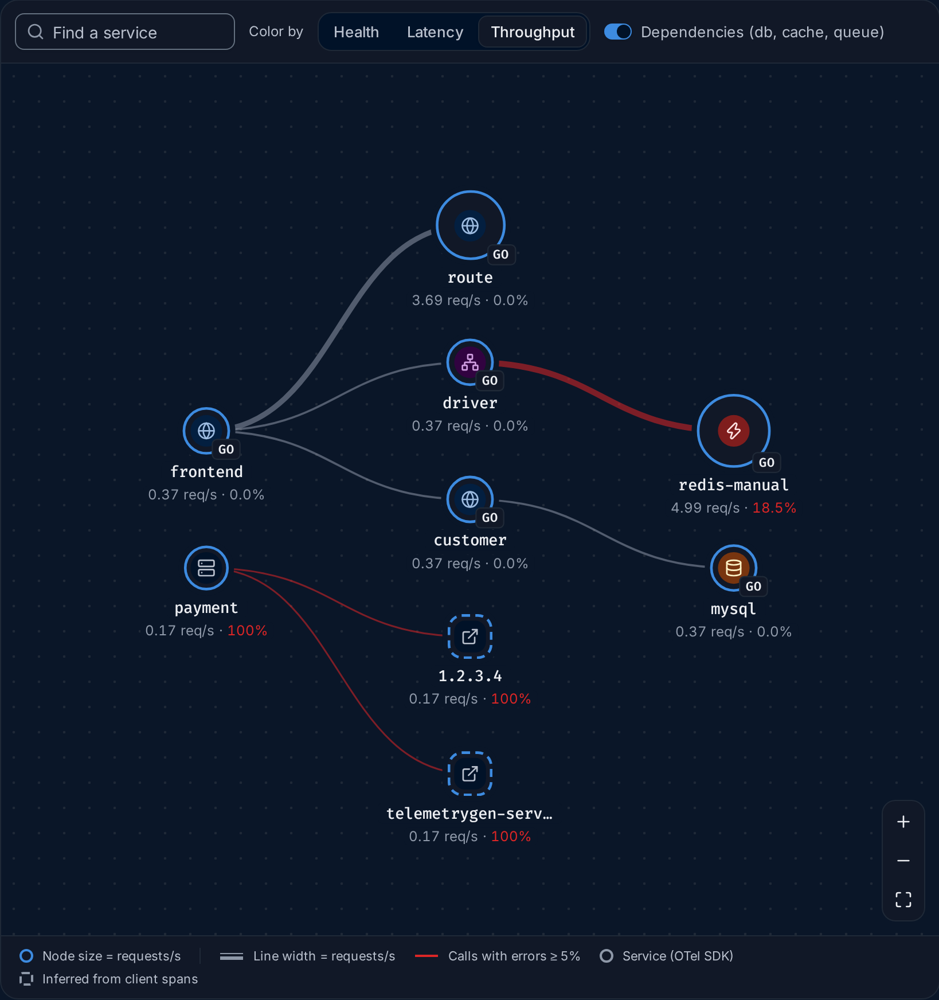
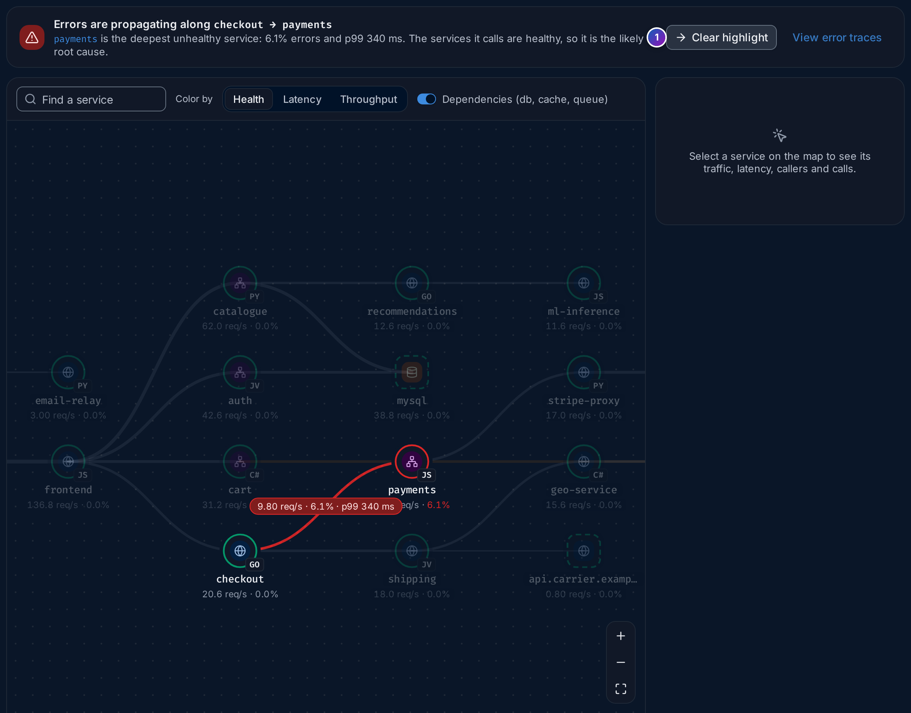

import { Aside, Steps } from "@astrojs/starlight/components";

**Service Map** (`/service-map`) draws your system as a graph: every
[service](/fusescope-docs/reference/glossary/#service) is a node, and every caller and
callee pair is a line between two nodes. It is built from your
[traces](/fusescope-docs/reference/glossary/#trace), so it shows how requests really
flow, not how a diagram says they should.

**Use this page when** you want to see how your services fit together, when several
services fail at once and you want to know which one started it, or when you want to
check that a new dependency, such as a database or a third-party API, is healthy.

## How the map is built

FuseScope draws a line from service A to service B when a span in B has its parent in
A: a client span calling a server span (`CLIENT → SERVER`), or a producer sending to a
consumer (`PRODUCER → CONSUMER`). Each line carries the numbers of those calls: the
request rate, the error rate and the latency.

Some things your services call don't send traces themselves: a managed database, a
cache, a queue or a third-party API. FuseScope still draws them, as **inferred
dependencies**, from what the callers' client spans say about them:

| The caller's span has | Drawn as |
|---|---|
| `db.system`, such as `postgresql` or `redis` | A database or cache |
| `messaging.system`, such as `kafka` | A queue |
| `peer.service` | A node with that name |
| `server.address` or `net.peer.name` | An external address, such as `api.example.com` or `1.2.3.4` |

An inferred node is drawn with a **dashed** outline, and its numbers come only from
its callers' spans. See [inferred dependency](/fusescope-docs/reference/glossary/#inferred-dependency).

The map is **layered**: entry points, the services nothing else calls, sit on the
left, and each step to the right is one call deeper. Requests flow from left to right.

## The page, part by part

1. **Filters**: **Select Environment/s** keeps the services of one or more
   `deployment.environment` values; the box next to it filters by other resource
   attributes. The map filters calls directly by `deployment.environment`,
   `k8s.cluster.name` and `k8s.namespace.name`. Other keys, such as
   `service.namespace`, keep the services they match, with their callers and callees.
2. **Services**: how many services send traces, plus the inferred dependencies, such
   as `+ 2 inferred dependencies`. **Connections**, next to it, counts the caller and
   callee pairs and lists their protocols, such as `DB, gRPC, HTTP`.
3. **Ingress throughput**: the requests per second arriving at the entry points, and
   which services those are (`at frontend, payment`). This is the traffic coming into
   your system from outside.
4. **Ingress error rate**: the share of those incoming requests that failed. Below it,
   how many connections fail 5% of their calls or more.
5. **Unhealthy services**: the services in the **Critical** state (see
   [Health](#health)), by name, or **None critical**.
6. **Root-cause banner**: where errors most likely start. See
   [Root cause](#root-cause).
7. **View error traces** opens the failing spans of the root-cause service in the
   [Traces explorer](/fusescope-docs/explore/traces/).
8. **Find a service**: type part of a name to dim every node that doesn't match.
9. **Color by**: **Health**, **Latency** or **Throughput**. See [Color by](#color-by).
10. **Dependencies (db, cache, queue)**: turn it off to hide databases, caches, queues
    and inferred nodes, and see only your own services.
11. **A service node**. Its icon is the
    [service type](/fusescope-docs/apm/services/#service-types), the badge is the SDK
    language (`GO`, `JS`, `PY`…), and below the name are its rate and error rate.
12. **An inferred node**, with a dashed outline: here `1.2.3.4`, an external address
    `payment` calls.
13. **Zoom in**, **Zoom out** and **Fit to screen**. You can also scroll to zoom and
    drag to move the map.
14. **Legend**: what the colours, line widths and outlines mean for the current
    **Color by**.
15. **Node panel**: click a node to see its details here. See
    [The node panel](#the-node-panel).
16. **Dependencies**: every caller and callee pair. See
    [The dependencies table](#the-dependencies-table).

Hover a line for its numbers, such as `4.68 req/s · 18.5% · p99 35 ms`. Click a node
to select it: the map dims everything that isn't its direct caller or callee.

## Health

With **Color by** on **Health** (the default), each node's outline shows its state:

| State | Colour | Rule |
|---|---|---|
| **Healthy** | Green | Below both thresholds |
| **Degraded** | Amber | Error rate 1% or more, or p99 latency 800 ms or more |
| **Critical** | Red | Error rate 5% or more, or p99 latency 2 s or more |

A line turns amber when 1% or more of its calls fail and red at 5% or more. Lines are
wider when they carry more requests per second.

## Color by

| Color by | Node outline | Node size |
|---|---|---|
| **Health** | Healthy, Degraded or Critical, as above | The same for every node |
| **Latency** | p99 latency: green below 500 ms, amber from 500 ms, red from 2 s, grey when unknown | The same for every node |
| **Throughput** | Blue for every node | Larger for more requests per second |

**Throughput** answers "where does the traffic go?". In the demo, `redis-manual`
(about 5 req/s) and `route` (about 3.7 req/s) are the largest nodes: `driver` and
`frontend` call them many times for each request they serve. Lines with errors stay
red whatever you colour by.

## Root cause

When several services fail at once, the one at the top of the list is rarely the one
to fix: a failure deep in the system makes every service that calls it fail too.
FuseScope looks for the **deepest** failing service with a simple rule:

> A service is a **likely root cause** when its error rate is **5% or more** and every
> service it calls is healthy.

Its callers fail because of it; nothing it calls explains its own errors. The banner
names it and says why, for example
`payments is the deepest unhealthy service: 6.1% errors and p99 340 ms. The services it calls are healthy, so it is the likely root cause.`

Some details of the rule:

- **Errors spreading up**: when the root cause's callers fail too, the banner reads
  `Errors are propagating along checkout → payments`, from the outermost failing
  caller to the root cause. **Highlight path** dims everything else on the map;
  **Clear highlight** brings it back.
- **Dependencies without an SDK** are never named as the root cause on their own,
  because FuseScope only sees them through their callers. Instead the banner names the
  caller and adds that its calls to them fail too, as with `payment` and `1.2.3.4` in
  the demo.
- **Several independent failures**: when two failing services are unrelated, the worst
  one is named first and the others follow under **Also failing on their own**.
- **Circular calls**: services that call each other in a loop and all fail count as
  one.

*Sample data: this image is a Storybook story, not the demo.*

<Aside>
  The rule is a starting point, not a verdict. It only uses error rates on the map.
  A service can fail because of something the map doesn't show, such as a bad deploy,
  a full disk or a slow query inside the service itself. Open its
  [Errors](/fusescope-docs/apm/services/#errors) tab and its traces to confirm.
</Aside>

## The node panel

Click a service on the map, or a name in the dependencies table, to open its details
on the right.

1. **Name, type and health**: `driver`, `RPC · go`, **Healthy**.
2. **Traces** and **Logs** open the service's spans and logs in the explorers.
3. **Service overview** opens its [service page](/fusescope-docs/apm/services/#service-details).
4. **Throughput**, **Error rate**, **p99 latency** and **Apdex**, each with its change
   against the previous period and a sparkline.
5. **Latency**: p50, p95 and p99 of the service's own server spans.
6. **Callers**: the services that call it, with their rate, error rate and p99.
7. **Calls**: what it calls, the same way. Red figures mark failing calls.
8. **Top operations**: its busiest [operations](/fusescope-docs/reference/glossary/#operation).
9. **Resource attributes**: such as `deployment.environment`, `host.name` and the SDK.

Click a caller or callee to move the panel to that node. An entry point says
`No callers. This is an entry point.`

### Inferred dependencies in the panel

An inferred node has a shorter panel, because FuseScope only sees it from outside:

- A note says which attribute it was found by, such as `server.address`.
- For an external address, **External APIs** opens the address on the
  **External APIs** page. For a database, cache or
  queue, **Traces from &lt;caller&gt;** opens the caller's spans that reach it.
- The tiles show **Throughput**, **Error rate**, **p99 latency** and **Callers**,
  measured on the callers' client spans.
- **Identified by** lists the attribute and value, and **seen in spans of** lists the
  callers.

## The dependencies table

**Dependencies** lists every caller and callee pair in the time range, **worst first**:
by error rate, then p99 latency, then traffic. Each row has **Caller**, **Callee**,
**Protocol** (`HTTP`, `gRPC`, `RPC`, `DB` or `Messaging`, or `—` when unknown),
**Req/s**, **Error rate**, **P99** and **Status** (**Healthy**, **Degraded** or
**Critical**, with the [health](#health) thresholds).

It shows the worst eight pairs; **View all** shows them all, **Show worst 8** goes
back. Click a caller or callee to select it on the map.

This table is the quickest way to answer "which calls fail?" on a large map, where
lines are hard to tell apart.

## Example: where do the demo's errors start?

The numbers are from the HotROD demo over the last 30 minutes.

<Steps>

1. **Read the KPIs.** Open **Service Map**. **Services** reads `7`, with
   `+ 2 inferred dependencies`. **Ingress error rate** is `31.0%`: almost one request in
   three that enters the system fails. **Unhealthy services** names `payment` and
   `redis-manual`.

2. **Read the banner.** It says `Errors originate at payment`:
   `payment is the deepest unhealthy service: 100% errors and p99 500 ms. Its calls to telemetrygen-server, 1.2.3.4 fail too`,
   with `Also failing on their own: redis-manual 18.5%`.

   So there are two separate problems. `payment` fails on every request, and so do its
   calls to two addresses that send no traces. `redis-manual` fails on its own, and
   nobody it calls explains it.

3. **Check who is affected.** `payment` is on the left: nothing calls it, so it is an
   entry point and its failures reach whoever calls it from outside. That is why the
   ingress error rate is so high. `redis-manual` is on the right, called by `driver`.

4. **Click driver.** Its panel shows **Healthy** with `0.0%` errors, but under
   **Calls**, `redis-manual` is red at `18.5%`. `driver` copes with the failures, so
   its users don't see errors, only extra latency.

5. **Confirm in the table.** **Dependencies** lists, worst first:
   `payment → telemetrygen-server` and `payment → 1.2.3.4` at `100%`, then
   `driver → redis-manual` (`DB`) at `18.5%`, all **Critical**. The other four pairs
   are **Healthy**.

6. **Go to the traces.** Click **View error traces** in the banner to see `payment`'s
   failed spans. For the cache, click `redis-manual` and **Service overview**, then its
   **Errors** tab: the
   [Services](/fusescope-docs/apm/services/#example-what-does-driver-depend-on-and-is-it-healthy)
   page follows that case.

</Steps>

**What you learn**: the demo has two unrelated failures. `payment` fails on every
request together with its outgoing calls, and `redis-manual` times out on about one
call in five, which `driver` absorbs.

## If something is missing

- **A service is missing.** It sent no spans in the time range, or a filter hides it.
  A service that calls nothing and is called by nothing still appears as a lone node.
- **No lines between services.** The services don't pass trace context to each other,
  so their spans have no parent in the other service. Use the OpenTelemetry
  instrumentation for your HTTP or gRPC client and server; see
  [Instrument applications](/fusescope-docs/sending-data/instrumentation/).
- **A database or API you call is missing.** The client spans don't carry `db.system`,
  `peer.service` or `server.address`. Most client instrumentations set at least one;
  check the attributes of the client span in
  [Trace details](/fusescope-docs/explore/trace-details/).
- **No services in this time range.** No spans arrived for the range and filters.
  Widen the range or clear a filter.

## Related

- [Services](/fusescope-docs/apm/services/): one service at a time, with its
  [Dependencies](/fusescope-docs/apm/services/#dependencies) tab.
- **External APIs**: the external addresses your
  services call.
- [Find out why a service is failing](/fusescope-docs/guides/failing-service/).
