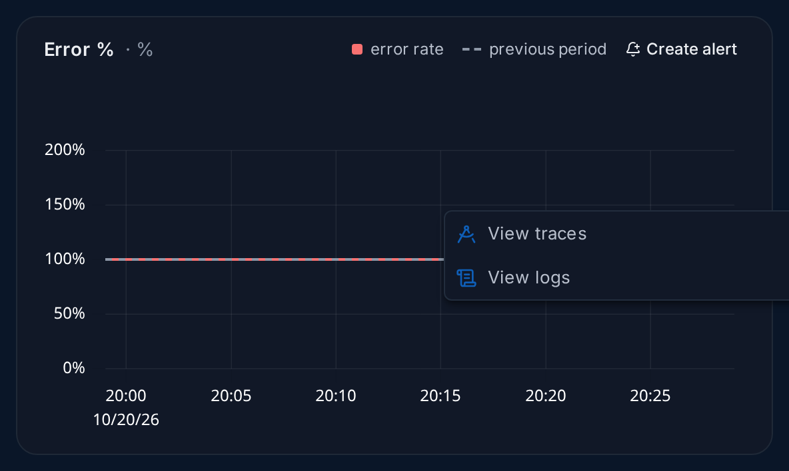
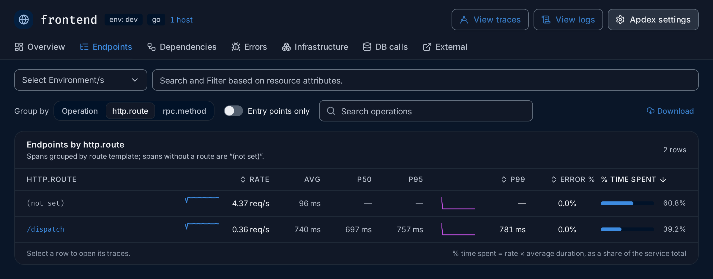
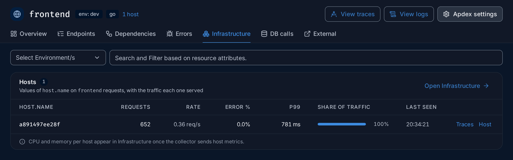
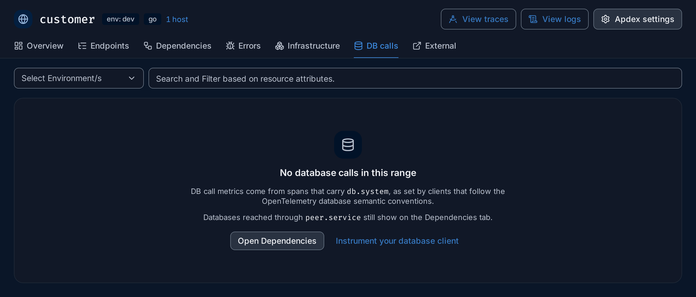
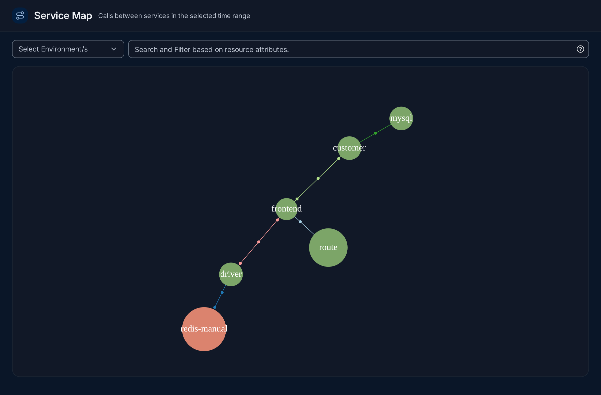
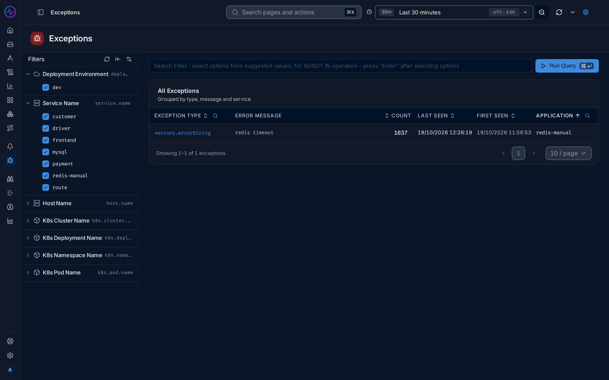
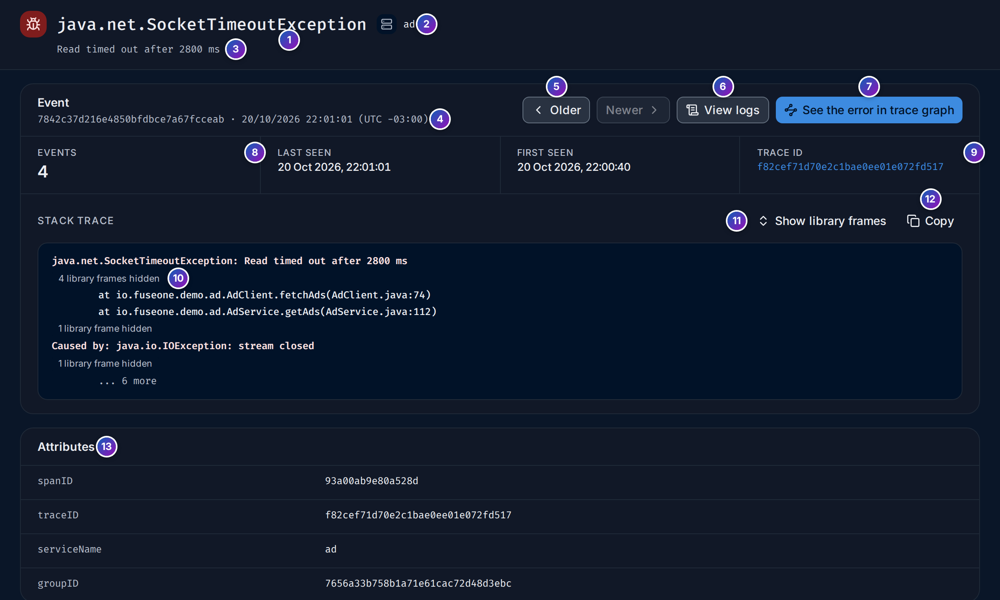

import { Aside, Steps } from "@astrojs/starlight/components";

**Services** is FuseScope's APM (application performance monitoring) view. It lists
every [service](/fusescope-docs/reference/glossary/#service) that sends
[traces](/fusescope-docs/reference/glossary/#trace) and tells you, for each one, how busy
it is, how often it fails and how long it takes. Any service whose spans carry a
`service.name` [resource attribute](/fusescope-docs/reference/glossary/#resource-attribute)
shows up here; you don't need to set up anything else.

**Use this page when** something is slow or failing and you don't yet know where, when
you want to check a service after a deploy, or when you want to know what a service
calls and what calls it. For step-by-step walkthroughs, see
[Investigate a slow endpoint](/fusescope-docs/guides/slow-endpoint/) and
[Find out why a service is failing](/fusescope-docs/guides/failing-service/).

## APM in plain words

If you are new to APM, read this section first. The rest of the page uses these words.

### Rate, errors and duration

Three numbers describe the health of almost any service. Together they are called the
[RED](/fusescope-docs/reference/glossary/#red-metrics) metrics:

- **Rate**: how many requests the service handles, in requests per second (`req/s`).
- **Errors**: how many of those requests failed, usually shown as a share, the
  **error rate**. A request fails when its span has an error status.
- **Duration**: how long the requests take, its **latency**.

A change in any of the three is worth a look: a service that suddenly takes twice as
long, fails more often, or receives far more (or far fewer) requests than an hour ago.

### Percentiles

Latency is never a single number: most requests are fast and a few are slow. An
average hides the slow ones, so FuseScope shows
[percentiles](/fusescope-docs/reference/glossary/#percentile):

- **p50** (the median): half the requests are faster than this.
- **p95**: 95 requests in 100 are faster than this.
- **p99**: 99 requests in 100 are faster; one in a hundred is slower.

A service with a p50 of 100 ms and a p99 of 2 s is fast for most users and very slow
for a few. That slow tail is often what people complain about.

### Apdex

[Apdex](/fusescope-docs/reference/glossary/#apdex) turns latency into one score from 0 to
1. You choose a target time *T* (500 ms by default). Requests that finish within *T*
count fully, those within 4 × *T* count half, and slower or failed ones count zero.
1.00 means every request was fast enough. See
[Core concepts](/fusescope-docs/start/concepts/#apdex) for the formula and
[Apdex threshold](#apdex-threshold) to change *T*.

### Entry points and internal operations

One request to a service usually produces several spans in it: the span where the
request arrives, and spans for the work it does inside, such as a database query or a
call to another service. The arriving span is the
[entrypoint span](/fusescope-docs/reference/glossary/#entrypoint-span) (or the root
span, if the request started there).

The numbers on the services list and the service KPIs count **entry points only**, so
that one request counts once. The [Endpoints](#endpoints) and [Errors](#errors) tabs
also look at the internal operations, which is why their counts can be higher.

### Where the numbers come from

By default FuseScope computes everything from the traces themselves. A FuseScope
server can instead read the RED numbers from **span metrics**, counters and latency
histograms the collector builds from spans as they arrive, which is faster on very
large volumes. The pages look the same either way.

<Aside>
  Span metrics are switched on for the whole server with the `use_span_metrics` feature
  flag: set `SIGNOZ_FLAGGER_CONFIG_BOOLEAN_USE__SPAN__METRICS=true` on the FuseScope
  server. With span metrics, the **Endpoints** tab can group only by operation, and the
  services list counts each service's top-level operations instead of its entry-point
  spans. The [latency distribution](#latency-distribution) always comes from span
  metrics.
</Aside>

## Service list

Click **Services** in the sidebar (`/services`). The list covers the time range at the
top of the page, such as the last 30 minutes.

1. **Count line**: how many services sent data in the range and how many of them have
   a [highlight](#highlight-badges), such as `7 services in the selected range · 1 with
   highlights`.
2. **Service map** opens the [Service map](#service-map).
3. **Search by service**: type part of a name to narrow the list.
4. **Filters**: **Select Environment/s** keeps only the services of one or more
   `deployment.environment` values; the box next to it filters by any other resource
   attribute. See [Filter the list](#filter-the-list).
5. **The highlight rule**, as a reminder of what the badges mean.
6. **Type icon**: what kind of service it is. See [Service types](#service-types).
7. **Language** of the service's OpenTelemetry SDK, from `telemetry.sdk.language`,
   such as `go` or `java`. Nothing is shown when the SDK doesn't report it.
8. **Highlight badge**: something crossed a rule. Hover it for the reason.
9. **Rate**: requests per second.
10. **Error %**: the share of requests that failed. It turns red and bold at 5% or more.
11. **p99 latency**: the time 99 in 100 requests stay under. The **p50** and **p95**
    columns next to it complete the picture.
12. **Sparkline**: how the value moved over the range. Rate, Error % and p99 each have
    one.
13. **Requests**: how many requests the service handled in the range.
14. **View traces**: the traces icon opens the service's traces in the
    [Traces explorer](/fusescope-docs/explore/traces/) for the same range.

Click a row, or the service name, to open the [service page](#service-details). The
list shows ten services per page.

### How to read the list

Under each Rate, Error % and p99 value is a **delta**: how it changed against the
**previous period**, a stretch of time just as long that ends where the current range
starts. For the last 30 minutes, the previous period is the 30 minutes before that.

| Delta | Meaning |
|---|---|
| `+12%`, `−20%` | The value rose or fell by that much |
| `↑2.4×` | The value more than doubled |
| `↑new` | The value was zero before |
| `+0.8 pp` | For error rates: the change in percentage points, so 1.0% → 1.8% is `+0.8 pp` |
| `no change` | Less than half a percent of difference |

A p99 delta turns red when latency rose by 10% or more, green when it fell by as much.
An error-rate delta turns red when the rate rose by more than half a percentage point,
green when it fell by as much. Rate deltas stay grey: more or less traffic is not good
or bad by itself.

Some practical rules:

- **Look at the badges first.** They mark the changes big enough to matter.
- **A steady error rate is not always a problem**; a change is. A service that always
  fails 0.1% of its calls is behaving as usual. One that went from 0% to 3% is not.
- **Compare p50 with p99.** If p50 is fine and p99 is high, a few requests are slow.
  If both rose, everything got slower.
- **A drop in rate** can mean callers stopped reaching the service.

### Highlight badges

A badge appears next to a service name when one of these rules is true. The rules
compare the current range with the previous period.

| Badge | Colour | Rule |
|---|---|---|
| `100% errors`, `62.0% errors` | Red | The error rate is 50% or more, whatever it was before |
| `errors ↑3×` | Red | The error rate is at least 1% and at least twice what it was |
| `new errors` | Red | The error rate is at least 1% and was zero before |
| `p99 ↑2×` | Amber | p99 latency is at least twice what it was |
| `rate ↑2×` | Blue | The request rate is at least twice what it was |

Hover a badge to see the numbers behind it, for example
`Error rate 4.0% vs 1.5% in the previous period`. Only increases are flagged; a
service that becomes faster or quieter gets no badge.

### Sorting

Until you sort a column, the services with badges come first (more badges, higher),
then the others by error rate, then by p99 latency, all from high to low. Click
**Service**, **Rate**, **Error %**, **p99 latency** or **Requests** to sort by that
column; click again to reverse the order.

### Service types

The icon before a name tells you what kind of service it is. FuseScope decides it from
what the service's spans contain, checking these rules in order and using the first
that matches:

| Icon | Type | When |
|---|---|---|
| Lightning bolt | **Cache** | The name or `db.system` contains `redis`, `memcache`, `valkey` or `dragonfly` |
| Cylinder | **Database** | Its spans carry `db.system`, other services name it as `peer.service` on database calls, or its name contains a database name such as `mysql`, `postgres`, `mongo` or `clickhouse` |
| Speech bubbles | **Queue** | Its spans carry `messaging.system`, or its name contains `kafka`, `rabbit`, `sqs`, `nats` or `pulsar` |
| Connected boxes | **RPC** | It serves more RPC calls (server spans with `rpc.method`) than HTTP requests |
| Globe | **Web** | It serves HTTP requests (server spans with `http.route` or `http.method`) |
| Connected boxes / Globe | **RPC** / **Web** | No spans say either way, but its name contains `grpc` (RPC), or `frontend`, `web`, `api`, `gateway` or `ui` (Web) |
| Arrow out of a box | **External** | Only seen as the target of calls, never sending data itself. Appears on the [Dependencies](#dependencies) tab |
| Server | **Service** | None of the above |

In the demo, `frontend`, `customer` and `route` are Web services, `driver` is RPC
(it serves gRPC), `mysql` is a Database, `redis-manual` a Cache, and `payment`, whose
spans say nothing about their protocol, a plain Service.

### Filter the list

**Select Environment/s** lists the values of `deployment.environment` in your data.
The box next to it filters by any resource attribute, such as
`k8s.namespace.name` or `service.namespace`. Both filters stay set when you open a
service, and its page uses them on every tab. Set these attributes in your SDK, for
example with `OTEL_RESOURCE_ATTRIBUTES`; see [OTLP](/fusescope-docs/sending-data/otlp/).

**Search by service** only narrows the rows you see; it doesn't change the counts.

<Aside type="caution">
  A red triangle before a name means the service has more than 2,500 distinct
  top-level operations, which slows the page down. Usually a span name contains an ID,
  such as `GET /orders/8812`. Click the triangle and **Show Top Level Operations** to
  see a sample (`/services/<name>/top-level-operations`), then put the ID in an
  attribute and keep the span name generic, such as `GET /orders/{id}`.
</Aside>

## Service details

Click a service to open its page (`/services/<service-name>`). Every tab uses the time
range at the top and the filters under the tabs.

### The header

1. **Name** and type icon (see [Service types](#service-types)).
2. **Badges**: the environment (`env: dev`) and the SDK language, when known. Next to
   them, **N hosts** counts the hosts that served the requests; click it to open the
   [Infrastructure](#infrastructure) tab. `payment` reports no language and no host,
   so only its environment shows.
3. **View traces**: the service's traces in the Traces explorer.
4. **View logs**: the service's logs in the [Logs explorer](/fusescope-docs/explore/logs/).
5. **Apdex settings**: the service's Apdex target. See [Apdex threshold](#apdex-threshold).
6. **Tabs**: [Overview](#overview), [Endpoints](#endpoints),
   [Dependencies](#dependencies), [Errors](#errors), [Infrastructure](#infrastructure),
   [DB calls](#db-calls) and [External](#external). The tab is part of the address
   (`?tab=ERRORS`, for example), so you can send someone a link to it.
7. **Compare with previous period** (Overview only): shows the deltas under the KPIs
   and draws the previous period as a dashed line on the charts. It is on by default,
   and FuseScope remembers your choice in this browser.

### Overview

#### KPIs

8. One number per signal, for the whole range: **Requests**, **Rate** (req/s),
   **Error rate**, **Errors**, **p99 latency**, **Avg latency** and **Apdex**. With
   the comparison on, each shows its delta and the previous value, for example
   `−1% vs 300`. Deltas follow the same rules as in the
   [list](#how-to-read-the-list); Apdex shows the difference in points, such as
   `−0.09`.

#### Highlights

9. **Highlights** explains what crossed a rule, with the count of active ones. It uses
   the [badge rules](#highlight-badges) of the list, plus one more: **a downstream
   dependency that fails 50% or more of its calls**. When nothing crossed a rule, it
   says `Nothing crossed a rule in this range.`
10. Each highlight links to where to look next:

| Highlight | Links |
|---|---|
| Error rate | **View error traces** (the service's failed spans), **Open endpoints** |
| p99 latency | **View slowest traces** (the service's traces; order them by duration), **Open endpoints** |
| Throughput | **Open endpoints** |
| Downstream dependency | **View dependency** (the Dependencies tab), **View error traces** |

Highlights always compare with the previous period, even with the comparison switch
off.

#### The charts

Four charts, two per row: **Latency** (p50, p90 and p99), **Rate** (req/s),
**Error %** and **Apdex**. Apdex shows its target next to the title, such as
`T = 500 ms`.

11. **Legend**: with the comparison on, the previous period is the dashed series. On
    Latency only p99 gets a previous-period line, to keep the chart readable.
12. **Create alert** opens the [alert editor](/fusescope-docs/alerts/alert-rules/) with
    the chart's query already filled in, so you only set the threshold.
13. Each chart is drawn over the selected range. Drag across one to zoom into that
    stretch of time; the whole page follows.

<Aside>
  The Apdex chart counts failed requests as frustrated, as Apdex defines. The **Apdex**
  KPI is computed from durations only, so a service whose requests are fast but fail,
  like `payment` in the demo, can show `1.00` in the KPI and a low line on the chart.
</Aside>

#### Drill down from a chart

Click a point on a chart for a menu:

- **View traces** opens the service's spans in the Traces explorer, for the time
  bucket you clicked.
- **View logs** opens the service's logs for that bucket.

On the **Error %** chart, both are narrowed to errors: traces with an error status,
and logs of severity `ERROR` or `FATAL`. That makes "what went wrong at 14:05?" two
clicks away.

#### Latency distribution

14. **Latency distribution** shows how many requests fell in each duration bucket, in
    milliseconds, over the whole range. The bucket that holds the median is tagged
    `p50` and the one that holds the 99th percentile `p99`; bars from the p99 bucket
    up are drawn in the second colour (**at or above p99**). Hover a bar for its
    count.

One tall bar means steady latency. Two humps mean two kinds of requests, for example
cache hits and cache misses; a long tail to the right means a few requests are much
slower than the rest.

#### Monitors

15. **Monitors** lists the [alert rules](/fusescope-docs/alerts/alert-rules/) that
    watch this service, the ones that need attention first: **Firing**, **Pending**,
    **Recovering**, **No data**, **OK**, then **Disabled**. Under each name is the
    rule's first filter. Click a rule to open it; **Create alert** starts a new one,
    and **All alert rules** opens the list.

A rule counts as watching the service when:

- one of its query filters has `service.name = '<service>'`, or
  `service.name IN [...]` with the service in the list; or
- it has a label `service.name` (or `serviceName`, `service_name`) equal to the
  service.

A rule that covers every service without naming them, or names the service only in a
`!=` or `NOT IN` filter, is not listed. In the demo, `redis-manual` shows the rule
`redis-manual error rate above 5%`; `payment` shows
`No alert rule covers this service yet.`

#### Top endpoints

16. **Top endpoints** lists the five operations where the service spends the most
    time, with their **Rate**, **p99**, **Error %** and **% time spent**. Click a row
    for its traces. **All endpoints** opens the [Endpoints](#endpoints) tab.

### Endpoints

The **Endpoints** tab lists everything the service does, one row per
[operation](/fusescope-docs/reference/glossary/#endpoint), with the numbers to compare
them.

- **Group by** chooses what a row is:
  - **Operation**: the span name, such as `/dispatch` or `HTTP GET`. This is the
    default.
  - **http.route**: the route template of HTTP spans, such as `/api/orders/{id}`.
  - **rpc.method**: the method of gRPC spans.

  Spans that don't have the attribute are grouped into one row, **(not set)**, shown
  in grey. Its percentiles are `—`, because it mixes unrelated work. In the demo,
  `frontend`'s outgoing `HTTP GET` calls have no route, so they land in **(not set)**.
  **http.route** and **rpc.method** are only offered when the numbers come from traces
  (see [Where the numbers come from](#where-the-numbers-come-from)).
- **Entry points only** keeps the operations where requests enter the service and
  hides the internal ones.
- **Search operations** narrows the rows by name.
- **Download** saves the table as **CSV** or **Excel**.

| Column | Meaning |
|---|---|
| Operation (or the attribute) | Click it, or the row, to open its traces |
| **Rate** | Requests per second, with a sparkline |
| **Avg**, **p50**, **p95** | Average and percentile latency |
| **p99** | 99th-percentile latency, with a sparkline |
| **Error %** | Share of its spans that failed; red and bold at 5% or more |
| **% time spent** | Its share of all the time the service spent, see below |

**% time spent** is rate × average duration, as a share of the service's total. A
fast operation called very often can take more of the service's time than a slow one
called rarely, and that is where speeding things up pays off most. The table is sorted
by it until you click **Rate**, **p99**, **Error %** or **% time spent**. It shows ten
rows per page.

Clicking a row opens the Traces explorer filtered on that operation, or on the
attribute value. For **(not set)**, it shows the spans where the attribute does not
exist.

### Dependencies

The **Dependencies** tab shows what the service calls (**downstream**) and what calls
it (**upstream**), from the same parent and child spans the [Service map](#service-map)
uses.

- **Map**: the callers on the left, the service in the middle with its rate and error
  rate, and what it calls on the right. Each box shows its own rate and error rate.
  A box gets an amber outline at 5% errors and a red one at 50%; the arrow towards
  a column turns red when any box in it is at 5% or more. **Open service map** opens the full
  map.
- **Downstream**: the services, databases and external addresses the service calls,
  with **Type**, **Rate**, **p50**, **p99** and **Error %**, failing ones first.
- **Upstream**: the traced services that call it.

| Type | What it is |
|---|---|
| **Service** | Another traced service |
| **Database** | A peer named in `peer.service` on database calls |
| **External** | An address the service calls that sends no traces itself, such as a third-party API |

The type icon in each row follows the [service type](#service-types) rules. Click a
row to open that service's page; for an External address, the
[External APIs](#external) page for it.

An empty **Upstream** with `No traced callers in this range` is normal for a service
that browsers or other untraced clients call directly: they send no trace context, so
there is no caller span to link to.

### Errors

The **Errors** tab answers "what is failing, and why?". It counts every span of the
service with an error status, internal operations included, so its numbers can be
larger than the request counts on the Overview.

A span can say it failed in two ways, and this tab shows both:

- An **exception**: the code recorded an `exception` event on the span, with a type,
  a message and often a stack trace. This is what most SDKs do for an uncaught error.
- A **status message**: the span's status is error, with an optional short message.
  Some code sets the status without recording an exception, so those failures have no
  stack trace.

The tab has three parts:

- **Summary**: **Error spans** and **Error rate**, each against the previous period;
  **With exception** (and how many exception types); **Status only**, the error spans
  with no exception event.
- **Top exceptions**: the exceptions recorded on the service, grouped by type and
  message, with **Count**, **Last seen** and **First seen**. Click one for its stack
  trace and occurrences on the [exception's page](#exceptions); **All in Exceptions**
  opens the Exceptions page.
- **Error status messages**: error spans grouped by status message and operation, with
  **Spans** and **Share of errors**. A span without a message shows
  `(no status message)`. **View traces** opens those spans. The **Exception** column
  says whether the message matches an exception:

| Exception | Meaning |
|---|---|
| **Recorded** | The service recorded an exception with exactly this message |
| **None** | The service recorded no exception at all in the range: these failures only set a status |
| **Not matched** | The service recorded exceptions, but none with this message. The error is probably described differently in the exception; check Top exceptions |

### Infrastructure

The **Infrastructure** tab lists the hosts that served the service's requests: each
value of the `host.name` resource attribute on its spans.

For each host: **Requests**, **Rate**, **Error %**, **p99**, **Share of traffic** and
**Last seen**. **Traces** opens the service's traces from that host; **Host** opens
the host on the **Infrastructure** page. A host that
fails much more than the others, or takes all the traffic, is easy to spot here.

The hosts come from your traces, so they appear as soon as your SDK sets `host.name`
(most do, or the collector's resource detection adds it). **CPU and memory** are a
different matter: they come from host metrics, which the collector sends only when
its host metrics receiver is on. Until then, **Open Infrastructure** shows no CPU or
memory for the host. When no span carries `host.name`, the table says so.

### DB calls

The **DB calls** tab charts **Database Calls RPS** and **Database Calls Avg Duration**,
one line per database system (`db.system`, such as `mysql` or `postgresql`).

The charts need client spans that carry `db.system`, which database client
instrumentations set when they follow the OpenTelemetry database conventions. Without
them the tab shows **No database calls in this range**. In that case:

- **Open Dependencies**: databases the service reaches through `peer.service` still
  appear on the [Dependencies](#dependencies) tab.
- **Instrument your database client**: add the instrumentation library for your
  database driver; see [Instrument applications](/fusescope-docs/sending-data/instrumentation/).

The HotROD demo fakes its database and cache calls without `db.system`, so this tab is
empty for every demo service; `customer`'s calls to `mysql` show on its Dependencies
tab.

### External

The **External** tab charts the service's calls to other addresses:
**External Call Error Percentage**, **External Call duration**,
**External Call RPS(by Address)** and **External Call duration(by Address)**. Click a
point for **View traces**, **View logs** or **View External APIs**, which opens the
External APIs page for that address.

### Apdex threshold

**Apdex settings** at the top of the service page opens **Application Settings**. Set
**Apdex threshold (in seconds)**, such as `0.3` for 300 ms, and click **Save**. The
default is 0.5 seconds. The Apdex KPI and chart use the new value right away; it is
saved per service for everyone.

Pick *T* as the time your users consider fast enough for this service's typical
request: a few hundred milliseconds for an API, more for a report.

## Example: why is payment failing?

The demo's `payment` service fails every request. Here is how you would find out what
is going on, starting from the list. The numbers are from the HotROD demo over the last
30 minutes.

<Steps>

1. **Spot it in the list.** Open **Services**. The count line reads
   `7 services in the selected range · 1 with highlights`, and `payment` is at the top
   with a red **100% errors** badge. Hover the badge: `Error rate at or above 50%`. Its
   Error % is `100%` and has been for the whole range (`no change`), at 0.17 req/s.

2. **Open the Overview.** Click `payment`. The KPIs read about 300 requests, all of
   them errors: **Error rate** `100.0%`, **p99 latency** `500 ms`. **Highlights**
   shows **2 active**:
   - **Error rate 100%**: `100% of requests failed, against 100% in the previous period.`
   - **Downstream 1.2.3.4 fails 100% of calls**: `payment` calls an external address,
     `1.2.3.4`, and every call fails.

   So the failure is not new, and it goes together with a failing outgoing call.

3. **Check the dependency.** Click **View dependency**. The Dependencies tab shows
   no callers (`payment` is an entry point) and one downstream: `1.2.3.4`, type
   **External**, at 0.17 req/s with `100%` errors.

4. **Read the errors.** Open the **Errors** tab. **Error spans** is about 900, three
   times the request count, because each request runs three operations (`lets-go`,
   `okey-dokey-0` and `okey-dokey-1`) and all three fail. **With exception** is `0`
   and **Status only** about 900: the code sets an error status but records no
   exception. **Error status messages** confirms it: three rows of
   `(no status message)`, a third each, with **Exception** `None`.

5. **Look at the traces.** Click **View traces** on the `lets-go` row, or go back to
   the Overview and click **View error traces** in the highlight. The Traces explorer
   opens with `serviceName in ['payment'] AND hasError in ['true']`, listing
   `lets-go` spans of 500 ms and `okey-dokey` spans of 250 ms. Open one to read it in
   [Trace details](/fusescope-docs/explore/trace-details/).

</Steps>

**What you learn**: `payment` has failed on every request for the whole range, its
calls to `1.2.3.4` fail too, and the code records no exception or message, so the
trace and the attributes of its spans are the only clues. The fix starts in the code:
record the exception (`span.recordException()`) and set a status message, so the next
failure explains itself.

## Example: what does driver depend on, and is it healthy?

`driver` itself shows no errors in the list. But does it rely on something that
fails?

<Steps>

1. **Open driver.** In **Services**, click `driver` (RPC icon, about 0.36 req/s,
   `0.0%` errors, p99 about 240 ms).

2. **Open Dependencies.** The map shows `frontend` calling `driver`, and `driver`
   calling `redis-manual`. The `redis-manual` box has an amber outline and reads
   `4.77 req/s · 18.5% errors`; the arrow towards it is red. In **Downstream**,
   `redis-manual` is a **Service** with a Cache icon, p50 `12 ms`, p99 `35 ms` and
   `18.5%` errors.

   `driver` calls `redis-manual` about 13 times for each request it serves, and almost
   one call in five fails. `driver` still answers successfully, so it retries or
   skips the failed lookups, which costs time.

3. **Follow the dependency.** Click `redis-manual`. Its Overview reads an error rate
   of `18.5%`, steady against the previous period, so there is no highlight: 18.5% is
   below the 50% rule and hasn't doubled. **Monitors** lists the rule
   `redis-manual error rate above 5%` (**Disabled** in the demo). **Top endpoints**
   shows the culprit: `GetDriver`, with `20.0%` errors and about 90% of the time
   spent.

4. **Read the errors.** Open **Errors**. **Top exceptions** has one entry,
   `*errors.errorString` with the message `redis timeout`, about 1,600 times. Under
   **Error status messages**, `An error occurred` on `GetDriver` holds 100% of the
   errors, marked **Not matched**: the status message and the exception message
   differ, but they are the same failures.

5. **Drill down to traces.** Click **View traces** on that row. The Traces explorer
   opens with `serviceName in ['redis-manual'] AND hasError in ['true'] AND name in
   ['GetDriver'] AND status_message in ['An error occurred']`. Open a span and look at
   its **Events** tab for the `redis timeout` exception, and at the waterfall to see
   how `driver` carries on after the failed call.

</Steps>

**What you learn**: `driver` depends on `redis-manual`, which times out on almost one
`GetDriver` call in five. It doesn't show in `driver`'s own error rate, but it adds to
its latency. Turning on the existing alert rule would warn you when it gets worse.

## Service map

**Service Map** (`/service-map`, also **Service map** on the services list) draws
every service and the calls between them, from the parent and child spans in your
traces.

- A circle is a service; its size follows how many requests it receives.
- A circle is red when calls to it return errors, green otherwise.
- A line is a caller–callee pair. Hover it for its **P99 latency**, **Request** rate
  and **Error Rate**.
- Scroll to zoom, and drag to move the map.

The filters above the map accept `deployment.environment`, `k8s.cluster.name` and
`k8s.cluster.namespace` only. Services that call nothing and are called by nothing, such
as `payment` in the demo, don't appear on the map. For one service's direct neighbours
with numbers, the [Dependencies](#dependencies) tab is easier to read.

## Exceptions

**Exceptions** (`/exceptions`) groups the exceptions recorded on spans as span events,
across all services. The **All Exceptions** table shows **Exception Type**,
**Error Message**, **Count**, **Last Seen**, **First Seen** and **Application**. Click
an exception to see its stack trace and attributes, step through **Older** and
**Newer** occurrences, and open **See the error in trace graph**. A service's own
exceptions are also on its [Errors](#errors) tab.

<Aside>
  OpenTelemetry SDKs record an exception on a span with `span.recordException()` or its
  equivalent, which adds an `exception` event carrying `exception.type`,
  `exception.message` and `exception.stacktrace`.
</Aside>

## If something is missing

- **A service is missing from the list.** It sent no spans in the time range, or the
  filters exclude it. Widen the range and clear the filters. A service that only
  receives calls and sends nothing itself, such as a third-party API, is not a
  service here; it shows as **External** on its callers' Dependencies tab.
- **No language, environment or hosts in the header.** The SDK doesn't set
  `telemetry.sdk.language`, `deployment.environment` or `host.name`. Set them with
  `OTEL_RESOURCE_ATTRIBUTES` or the SDK's resource detectors.
- **No deltas or badges.** There is no data for the previous period yet, for example
  right after you start sending.
- **No latency distribution.** It reads span metrics; check that the collector's span
  metrics are enabled.

## Related

- [Investigate a slow endpoint](/fusescope-docs/guides/slow-endpoint/) and
  [Find out why a service is failing](/fusescope-docs/guides/failing-service/):
  step-by-step guides.
- [Core concepts](/fusescope-docs/start/concepts/): spans, entrypoint spans,
  percentiles and Apdex.
- [Trace details](/fusescope-docs/explore/trace-details/): read one request end to end.
- [Alert rules](/fusescope-docs/alerts/alert-rules/): get notified when a service
  degrades.
