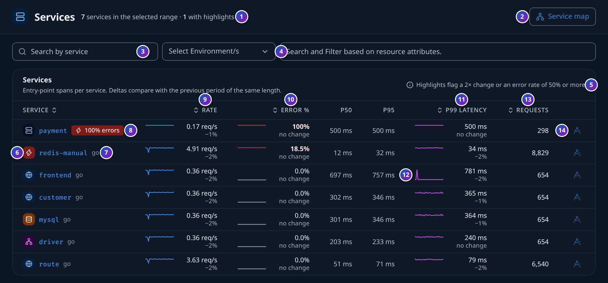
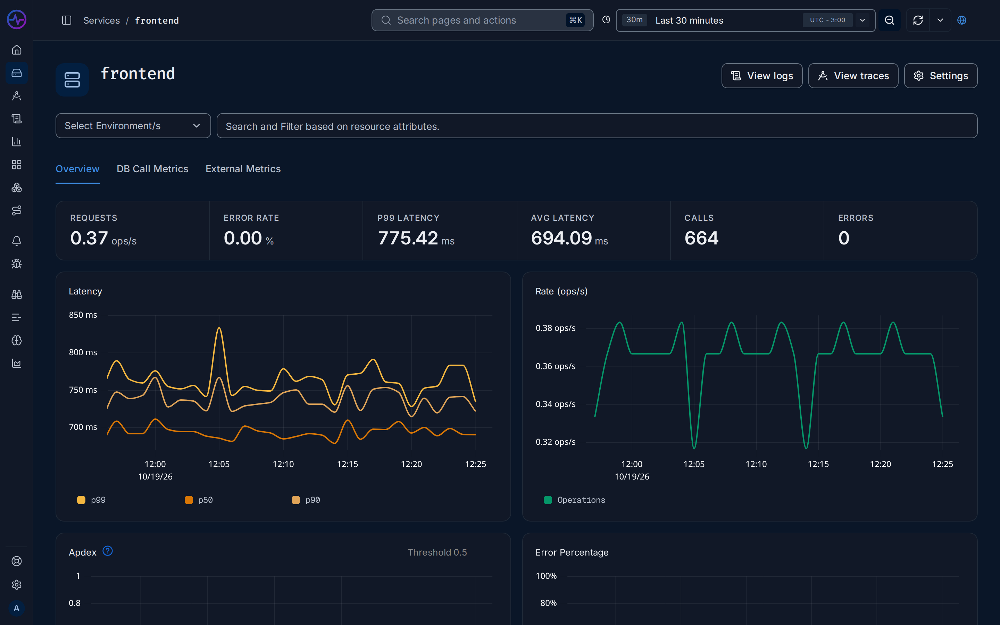

import { Aside } from "@astrojs/starlight/components";

FuseScope builds its APM (application performance monitoring) views from
[traces](/fusescope-docs/reference/glossary/#trace): any service that sends spans with a
`service.name` [resource attribute](/fusescope-docs/reference/glossary/#resource-attribute)
appears here. No extra metrics pipeline is needed.

**Use this page when** you want to know which service is slow or failing, and start
there. For a walkthrough, see
[Investigate a slow endpoint](/fusescope-docs/guides/slow-endpoint/).

## Service list

Open **Services** in the sidebar (`/services`). For the selected time range, each row
shows:

| Column | Meaning |
|---|---|
| **Application** | The service name; search with **Search by service** |
| **P99 latency (in ms)** | 99th [percentile](/fusescope-docs/reference/glossary/#percentile) duration of the service's [entrypoint spans](/fusescope-docs/reference/glossary/#entrypoint-span) |
| **Error Rate (% of total)** | Share of those spans with an error status |
| **Operations Per Second** | Their throughput |

### How to read the list

- **P99 latency** is the time 99 in 100 requests stay under: one request in a hundred
  is slower than this. A P99 of 800 ms with a normal P50 of 100 ms means a slow tail
  worth opening the service for.
- **Error Rate** is the share of requests that failed. Some services run with a small,
  steady rate; what matters is a change. A jump from 0% to a few percent, or any rate
  on a service that users call directly, needs a look.
- **Operations Per Second** tells you how busy the service is. A sudden drop can mean
  that callers stopped reaching it.

Click a column header to sort by it.

### Filter the list

**Select Environment/s** filters by `deployment.environment`, and the resource attribute
filter narrows the list by any other resource attribute. Set these attributes in your SDK
with `OTEL_RESOURCE_ATTRIBUTES`; see [OTLP](/fusescope-docs/sending-data/otlp/).

## Service details

Click a service to open `/services/<service-name>`. The header has **View logs** and
**View traces**, which open the explorers filtered on the service, and **Settings**. Below
the filters, a row of totals for the time range shows **Requests** (ops/s),
**Error Rate**, **P99 Latency**, **Avg Latency**, **Calls** and **Errors**. The page has
three tabs.

### Overview

| Chart | Shows |
|---|---|
| **Latency** | p50, p90 and p99 latency |
| **Rate** | Operations per second |
| **Apdex** | User satisfaction score, from 0 to 1 |
| **Error Percentage** | Share of requests with an error |

Drag across a chart to zoom into a time range. Click a point for **View traces** or
**View logs**, which open the explorers on that service and moment.

Below the charts, **Key Operations** lists the service's operations with P50, P95 and
P99 latency (in ms), **Number of Calls** and **Error Rate**. Turn on **Entrypoint Spans**
to list only the spans where requests enter the service (**Key Entrypoint Operations**).
Click an operation to see its traces. The table downloads as CSV or Excel.

### DB Call Metrics

**Database Calls RPS** and **Database Calls Avg Duration**, per `db.system`, from the
service's spans that carry a `db.system` attribute.

### External Metrics

Calls to other services and APIs: **External Call Error Percentage**,
**External Call duration**, **External Call RPS(by Address)** and
**External Call duration(by Address)**. **View External APIs** opens the External APIs
page.

### Apdex threshold

Apdex scores requests against a threshold *T*: requests faster than *T* are satisfied,
those faster than 4*T* are tolerating, and the rest frustrated. *T* is 0.5 seconds
by default. To change it for a service, open **Settings** on the service page and set **Apdex threshold (in seconds)**
under **Application Settings**.

## Service map

**Service Map** (`/service-map`, beta) draws the services and the calls between them,
from the parent and child spans in your traces. A node's size follows its call rate, and
it turns red when the service has errors. Hover over a link for its P99 latency,
requests per second and error rate.

## Exceptions

**Exceptions** (`/exceptions`) groups the exceptions recorded on spans as span events.
The **All Exceptions** table shows **Exception Type**, **Error Message**, **Count**,
**Last Seen**, **First Seen** and **Application**. Click an exception to see its stack
trace and attributes, step through **Older** and **Newer** occurrences, and open
**See the error in trace graph**.

<Aside>
  OpenTelemetry SDKs record an exception on a span with `span.recordException()` or its
  equivalent, which adds an `exception` event carrying `exception.type`,
  `exception.message` and `exception.stacktrace`.
</Aside>
