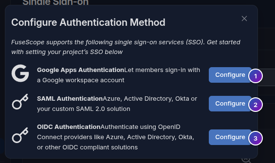
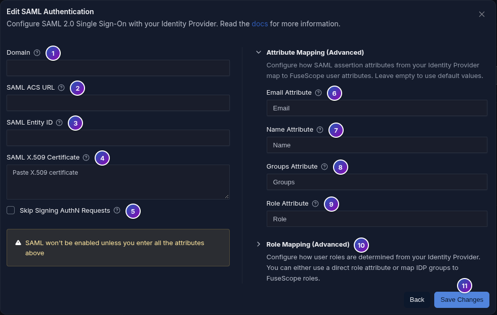

import { Aside, Steps } from "@astrojs/starlight/components";

**Use this page when** you want people to sign in with their company account instead of a FuseScope password.

FuseScope signs users in through one of three protocols:

| Protocol | Use it for |
|---|---|
| [OpenID Connect (OIDC)](#register-fusescope-at-the-provider) | Microsoft Entra ID, Keycloak, Okta, Auth0 or any OIDC provider |
| [Google Workspace](#google-workspace) | Google accounts of one Workspace domain |
| [SAML 2.0](#saml-20) | Identity providers that only speak SAML, such as AD FS or JumpCloud |

An **auth domain** ties an email domain, such as `example.com`, to one provider. Users
whose email is in that domain sign in through it. Creating auth domains needs the Admin
[role](/administration/users-and-roles/#roles).

Auth domains are created in the UI or declared in the
[configuration file](#declare-domains-in-the-configuration-file).

## Choose a protocol

Go to *Settings → Single Sign-on* and click **Add Domain**.



1. **Google Apps Authentication**: see [Google Workspace](#google-workspace).
2. **SAML Authentication**: see [SAML 2.0](#saml-20).
3. **OIDC Authentication**: continue below.

The domain list shows each domain, an **Enforce SSO** switch, the
**IDP Initiated SSO URL** for SAML domains, and **Configure** and **Delete** actions.

## Register FuseScope at the provider

Create a confidential OIDC client (authorization code flow) and register this redirect
URI:

```text
https://<fusescope-host>/api/v1/complete/oidc
```

When FuseScope is served under a path, set `global.external_url` to the full URL; its
path goes before `/api/v1/complete/oidc`.

FuseScope always requests the `openid`, `email` and `profile` scopes and adds the ones you
configure. Okta only sends group membership when the `groups` scope is requested.

## Configure in the UI

<Steps>

1. Go to *Settings → Single Sign-on* and click **Add Domain**.
2. Choose **OIDC Authentication**.
3. Pick a preset: Generic OIDC, Microsoft Entra ID, Keycloak, Okta or Auth0. Presets only
   prefill the issuer placeholder and scopes.
4. Fill in the domain, issuer URL, client ID and client secret, then save.

</Steps>

| Issuer for | Format |
|---|---|
| Microsoft Entra ID | `https://login.microsoftonline.com/<tenant-id>/v2.0` |
| Keycloak | `https://<host>/realms/<realm>` |
| Okta | `https://<your-org>.okta.com` |
| Auth0 | `https://<tenant>.<region>.auth0.com/` |

## How sign-in is checked

- The ID token is verified against the issuer's discovery document and the client ID.
- The email claim must be present and `email_verified` must be true. Turn on
  `insecureSkipEmailVerified` only for providers that never send it.
- The email must belong to the auth domain, compared case-insensitively.
- With `getUserInfo`, claims missing from the ID token are read from the userinfo
  endpoint. If that endpoint fails, sign-in continues with the ID token claims; a userinfo
  subject that differs from the ID token is rejected.

## OIDC settings

| Field | Description |
|---|---|
| `issuer` | Issuer URL; discovery is read from `<issuer>/.well-known/openid-configuration`. Required. |
| `issuerAlias` | Issuer to validate tokens against when it differs from the discovery URL, for example Entra ID multi-tenant. |
| `clientId`, `clientSecret` | Client credentials. Required. |
| `scopes` | Scopes added to `openid email profile`. |
| `getUserInfo` | Merge claims from the userinfo endpoint. |
| `insecureSkipEmailVerified` | Accept emails without `email_verified`. |
| `claimMapping` | Claim names for `email`, `name`, `groups` and `role`; the defaults are those names. |

## Google Workspace

Google sign-in lets the accounts of one Google Workspace domain in. Users from other
domains, and personal Gmail accounts, are rejected.

### Create the OAuth client

<Steps>

1. In the Google Cloud console, open *APIs & Services → Credentials* and create an
   **OAuth client ID** of type **Web application**.
2. Add this authorized redirect URI:

   ```text
   https://<fusescope-host>/api/v1/complete/google
   ```

3. Copy the client ID and client secret.

</Steps>

FuseScope requests the `email` and `profile` scopes.

### Fill in the form


1. **Domain**: the Workspace domain, such as `example.com`. Google must report the same
   domain for the account (the `hd` claim), so sign-in fails for other domains.
2. **Client ID**: from the OAuth client.
3. **Client Secret**: from the OAuth client.
4. **Skip Email Verification**: accept accounts whose email Google has not verified.
   Leave it off.
5. **Fetch Groups**: read the user's Workspace groups at sign-in, for
   [role mapping](#role-mapping) or to restrict who may sign in. Needs fields 6 and 7.
6. **Service Account JSON**: the key file of a Google Cloud service account with
   domain-wide delegation for the `admin.directory.group.readonly` scope.
7. **Domain to Admin Email Mapping**: a Workspace admin the service account acts as, per
   email domain. Use `*` as the domain to match any domain.
8. **Fetch Transitive Group Membership**: also include groups that contain the user's
   groups.
9. **Allowed Groups**: group emails. When set, only members of one of these groups can
   sign in.
10. **Role Mapping**: see [Role mapping](#role-mapping).
11. **Save Changes**.

If groups cannot be read, sign-in fails rather than continuing without them.

## SAML 2.0

### Register FuseScope at the identity provider

Create a SAML application with these values:

| Setting | Value |
|---|---|
| Assertion Consumer Service (ACS) URL, also called reply or single sign-on URL | `https://<fusescope-host>/api/v1/complete/saml` |
| Entity ID, also called audience or SP entity ID | `<fusescope-host>`: the host, with its port if any, without scheme or path |
| Name ID | The user's email address |

Under a base path, set `global.external_url`; its path goes before
`/api/v1/complete/saml`. Set `global.external_url` in any case: FuseScope only accepts
SAML sign-ins for that host, or for `global.allowed_origins`.

From the identity provider's metadata, note the **entity ID**, the **single sign-on
URL** and the **signing certificate**.

### Fill in the form



1. **Domain**: the email domain, such as `example.com`.
2. **SAML ACS URL**: despite its label, the identity provider's **single sign-on URL**
   (`SingleSignOnService` `Location` in its metadata), where FuseScope sends users.
3. **SAML Entity ID**: the identity provider's entity ID (`entityID` in its metadata).
4. **SAML X.509 Certificate**: the identity provider's signing certificate, as the base64
   body of `X509Certificate` or a PEM block.
5. **Skip Signing AuthN Requests**: turn on for providers that require unsigned
   requests, such as JumpCloud.
6. **Email Attribute**: the assertion attribute with the email. Empty uses `email`.
   When the attribute is missing, the Name ID is used.
7. **Name Attribute**: empty uses `name`.
8. **Groups Attribute**: the groups used by [role mapping](#role-mapping). Empty uses
   `groups`.
9. **Role Attribute**: the role used with **Use Role Attribute Directly**. Empty uses
   `role`.
10. **Role Mapping**: see [Role mapping](#role-mapping).
11. **Save Changes**.

### How a SAML sign-in is checked

- The response must be signed with the configured certificate and addressed to
  FuseScope.
- An assertion outside its validity window is rejected.
- Each assertion is accepted once. With several backend replicas, use the `redis`
  [cache](/configuration/config-file/#main-sections) so replays are
  caught across replicas.
- The email must belong to the auth domain.

### Sign in from the identity provider

To start the sign-in from the identity provider's portal instead of the FuseScope login
page, copy the domain's **IDP Initiated SSO URL** from the domain list and set it as
the application's default relay state.

## Role mapping

FuseScope assigns roles when it creates the user at the first SSO sign-in. Existing users
keep their roles.

Every provider form has a **Role Mapping (Advanced)** section with these fields:

| Key | Form field | Description |
|---|---|---|
| `defaultRole` | Default Role | Role when no group mapping applies. Defaults to viewer. |
| `groupMappings` | Group to Role Mappings | Map of provider group to role. A user in several mapped groups gets every mapped role. |
| `useRoleAttribute` | Use Role Attribute Directly | Use the `role` claim as the role name when it names an existing role, instead of group mappings. |

Role names are `signoz-admin`, `signoz-editor` and `signoz-viewer`, or a custom role.
`ADMIN`, `EDITOR` and `VIEWER` are accepted and converted.

## Declare domains in the configuration file

Domains under `authdomain.domains` are created or updated at startup, deleted when
removed from the list, and re-applied every `reconcile_interval` (default `1m`), which
also picks up an organization created at first sign-up. Domains created in the UI are not
affected.

```yaml
authdomain:
  reconcile_interval: 1m
  domains:
    - name: example.com
      config:
        kind: oidc
        spec:
          issuer: https://login.microsoftonline.com/<tenant-id>/v2.0
          clientId: <application-id>
          clientSecret: ${FUSESCOPE_ENTRA_CLIENT_SECRET}
      role_mapping:
        defaultRole: VIEWER
        groupMappings:
          <group-object-id>: ADMIN
    - name: example.org
      config:
        kind: oidc
        spec:
          issuer: https://keycloak.example.org/realms/<realm>
          clientId: fusescope
          clientSecret: ${FUSESCOPE_KEYCLOAK_CLIENT_SECRET}
          getUserInfo: true
```

| Key | Description |
|---|---|
| `name` | Email domain. Each domain may appear once. |
| `org` | Organization ID or name. May be omitted when there is a single organization. |
| `enabled` | Defaults to `true`. |
| `config` | `kind` (`oidc`, `google` or `saml`) and `spec`. For `oidc`, see the [OIDC settings](#oidc-settings); `google` and `saml` take the [Google](#google-settings) and [SAML](#saml-settings) keys below. |
| `role_mapping` | `defaultRole`, `groupMappings`, `useRoleAttribute`. |

### Google settings

| Key | Form field |
|---|---|
| `clientId`, `clientSecret` | Client ID, Client Secret |
| `insecureSkipEmailVerified` | Skip Email Verification |
| `fetchGroups` | Fetch Groups |
| `serviceAccountJson` | Service Account JSON, as a string |
| `domainToAdminEmail` | Domain to Admin Email Mapping, such as `{"*": "admin@example.com"}` |
| `fetchTransitiveGroupMembership` | Fetch Transitive Group Membership |
| `allowedGroups` | Allowed Groups |

### SAML settings

| Key | Form field |
|---|---|
| `entityId` | SAML Entity ID |
| `location` | SAML ACS URL, the identity provider's single sign-on URL |
| `certificate` | SAML X.509 Certificate |
| `insecureSkipAuthNRequestsSigned` | Skip Signing AuthN Requests |
| `attributeMapping` | `email`, `name`, `groups` and `role` attribute names |

String values may reference environment variables as `${NAME}`; use this for client
secrets. A referenced variable that is not set stops the backend at startup.

Declared domains are read-only: the UI marks them **Managed by configuration**, and
changing or deleting one through the API returns `403` with the error code
`auth_domain_managed`. Edit the file instead.

<Aside>
  With the Helm chart, put this block under `signoz.config` and provide the secrets
  through `signoz.env`. See [Install with Helm](/install/helm/#configuration-file).
</Aside>
