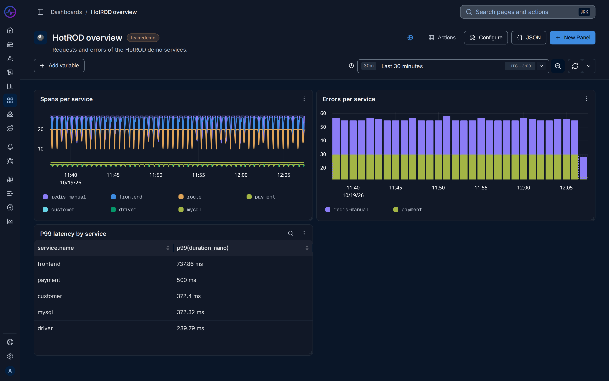
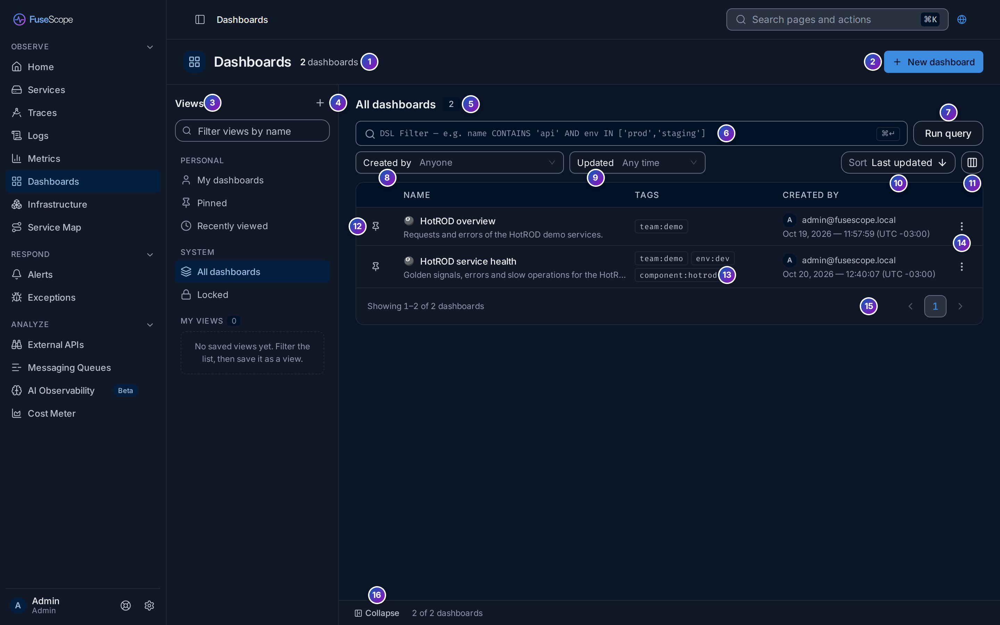
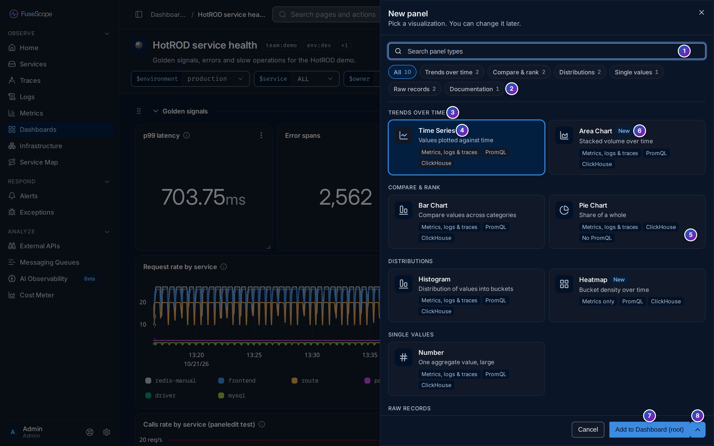
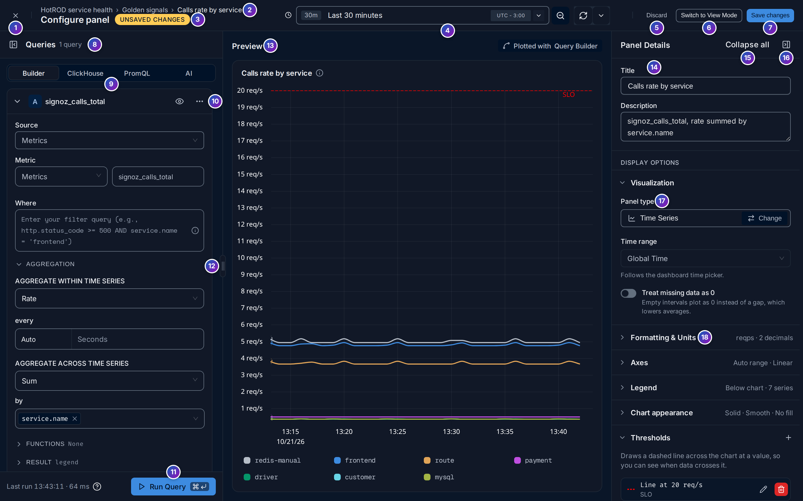

import { Aside, Steps } from "@astrojs/starlight/components";

A [dashboard](/fusescope-docs/reference/glossary/#dashboard) is a page of
[panels](/fusescope-docs/reference/glossary/#panel) you arrange yourself: charts, tables
and numbers over traces, logs and metrics.

**Use this page when** you want the same charts in front of you every day, or to share
them with your team. To build one step by step, see
[Build your first dashboard](/fusescope-docs/guides/first-dashboard/).

Open **Dashboards** in the sidebar (`/dashboard`).



## Create a dashboard

Click **New dashboard**. The dialog has three tabs:

- **Blank**: enter a **Title**, an optional **Description** and **Tags**, then
  **Create dashboard**. Tags are `key:value` pairs such as `team:payments`; press Enter
  after each. A dashboard can have up to 10 tags.
- **Import JSON**: paste a dashboard JSON or **Upload JSON file**, then
  **Import and Next**.
- **From a template** links to a template catalogue; FuseScope ships no templates.

## Find dashboards

The views on the left list **My dashboards**, **Pinned**, **Recently viewed**,
**All dashboards** and **Locked**. Pin a dashboard with the pin icon on its row. Filter
with **Created by** and **Updated**, or write a filter in the search box:

```text
name CONTAINS 'api' AND team IN ['payments', 'checkout']
```

The keys are `name`, `description`, `created_by`, `created_at`, `updated_at` and
`locked`; any other key is a tag key. Text keys and tags take `=`, `!=`, `CONTAINS`,
`LIKE`, `ILIKE` and `IN`, each with a `NOT` form; tags also take `EXISTS`. Dates take
comparisons and `BETWEEN`. **Save as view** keeps a filter as a custom view.



Each row's menu has **View**, **Open in New Tab**, **Copy Link**, **Rename**,
**Edit Tags**, **Duplicate**, **Lock Dashboard** and **Delete Dashboard**.

## Lock a dashboard

A locked dashboard can't be edited or deleted until it is unlocked. Only its creator or an
[Admin](/fusescope-docs/administration/users-and-roles/#roles) can lock or unlock it.

## Add panels

<Steps>

1. Click **New Panel** and pick a panel type.
2. Write the query on the **Query Builder**, **ClickHouse Query** or **PromQL** tab, and
   click **Run Query**.
3. Set the panel's title and options on the right.
4. Click **Save changes**.

</Steps>





Queries are described in [Query builder](/fusescope-docs/querying/query-builder/) and
[ClickHouse SQL and PromQL](/fusescope-docs/querying/clickhouse-promql/). Explorers can
also send their query to a dashboard with **Add to dashboard**.

Drag a panel by its header to move it, and drag its corner to resize it. The layout saves
when you let go.

### Sections

**Actions → New section** groups panels under a collapsible title. On a dashboard
without sections, the first one moves the existing panels into their own section. A
section's menu adds a panel, renames, clones or deletes the section; drag sections to
reorder them.

### Panel menu

| Item | Does |
|---|---|
| **View** | Opens the panel full size |
| **Edit panel** | Opens the panel editor |
| **Clone** | Copies the panel |
| **Create Alerts** | Starts an [alert rule](/fusescope-docs/alerts/alert-rules/) from the panel's query, on panel types that support alerts |
| **Download** | As PNG or SVG; Table panels also as CSV |
| **Move to section** | Moves the panel to another section, on dashboards that have sections |
| **Delete panel** | Removes the panel |

Clicking a point on a chart offers **View in Logs**, **View in Traces** and
**Breakout by ..** to split the series by another attribute.

## Panel types

| Type | Use it for |
|---|---|
| **Time Series** | Values over time, as lines |
| **Area Chart** | Values over time, as areas, overlapping or stacked |
| **Bar Chart** | Values over time, as bars, side by side or stacked |
| **Pie Chart** | Shares of a total |
| **Histogram** | The distribution of values in buckets |
| **Heatmap** | A distribution over time |
| **Number** | A single value |
| **Table** | Aggregated values, one row per group |
| **List** | Raw logs or spans |
| **Text** | Notes and documentation |

### Panel options

| Group | Options |
|---|---|
| Visualization | Panel type; **Time range** to pin the panel to its own range instead of the dashboard's; **Treat missing data as 0** (Time Series, Area Chart) |
| Formatting & Units | **Unit**, **Decimal places**; **Column units** for tables |
| Axes | **Y axis** soft min and max, **Scale**: Auto, Linear, Logarithmic or Symlog |
| Legend | **Position**: below or right of the chart; **Series colors** |
| Chart appearance | Line style, how points connect, area fill, **Show points**, and whether to connect or break the line on missing data |
| Buckets | **Count**, **Width** and **Combine queries** (Histogram) |
| Thresholds | A line on charts, a colour for Number panels, or per-column colours for tables |
| Context Links | Links on the panel, with a **Label** and a URL that can include [variables](/fusescope-docs/dashboards/variables/) as `{{variable}}` |

List panels take query builder queries on logs or traces; pick their columns with
**Add column**.

## Dashboard settings

**Configure** opens the dashboard settings:

- **Overview**: name, icon, description and tags, and **Cross-Panel Sync**. Its
  **Sync Mode** shares the crosshair or the tooltip between all charts on hover.
- **Variables**: see [Dashboard variables](/fusescope-docs/dashboards/variables/).

The toolbar also has the time range picker, auto-refresh (from 5 seconds to 1 day), and
**Actions** to rename, clone, lock, delete or show the dashboard full screen.

## Share

The share option copies a link to the dashboard. Tick **Include variables** to keep the
current variable values in the link.

## Export and edit as JSON

**JSON** opens the dashboard as JSON. **Download** saves it as `<name>.json`; edit it in
place and **Apply changes** to change the dashboard directly. The format is described in
[Dashboard JSON](/fusescope-docs/reference/dashboard-json/).
