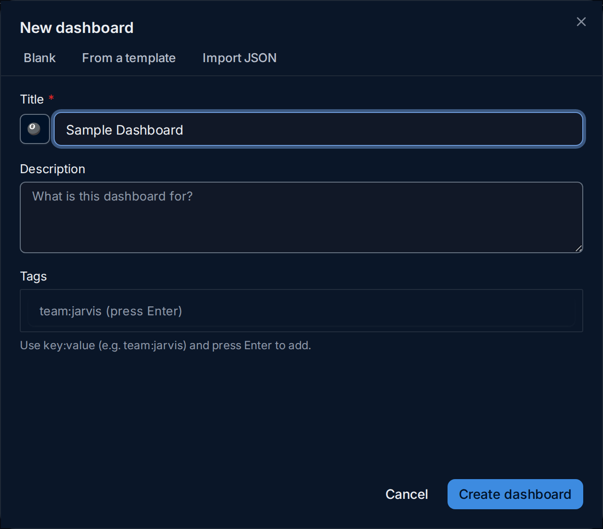
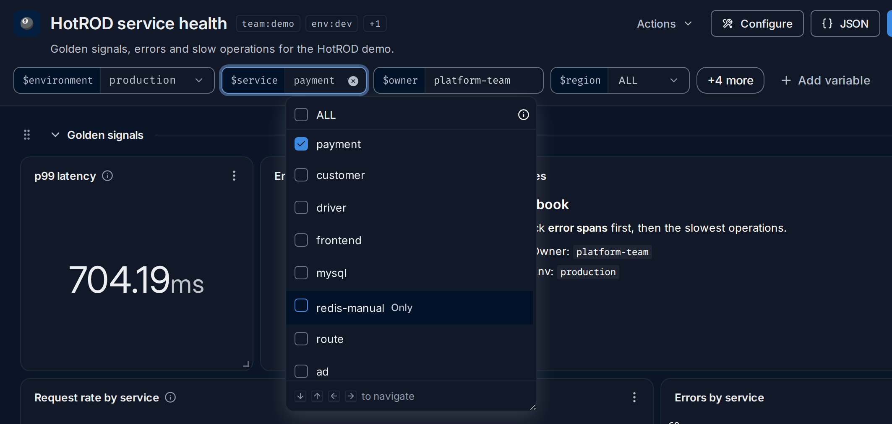
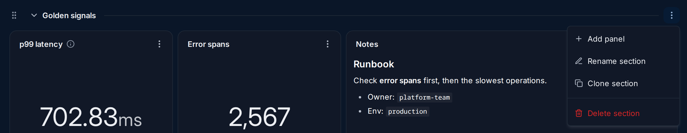
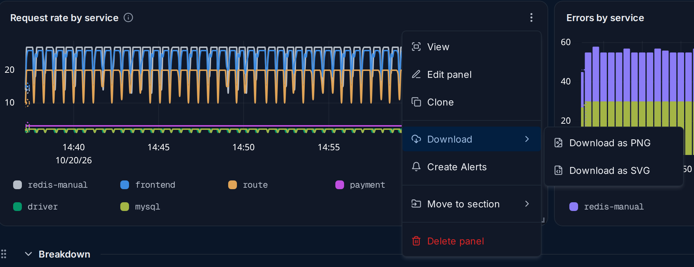
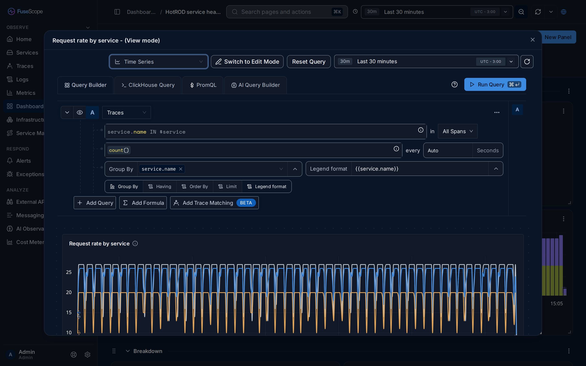
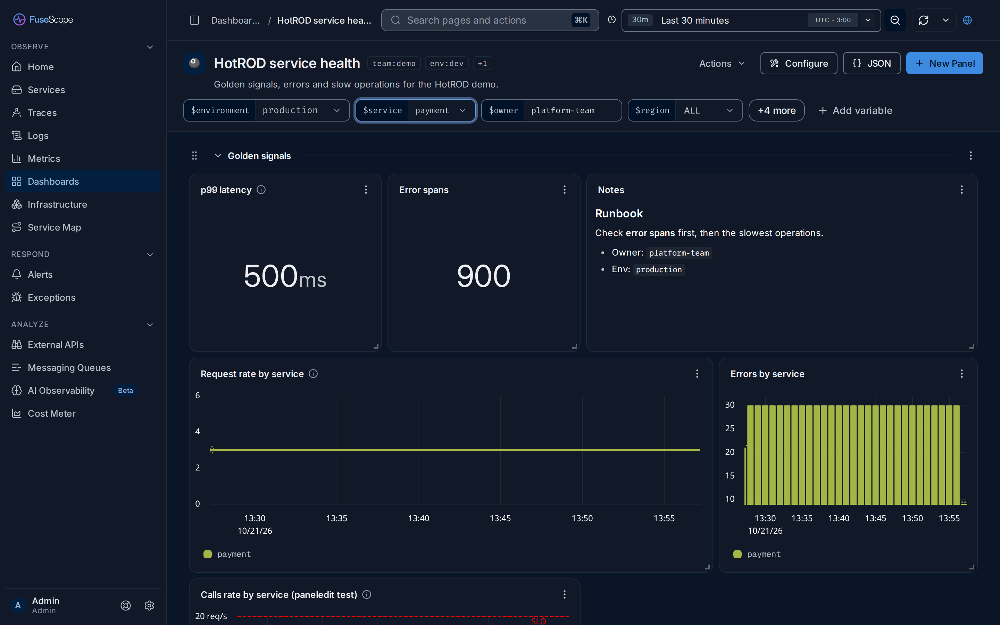
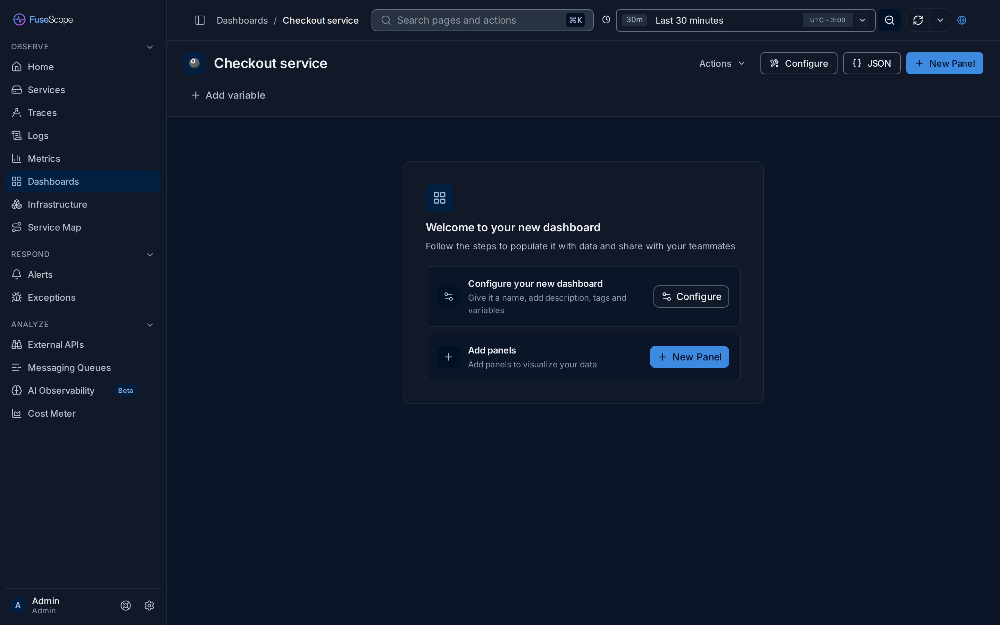
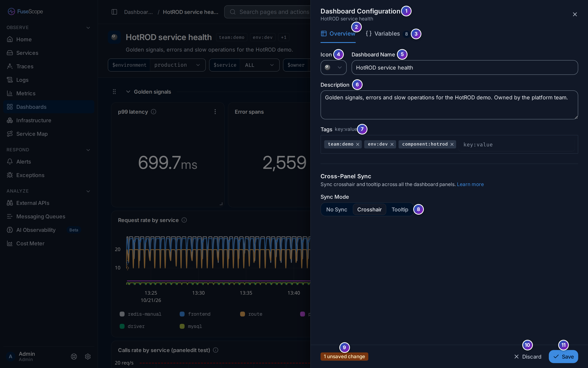
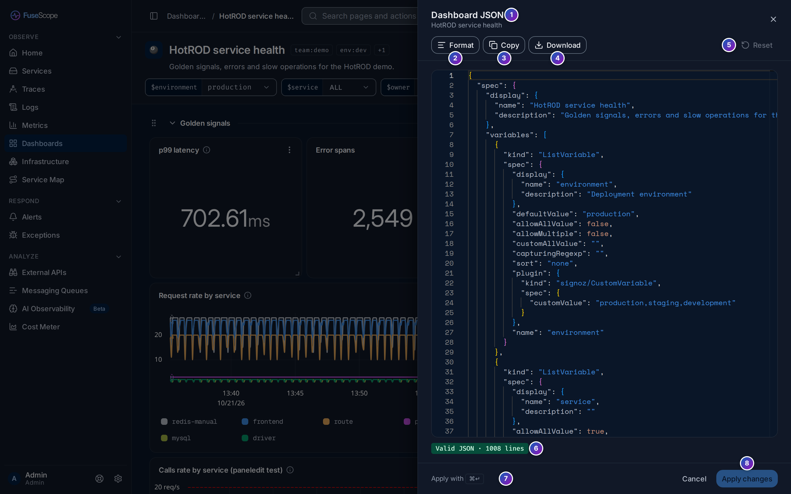

import { Aside, Steps } from "@astrojs/starlight/components";

A [dashboard](/fusescope-docs/reference/glossary/#dashboard) is a page of
[panels](/fusescope-docs/reference/glossary/#panel) you arrange yourself: charts, tables,
numbers and notes over traces, logs and metrics. Panels can be grouped into
[sections](/fusescope-docs/reference/glossary/#section), and
[variables](/fusescope-docs/reference/glossary/#dashboard-variable) at the top let one
dashboard show any service, environment or host.

**Use this page when** you want the same charts in front of you every day, want to
share them with your team, or have opened a dashboard someone else built and want to
know what each control does. To build one step by step, see
[Build your first dashboard](/fusescope-docs/guides/first-dashboard/).

## The dashboards list

Click **Dashboards** in the sidebar (`/dashboard`). The list shows every dashboard in
the workspace that you can see.


1. **Count line**: how many dashboards the workspace has, such as `2 dashboards`.
2. **New dashboard**. See [Create a dashboard](#create-a-dashboard).
3. **Views**: ready-made filters on the left. See [Views](#views).
4. **+** saves the current search and filters as a view of your own.
5. **The active view** and how many dashboards it shows.
6. **Filter box**: type a filter in a small query language. See
   [Find dashboards](#find-dashboards).
7. **Run query** applies the filter box. A dot on the button means the box has changes
   you have not run yet.
8. **Created by**: show only dashboards created by the people you tick.
9. **Updated**: **Any time**, **Today**, **Last 7 days** or **Last 30 days**.
10. **Sort**: by **Name**, **Last created** or **Last updated**, **Ascending** or
    **Descending**. The list starts with the most recently updated first.
11. **Columns**: show or hide the **Updated at** and **Updated by** columns. Name, tags
    and creator are always shown.
12. **Pin**: the pin icon keeps a dashboard in the **Pinned** view. Click it again to
    unpin.
13. **Tags** of each dashboard, as `key:value` chips. Up to three are shown; hover the
    `+N` chip for the rest.
14. **Row menu** (**⋮**). See [Row actions](#row-actions).
15. **Pager**: 20 dashboards per page. The line on the left reads, for example,
    `Showing 1–2 of 2 dashboards`.
16. **Collapse** folds the Views rail away; **Expand** brings it back. Next to it, the
    status bar counts the dashboards shown, such as `2 of 2 dashboards`.

Click a row to open the dashboard. Under each name is its description, when it has one.
A lock icon next to a name means the dashboard is [locked](#lock-a-dashboard).

### Find dashboards

The filter box takes conditions such as:

```text
name CONTAINS 'api' AND team IN ['payments', 'checkout']
```

It suggests keys, operators and values as you type. Press **⌘ + Enter**
(**Ctrl + Enter** on Windows and Linux) or click **Run query** to apply it. **Clear**
empties the box and shows every dashboard again.

| Key | What it matches | Operators |
|---|---|---|
| `name`, `description`, `created_by` | Text | `=`, `!=`, `CONTAINS`, `LIKE`, `ILIKE`, `IN`, each with a `NOT` form |
| `created_at`, `updated_at` | Dates | `=`, `!=`, `<`, `<=`, `>`, `>=`, `BETWEEN`, `NOT BETWEEN` |
| `locked` | `true` or `false` | `=`, `!=` |
| Any other key | A tag key, such as `team` or `env` | The text operators, plus `EXISTS` and `NOT EXISTS` |

Some examples:

| To find | Type |
|---|---|
| Dashboards with "checkout" in the name | `name CONTAINS 'checkout'` |
| Dashboards tagged `env:prod` or `env:staging` | `env IN ['prod', 'staging']` |
| Dashboards that have a `team` tag at all | `team EXISTS` |
| Dashboards created by one person | `created_by = 'ana@example.com'` |
| Locked dashboards | `locked = true` |

Join conditions with `AND`. Text values go between single quotes.

**Created by** and **Updated** write their condition into the filter box for you, so
you can see it and edit it. **Created by** applies when its list closes; **Updated**
applies as soon as you pick.

### Views

A view is a saved filter. The rail has three groups:

- **Personal**: **My dashboards** (the ones you created; it fills the filter box with
  your email), **Pinned** (the ones you pinned) and **Recently viewed** (the last
  dashboards you opened in this browser, most recent first).
- **System**: **All dashboards** and **Locked** (it fills the box with
  `locked = true`).
- **My views**: the views you saved. **Filter views by name** finds one.

To save a view, filter the list, then click **+** next to **Views** and give it a name.
When you change the filters of an active view, the rail offers **Save as new view**
(or **Save** and **Save as…** for your own views) and **Reset**. Hover one of your
views to rename or delete it; deleting a view never deletes dashboards.

### Row actions

The **⋮** menu at the end of a row has:

| Item | Does |
|---|---|
| **View** | Opens the dashboard |
| **Open in New Tab** | Opens it in a new browser tab |
| **Copy Link** | Copies the dashboard's address |
| **Rename** | Changes its title |
| **Edit Tags** | Adds or removes tags (**Add Tags** when it has none) |
| **Duplicate** | Creates a copy |
| **Lock Dashboard** / **Unlock Dashboard** | See [Lock a dashboard](#lock-a-dashboard) |
| **Delete Dashboard** | Deletes it, after you confirm |

Items you are not allowed to use are greyed out, with the reason in a tooltip.

### An empty list

In a workspace with no dashboards yet, the list shows **No dashboards yet.** with
**New dashboard** and a **Learn more** link to this page. When a filter or view matches
nothing, it says so instead, for example `No dashboards match your filters` or
`No pinned dashboards yet`.

## Create a dashboard

Click **New dashboard**. The dialog has three tabs.



- **Blank**: enter a **Title** (required; the button left of it picks an icon), an
  optional **Description** and **Tags**, then click **Create dashboard**. Tags are
  `key:value` pairs such as `team:payments`; press Enter after each one. The new,
  [empty dashboard](#a-new-empty-dashboard) opens.
- **From a template**: FuseScope ships no built-in templates. **Browse dashboard
  templates** opens [Dashboard JSON](/fusescope-docs/reference/dashboard-json/), which
  explains how to import a dashboard someone shared as a file.
- **Import JSON**: paste a dashboard JSON, or click **Upload JSON file**, then
  **Import and Next**. See
  [Import a dashboard](/fusescope-docs/reference/dashboard-json/#import-a-dashboard).

## Read a dashboard


1. **Title** and icon. If you may edit the dashboard, click the title to rename it in
   place; Enter saves and Esc cancels.
2. **Tags**. Two are shown; hover `+N` for the rest.
3. **Description**, when the dashboard has one.
4. **Actions**: **Rename**, **Clone dashboard**, **Lock dashboard** or
   **Unlock dashboard**, **Full screen** (the dashboard alone, without the app around
   it), **New section** and **Delete dashboard**.
5. **Configure** opens the [dashboard settings](#dashboard-settings).
6. **JSON** opens the dashboard as JSON. See
   [Export and edit as JSON](#export-and-edit-as-json).
7. **New Panel** opens the panel type picker. See
   [Add a panel](/fusescope-docs/dashboards/panel-editor/#add-a-panel).
8. **Time range** for every panel. See [Time range and refresh](#time-range-and-refresh).
9. **Zoom out**, **refresh** and, in the arrow next to it, **auto-refresh**.
10. **Share** copies a link to the dashboard. See [Share](#share).
11. **Variables**: one control per variable. See [The variables bar](#the-variables-bar).
12. **+4 more**: four more variables that don't fit on the line.
13. **Add variable**.
14. **Section header**: the grip to drag the section, the arrow to fold it, and its
    title. See [Sections](#sections).
15. **Section menu** (**⋮**).
16. **Panel menu** (**⋮**). See [Panel menu](#panel-menu).
17. **Resize corner** of a panel.

### Time range and refresh

The time range at the top applies to every panel, unless a panel has its own range;
such a panel shows that range in its header. Drag across a chart
to zoom into that stretch of time; **Zoom out** widens the range again.

The refresh button reruns every query now. The arrow next to it sets
**auto-refresh**, from every 5 seconds to once a day, or **off**.

### The variables bar

Each variable is a pill: its name on the left, such as `$service`, and its current
value on the right. A panel whose query uses `$service` shows only what the variable
selects. Hover a name for the variable's description and for the variables it
**Depends on** or is **Used by**.

What the control looks like depends on the
[variable type](/fusescope-docs/dashboards/variables/#variable-types):

| Type | The control | In the demo |
|---|---|---|
| **Custom** | A list of fixed values | `$environment`: production, staging or development |
| **Dynamic** | A list of the values an attribute really has in your data | `$service`: every `service.name` in the traces |
| **Query** | A list of the values a ClickHouse query returns | `$svc_query` |
| **Textbox** | A text field | `$owner`: `platform-team` |

- **Single or multiple values.** A variable that allows several values has a checkbox
  per value. Hover a value and click **Only** to select just that one. A multi-select
  applies when its list closes; a single value applies as soon as you pick it.
- **ALL** selects every value. For a dynamic variable it also includes values that
  appear later; see [The ALL option](/fusescope-docs/dashboards/variables/#the-all-option).
- **Textbox** applies when you press Enter or leave the field. Empty it to go back to
  the default value.
- **+N more** appears when the variables don't fit on one line; hover it to see what
  the hidden ones are set to. Click it to show every variable over several lines, and
  **Less** to fold them again.
- **A spinner** in a pill means its values are loading. **A red pill** with a warning
  icon means they couldn't be loaded; hover the icon for the reason and click
  **Retry**. See
  [Loading and errors](/fusescope-docs/dashboards/variables/#loading-and-errors).
- **Add variable** opens the dashboard settings on **Variables**, ready to add one. See
  [Dashboard variables](/fusescope-docs/dashboards/variables/).



Your selection is remembered in this browser, per dashboard, and is not saved in the
dashboard itself: each viewer picks their own values. To send someone your selection,
use [Share](#share) with **Include variables**.

### Sections

A section is a titled group of panels. Its header has:

- **The grip** (⠿): drag it up or down to reorder sections.
- **The arrow** and title: click to fold or unfold the section. Folded sections stay
  folded the next time you open the dashboard in this browser.
- **The section menu** (**⋮**), on the right.



| Item | Does |
|---|---|
| **Add panel** | Opens the panel picker, set to add to this section |
| **Rename section** | Changes its title |
| **Clone section** | Copies the section and its panels |
| **Delete section** | Deletes the section **and its panels**, after you confirm |

To add a section, click **Actions** › **New section** and give it a name; it is added
at the bottom. A dashboard doesn't need sections: without them, panels sit in one grid.

### Panels

Each panel is a card. Its header shows the title and, when present:

- **ⓘ** with the panel's description;
- a spinner while it refreshes;
- the panel's own time range, if it doesn't follow the dashboard's;
- a **search** icon on Table and List panels, to filter the rows shown;
- a red or amber icon when the query failed or returned a warning; hover it for the
  reason;
- the **panel menu** (**⋮**).

To rearrange panels, drag a panel by its header, and drag its bottom-right corner to
resize it. The grid is 12 columns wide, and the layout is saved when you let go. You
can't move or resize panels on a [locked](#lock-a-dashboard) dashboard.

Click a point on a chart for more: **View in Logs** and **View in Traces** open the
matching data, and **Breakout by ..** splits the series by another attribute.

### Panel menu



| Item | Does |
|---|---|
| **View** | Opens the panel full size. See [View a panel full size](#view-a-panel-full-size) |
| **Edit panel** | Opens the [panel editor](/fusescope-docs/dashboards/panel-editor/) |
| **Clone** | Copies the panel |
| **Download** | **Download as PNG** or **Download as SVG**; Table panels also **Download as CSV** |
| **Create Alerts** | Starts an [alert rule](/fusescope-docs/alerts/alert-rules/) from the panel's query, on panel types that support alerts |
| **Move to section** | Moves the panel to another section, or to the top level, **Dashboard (root)** |
| **Delete panel** | Removes the panel |

Which items appear depends on the panel type: a Text panel, for example, has no
**Download** or **Create Alerts**. Items you can't use, for example on a locked
dashboard, are greyed out with the reason in a tooltip.

### View a panel full size

**View** opens the panel in a large window titled, for example,
`Request rate by service - (View mode)`. The address of the page changes too, so you
can send the link to someone.



Here you can try things without changing the dashboard: switch the panel type, change
the query and click **Run Query**, or pick a different time range just for this window.
**Reset Query** goes back to the saved query. To keep your changes, click
**Switch to Edit Mode**, which opens the
[panel editor](/fusescope-docs/dashboards/panel-editor/) with them. Close the window, or
press Esc, to go back.

## Example: filter a dashboard by service

The goal: see only the `payment` service on the demo dashboard **HotROD service
health**. It has a `$service` variable of the **Dynamic** type, which lists every
`service.name` in the traces, and the query of every panel except **Notes** filters
with `service.name IN $service`.

<Steps>

1. Open **Dashboards** and click **HotROD service health**. `$service` reads **ALL**:
   the panels cover every service, and **Errors by service** shows two services with
   errors, `redis-manual` and `payment`.

2. Click the `$service` control. The list has `customer`, `driver`, `frontend`, `mysql`,
   `payment`, `redis-manual` and `route`, all ticked because ALL is selected.

3. Hover `payment` and click **Only**. Now only `payment` is ticked.

4. Close the list: click outside it or press Esc. The panels reload.

</Steps>



**What you get**, in the demo data over the last 30 minutes: **p99 latency** reads
`500 ms`, **Error spans** about `900`, and both charts show a single series,
`payment`. In the **Breakdown** section, **Top operations by p99** lists only the
payment operations. The **Notes** panel doesn't change: it has no query.

Try `frontend` instead: **Error spans** drops to `0` and **Errors by service** shows
*No data in this time range*, because the frontend service records no errors in the
demo.

To go back, open the list and tick **ALL**.

## Add panels

Click **New Panel** in the toolbar, or **Add panel** in a section's menu. The
**New panel** picker opens on the right: pick a panel type, choose where it goes and
click **Add to …**. The [panel editor](/fusescope-docs/dashboards/panel-editor/) opens,
where you write the query, set the title and options, and click **Save changes**.

[Add a panel](/fusescope-docs/dashboards/panel-editor/#add-a-panel) describes the
picker, including what the data chips on each type mean. Explorers can also send their
query to a dashboard with **Add to dashboard**.

### A new, empty dashboard

A dashboard with no panels shows **Welcome to your new dashboard** and two steps:
**Configure** (name, description, tags and variables) and **New Panel**.



## Panel types

| Type | Category in the picker | Use it for | Accepts |
|---|---|---|---|
| **Time Series** | Trends over time | Values over time, as lines | Metrics, logs & traces; PromQL; ClickHouse |
| **Area Chart** | Trends over time | Values over time, as areas, overlapping or stacked | Metrics, logs & traces; PromQL; ClickHouse |
| **Bar Chart** | Compare & rank | Values over time, as bars, side by side or stacked | Metrics, logs & traces; PromQL; ClickHouse |
| **Pie Chart** | Compare & rank | Shares of a total | Metrics, logs & traces; ClickHouse; no PromQL |
| **Histogram** | Distributions | The distribution of values in buckets | Metrics, logs & traces; PromQL; ClickHouse |
| **Heatmap** | Distributions | A distribution over time | Metrics only; PromQL; ClickHouse |
| **Number** | Single values | A single value | Metrics, logs & traces; PromQL; ClickHouse |
| **Table** | Raw records | Aggregated values, one row per group | Metrics, logs & traces; ClickHouse; no PromQL |
| **List** | Raw records | Raw logs or spans | Logs & traces |
| **Text** | Documentation | Notes and documentation, in Markdown | No query |

List panels take query builder queries on logs or traces; pick their columns with
**Add column**. The options each type has are listed in
[Panel settings](/fusescope-docs/dashboards/panel-editor/#panel-settings).

## Lock a dashboard

A locked dashboard can't be changed or deleted until it is unlocked. Use
**Actions** › **Lock dashboard**, or **Lock Dashboard** in the list's row menu. Only
the dashboard's creator or an
[Admin](/fusescope-docs/administration/users-and-roles/#roles) can lock or unlock it.

On a locked dashboard:

- a lock icon sits next to the title, and a **LOCKED** badge in the bottom-right
  corner of the page. Whoever may unlock it can click the lock icon to unlock;
- **Configure**, **New Panel**, **Rename**, **New section**, **Delete dashboard** and
  the editing items of the section and panel menus are greyed out, with the tooltip
  *This dashboard is locked*;
- panels can't be moved or resized;
- you can still change the time range and variables, view and download panels,
  **Clone dashboard** and use **Full screen**.

## Dashboard settings

**Configure** opens **Dashboard Configuration**, a panel on the right side of the
page. Its subtitle is the dashboard's name. It has two tabs: **Overview** and
**Variables**.



1. **Dashboard Configuration** and the dashboard's name. **✕** on the right, a click
   outside the panel or Esc closes it.
2. **Overview**: what the dashboard is called and how it looks.
3. **Variables**, with how many the dashboard has. See
   [Dashboard variables](/fusescope-docs/dashboards/variables/#manage-variables).
4. **Icon**: the picture shown next to the title and in the dashboards list.
5. **Dashboard Name**: the title at the top of the page.
6. **Description**: shown under the title. Use it to say what the dashboard is for.
7. **Tags**: `key:value` labels, such as `team:payments`, that help you
   [find dashboards](#find-dashboards). Type one and press Enter; click **×** on a
   tag to remove it.
8. **Cross-Panel Sync** › **Sync Mode**: what other charts do when you hover one.
   - **No Sync**: nothing.
   - **Crosshair**: every chart shows a vertical line at the same moment.
   - **Tooltip**: every chart also shows its tooltip for that moment. A second
     setting, **Synced Tooltip Series**, picks **All** series, with the matching ones
     highlighted, or only the **Filtered** ones that share a group-by value.

   Sync applies at once and is remembered in this browser, per dashboard. It is not
   part of the dashboard, so it needs no saving.
9. **Unsaved changes**: as soon as you change the icon, name, description or tags, a
   bar appears at the bottom with how many fields changed, such as
   `1 unsaved change`.
10. **Discard** puts the fields back as they were.
11. **Save** saves the changes to the dashboard.

Variables you add, edit or delete on the **Variables** tab are saved straight away;
they don't go through this bar.

## Share

**Share** (the globe icon at the top right) opens a dialog with **Copy page link**.
Before copying:

- **Enable absolute time** turns a relative range such as *Last 30 minutes* into fixed
  start and end times, so the link shows the same data later.
- **Include variables** adds your current variable selection to the link. Whoever opens
  it sees the dashboard with those values.

Anyone who opens the link needs a FuseScope account with access to the dashboard.

<Aside>
  Public dashboards, a read-only link that works without an account, are not available
  in FuseScope yet.
</Aside>

## Export and edit as JSON

**JSON**, in the toolbar, opens **Dashboard JSON** on the right: the whole dashboard
as text, which you can copy, download or edit. It is a panel of its own, separate
from [Dashboard settings](#dashboard-settings).



1. **Dashboard JSON** and the dashboard's name.
2. **Format** tidies the indentation, for example after you paste JSON in.
3. **Copy** puts the JSON on the clipboard.
4. **Download** saves it as a `.json` file, to keep it or
   [import it](/fusescope-docs/reference/dashboard-json/#import-a-dashboard)
   elsewhere.
5. **Reset** throws your edits away and shows the saved dashboard again. It is greyed
   out while there is nothing to reset.
6. **Validity**: *Valid JSON* and the number of lines, in green, or in red the line
   and the reason it can't be read, as `Line 12 · …`. A warning
   also appears when a panel is not placed in any layout, or a layout points to a
   panel that doesn't exist.
7. **⌘ + Enter** (**Ctrl + Enter** on Windows and Linux) applies, like the button.
8. **Apply changes** saves your edits to the dashboard and closes the sheet. It is
   greyed out until you change something, and while the JSON is invalid. **Cancel**,
   or Esc, closes the sheet without applying.

The JSON holds the dashboard's `spec` (panels, layouts and variables), its `tags` and
its `image`. Its ID, owner and timestamps are left out and can't be changed here. On a
locked dashboard, or without permission to edit, you can read, copy and download the
JSON but not change it: **Format**, **Reset** and **Apply changes** are greyed out.
The format is described in
[Dashboard JSON](/fusescope-docs/reference/dashboard-json/).

## Related

- [Build your first dashboard](/fusescope-docs/guides/first-dashboard/): a step-by-step
  guide.
- [Panel editor](/fusescope-docs/dashboards/panel-editor/): build and change panels.
- [Dashboard variables](/fusescope-docs/dashboards/variables/): create the variables
  the bar shows.
- [Query builder](/fusescope-docs/querying/query-builder/): aggregations, group by and
  formulas for panel queries.
