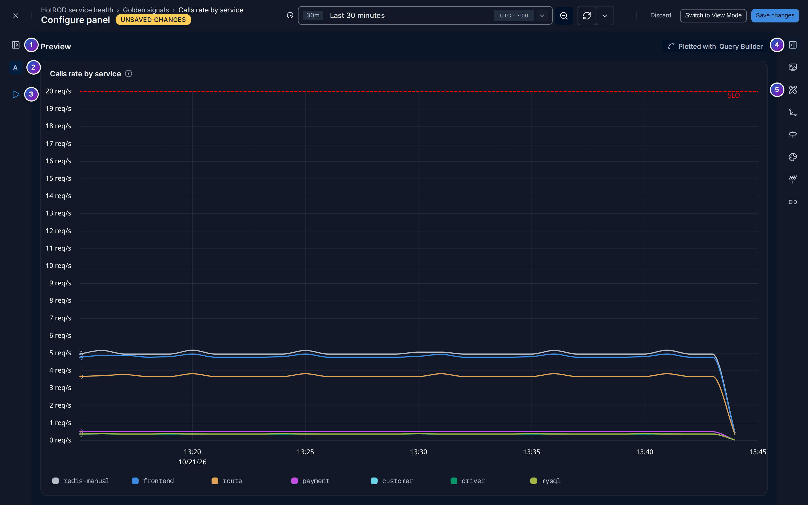
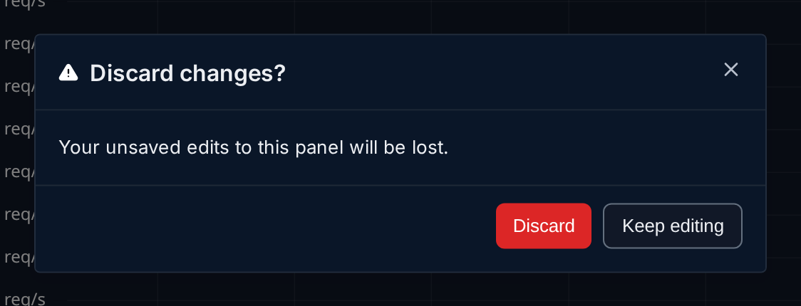
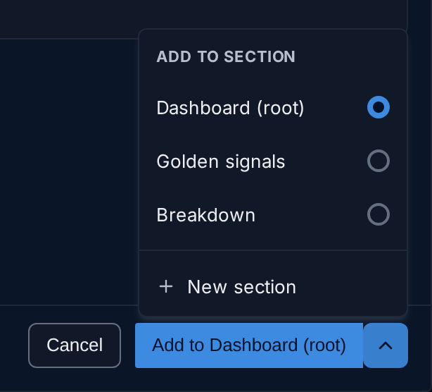
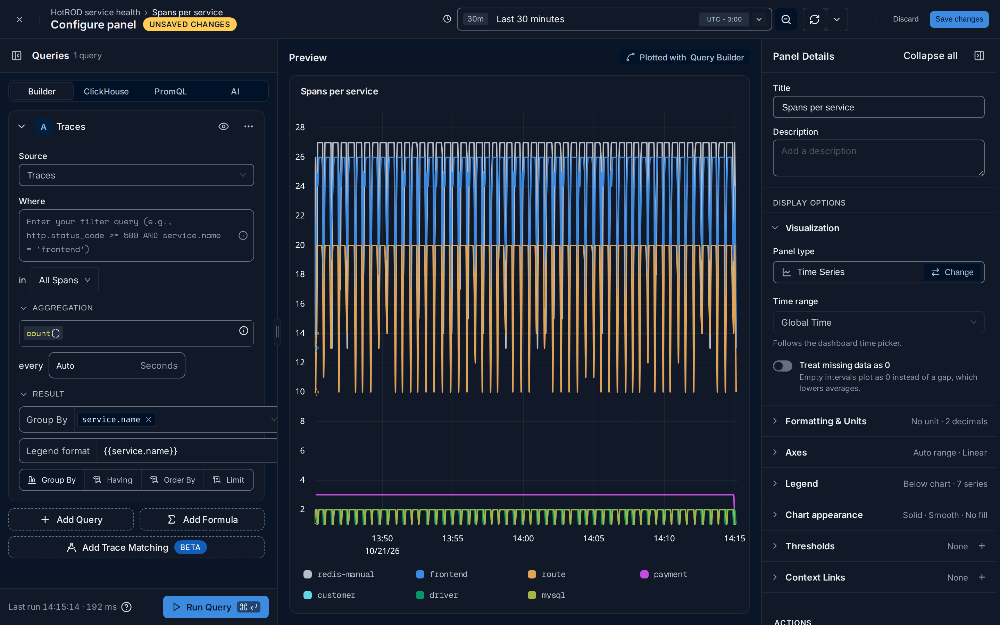

import { Aside, Steps } from "@astrojs/starlight/components";

The panel editor is the full-screen page where you build one
[panel](/reference/glossary/#panel): you write its query, check the
chart it draws, and set its title, units, colours and other options.

**Use this page when** you are adding a panel to a dashboard, or changing one that
already exists, and want to know what each part of the editor does.

## Open the editor

- **A new panel**: click **New Panel** on the dashboard, pick a panel type and click
  **Add to …**. See [Add a panel](#add-a-panel).
- **An existing panel**: open the panel menu (**⋮**) and click **Edit panel**.
- **From View mode**: click **Switch to Edit Mode**. Any changes you made there come
  with you.

The editor has its own address, so you can bookmark it or send it to someone.

## The editor at a glance

The page has a header across the top and three columns below it: your
**queries** on the left, a live **preview** of the panel in the middle, and the
panel **settings** on the right.

**Header**

1. **Close** (**✕**) takes you back to the dashboard. If you have unsaved changes,
   FuseScope asks first; see [Save or discard](#save-or-discard).
2. **Breadcrumb**: where the panel lives, as *dashboard › section › panel*.
3. **Unsaved Changes**: appears as soon as you change anything, and goes away when you
   save or discard.
4. **Time range**, refresh and auto-refresh for the preview. Changing it here doesn't
   change the dashboard's time range.
5. **Discard** throws your changes away. It is greyed out while there is nothing to
   discard.
6. **Switch to View Mode** opens the panel full size on the dashboard, with your
   changes, but without saving them. It is only shown for panels that already exist.
7. **Save changes** saves the panel to the dashboard and takes you back to it.

**Queries panel** (left)

8. **Queries** and how many the panel has. The icon on its left folds the panel; see
   [Make more room](#make-more-room).
9. **Query type**: **Builder**, **ClickHouse**, **PromQL** or **AI**. See
   [Query types](#query-types).
10. **A query card**. Its header shows the query's letter and what it reads, such as
    the metric name. See [Query cards](#query-cards).
11. **Run Query** redraws the preview with your query. See [Run the query](#run-the-query).
12. **Resize handle**: drag it to make the Queries panel wider or narrower.

**Preview** (middle)

13. **Preview**: the panel exactly as it will look on the dashboard. The label on the
    right, such as *Plotted with Query Builder*, says which query type drew it.

**Settings pane** (right)

14. **Title** and **Description** of the panel. The description is shown when you
    hover the ⓘ next to the title on the dashboard.
15. **Collapse all** closes every settings section at once.
16. **Fold** the settings pane into a narrow rail.
17. **Panel type**, with **Change** to switch to another one. See
    [Change the panel type](#change-the-panel-type).
18. **A settings section**. Click its name to open or close it. Closed sections show a
    short summary on the right, such as `reqps · 2 decimals`, so you can see the
    setting without opening it. See [Panel settings](#panel-settings).

## Query types

The tabs at the top of the Queries panel choose how you write the query:

| Tab | Use it to |
|---|---|
| **Builder** | Pick a source (metrics, logs or traces), a filter, an aggregation and a group by from lists. The best place to start. See [Query builder](/querying/query-builder/). |
| **ClickHouse** | Write SQL against the ClickHouse tables yourself. See [ClickHouse SQL and PromQL](/querying/clickhouse-promql/). |
| **PromQL** | Write a Prometheus query over metrics. |
| **AI** | The query builder set up for AI and LLM spans, the data behind [AI Observability](/analyze/ai-observability/). It reads traces. |

Each tab keeps its own query. **The tab that is selected when you save is the one the
panel uses.** Switching tabs counts as a change, so **Unsaved Changes** appears.

Not every panel type takes every query type: a [List](/dashboards/dashboards/#panel-types)
panel, for example, only takes the builder on logs or traces. The
[type picker](#add-a-panel) shows what each type accepts.

## Query cards

On the **Builder** tab each query is a card, named with a letter: **A**, **B**, **C**…
Only one card is open at a time, so the list stays short: click a closed card's header
to open it, and the open one closes.

The card header has:

- **the arrow**, to open or close the card;
- **the eye**, to hide the query: a hidden query still exists but is not drawn. Use it
  for a query that only feeds a formula;
- **⋯**, with **Clone** (copy the query) and **Delete**. A panel's only query can't be
  deleted.

Inside the card, **Source**, **Where** (the filter) and **Aggregation** come first.
**Functions** and **Result** are folded, with a summary next to them, such as `None`
or `legend`. Open **Result** for **Group By**, **Having**, **Order By**, **Limit** and
**Legend format**.

Below the cards, **Add Query** adds another query and **Add Formula** adds a formula
that combines them, such as `B / A * 100`. On traces, **Add Trace Matching** finds
traces whose spans match several queries. See
[Several queries and formulas](/querying/query-builder/#several-queries-and-formulas).

## Run the query

The preview does not redraw on every keystroke. When your query is ready:

- click **Run Query** at the bottom of the Queries panel, or
- press **⌘ + Enter** (**Ctrl + Enter** on Windows and Linux).

The line next to the button says when the query last ran and how long it took, such as
`Last run 13:33:45 · 84 ms`, or *Not run yet*. While a query runs, the button lets you
cancel it.

<Aside type="tip">
  **Save changes** saves the query as it is written, even if you haven't run it. Run it
  first to check the chart.
</Aside>

## Panel settings

The settings pane starts with **Title** and **Description**, then the display
options in sections. Which sections you see depends on the panel type.

| Section | What it sets |
|---|---|
| **Visualization** | **Panel type**; **Time range**: *Global Time* follows the dashboard, or pin the panel to its own range; **Treat missing data as 0** (Time Series, Area Chart) |
| **Formatting & Units** | **Unit** and **Decimal places**; **Column units** for tables |
| **Axes** | **Y axis** soft min and max, and the **Scale**: Auto, Linear, Logarithmic or Symlog |
| **Legend** | **Position**, below or right of the chart; **Series colors** |
| **Chart appearance** | Line style, how points connect, area fill, **Show points**, and whether to connect or break the line on missing data |
| **Buckets** | **Count**, **Width** and **Combine queries** (Histogram) |
| **Thresholds** | A dashed line on charts, a colour for Number panels, or per-column colours for tables. The **+** on the section adds one |
| **Context Links** | Links on the panel, with a **Label** and a URL that can include [variables](/dashboards/variables/) as `{{variable}}` |

**Visualization** starts open. **Thresholds** and **Context Links** start open when
the panel already has some; the others start closed. At the bottom, **Actions** has
**Create alert**, which starts an [alert rule](/alerts/alert-rules/)
from the panel's query. It isn't offered for queries on the **AI** tab.

### Change the panel type

Click **Change** next to **Panel type**. The **Change panel type** picker opens: the
same tiles as the [type picker](#add-a-panel), with the current type highlighted.
Click a type to switch to it; the preview redraws straight away.

A type that can't show your current query is greyed out; hover it for the reason, for
example *List doesn't support metrics data*. Change the query first, then the type.

## Make more room

Both side panels fold away, so the preview can use the whole width.

- **The Queries panel**: click the icon left of **Queries**. It becomes a rail with:
  1. the button that unfolds it again;
  2. one letter per query and formula. Click a letter to unfold the panel with that
     query open;
  3. **Run query** (▷), so you can still run the query with the panel folded.
- **The settings pane**: click the icon right of **Collapse all**. It becomes a rail
  with:
  4. the button that unfolds it again;
  5. one icon per settings section. Hover an icon for its name, and click it to unfold
     the pane with only that section open.

FuseScope remembers the width of the Queries panel and which side panels are folded,
in this browser, the next time you open the editor.

## Save or discard

Any change, whether to a query, a setting, the title or the query tab, shows the
**Unsaved Changes** badge in the header. Nothing reaches the dashboard until you save.

- **Save changes** saves the panel and takes you back to the dashboard, where the
  panel is scrolled into view. *Panel saved* confirms it.
- **Discard** asks *Discard changes?* first. Click **Discard** to throw your edits away
  and go back to the dashboard, or **Keep editing** to stay.
- **Close** (**✕**) does the same as **Discard** when there are unsaved changes, and
  simply closes the editor when there are none.
- Leaving the page another way, such as closing the browser tab, also warns you when
  there are unsaved changes.

On a [locked](/dashboards/dashboards/#lock-a-dashboard) dashboard, or
if your [role](/administration/users-and-roles/#roles) can't edit it,
**Save changes** is greyed out; hover it for the reason.

## Add a panel

Click **New Panel** at the top of the dashboard, or **Add panel** in a section's menu
(**⋮**). The **New panel** picker opens on the right.

1. **Search panel types** narrows the tiles as you type.
2. **Categories**: **All**, **Trends over time**, **Compare & rank**,
   **Distributions**, **Single values**, **Raw records** and **Documentation**. Each
   shows how many types it has. Click one to see only those types.
3. **Category headings** group the tiles.
4. **A tile**: the type's name and what it is for. Click it to select it.
5. **Data chips**: what the type can show. See [What the chips mean](#what-the-chips-mean).
6. **New** marks types that were added recently.
7. **Add to …** creates the panel and opens the [panel editor](#the-editor-at-a-glance).
   The button names where the panel goes.
8. **The arrow** next to it chooses another place.

### What the chips mean

The chips on each tile tell you, before you pick, what data the type can draw and
which query types it accepts:

| Chip | Meaning |
|---|---|
| **Metrics, logs & traces** | The query builder can read any of the three |
| **Logs & traces** | The query builder can read logs or traces, not metrics |
| **Metrics only** | The query builder can only read metrics |
| **PromQL** | You can write the query in PromQL |
| **ClickHouse** | You can write the query in ClickHouse SQL |
| **No PromQL** | The type takes metrics, but only through the query builder, not PromQL |
| **No query** | The type shows no data, such as a Text panel |

For example, **Pie Chart** shows *Metrics, logs & traces*, *ClickHouse* and
*No PromQL*: build a metrics pie chart with the query builder, not with PromQL.
**Heatmap** shows *Metrics only*, *PromQL* and *ClickHouse*.

### Choose where the panel goes

On a dashboard with [sections](/dashboards/dashboards/#sections), the
arrow next to the main button opens **Add to section**:

- **Dashboard (root)**: the top level, outside any section;
- a section's name, such as **Golden signals**;
- **New section**: type a name for a new section, created together with the panel.

The main button follows your choice: **Add to Dashboard (root)**,
**Add to Golden signals**, **Add to new section**. On a dashboard without sections it
just reads **Add panel**. If you opened the picker from a section's menu, that section
is already chosen.

The new panel is not added to the dashboard until you click **Save changes** in the
editor. If you discard, nothing is created.

### Example: a first panel

<Steps>

1. Click **New Panel**, pick **Time Series** and click **Add to Dashboard (root)**.
2. In the query card, set **Source** to **Traces**. The aggregation is `count()`, the
   number of spans.
3. Open **Result**, click **Group By** and pick `service.name`, to draw one line per
   service. In **Legend format**, enter `{{service.name}}`.
4. On the right, set **Title** to `Spans per service`.
5. Click **Run Query**. The preview shows one line per service.
6. Click **Save changes**.

</Steps>

## Related

- [Dashboards](/dashboards/dashboards/): the dashboard page, sections
  and the panel menu.
- [Query builder](/querying/query-builder/): aggregations, group by and
  formulas.
- [Dashboard variables](/dashboards/variables/): use `$name` in a
  panel's query and title.
- [Build your first dashboard](/guides/first-dashboard/): a step-by-step
  guide.
