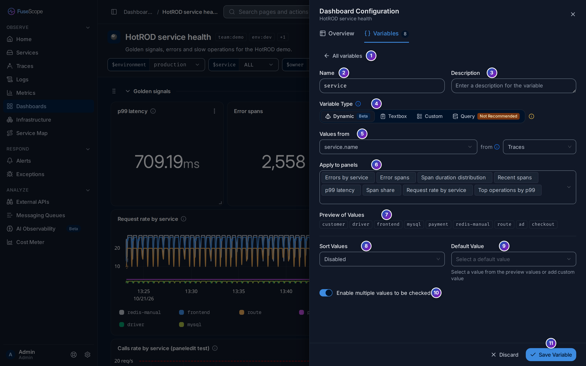
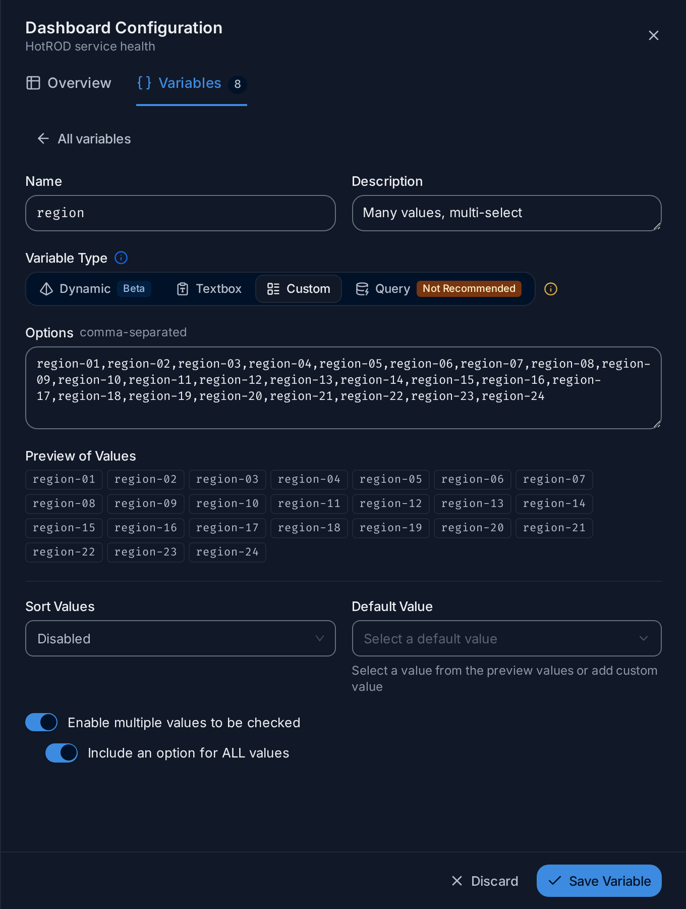
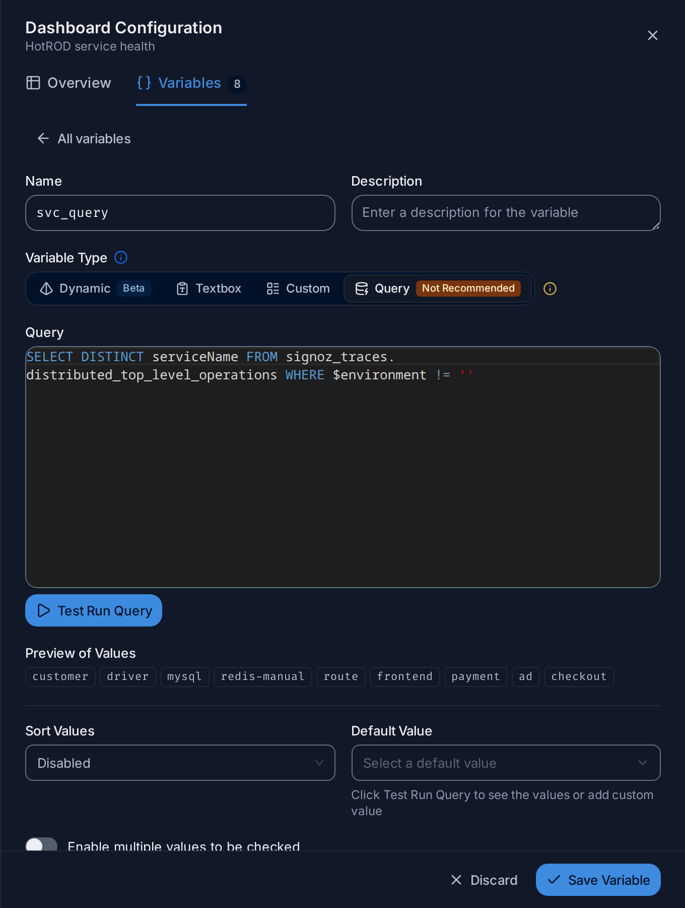
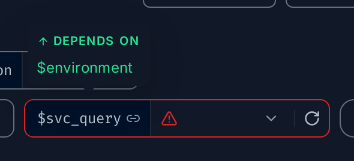
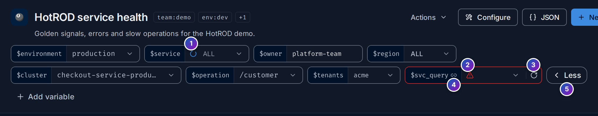

import { Aside, Steps, Tabs, TabItem } from "@astrojs/starlight/components";

A [variable](/fusescope-docs/reference/glossary/#dashboard-variable) is a value you
pick at the top of a dashboard, such as a service name or an environment. Panels use
it in their queries as `$name`. Change the value, and every panel that uses it shows
the data for the new value.

Without variables you would need one dashboard per service. With a `$service`
variable, one dashboard shows any service: pick `checkout`, and every panel shows
checkout; pick `payment`, and they show payment.

**Use this page when** you want to add a variable to a dashboard, change one, or
understand what the variables bar shows. How viewers use the bar is described in
[The variables bar](/fusescope-docs/dashboards/dashboards/#the-variables-bar).

## Variable types

There are four types. They differ in where the list of values comes from.

| Type | The values come from | Use it when |
|---|---|---|
| **Dynamic** | An attribute in your telemetry, such as every `service.name` seen in traces | You want a list that stays up to date by itself. The best choice in most cases |
| **Textbox** | Whatever the viewer types | The value is free text, such as a team name or an ID |
| **Custom** | A fixed list you type, separated by commas | The list is short and doesn't change, such as `production,staging,development` |
| **Query** | A ClickHouse SQL query you write | No attribute gives the list you need. Marked **Not Recommended**: it is slower and harder to maintain than **Dynamic** |

**Dynamic** carries a **Beta** badge: it works, but may still change.

## Manage variables

Click **Configure** on the dashboard and open the **Variables** tab, or click
**Add variable** in the variables bar. The tab lists every variable in the order the
bar shows them.


1. **Drag handle**: drag a row up or down to change the order of the variables in the
   bar.
2. **Name and badges**: the variable's name, its type (**Dynamic**, **Textbox**,
   **Custom** or **Query**) and, when set, **Multi** (several values can be picked)
   and **ALL** (an "all values" option). See [Multiple values and ALL](#multiple-values-and-all).
3. **Summary**: where the values come from, such as `service.name from Traces`,
   `Custom list · 24 values` or the query, and the description, if any.
4. **Sample values**: the first few values the variable offers; `+N` counts the rest.
5. **Apply to all** (Dynamic only) adds the variable as a filter to every panel. See
   [Add a variable to panels](#add-a-variable-to-panels).
6. **Edit** (pencil) opens the variable's form.
7. **Delete** (bin) asks *Delete?*: click ✓ to confirm or ✕ to cancel. If a panel
   still uses the variable, a dialog lists where, so you can fix those first.
8. **depends on**: this variable's values are calculated from another variable. See
   [Dependencies](#dependencies).
9. **Add variable** opens an empty form.

Adding, editing, reordering and deleting variables are saved to the dashboard straight
away; there is no separate save step.

## Create or edit a variable

Click **Add variable**, or **Edit** on a row. The form replaces the list;
**All variables** at the top takes you back.



1. **All variables** goes back to the list without saving.
2. **Name**: what you type after `$` in queries. No spaces, and unique in the
   dashboard. `service` becomes `$service`.
3. **Description** (optional): shown when someone hovers the variable's name in the
   bar.
4. **Variable Type**: **Dynamic**, **Textbox**, **Custom** or **Query**. The fields
   below change with the type; see [The fields of each type](#the-fields-of-each-type).
5. **Values from** (Dynamic): the attribute, such as `service.name`, and next to
   **from**, the signal to read it from.
6. **Apply to panels** (Dynamic): the panels that should filter on this variable.
7. **Preview of Values**: the values the variable will offer, so you can check them
   before saving.
8. **Sort Values**: keep the order as it comes (**Disabled**), or sort alphabetically
   or numerically, ascending or descending.
9. **Default Value**: the value selected when someone opens the dashboard for the
   first time. Pick one of the preview values or type your own.
10. **Enable multiple values to be checked**: let viewers pick several values at once.
11. **Save Variable** saves it. **Discard**, next to it, leaves without saving.

If something is wrong, the form says so before saving: *Variable name is required*,
*Variable name cannot contain whitespaces*, *Variable name already exists*, or, for two
Query variables that use each other, *Cannot save: circular dependency detected…*.

## The fields of each type

### Dynamic variables

- **Values from**: start typing an attribute name, such as `service.name`,
  `k8s.namespace.name` or `http.route`, and pick it.
- **from**: **All telemetry**, **Traces**, **Logs** or **Metrics**. Reading from one
  signal is faster than **All telemetry** on large data.
- **Apply to panels**: pick panels here and FuseScope adds `<attribute> IN $<name>`
  to their filters when you save, after you
  [review the change](#add-a-variable-to-panels).

The values are the ones seen in the dashboard's time range. A Dynamic variable is
also narrowed by the other Dynamic variables: when `$namespace` is `checkout`,
`$pod` only lists the pods in `checkout`.

### Textbox variables

- **Default Value**: the text the box starts with. Leave it empty for none.

The viewer types a value in the bar and presses Enter, or clicks away, to apply it.
Emptying the box goes back to the default.

### Custom variables

- **Options**: the values, separated by commas, such as
  `production,staging,development`.



### Query variables

- **Query**: a ClickHouse SQL query whose first column becomes the list of values.
  Select one column, with `DISTINCT`.
- **Test Run Query** runs it and fills **Preview of Values**. If it fails, the form
  shows the reason.



```sql
SELECT DISTINCT resource_string_service$$name
FROM signoz_traces.distributed_signoz_index_v3
WHERE ts_bucket_start >= $start_timestamp - 1800 AND ts_bucket_start <= $end_timestamp
```

The query runs with the dashboard's time range. Besides other variables, it can use
`$start_timestamp` and `$end_timestamp`, and their `_ms` and `_nano` forms.
Statements that drop, alter or truncate are rejected. See
[ClickHouse SQL and PromQL](/fusescope-docs/querying/clickhouse-promql/#tables) for
the tables.

## Dependencies

A **Query** variable can use another variable in its query, written `$environment`,
`{{environment}}`, `{{.environment}}` or `[[environment]]`. It then **depends on**
that variable:

- its list is recalculated whenever the other variable changes;
- the list shows *depends on $environment* on its row;
- in the bar, a link icon sits next to its name, and hovering the name shows
  **Depends on** and the variables it depends on. The other variable shows
  **Used by**.



While the variable it depends on is loading, the dependent one waits, with a spinner.
Two variables can't depend on each other; the form refuses to save a loop.

## Multiple values and ALL

**Enable multiple values to be checked** lets viewers tick several values, for
example two services at once. In the bar the list then has a checkbox per value, and
hovering a value shows **Only**, to select just that one.

### The ALL option

With multiple values turned on, **Custom** and **Query** variables get a second switch:
**Include an option for ALL values**. It adds **ALL** at the top of the list, to tick
every value at once. A **Dynamic** variable with multiple values always offers
**ALL**.

What **ALL** sends to the panels:

- **Dynamic**: the condition is dropped, so `service.name IN $service` matches every
  service, including ones that appear later and aren't listed yet. In PromQL the
  label matcher is removed.
- **Custom** and **Query**: the full list of values.

The list row shows **Multi** for multiple values, and **Multi · ALL** when ALL is
offered too.

## Use variables in queries and titles

Write the variable's name with a `$` in front.

<Tabs>
<TabItem label="Query builder">

Use it in the **Where** filter:

```text
service.name IN $service AND deployment.environment = $env
```

Use `IN` with variables that allow multiple values, and `=` with single values.

</TabItem>
<TabItem label="ClickHouse SQL">

Write `$service`, `{{service}}`, `[[service]]` or `{{.service}}`. Values are inserted as
SQL literals, so don't add quotes:

```sql
WHERE resource_string_service$$name IN $service
```

A single string value comes quoted (`'checkout'`) and a multiple value as an array
(`['checkout', 'cart']`).

</TabItem>
<TabItem label="PromQL">

Values are inserted as they are; multiple values are joined with `|`. Use a regex
matcher:

```text
sum(rate({"http.server.duration.count", "service.name"=~"$service"}[5m]))
```

</TabItem>
</Tabs>

Variables also work outside queries:

- **Panel titles**: a title such as `Latency of $service` reads
  *Latency of checkout* on the dashboard. Several values are joined with commas.
- **Text panels**: write `$owner` in the Markdown and the panel shows the value.
- **Context links**: write `{{service}}` in the link's URL. See
  [Panel settings](/fusescope-docs/dashboards/panel-editor/#panel-settings).

A variable that doesn't exist is left as it is written.

## Add a variable to panels

A **Dynamic** variable can add its filter to panels for you, so you don't have to edit
each query:

- in its form, pick panels in **Apply to panels** and click **Save Variable**; or
- in the list, click **Apply to all** to add it to every panel. The button is greyed
  out when every panel already uses the variable.

Either way, **Apply $name to panels** opens first, so you can see each change before
it happens:


- One card per panel query, with the query type, the **Current** filter and the
  **Result**. You can edit the result before applying.
- Untick a card to leave that panel as it is.
- **Apply** saves the changes; **Cancel** changes nothing.

Renaming a variable that panels use opens the same kind of review, **Rename $name**,
with the queries rewritten to the new name.

## The variables bar

The bar under the dashboard title shows one pill per variable, in the order of the
list: `$name | value`. Click the value to change it.



- **+N more**: when the pills don't fit on one line, the rest are folded behind this
  button. Hover it to see what the hidden variables are set to; click it to show all of
  them over several lines, and **Less** (5) to fold them again.

### Loading and errors

1. **Loading**: a spinner in the pill means the values are being fetched, or the
   variable is waiting for one it [depends on](#dependencies).
2. **Error**: the pill turns red with a warning icon when the values can't be loaded,
   for example when the query of a Query variable fails. Hover the icon for the
   reason.
3. **Retry** fetches the values again. It is only shown when the server failed;
   when the request itself is wrong, such as a query with a mistake in it,
   [edit the variable](#create-or-edit-a-variable) instead.
4. **Link icon**: the variable depends on another one. Hover the name to see which.

## Your selection and links

The values you pick are remembered in your browser, per dashboard. They are not saved
in the dashboard, so every viewer has their own selection; the
[default value](#create-or-edit-a-variable) is what a new viewer starts with.

To send a selection to someone, click **Share** and turn on **Include variables**
before **Copy page link**. The link then carries `?variables=` followed by a JSON
object, for example `{"service":"checkout"}`; **ALL** is written `__ALL__`. When the
link is opened, those values are applied and the parameter is removed from the
address.

## Example: one dashboard for every service

<Steps>

1. On the dashboard, click **Add variable**.
2. Set **Name** to `service` and **Variable Type** to **Dynamic**.
3. In **Values from**, pick `service.name`, and next to **from**, pick **Traces**.
   **Preview of Values** lists your services.
4. Turn on **Enable multiple values to be checked**.
5. In **Apply to panels**, pick the panels to filter, then click **Save Variable**.
6. Review the changes in **Apply $service to panels** and click **Apply**.
7. A `$service` pill appears in the bar, set to **ALL**. Hover `frontend` in its list
   and click **Only**: every panel you picked now shows only `frontend`.

</Steps>

<Aside type="tip">
  Give a panel the title `Requests for $service`, so the title says which service it
  shows.
</Aside>

## Related

- [Dashboards](/fusescope-docs/dashboards/dashboards/): the dashboard page and the
  variables bar.
- [Panel editor](/fusescope-docs/dashboards/panel-editor/): write the queries that use
  the variables.
- [Query builder](/fusescope-docs/querying/query-builder/): filters and `IN`.
