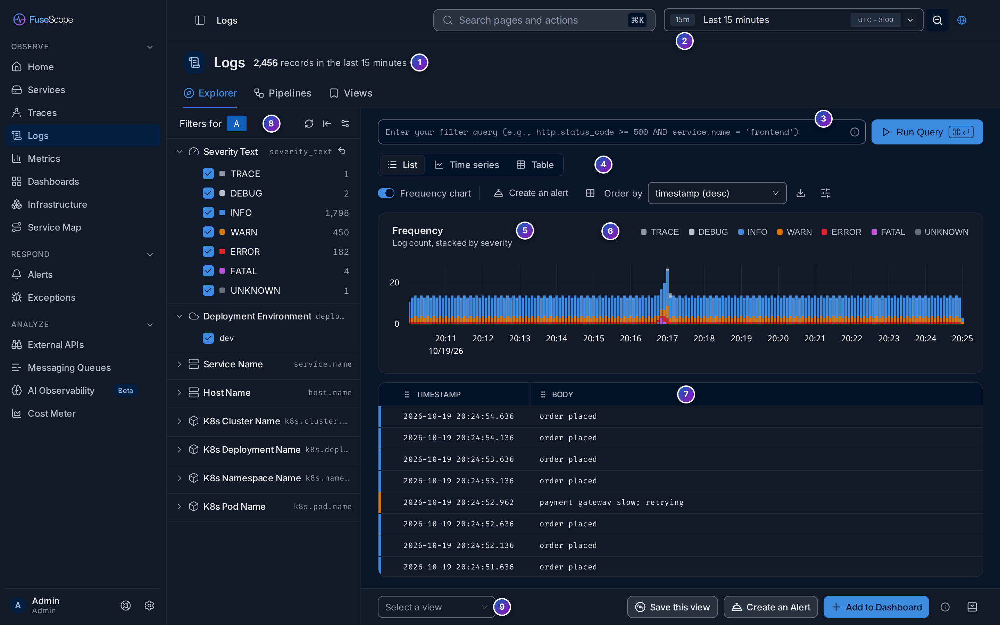
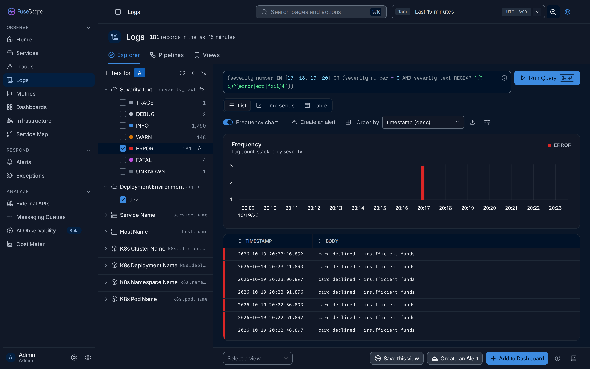
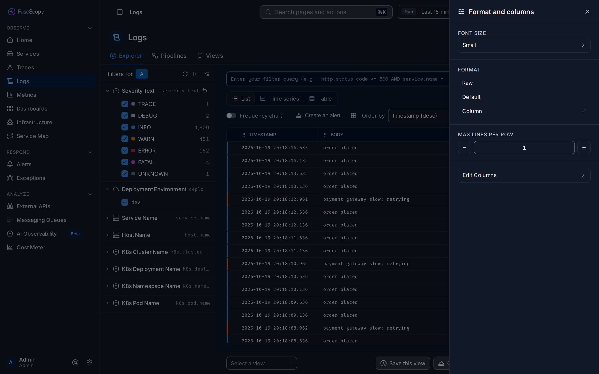
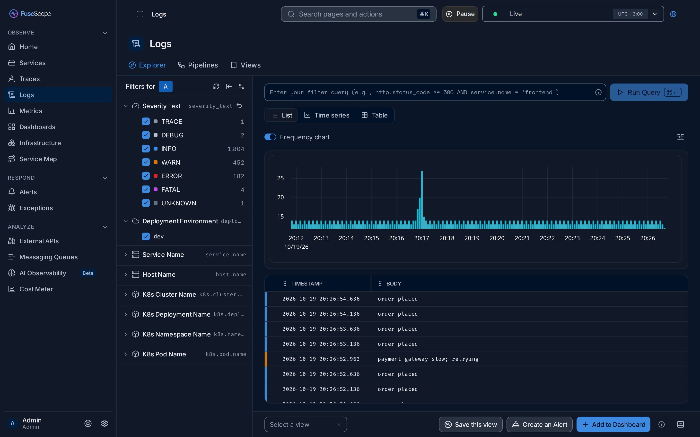
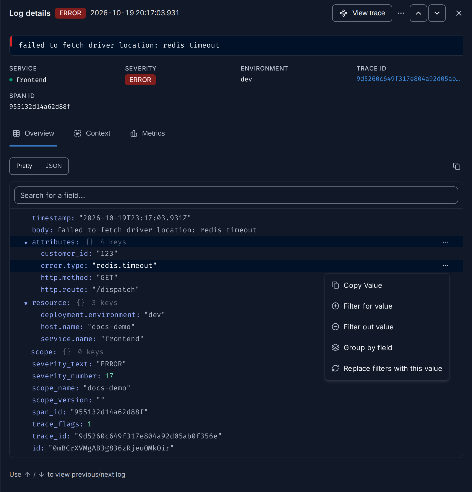
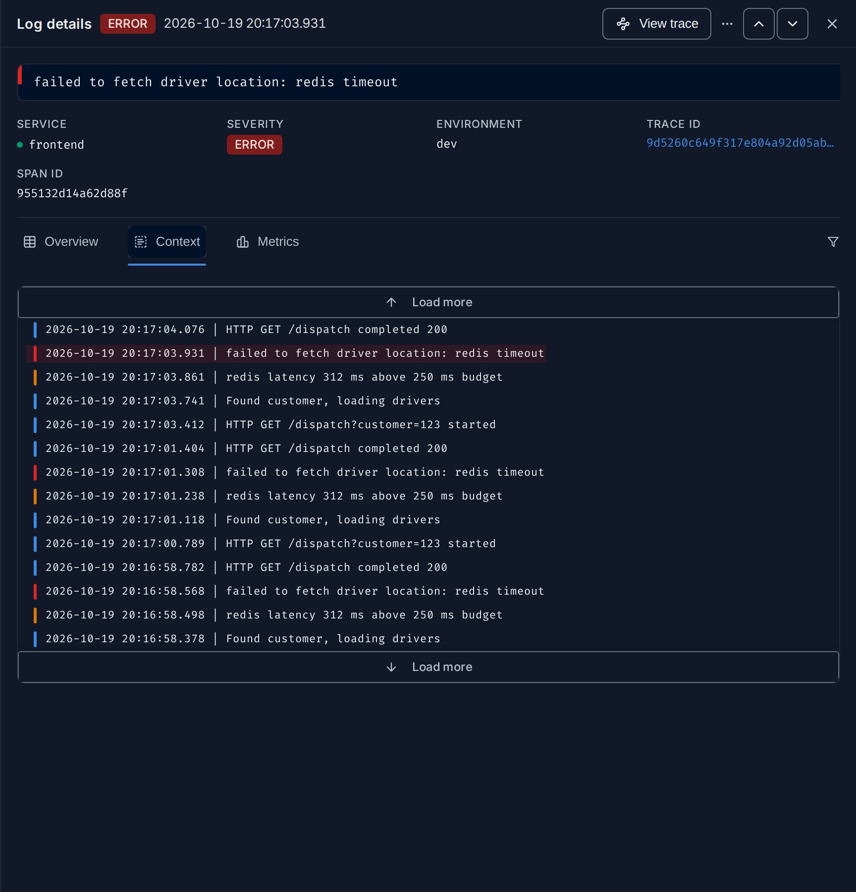

import { Aside, Steps } from "@astrojs/starlight/components";

The Logs explorer searches the [logs](/reference/glossary/#log) your
services and hosts send, and streams new ones as they arrive.

**Use this page when** you need the exact words behind a problem: an error message, a
stack trace a program printed, or what happened just before a crash. If you already
have the request's trace, you can open its logs from the trace instead; see
[See the logs for one request](/guides/logs-for-a-request/).

## Open the explorer

Click **Logs** in the sidebar (`/logs/logs-explorer`). The page has three tabs:

- **Explorer**, described here;
- **Pipelines**, which transform logs before they are stored; see
  [Log pipelines](/sending-data/log-pipelines/);
- **Views**, the log searches you saved.

## Read the page



1. **Record count**: how many logs match, such as `2,456 records in the last 15
   minutes`. It follows the query and the time range, and reads `between … and …` for
   a custom range. The number comes from the frequency chart, so it is hidden when the
   chart is off and during live tail.
2. **Time picker**, in the top bar. Pick a range such as **Last 15 minutes**, or a
   custom one. Its first option, **Live**, streams new logs; see [Live tail](#live-tail).
3. **Query bar**. Write a filter and click **Run Query**; see [Search logs](#search-logs).
4. **Toolbar**: **List**, **Time series** and **Table** ([Views](#views)), the
   **Frequency chart** switch, **Create an alert**, **Order by**, download, and the
   options button ([List options](#list-options)).
5. **Frequency chart**: how many logs arrived over time, one stacked bar per interval,
   coloured by [severity](#severity-levels).
6. **Legend** of the chart. Click a level to show only it; click it again to show all.
7. **Log list**, newest first. The coloured stripe on the left of each row is its
   severity. Click a row to open its [details](#log-details).
8. **Filters rail**: quick filters with a count for each value. See
   [Search logs](#search-logs).
9. **Bottom bar**: load or save a view, **Create an Alert** and **Add to Dashboard**.
   See [Alerts, dashboards and saved views](#alerts-dashboards-and-saved-views).

## Severity levels

A log's [severity](/reference/glossary/#severity) says how serious it
is. Programs spell it in many ways: one writes `Fatal`, another `FATAL`, a third
`critical`. Listed as they are, these would be three separate rows in a filter and
three colours in a chart, though they mean the same thing.

So FuseScope groups every log into one of seven levels, everywhere it shows a
severity: the filter, the chart, the row colours and the log details.

| Level | Colour | `severity_number` | Also matches the text |
|---|---|---|---|
| **TRACE** | grey | 1–4 | `trace`, `trc` |
| **DEBUG** | light grey | 5–8 | `debug`, `dbg` |
| **INFO** | blue | 9–12 | `info`, `information`, `notice` |
| **WARN** | amber | 13–16 | `warn`, `warning`, `wrn` |
| **ERROR** | red | 17–20 | `error`, `err`, `fail` |
| **FATAL** | purple | 21–24 | `fatal`, `critical`, `crit`, `emerg`, `emergency`, `alert`, `panic` |
| **UNKNOWN** | dark grey | none | anything else |

How a log gets its level:

1. **By number first.** OpenTelemetry gives every log a `severity_number` from 1 to
   24, in fixed ranges per level. If the log has one, its range decides the level.
2. **By text otherwise.** If the number is 0 (not set), FuseScope reads
   `severity_text`, ignoring case, and looks it up in the table.
3. **UNKNOWN** if neither matches, such as a text-only `verbose`.

<Aside>
  Grouping only changes what you see. The stored `severity_text` and
  `severity_number` are not modified, and the log details still show them as they
  arrived. To store one spelling for good, normalise the text when logs come in, with
  a [Severity parser](/sending-data/log-pipelines/#severity-parser) in a
  log pipeline.
</Aside>

### Filter by severity

The **Severity Text** filter at the top of the rail lists the levels that appear in
the current range, with their counts. In the example above, `FATAL 4` counts four
logs written as `Fatal`, `FATAL`, `critical` and `emerg`.

- Untick a level to hide it, or tick it to bring it back.
- Hover a level and click **Only** to keep just that one; **All** brings the others
  back.
- The arrow next to the title clears the filter.

FuseScope writes the matching condition into the query bar for you. **Only** on
**ERROR** gives:

```text
(severity_number IN [17, 18, 19, 20] OR (severity_number = 0 AND severity_text REGEXP '(?i)^(error|err|fail)$'))
```



## Search logs

Write a filter in the query bar with the
[search syntax](/querying/search-syntax/), pick a time range and click
**Run Query**. A quoted string on its own searches the log body:

```text
"connection refused" AND service.name = 'checkout'
```

The [filters](/reference/glossary/#filter) rail does the same without
typing. Under **Filters for**, each section is one attribute; expand it and tick
values. By default the rail has Severity Text, Deployment Environment, Service Name,
Host Name, K8s Cluster Name, K8s Deployment Name, K8s Namespace Name and K8s Pod
Name. The icons at the top refresh the counts, collapse the rail and open the
settings, which add or remove quick filters for everyone in the organization.

An attribute appears as a quick filter only when logs carry it as an
[attribute](/reference/glossary/#attribute), not just as text inside the
body. A [log pipeline](/sending-data/log-pipelines/) can parse it out.

## Views

| View | Shows |
|---|---|
| **List** | The matching logs, newest first |
| **Time series** | The query's aggregation as a chart, such as `count()` grouped by `severity_text` |
| **Table** | The query's aggregation as a table, one row per group |

Aggregation and group by are described in
[Query builder](/querying/query-builder/).

### List options

- **Frequency chart** turns the chart (and the record count) on or off.
- **Order by** sorts by timestamp or another field; the default is
  `timestamp (desc)`.
- The download button exports `csv` or `jsonl`, up to 10k, 30k or 50k rows, with all
  columns or only the selected ones.
- The options button (sliders icon) opens **Format and columns**:

  | Setting | Does |
  |---|---|
  | **Font Size** | Small, Medium or Large text |
  | **Format** | **Raw** (the default): the body on one line. **Default**: the timestamp and body, with the selected fields below. **Column**: a table with one column per field. |
  | **Max lines per row** | How many lines of a long body to show, 1 to 10 |
  | **Edit Columns** | In **Column** format, add attributes as columns; `timestamp` and `body` always stay |



Hover a row for two buttons: **Show in Context** opens the log on its
[Context](#context) tab, and **Copy Link** copies a link to it.

## Live tail

Live tail shows logs as they arrive, like `tail -f` on a server.

<Steps>

1. Write a filter if you only want some logs, for example `service.name = 'payment'`.
2. Open the time picker in the top bar and choose **Live**.
3. New logs appear at the top of the list. The list keeps the latest 1000.

</Steps>

While live, a **Pause** button sits next to the time picker; **Resume** starts the
stream again. The chart shows one total bar per interval instead of the severity
colours, and the record count is hidden. To stop, pick a time range in the time
picker.



## Log details

Click a log to open **Log details** on the right. Move to the previous or next log
with the arrows at the top, or the ↑ and ↓ keys.

The top of the panel shows:

- the severity level and the time the log was written;
- **View trace**, when the log carries a `trace_id`. It opens the request's
  [trace](/reference/glossary/#trace) in a new tab, with the log's span
  selected;
- the **⋯** menu, with **Copy log** and **Copy link to log**;
- the body, and the highlighted fields **SERVICE**, **SEVERITY**, **NAMESPACE**,
  **ENVIRONMENT**, **TRACE ID** and **SPAN ID**, each when the log has it. The trace ID
  is a link to the trace too.

Below them are three tabs.

### Overview

Every field of the log: the body, its attributes, its resource attributes, the
severity fields as stored, and the trace and span IDs. Switch between **Pretty**, a
readable tree, and **JSON**, the raw record to copy. **Search for a field...** finds one
field in a long log.


Hover a value and click **⋯** for its actions:

| Action | Does |
|---|---|
| **Copy Value** | Copies the value |
| **Filter for value** | Adds a condition to the query that keeps logs with this value |
| **Filter out value** | Adds a condition that hides logs with this value |
| **Group by field** | Switches to **Time series**, grouped by this field |
| **Replace filters with this value** | Replaces the whole query with this one condition |



### Context

The logs written just before and after this one by the same source: same service,
host and other resource attributes. The current log is highlighted. **Load more** at
the top and bottom fetches 10 more in each direction, and the filter icon narrows the
context with a query. Use it to see what led up to an error.



### Metrics

CPU, memory and other metrics of the host or Kubernetes pod that wrote the log, around
the time it was written. It needs host or Kubernetes attributes on the log, such as
`host.name` or `k8s.pod.name`.

<Aside>
  **View trace** and the trace ID link appear only when the log carries `trace_id`.
  OpenTelemetry SDKs and logging bridges add it when a log is written inside an active
  span. See [Instrument applications](/sending-data/instrumentation/#logs).
</Aside>

## Example: from an error log to its request

Two services are failing. Find their errors, and follow one to the request that
caused it.

<Steps>

1. **See the errors.** Set the time picker to **Last 1 hour**. In the rail, hover
   **ERROR** under **Severity Text** and click **Only**. The list turns red and only
   error logs are left.

2. **Narrow to payment.** In the query bar, add `AND service.name = 'payment'` after
   the severity condition and click **Run Query**. Every row reads
   `card declined - insufficient funds`. Open one: its details have no trace ID and no
   **View trace**, because the payment service writes these logs outside any traced
   request. The log is all there is.

3. **Try frontend.** Change `'payment'` to `'frontend'` and run the query again. The
   errors read `failed to fetch driver location: redis timeout`.

4. **Open one.** Click a row. The details show **SERVICE** `frontend`, **SEVERITY**
   `ERROR`, a trace ID, a span ID and **View trace**.

5. **Read the context.** Open the **Context** tab; newer logs are above the
   highlighted error, older ones below. Just before it, the request logged
   `redis latency 312 ms above 250 ms budget`; just after it,
   `HTTP GET /dispatch completed 200`. The request survived the timeout.

6. **Jump to the trace.** Click **View trace**. The `/dispatch` trace opens in a new
   tab with the frontend span selected and a red **3 errors** badge. Turn on
   **Highlight errors**: the first match (`1 / 3`) is a `GetDriver` span of
   `redis-manual`, the Redis call that failed.

</Steps>

**Conclusion:** the frontend error is a Redis read that timed out inside a
`/dispatch` request, which still answered. The payment errors are business errors
(declined cards) and have no request to follow. The trace page is described in
[Trace details](/explore/trace-details/).

## Alerts, dashboards and saved views

As in the [Traces explorer](/explore/traces/#export-alert-add-to-dashboard),
**Create an Alert** ([Alert rules](/alerts/alert-rules/)) and **Add to
Dashboard** reuse the current query. In the bottom bar, **Save this view** stores the
current search under a name, and **Select a view** loads one. The **Views**
tab lists every saved log view.

## Related

- [See the logs for one request](/guides/logs-for-a-request/).
- [Log pipelines](/sending-data/log-pipelines/): parse and normalise
  logs before they are stored.
- [Search syntax](/querying/search-syntax/).
- [Core concepts](/start/concepts/#logs-body-and-severity): body and
  severity.
