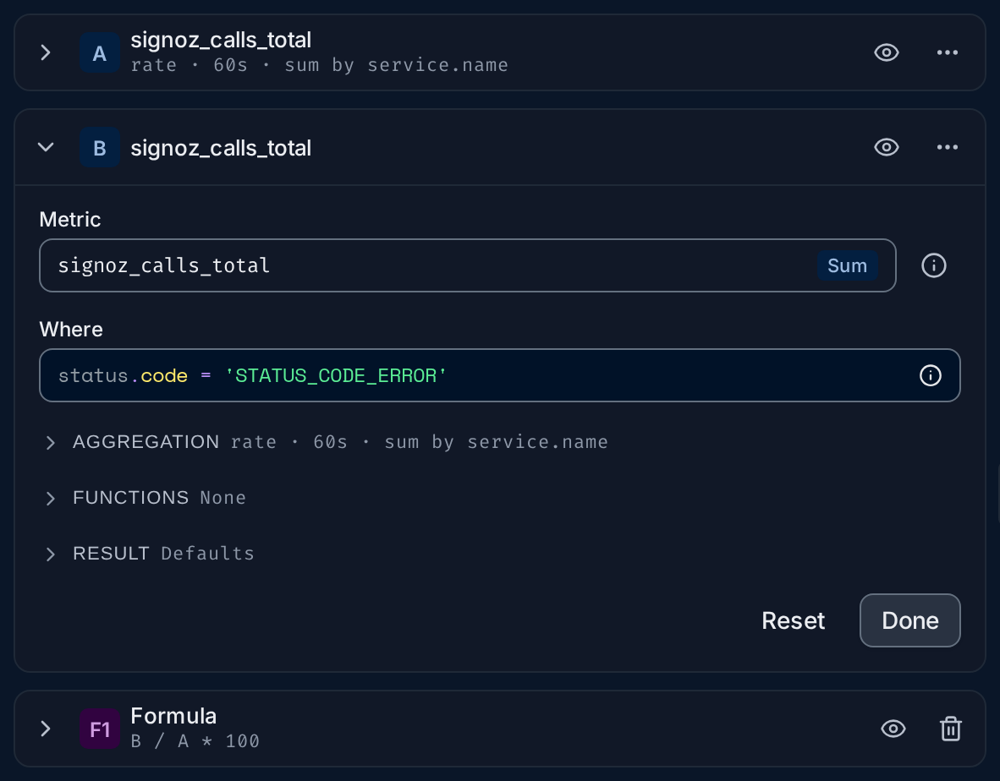
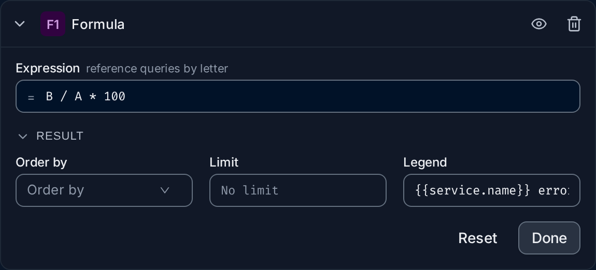
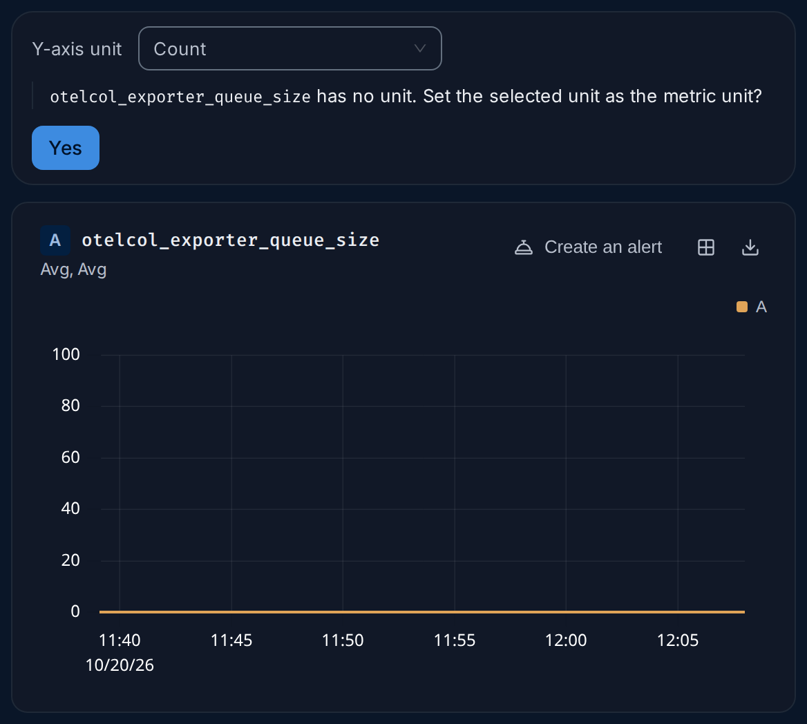
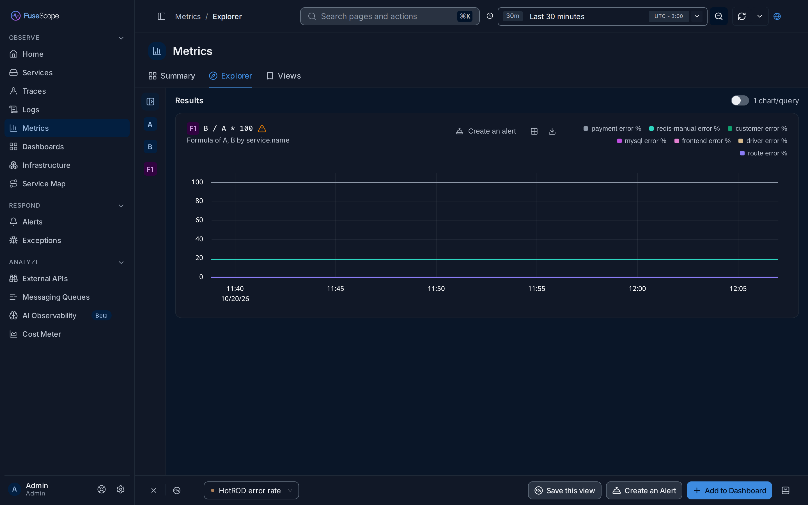
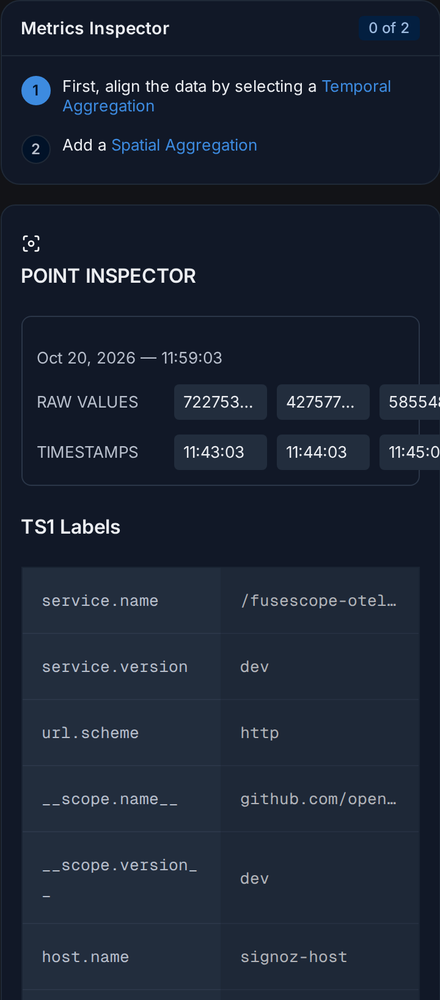
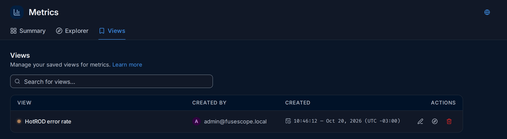
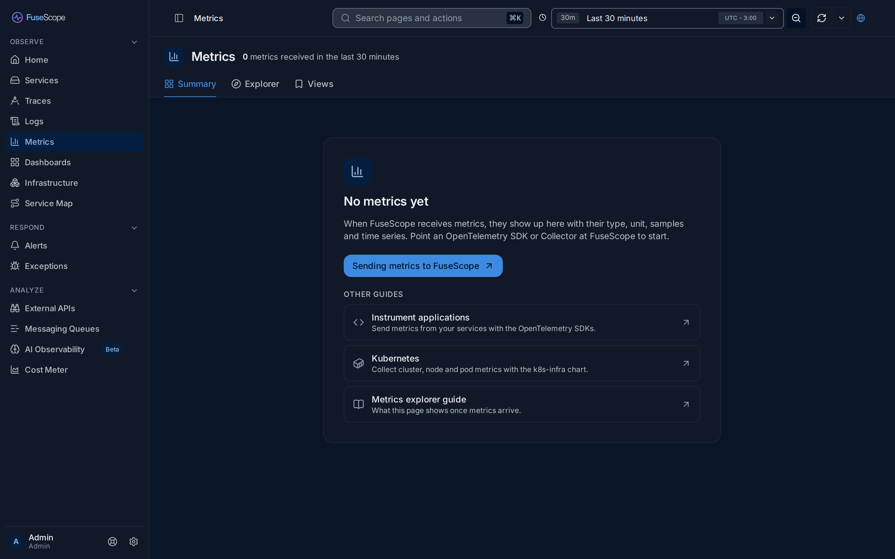

import { Aside, Steps } from "@astrojs/starlight/components";

The Metrics explorer lists the [metrics](/reference/glossary/#metric)
FuseScope receives, explains each one, and charts them.

**Use this page when** you want to know which metrics exist and what they measure, or
to chart one before putting it on a dashboard or in an alert. For the latency and
errors of your services you don't need metrics at all:
[Services](/apm/services/) computes them from traces.

## Open the Metrics page

Click **Metrics** in the sidebar. The page has these tabs:

- **Summary** (`/metrics-explorer/summary`): every metric received in the time range,
  with its type, unit and size. See [Browse metrics](#browse-metrics).
- **Explorer** (`/metrics-explorer/explorer`): build queries and chart them. See
  [Chart a metric](#chart-a-metric).
- **Views**: the metric queries you saved. See
  [Views, alerts and dashboards](#views-alerts-and-dashboards).
- **Volume Control**, only when metrics reduction is enabled for the workspace: compares
  what is ingested with what the reduction rules keep.

## Metric basics

If you are new to metrics, read this section first. The rest of the page assumes it.

A metric is a number with a name, measured again and again over time, such as
`http.server.request.count` or `system.memory.usage`. Each measurement is a
[sample](/reference/glossary/#sample): one value at one moment.

### Metric types and temporality

The type tells FuseScope what the numbers mean and how they may be added up. The
Summary shows it as a coloured badge.

| Type | What it holds | Example | Usual query |
|---|---|---|---|
| [**Sum**](/reference/glossary/#sum) | A total. A *counter* when it only goes up. | Requests served | **Rate**, then **Sum** |
| [**Gauge**](/reference/glossary/#gauge) | The value right now; it goes up and down. | Memory in use, queue length | **Avg** or **Max**, then **Avg** or **Sum** |
| [**Histogram**](/reference/glossary/#histogram) | How many values fell in each range (bucket). | Request durations | **P50** to **P99** |
| [**Exp. Histogram**](/reference/glossary/#exponential-histogram) | A histogram whose buckets grow exponentially, so it needs no bucket setup. | Request durations | **P50** to **P99** |
| [**Summary**](/reference/glossary/#summary-metric-type) | Percentiles the application computed itself. | Older Prometheus clients | As a gauge |

A Sum is [monotonic](/reference/glossary/#monotonic) when it can only
grow, like requests served. A non-monotonic Sum, such as items in a cart, can also
shrink, and is queried like a gauge.

[Temporality](/reference/glossary/#temporality) says how a counter
reports its value. Picture a page-view counter on a web server:

- **Cumulative**: every report gives the total since the server started: 100, then
  160, then 230. Each number includes all the earlier ones.
- **Delta**: every report gives only what happened since the last one: 100, then 60,
  then 70.

You don't need to convert between them: FuseScope reads the temporality and computes
rates correctly for both. You see it in the [metric details](#metric-details).

### Samples and time series

A metric is rarely one line. Every combination of its
[attribute](/reference/glossary/#attribute) values is a separate
[time series](/reference/glossary/#time-series). A request counter with
`service.name` (5 services) and `http.route` (10 routes) can have up to 50 time series,
each with its own samples.

The Summary shows both numbers for every metric:

- **Samples**: how many values arrived in the time range. More series or a shorter
  reporting interval means more samples.
- **Time series**: how many separate series the metric has, its
  [cardinality](/reference/glossary/#cardinality). An attribute with
  many values, such as a user or request ID, multiplies it quickly, which makes
  storage and queries more expensive.

### Why counters are queried with a rate

A counter only grows, so its raw value says little: "4,182,051 requests since the pod
started" changes every time the pod restarts. What you want to know is how fast it
grows. [Rate](/reference/glossary/#rate) turns the counter into
*per second*: "35 requests per second". **Increase** gives the growth per interval
instead, such as 2,100 requests per minute.

That is why, when you pick a counter in the Explorer, the aggregation starts as
**Rate**.

## Browse metrics

**Summary** lists every metric received in the selected time range.


1. **Count line**: how many metrics arrived, such as `40 metrics received in the last
   30 minutes`. It follows the search and the time range.
2. **Tabs**: Summary, Explorer and Views.
3. **Search bar**. Filter by attribute, such as `service.name = 'api'` for the metrics
   an API service sends, or type part of a name, such as `http.client`. Click
   **Run Query** to apply it.
4. **Samples** or **Time series**: what the Proportion view sizes its tiles by.
5. **Proportion view**: the top 100 metrics as tiles, each sized by its share of the
   total. The biggest tile is the metric that sends the most data. Click a tile to open
   its [details](#metric-details); the arrow next to the title folds the view away.
6. **List view** and its name search: the magnifier next to **Metric** looks up a
   metric by name.
7. **Type badge**: Sum, Gauge, Histogram, Exp. Histogram or Summary. Under each name is
   its description, when the metric has one.
8. **Samples** and **Time series** columns. Click a header to sort by it; the list
   starts sorted by samples, largest first.
9. **Open in Explorer** appears when you hover a row: it charts the metric in the
   Explorer with a query that suits its type.

Click a row to open its details. The pager at the bottom of the list moves between
pages and changes how many rows each one shows.

<Aside>
  The Summary leaves out the span metrics FuseScope derives from traces, whose names
  start with `signoz_`, such as `signoz_calls_total`. They are still there: type their
  name in the Explorer's **Metric** field, as in the
  [example below](#example-error-rate-per-service).
</Aside>

## Metric details

Clicking a metric opens its details in a panel on the right.


- **The header** has the type badge, the name (the copy icon copies it) and the
  description. **Open in Explorer** charts the metric. **Inspect** appears on
  [gauges](#inspect) only.
- **Samples**, **Time series** and **Last received**. Time series reads, for example,
  `45 total — 3 active`: *active* series received data in the last hour, the others
  only earlier. Hover a value for the exact number or date.
- **Used in** lists the dashboards and alert rules whose queries use the metric; click
  one to open it. It is hidden when nothing uses the metric. Check it before you rename
  or stop sending a metric.
- **Metadata**: description, unit, metric type, temporality and whether it is
  monotonic. See [Edit metadata](#edit-metadata).
- **All attributes**. See [Attributes](#attributes).

The panel follows the time range of the page. Close it with the × or Esc.

### Edit metadata

The metadata decides which aggregations the query builder offers and how values are
labelled, so it pays to get it right. Click **Edit** in **Metadata**, change the
fields and click **Save**.


| Field | Can you change it? |
|---|---|
| **Description** | Yes, at any time. |
| **Unit** | Only while the metric has none. Once set, it is locked: *Set once; it cannot be changed after the metric has a unit.* |
| **Metric Type** | Yes: Sum, Gauge, Histogram, Summary or Exponential Histogram. |
| **Temporality** | Yes: **Delta** or **Cumulative**. |
| **Monotonic** | No. It comes from the data the application sends. |

<Aside type="caution">
  Pick a unit carefully: you can't change it later. Values are stored as the
  application sent them, so a duration sent in milliseconds needs the unit
  Milliseconds, not Seconds.
</Aside>

### Attributes

**All attributes** lists the attribute keys seen on the metric in the time range,
the keys with most values first, with the number of values and up to five of them.
**Search** matches keys and values.


- The compass icon, **Open in Metric Explorer**, charts the metric split by that key:
  one line per value.
- The copy icon, **Copy Key**, copies the key name, ready to paste into a filter.
- Click a value for **Open in Metric Explorer**, which charts only the series with that
  value, or **Copy Value**.
- **All values (n)** opens the full list when there are more than five, with its own
  search.

## Chart a metric

The **Explorer** tab charts metrics. Queries sit in a panel on the left and the charts
on the right.


1. **Queries**, with the number of queries and formulas, such as `2 queries ·
   1 formula`. The icon on the left [collapses the panel](#resize-and-collapse-the-panel);
   **Collapse all** closes every card.
2. **A query card**. Its head shows the letter, the metric, the eye that shows or hides
   its result, and a menu (**…**) to clone or delete it.
3. **Metric**. Type part of a name and pick the metric; its type appears in the field.
   The ⓘ icon next to it opens the [metric details](#metric-details).
4. **Where**: a [filter](/querying/search-syntax/) that keeps only some
   series, such as `status.code = 'STATUS_CODE_ERROR'`.
5. **Aggregation**: how the series become lines. See [Aggregation](#aggregation).
6. **Functions** and **Result**: optional steps. See
   [Functions and Result](#functions-and-result).
7. **Reset** puts the card back as it was when you opened it; **Done** closes it.
8. **Add query** and **Add formula**.
9. **Last run**, such as `Last run 12:12:27 · 118 ms`, then **Run Query**. While a query
   runs, the button becomes **Cancel**.
10. **The grip** between the panel and the results.
11. **Results** and the **1 chart/query** switch. See [Read the results](#read-the-results).
12. **The chart** and its legend.
13. **The bottom bar**: the saved view in use, **Save this view**, **Create an Alert**
    and **Add to Dashboard**. See [Views, alerts and dashboards](#views-alerts-and-dashboards).

### Query cards

Each query and formula is a card, named by a letter: **A**, **B** and so on for
queries, **F1**, **F2** for formulas. Only one card is open at a time, so the panel
stays short: opening a card closes the one before, and a card you add opens by
itself.

A closed card reads as one line, for example:

```text
signoz_calls_total
rate · 60s · sum by service.name · where status.code = 'STATUS_CODE_ERROR'
```

Inside an open card, the fields come in reading order: **Metric**, then **Where**, then
three sections that fold to a one-line summary. A section opens by itself when it
holds a setting, such as a group by; otherwise it stays as you last left it.



### Aggregation

A metric query works in two steps, and the Aggregation section has one field for
each. The summary next to the title reads them in order, such as
`rate · 60s · sum by service.name`.

1. **Over time**, *within each series*: what to do with the samples of one series in
   each interval. **Rate** for counters, **Avg**, **Max** or **Latest** for gauges.
   **every** sets the interval in seconds; leave it empty (**Auto**) and FuseScope
   picks one from the time range. See
   [Time step](/querying/query-builder/#time-step).
2. **Across series**, *combine into groups*: how to merge the series into lines.
   **Sum**, **Avg**, **Min** or **Max**, and **by** the keys to keep apart. With
   `service.name` you get one line per service; with no key, one line for everything
   (`no breakdown`).

Histograms skip the first step: pick a percentile, such as **P95**, and the keys. The
options for each type are listed in
[Aggregations](/querying/query-builder/#aggregations).

### Functions and Result

- **Functions** change the finished lines, *applied in order, top to bottom*: for
  example **EWMA 5** to smooth a noisy line, or **Time Shift** to compare with an
  earlier period. Up to three per query. See
  [Functions](/querying/query-builder/#functions).
- **Result** has **Having**, to keep only groups whose value matches, such as
  `value > 5`; **Order by**; **Limit**, to keep the first *n* lines; and **Legend**,
  to name the lines, such as `{{service.name}}`. Its summary reads **Defaults** while
  none is set. See [Legend format](/querying/query-builder/#legend-format).

### Formulas

**Add formula** adds a card that combines queries by letter, such as `B / A * 100`.
Write it in **Expression** (*reference queries by letter*). Its **Result** section has
**Order by**, **Limit** and **Legend**.



A formula needs its queries to be grouped by the same keys, so that each line of `B`
meets the matching line of `A`. Hide the queries a formula uses with their eye icon
and the chart shows only the formula's lines: the hidden queries still run. The
operators and functions a formula accepts are listed in
[Several queries and formulas](/querying/query-builder/#several-queries-and-formulas).

### Run a query

Click **Run Query**, or press **⌘ + Enter** (**Ctrl + Enter** on Windows and Linux).
Editing a card does not change the chart until you run it. **Last run** says when the
last run finished and how long it took.

### Read the results

- **One chart for every visible query and formula.** The chart title names what it
  plots: the metric for a single query, the expression for a single formula, such as
  `B / A * 100` with `Formula of A, B by service.name` under it, or **All queries**
  when there are several. When several share a chart, each legend entry starts with
  its letter, such as `A · frontend`.
- **1 chart/query** draws each query and formula on its own chart instead. It turns on
  by itself when queries have different units, so that unrelated values don't share an
  axis.
- **The legend** names each line, from the **Legend** set in the card's Result
  section.
- **Chart actions**, top right of the chart: **Create an alert**, add to a dashboard,
  and download the data.
- **A warning triangle** next to the title means a metric on the chart has no unit;
  its tooltip links to the metric details, where you can set one.

#### Y-axis unit

When the chart shows one metric without a unit, a **Y-axis unit** field appears above
it. Pick a unit to format the axis, for example **Count** or **Bytes**. FuseScope then
asks whether to keep it:



**Yes** saves the unit as the metric's own, for every chart, dashboard and alert. As
with [Edit metadata](#edit-metadata), it can't be changed afterwards, so leave the
prompt unanswered if you are only trying a unit out.

### Resize and collapse the panel

- **Resize**: drag the grip between the panel and the results. The panel takes
  between 30% and 70% of the width; double-click the grip to return to half.
- **Collapse**: the icon left of **Queries** folds the panel into a narrow rail of
  query letters, leaving the width to the charts. Click a letter to reopen the panel
  on that card, or the icon at the top of the rail to reopen it as it was.



The browser remembers the width and whether the panel is collapsed.

## Example: error rate per service

The goal: one line per service with the percentage of its calls that failed. It uses
`signoz_calls_total`, a counter FuseScope derives from traces: one count per call,
with the attributes `service.name` and `status.code`. Failed calls have
`status.code = 'STATUS_CODE_ERROR'`; in the demo the others have `STATUS_CODE_UNSET`.
The [metric details](#attributes) of a metric list the values each key really has.

<Steps>

1. **Count all calls.** Open **Metrics** › **Explorer**. In card **A**, type
   `signoz_calls_total` in **Metric** and pick it. Open **Aggregation**: **Over time**
   is already **Rate**, as for any counter. Set **Across series** to **Sum** **by**
   `service.name`. Click **Run Query**: one line per service, in calls per second.

2. **Count the failed calls.** In the card menu (**…**), click **Clone**. In the new
   card **B**, type this in **Where**:

   ```text
   status.code = 'STATUS_CODE_ERROR'
   ```

   It keeps the same metric, rate and group by, so each of its lines matches a line
   of **A**.

3. **Divide.** Click **Add formula**. In **F1**, enter the expression `B / A * 100`:
   the failed calls as a percentage of all calls.

4. **Name the lines.** Open the **Result** section of **F1** and set **Legend** to:

   ```text
   {{service.name}} error %
   ```

5. **Show only the result.** Click the eye icon on **A** and on **B**. They still run
   for the formula, but leave the chart.

6. Click **Run Query**.

</Steps>

**What you get**, in the demo data over the last 30 minutes: `payment error %` at 100,
because every call of the payment demo service fails; `redis-manual error %` at about
18.5; and the other services at 0. The chart title reads `B / A * 100`, with
`Formula of A, B by service.name` under it.

This query is saved in the demo as the view **HotROD error rate**. To be told when the
rate climbs, click **Create an Alert** and set a threshold on **F1**; see
[Set up your first alert](/guides/first-alert/), which builds the same
percentage from traces.

## Inspect

Inspect shows, step by step, how a query turns raw series into a chart. It exists for
**gauges** only: open the [metric details](#metric-details) of a gauge and click
**Inspect**. It always uses the **last 30 minutes** of data.


The **Query** card has four numbered steps:

1. **From**: the metric. You can switch to another one here.
2. **Where**: an optional filter on its attributes.
3. **AGGREGATE BY TIME**: **Align with** an aggregation, such as **Avg**, **aggregated
   every** a number of seconds. This is the *Over time* step of the Explorer.
4. **AGGREGATE BY LABELS**: **Sum by**, **Min by**, **Max by** or **Avg by**, and the
   labels to keep. This is the *Across series* step.

Click **Run Query** after each step and watch the chart: first the raw series, one line
each, then each series aligned in time, then the series combined. The **Metrics
Inspector** checklist on the right ticks off steps 3 and 4 (`2 of 2`); **Reset query**
starts again.

- **Graph** and **Table** switch between the lines and their values in a table.
- **Point inspector**: click a point on the chart, then **View details**. Before the
  aggregation steps it lists the raw values and their timestamps around that point,
  and the labels of the series.



## Views, alerts and dashboards

The bar at the bottom of the Explorer acts on the current query:

- **Select a view** loads a saved view. Once one is loaded, its name shows in the
  selector, with an × to clear it.
- **Save this view** saves the queries under a name, to come back to later or share
  with the team.
- **Create an Alert** opens a new [alert rule](/alerts/alert-rules/) with
  the query filled in.
- **Add to Dashboard** adds the chart as a panel to a new or existing
  [dashboard](/dashboards/dashboards/).

The **Views** tab lists the saved metric views, with who created each one and when.
**Search for views...** filters them. In **Actions**, the pencil edits a view's name and
colour, the compass opens it in the Explorer and the bin deletes it.



## Before the first metric

When no metric has arrived and no search is set, the Summary explains what will
appear and where to start, instead of an empty table. **Sending metrics to FuseScope**
opens [OTLP](/sending-data/otlp/), and **Other guides** links to
[Instrument applications](/sending-data/instrumentation/),
[Kubernetes](/sending-data/kubernetes/) and this page.



If you expected metrics, widen the time range first, then check that the application
or collector exports metrics to FuseScope's OTLP endpoint.

<Aside>
  PromQL and ClickHouse SQL over metrics are written in dashboard panels and alert
  rules; see [ClickHouse SQL and PromQL](/querying/clickhouse-promql/).
</Aside>

## Related

- [Query builder](/querying/query-builder/): every aggregation, function
  and formula option.
- [Build your first dashboard](/guides/first-dashboard/) and
  [Set up your first alert](/guides/first-alert/): put a query to work.
- [Core concepts](/start/concepts/#metrics-and-metric-types): metrics
  next to traces and logs.
