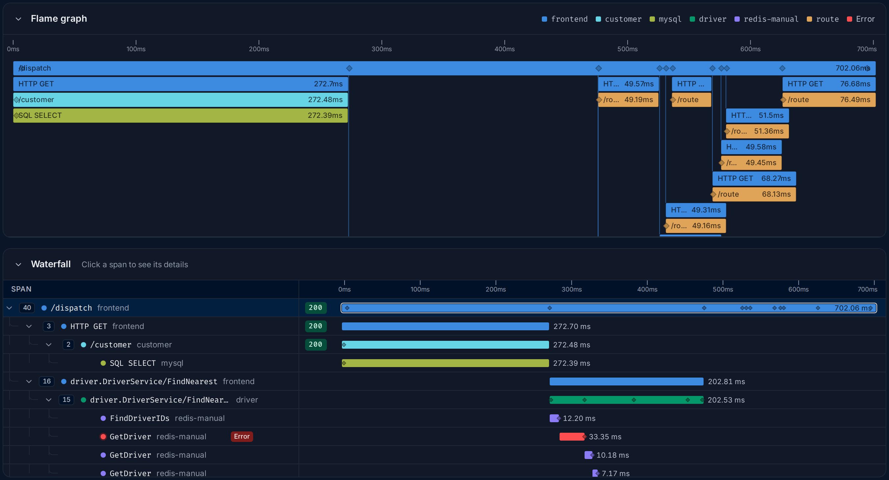
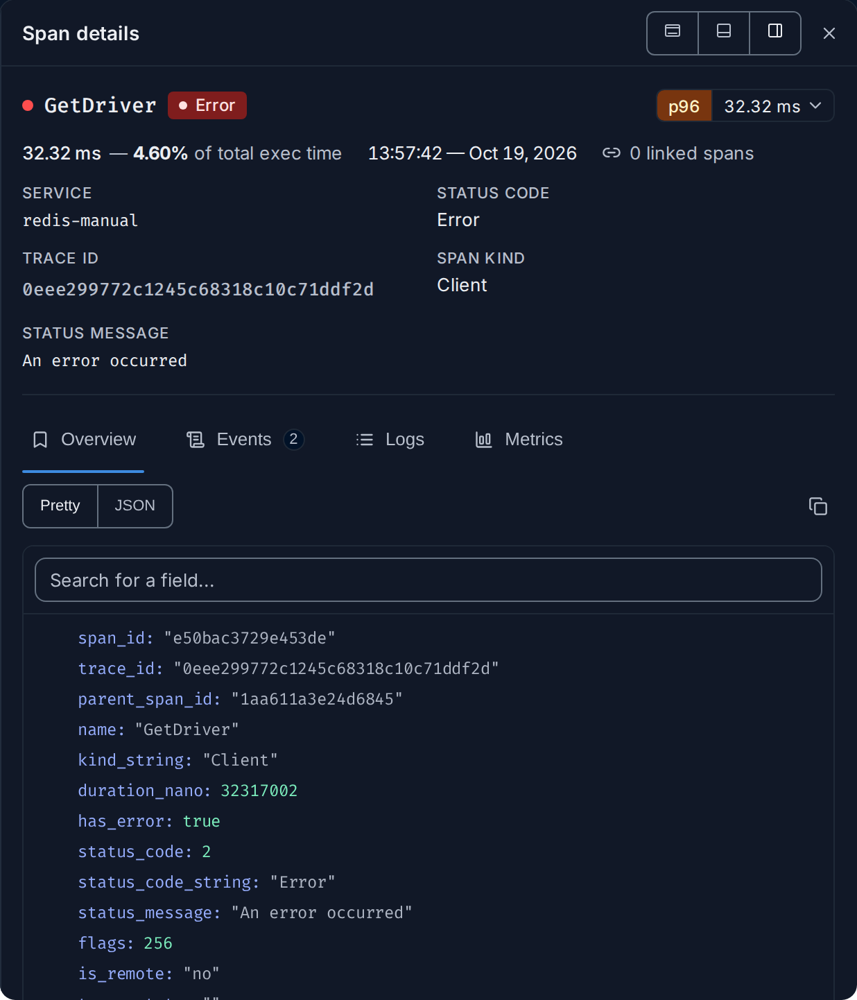
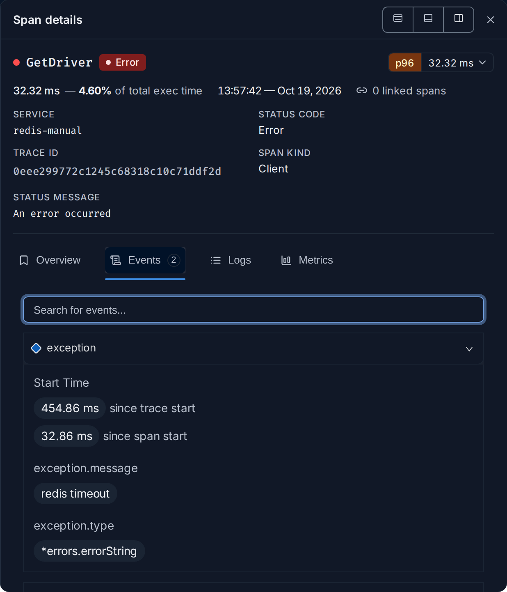
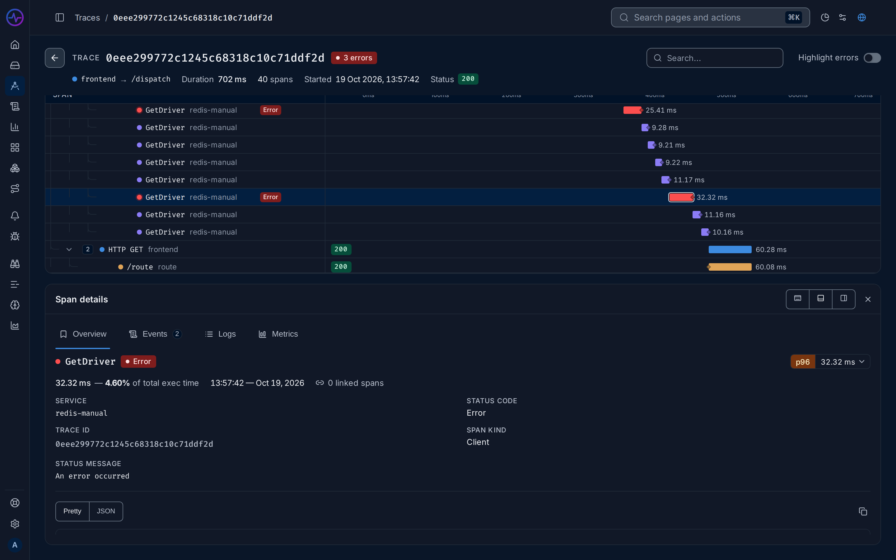
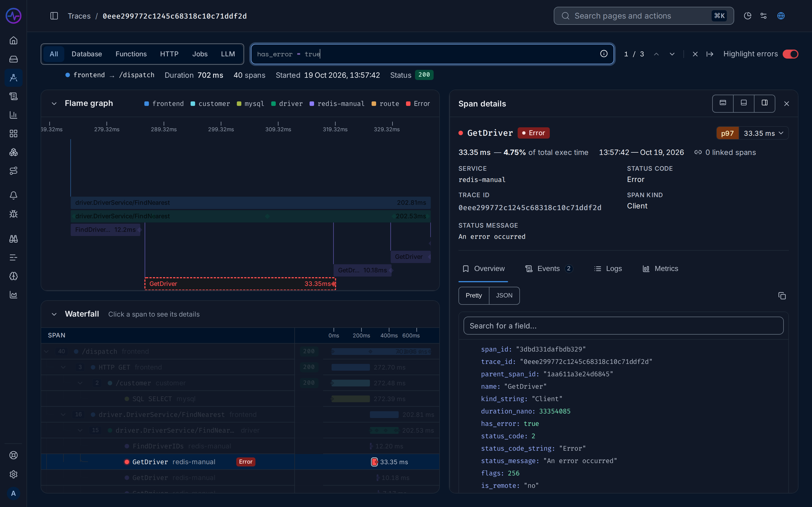
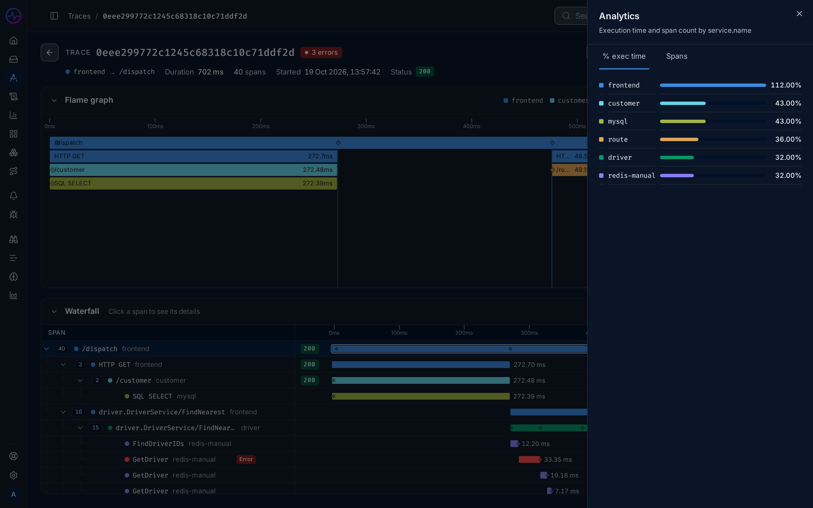
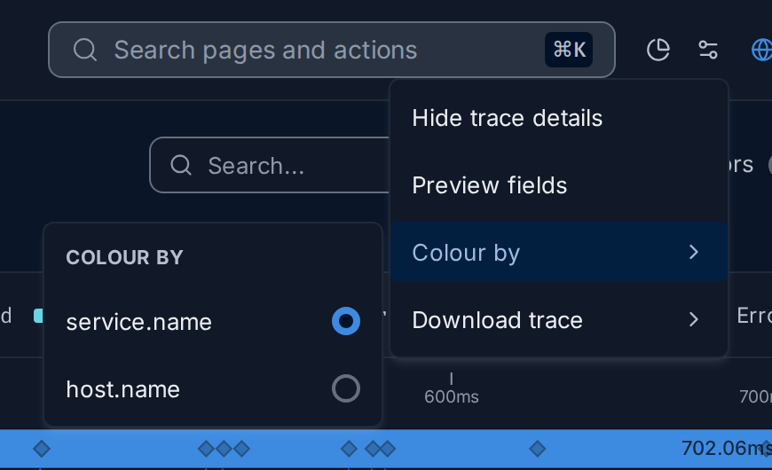

import { Aside, Steps } from "@astrojs/starlight/components";

The trace details page shows one [trace](/fusescope-docs/reference/glossary/#trace):
every [span](/fusescope-docs/reference/glossary/#span) of a single request, from the
first service it reached to the last database call, laid out on a shared timeline.

**Use this page when** you have found one request worth a closer look, such as a slow
one, a failed one or one a user reported, and you want to know where its time went or
which call broke. To find such a request first, use the
[Traces explorer](/fusescope-docs/explore/traces/).

## Open a trace

A trace has its own address, `/trace/<trace-id>`, so a link to it can be shared. You
usually get there by clicking through from another page:

| From | Do this |
|---|---|
| **Traces explorer** | Click a row in the **List** or **Traces** view. See [Traces explorer](/fusescope-docs/explore/traces/). |
| **A service** | On the service page, click an operation on the **Endpoints** tab, a point on a chart and **View traces**, or **View traces** on the **Errors** tab, then click a row. See [Services](/fusescope-docs/apm/services/). |
| **An exception** | On the exception's page, click **See the error in trace graph**. See [Exceptions](/fusescope-docs/apm/services/#exceptions). |
| **A log** | Open the log and click **View trace**, or its [trace ID](/fusescope-docs/reference/glossary/#trace-id). See [See the logs for one request](/fusescope-docs/guides/logs-for-a-request/). |
| **An alert** | On the rule's **History** tab, follow the link to the related traces, then click a row. See [Alert rules](/fusescope-docs/alerts/alert-rules/#states-and-history). |

## Read the page

1. **Trace ID** and, when any span failed, a red badge with the number of errors. The
   arrow on the left goes back to where you came from.
2. **Summary row**: the [root span](/fusescope-docs/reference/glossary/#root-span)'s
   service and operation (`frontend → HTTP GET /dispatch`), the **Duration** of the
   whole request, the number of spans, when it **Started**, and the root span's
   **Status** code.
3. **Search** box and the **Highlight errors** switch. See
   [Find spans in a trace](#find-spans-in-a-trace).
4. **Analytics** (the pie-chart icon) and **Trace options** (the sliders icon), in the
   top bar. See [Analytics](#analytics) and [Trace options](#trace-options).
5. **Flame graph**, with a legend of the colours it uses.
6. **Waterfall**, the list of spans as a tree.
7. **Span details** for the selected span.

The bar at the very bottom of the window repeats the number of spans and errors. If
FuseScope did not receive every span of the trace, a **This trace has missing spans**
note appears under the summary row; see [If something is missing](#if-something-is-missing).

### Flame graph

The flame graph is a picture of the whole request. It is the fastest way to see its
shape.

- **Time runs left to right.** The left edge is when the request started and the right
  edge when it ended. A wider bar took longer.
- **Below means "called by the bar above".** Each bar sits under the span that started
  it, so the top row is the root span and each row down is one level deeper.
- **Colours are services.** Every span of the same service has the same colour; the
  legend next to the title names them. To colour by host or another attribute instead,
  use **Colour by** in [Trace options](#trace-options).
- **Red is an error.** A span that failed is red, whatever its service.

Scroll over the flame graph to zoom in around the pointer, and drag to move along the
timeline. Hover a bar to see its name, service and duration; click it to select it in
the waterfall and open its details. Drag the bottom edge to make the flame graph taller.

### Waterfall

The waterfall lists every span as a row of a tree.

- **The tree on the left** shows who called whom. Each row is indented under its
  parent, with a dot in its service's colour, the span name and the service name. The
  number next to the arrow is how many spans are below it; click the arrow to fold or
  unfold them. Failed spans have an **Error** badge.
- **The status column** shows each span's status code, such as `200` or `503`, in red
  when it failed.
- **The bars on the right** show when each span ran and for how long, on the same
  timeline as the flame graph, with the duration written next to the bar.

**To find the slowest part**, look for a long bar whose children are short or absent.
A parent's bar always covers its children, so a long parent with one equally long child
is only waiting: follow the child. When the long bar has no children, or its children
cover only a small part of it, the time is spent in that span itself. That span is
where to look.

Gaps matter too: when a parent's bar is long but its children are short and spread
out, the time is spent between calls, in the parent's own code or waiting on something
that is not traced.

Click **Flame graph** or **Waterfall** in the section titles to fold a section and give
the other more room.

## Span details

Click a span in the waterfall or the flame graph to open **Span details**. The top of the
panel always shows:

- the span name, with an **Error** badge if it failed;
- a [percentile](/fusescope-docs/reference/glossary/#percentile) badge such as `p95`:
  how this span's duration compares with other spans of the same name and service.
  Click it for the full table over the last hours;
- its duration and the share of the whole trace it covers (`of total exec time`), when
  it started, and its linked spans;
- **SERVICE**, **STATUS CODE**, **TRACE ID**, **SPAN KIND** and, on failures,
  **STATUS MESSAGE**.

Below them are up to four tabs. When the panel is docked at the bottom, this summary
moves into the **Overview** tab.

### Overview

Every field and [attribute](/fusescope-docs/reference/glossary/#attribute) of the span.
Attributes are the facts the program recorded about the work: which URL was called
(`http.url`), which status came back (`http.status_code`), which query ran
(`db.statement`), which host or pod ran it. They are what turns "this span was slow"
into "this query on this host was slow".

Switch between **Pretty**, a readable list, and **JSON**, the raw data to copy, and use
**Search for a field...** to find one attribute. Each value in the list has these actions:

| Action | Does |
|---|---|
| Copy | Copies the value |
| Pin | Keeps the field at the top of the list, on every span, for you |
| **Filter for value** | Opens the Traces explorer with spans that have this value |
| **Filter out value** | Opens the Traces explorer with spans that do not |
| **Group by attribute** | Opens the Traces explorer grouped by this attribute |

### Events

Things that happened at one moment inside the span, each with a time and its own
attributes. The most common is an `exception` event: the error type, message and stack
trace your code raised. Use it to read the error itself. The tab shows a count when the
span has events; search them with the box on top. See
[span event](/fusescope-docs/reference/glossary/#span-event).

### Logs

The [logs](/fusescope-docs/reference/glossary/#log) your code wrote while this request
ran, from five minutes before to five minutes after the trace. Logs of the selected span
are marked; the others give context. **Open in Logs Explorer** opens the same search in
the Logs explorer.

<Aside>
  A log appears here only when it carries the request's `trace_id` (and, to be tied to a
  span, its `span_id`). OpenTelemetry SDKs and logging bridges add them when a log is
  written inside an active span. If the tab is empty, see
  [Instrument applications](/fusescope-docs/sending-data/instrumentation/#logs) and
  [How logs and traces are linked](/fusescope-docs/guides/logs-for-a-request/#how-logs-and-traces-are-linked).
</Aside>

### Metrics

CPU, memory and other metrics of the host or Kubernetes pod that ran the span, around the
time it ran. The tab is shown only when the span has host or Kubernetes attributes, such
as `host.name` or `k8s.pod.name`. Use it to tell whether a slow span was the code or a
busy machine.

### Move the panel

The three buttons at the top right of the panel choose where it sits. FuseScope
remembers your choice.

| Mode | Use it when |
|---|---|
| **Dock on the right** (default) | You want the waterfall and the details side by side. Drag the panel's left edge to widen it. |
| **Dock at the bottom** | You want the full width for the waterfall's timeline, and read details below it. |
| **Open as floating panel** | You want to place it anywhere; drag it by its title. |

Close the panel with the **×** next to the dock buttons.

## Find spans in a trace

A trace can have hundreds of spans. Click **Search...** at the top of the page and write
a filter with the [search syntax](/fusescope-docs/querying/search-syntax/), for example
`service.name = 'redis-manual'` or `duration_nano > 100000000` (100 ms). Matching spans
are highlighted in the flame graph and the waterfall, and the others are dimmed.

- The arrows next to the count (`1 / 12`) jump from one match to the next.
- The buttons above the search box limit it to one kind of span:

  | Category | Matches spans with |
  |---|---|
  | **All** | Any span |
  | **Database** | `db.system` |
  | **Functions** | `kind_string = 'Internal'`: work inside one service |
  | **HTTP** | `http.method` |
  | **Jobs** | `messaging.system`: queues and background jobs |
  | **LLM** | `gen_ai.request.model`: calls to language models |

- **Highlight errors** adds `has_error = true` to the search, so only failed spans stand
  out.
- The **×** clears the search; the arrow folds the box back.

## Analytics

Click the pie-chart icon in the top bar to open **Analytics** on the right. It splits
the trace by service (or by the **Colour by** attribute):

- **% exec time**: how much of the trace's duration each service's spans take. The
  values don't add up to 100%: a caller keeps running while it waits for the service it
  called, and a service whose spans overlap can even go above 100%, as `frontend` does
  below.
- **Spans**: how many spans each service produced.

Read them together. A service with a high **% exec time** is on the request's critical
path. A service with many spans but little time is making lots of small calls, which
is worth a look when they run one after another. A service with few spans and a lot of
time is doing slow work in a few calls.

## Trace options

The sliders icon in the top bar opens **Trace options**:

- **Hide trace details** / **Show trace details** hides or shows the summary row.
- **Preview fields** picks up to 10 attributes to show on each span when you hover it,
  so you can compare spans without opening each one.
- **Colour by** colours the flame graph, the waterfall and the analytics by
  `service.name` (the default) or another resource attribute the trace has, such as
  `host.name` or `k8s.node.name`. Use it to see whether slow spans share a host.
- **Download trace** saves every span as **CSV** or **JSONL**, to attach to a ticket or
  analyse elsewhere.

## Next steps from a span

Hover a row in the waterfall for two buttons at its right end:

- **Copy Span Link** copies a link that opens this trace with this span selected. Paste
  it into a ticket or a chat so others land on the same span.
- **Add to Trace Funnel** adds the span as a step of a new or existing
  [funnel](/fusescope-docs/explore/traces/#funnels), to follow how many requests reach
  it.

From the span details you can also open its logs in the Logs explorer
([Logs](#logs) tab), or search for similar spans across all traces with
**Filter for value** ([Overview](#overview) tab).

## Example: why did this request take 700 ms?

The HotROD demo's `frontend` answers `/dispatch` in about 700 ms. Here is how to find
out why from one trace.

<Steps>

1. **Open a slow trace.** In the Traces explorer, search
   `service.name = 'frontend' AND name = '/dispatch'`, set **Order by** to
   `duration_nano (desc)` and click the first row.

2. **Look at the shape.** In the flame graph, `frontend`'s `/dispatch` spans the whole
   width. Under it, three blocks run one after another: `customer`, then `driver`, then
   a group of `route` calls side by side. Nothing overlaps, so the request waits for
   each in turn.

3. **Find the longest block.** In the waterfall, compare the bars under `/dispatch`.
   `driver.DriverService/FindNearest` is one of the widest, and under it is a long
   staircase of short `redis-manual` spans that run one at a time.

4. **Check the errors.** Turn on **Highlight errors**. A few `redis-manual` `GetDriver`
   spans light up in red. Click one: **STATUS MESSAGE** only says `An error occurred`,
   but the **Events** tab has an `exception` event whose `exception.message` is
   `redis timeout`.

5. **Read the numbers.** Open **Analytics**. `customer` and `mysql` each take about 43%
   of the trace: one SQL query of roughly 270 ms. `driver` and `redis-manual` take about
   32%, and on the **Spans** tab `redis-manual` has by far the most spans: many small
   calls, made one after another.

</Steps>

**Conclusion:** the 700 ms is two slow steps in a row. The `customer` lookup is a single
SQL query of about 270 ms, the largest block, so it is the first thing to speed up. Then
`FindNearest` reads each driver from Redis one call at a time, about 200 ms, and every
timeout adds a retry. Fetching drivers in one batch, or in parallel, would remove most
of the second step.

The same steps, starting from the service list, are in
[Investigate a slow endpoint](/fusescope-docs/guides/slow-endpoint/).

## If something is missing

- **This trace has missing spans.** Some spans the trace refers to never arrived: a
  service is not instrumented, dropped them, or sent them to another backend. The tree
  shows a gap where they belong.
- **The trace stops at one service.** The next service does not pass the trace context
  on. See [Instrument applications](/fusescope-docs/sending-data/instrumentation/).
- **The Logs tab is empty.** Your logs have no `trace_id`; see [Logs](#logs).
- **No trace found.** The trace is older than your
  [retention](/fusescope-docs/administration/retention/), or the ID is wrong.
- **A warning next to Flame graph.** The trace has too many spans to draw them all, so
  the flame graph shows a sample. The waterfall still has every span.

## Related

- [Traces explorer](/fusescope-docs/explore/traces/): find the traces to open.
- [Investigate a slow endpoint](/fusescope-docs/guides/slow-endpoint/).
- [Find out why a service is failing](/fusescope-docs/guides/failing-service/).
- [See the logs for one request](/fusescope-docs/guides/logs-for-a-request/).
- [Core concepts](/fusescope-docs/start/concepts/#traces-and-spans): traces, spans and
  root spans.
