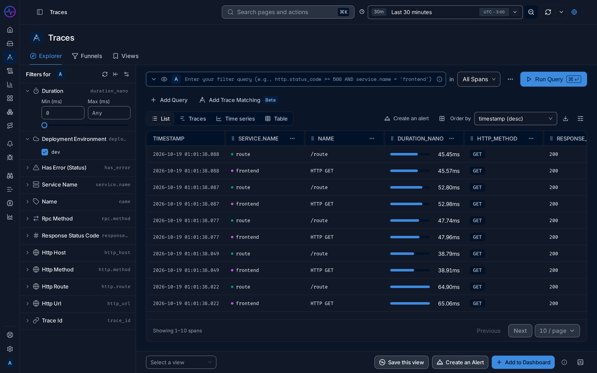
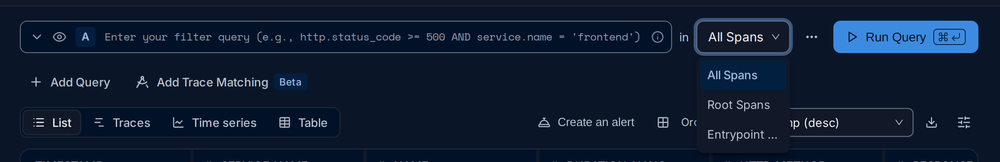
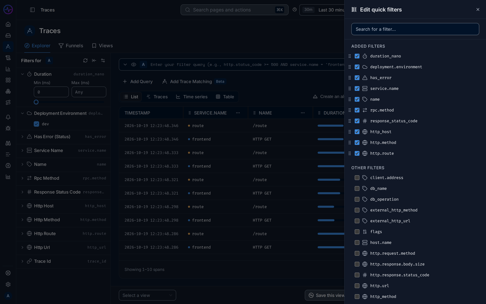
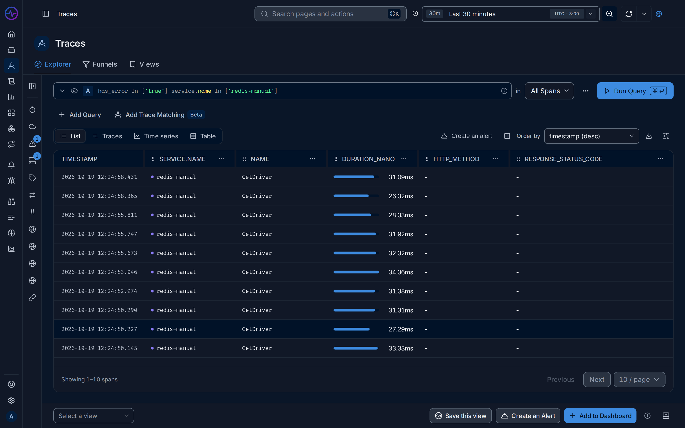
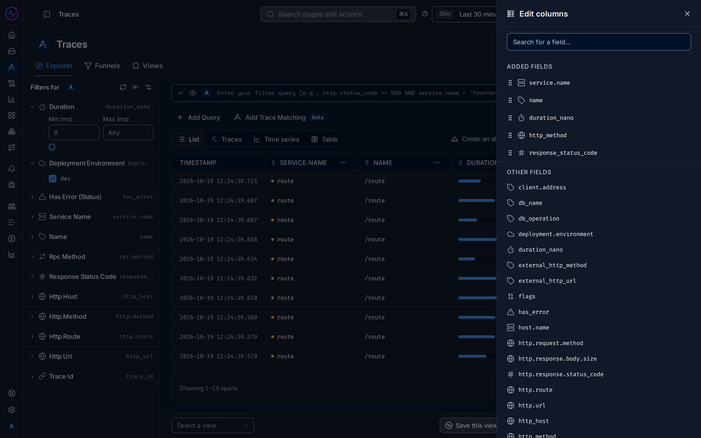
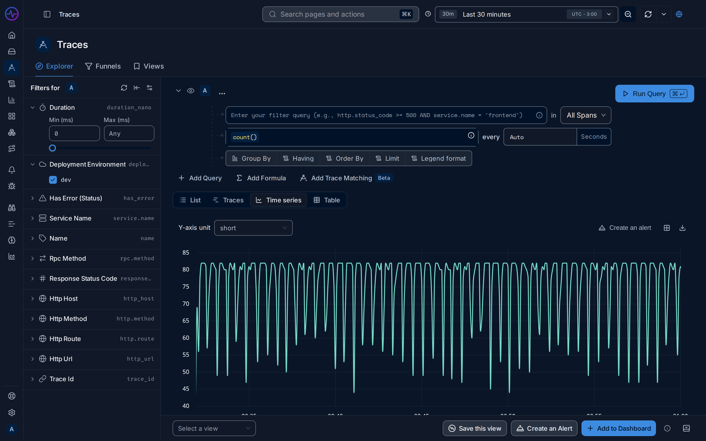
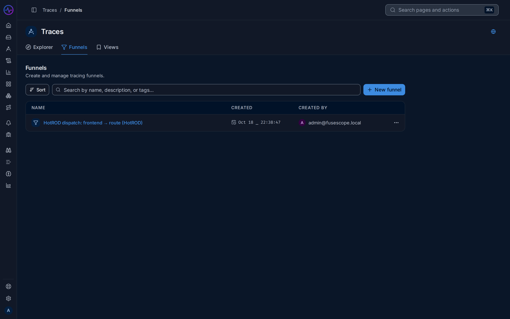
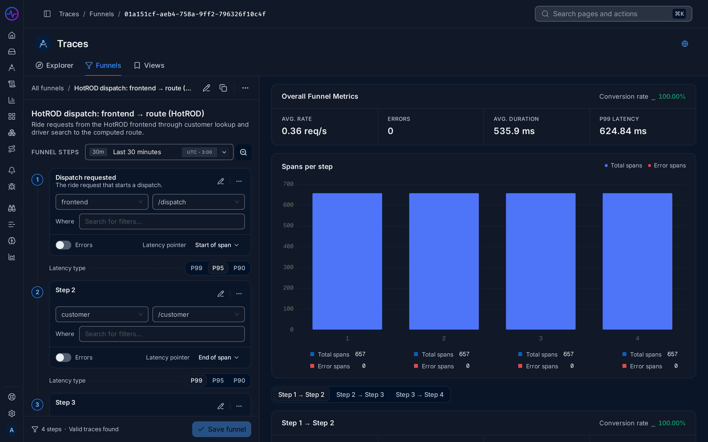
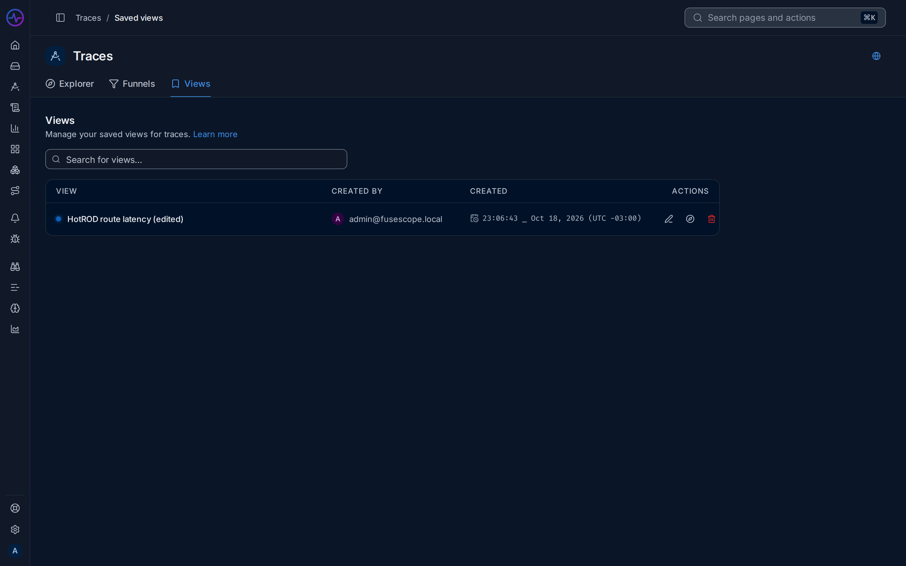

import { Aside, Steps } from "@astrojs/starlight/components";

The Traces explorer searches every [span](/fusescope-docs/reference/glossary/#span)
your services send, and opens the [trace](/fusescope-docs/reference/glossary/#trace)
each one belongs to.

**Use this page when** you need to find specific requests: the slowest ones, the failed
ones, or the ones that touched a given route, customer or host. To see a service's
overall health first, start from [Services](/fusescope-docs/apm/services/).

Open **Traces** in the sidebar (`/traces-explorer`). The page has three tabs:
**Explorer**, **Funnels** and **Views**.

## Search spans

Write a filter in the search box with the
[search syntax](/fusescope-docs/querying/search-syntax/), pick a time range in the top
bar and click **Run Query**. The scope selector next to the search box limits the query:

| Scope | Searches | Use it to |
|---|---|---|
| **All Spans** | Every span | Find any operation, such as one database query |
| **Root Spans** | Only the first span of each trace, the one with no parent ([root span](/fusescope-docs/reference/glossary/#root-span)) | Look at whole requests as the user saw them |
| **Entrypoint Spans** | The first span of a request in each service ([entrypoint span](/fusescope-docs/reference/glossary/#entrypoint-span)) | Look at the requests each service received |

The filter panel on the left lists quick filters. By default: Duration, Deployment
Environment, Has Error (Status), Service Name, Name, Rpc Method, Response Status Code,
Http Host, Http Method, Http Route, Http Url and Trace Id. Duration is a range; the others
list values to tick. Each filter shows the attribute it filters on, with an icon for its
kind. Above the filters:

- **Settings** opens the **Edit quick filters** sheet on the right, to add, remove and
  reorder filters for everyone in the organization.
- **Reset All** clears the selected values.
- **Collapse Filters** folds the panel into a narrow rail of icons that still marks the
  active filters with a badge. The explorer remembers it.

## Views

The toolbar switches between four views of the same query:

| View | Shows |
|---|---|
| **List** | One row per span: timestamp, service, span name, duration, HTTP method and response status code |
| **Traces** | One row per trace, from its root span: service, name, duration, span count and trace ID |
| **Time series** | The query's aggregation as a chart |
| **Table** | The query's aggregation as a table, one row per group |

**Time series** and **Table** use the query's aggregation and group by; see
[Query builder](/fusescope-docs/querying/query-builder/). In List, **Order by**
sorts the spans, and **Columns and options** opens the **Edit columns** sheet to add,
remove and reorder columns with any attribute.

Click a row to open its trace.

## Example: the slowest requests of a service

<Steps>

1. In the search box, type `service.name = 'frontend'` and set the scope to
   **Entrypoint Spans**, so you get one row per request the service received.
2. In the **List** view, set **Order by** to `duration_nano (desc)`.
3. Click **Run Query**. The slowest requests are at the top; click one to open its
   trace.
4. Click **Save this view** at the bottom and name it `frontend slowest`, to come back
   to it later.

</Steps>

The full walkthrough is in
[Investigate a slow endpoint](/fusescope-docs/guides/slow-endpoint/).

## Export, alert, add to dashboard

Above the results:

- **Download** exports the List or Traces view as `csv` or `jsonl`, up to 10k, 30k or 50k
  rows. **Table** and **Time series** results export the same way.
- **Create an alert** starts an [alert rule](/fusescope-docs/alerts/alert-rules/) from the current query.
- **Add to dashboard** adds the query as a panel to a new or existing dashboard.

Both need a query that has run.

## Trace details

A trace opens at `/trace/<trace-id>`. The header shows the trace ID, root service, entry
point, duration, start time and status code.

- **Flame Graph** shows every span on a time axis, with the span and error counts.
- **Waterfall** lists the spans as a tree. Search spans with a filter expression, pick a
  category (All, Database, Functions, HTTP, Jobs, LLM), step through matches, and turn on
  **Highlight errors**.
- **Analytics** breaks the trace down by **% exec time** and by **Spans**.
- **Trace options** sets **Preview fields** (up to 10 attributes shown on each span),
  **Colour by**, and **Download trace** as CSV or JSONL.

Each span row has **Copy Span Link** and **Add to Trace Funnel**.

### Span details

Click a span to open **Span details**. It can float, dock at the bottom or dock on the
right.

| Tab | Content |
|---|---|
| **Overview** | Every field and attribute, as a list or JSON. Each value can be copied, pinned, used to **Filter for value** or **Filter out value**, or to **Group by attribute** in the explorer. |
| **Events** | Span events, such as exceptions |
| **Logs** | Logs with the span's trace ID, from 5 minutes before to 5 minutes after the trace; **Open in Logs Explorer** shows them there |
| **Metrics** | Host or Kubernetes metrics, when the span has host or Kubernetes attributes |

<Aside>
  Logs appear in the **Logs** tab only when they carry the `trace_id` and `span_id` of the
  span. OpenTelemetry SDKs and log bridges add them when a log is written inside an
  active span. See [Instrument applications](/fusescope-docs/sending-data/instrumentation/#logs).
</Aside>

## Funnels

A funnel follows requests through an ordered set of steps. Each step is a service and a
span name, with optional filters. In the **Funnels** tab, click **New funnel**,
name it and add steps; spans can also be added from a trace with **Add to Trace Funnel**.
The results show the **Overall Funnel Metrics**, the traces that pass every step, and
the **Slowest 5 traces** and **Traces with errors**. Editing funnels needs the Editor or
Admin [role](/fusescope-docs/administration/users-and-roles/#roles).

## Saved views

A view saves the query, the explorer view and its columns. The bar at the bottom of the
explorer has **Select a view** and **Save this view**: give the view a label and a
colour. With a view open, **Update this view** saves changes and **Clear this view**
starts over. The **Views** tab lists the saved views, to open, edit or delete them.

Saving, editing and deleting views needs the Editor or Admin
[role](/fusescope-docs/administration/users-and-roles/#roles).
