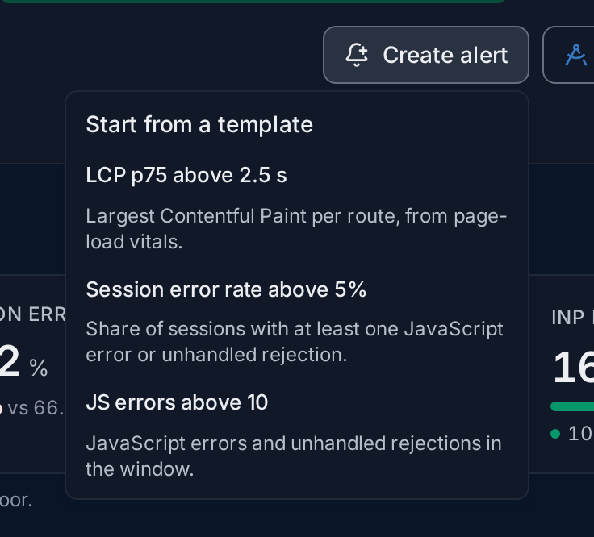

import { Aside, Steps } from "@astrojs/starlight/components";

RUM data is stored as ordinary logs, so frontend alerts are ordinary
[logs-based alert rules](/fusescope-docs/alerts/alert-rules/). Three **templates** fill
the query, the condition and the name for you; you only pick a notification channel and
save. Creating and editing rules needs the **Admin** or **Editor** role.

**Use them when** you want to know, without watching the screens, that pages became slow,
that more users hit errors, or that one particular error came back.

## The templates

| Template | Fires when | Query | Condition |
|---|---|---|---|
| **LCP p75 above 2.5 s** | Largest Contentful Paint gets slow, one alert per route. | `p75(browser.web_vital.value)` of `browser.web_vital` events with `browser.web_vital.name = 'lcp'`, grouped by `fusescope.rum.view.route` | **ABOVE** 2.5 s **ALL THE TIME** |
| **Session error rate above 5%** | More than 5% of sessions hit a JavaScript error. | **A**: sessions with an `exception` event; **B**: all sessions (both `count_distinct(session.id)`); formula **F1** = `A / B * 100` | **ABOVE** 5% **AT LEAST ONCE** |
| **JS errors above 10** | More than 10 errors in the evaluation window. | `count()` of `exception` events | **ABOVE** 10 **IN TOTAL** |

Every template is filtered to one application with `fusescope.rum.application.id`. Change
the values freely before saving: the threshold, the route, or **Group By**
`service.version` to get one alert per release. With the default evaluation window,
**Last 5 minutes**, **JS errors above 10** means more than 10 errors in 5 minutes. See
[Conditions](/fusescope-docs/alerts/alert-rules/#conditions) for what **ALL THE TIME**,
**AT LEAST ONCE** and **IN TOTAL** mean.

## Start from a template

From anywhere, open **Alerts**, click **New Alert** and choose **Log-based Alert**. When you have
RUM applications, a **Start from a frontend template** panel sits above the query:

1. **Rule name**: filled from the application and the template, such as
   `shop-demo LCP p75 above 2.5 s on /`. Rename it as you like.
2. **Start from a frontend template** fills the query, the condition and the name.
3. **Application**: the RUM application the rule watches.
4. The **templates**; the selected one is highlighted. Picking another replaces the query.
5. The **query** the template wrote, here LCP events of `shop-demo` on the route `/`.
6. **How this maps to frontend data**: which events and attributes each part of the query
   reads, and tips such as keeping the LCP alert to routes with about 50 page loads in the
   window, since a p75 of a few loads is noisy.

Then set the notification channel in **Notification settings** and click **Save Alert
Rule**. The rule then behaves like any other; see
[Alert rules](/fusescope-docs/alerts/alert-rules/).

## Start from the RUM screens

The RUM screens open the same editor with the template already applied:

- **Create alert** in an application's header offers the three templates for that
  application. **LCP p75 above 2.5 s** is grouped by route, so each route alerts on its
  own.

  

- **Create alert** in a [route's detail](/fusescope-docs/frontend/views/#route-detail)
  starts **LCP p75 above 2.5 s** filtered to that route.
- **Alert on this error** in an [error's detail](/fusescope-docs/frontend/errors/#error-detail)
  starts **JS errors above 10** filtered to that exception type and message.

<Aside>
  Nothing is saved until you click **Save Alert Rule**. Close the editor to discard the
  draft.
</Aside>

## Example: be told when a release slows a page

<Steps>

1. **Open the route.** In **Views**, click the route your users land on, such as `/`.

2. **Create the alert.** Click **Create alert** in the sheet. The editor opens with
   `shop-demo LCP p75 above 2.5 s on /`.

3. **Check the preview.** The chart under the query draws the route's LCP p75 with the
   2.5 s threshold as a dashed line. If the line is far below it, the threshold is right.

4. **Choose who is told.** In **Notification settings**, pick a channel, such as
   `slack-oncall`, and click **Save Alert Rule**.

</Steps>

## Related

- [Alert rules](/fusescope-docs/alerts/alert-rules/)
- [Notification channels](/fusescope-docs/alerts/notification-channels/)
- [Views](/fusescope-docs/frontend/views/)
