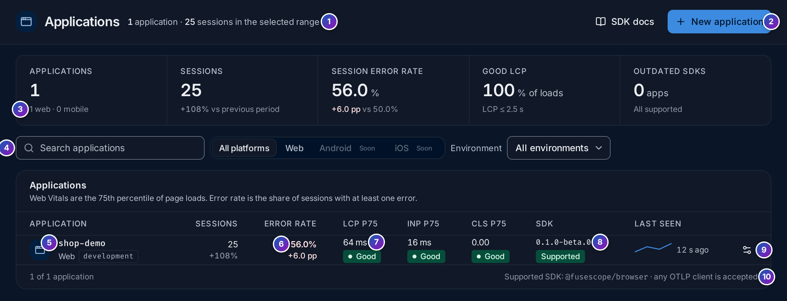

import { Aside, Steps } from "@astrojs/starlight/components";

**Frontend** (`/frontend/applications`, under **Observe** in the sidebar, marked
**Beta**) lists your [Real User Monitoring](/fusescope-docs/frontend/real-user-monitoring/)
applications. Click one to open its overview.

**Use these screens when** you want to know how fast your pages are for real users,
which JavaScript errors they hit, or which backend request was behind a slow or failing
page.

All numbers follow the time range at the top right, **Last 30 minutes** by default.

<Aside type="note">
  In the beta, the Frontend screens are open to the **Admin** and **Editor** roles.
</Aside>

## The applications list

1. **Count line**: how many applications there are and how many sessions they had in
   the range.
2. **New application**: create one; see
   [Set up a web application](/fusescope-docs/frontend/set-up-web/). **SDK docs** opens
   the SDK's README.
3. **KPI strip**, over every application:
   - **Applications**, with how many are web and mobile;
   - **Sessions**;
   - **Session error rate**: the share of sessions with at least one JavaScript error;
   - **Good LCP**: the share of page loads with an LCP of 2.5 s or less;
   - **Outdated SDKs**: applications whose latest data came from an SDK version this
     server no longer supports, or **All supported**.
4. **Search applications** by name, and filter by **platform** (Android and iOS are
   coming soon) and **Environment**.
5. **Application**: its name, platform and environment. Click the row to open its
   [overview](#the-overview).
6. **Sessions** and **Error rate**, with the change from the previous period of the
   same length.
7. **LCP p75**, **INP p75** and **CLS p75**, each rated **Good**, **Needs work** or
   **Poor**. See [Web Vitals in plain words](/fusescope-docs/frontend/real-user-monitoring/#web-vitals-in-plain-words).
8. **SDK**: the version of `@fusescope/browser` the application last reported, and its
   support badge: **Supported**, **Outdated** (data is still accepted) or
   **Other client** for another OpenTelemetry SDK. **Last seen** shows recent activity
   and when the last data arrived, or **No data yet**.
9. **Settings** opens the application's sheet: **Settings**, **Public key** and
   **Install**.
10. **Supported SDK**: the SDK this server is tested with. Any OTLP client is
    accepted.

## The overview

Click an application to open its overview (`/frontend/applications/<id>`).

### Header

1. **Badges**: the platform (**Web**), the environment and the latest release, which is
   the `version` your app passes to `init()`.
2. **SDK badge**: the SDK and version last seen, such as
   `@fusescope/browser 0.1.0-beta.0 · Supported`.
3. **View traces** and **View logs** open the
   [Traces](/fusescope-docs/explore/traces/) and
   [Logs](/fusescope-docs/explore/logs/) explorers filtered to this application. RUM
   spans (views and requests) are traces; errors, Web Vitals and clicks are logs.
4. **Settings** opens the application's sheet.
5. **Views**, **Errors** and **Sessions** are marked **Soon**: per-route details,
   errors grouped with source maps, and the full session list with a timeline come in a
   later release.

### Key numbers

6. **Release**: narrow the page to one release, to compare a new version with the
   previous one.
7. **Sessions**, **Views** (with views per session) and **Session error rate**, the
   share of sessions with at least one error.
8. **LCP p75**, **INP p75** and **CLS p75**, each with its rating and a bar that splits
   the page loads into good (green), needs improvement (amber) and poor (red). The line
   under the strip says how many page loads the vitals come from, and the thresholds for
   good.

### Panels

9. **Top routes by LCP**: one row per route template, slowest LCP first, with the
   number of **Page loads**, **LCP p75** and its split, **INP p75**, **CLS p75** and
   **Errors**. Vitals belong to the route the page was loaded on, so a single-page app
   that is always entered through `/` shows mostly `/` here.
10. **Recent errors**: JavaScript errors and unhandled rejections grouped by type and
    message, with the **Route**, the number of **Events** and of **Sessions** affected,
    and **Last seen**. Stack traces are not symbolicated yet. **Open in Logs** shows all
    of them in the Logs explorer.
11. **View in Logs** opens one group's events, with their full stack trace.
12. **Recent sessions**: the latest sessions with when they **Started**, their
    **Duration**, number of **Views** and **Errors**, **Browser · OS** and **Release**.
13. **View backend trace** opens, in
    [Trace details](/fusescope-docs/explore/trace-details/), the backend trace of the
    session's slowest or failing request, such as `GET /dispatch 200 · 737 ms`.
    **No backend requests** means the session made no linked request.
14. **All traces for these sessions** opens the Traces explorer filtered to their
    `session.id` values.

## Example: errors, and the backend behind a click

The numbers are from the `shop-demo` sample application over the last 30 minutes. Its
**Order a ride** button calls the HotROD demo's `/dispatch` API on another origin, and
two buttons raise JavaScript errors.

<Steps>

1. **Open the application.** In **Frontend**, the `shop-demo` row shows about 25 sessions
   and an **Error rate** of 56%: more than half the visits hit an error. LCP, INP and
   CLS are all **Good**, so the pages are fast; the problem is errors.

2. **Read the errors.** In **Recent errors**, `TypeError` *Cannot read properties of
   undefined (reading 'price')* affected 10 sessions: an uncaught error, a bug in the
   page's code. `Error` *Failed to fetch: POST /api/cart returned 502* affected 7: an
   unhandled promise rejection.

3. **See the stack trace.** Click **View in Logs** on the `TypeError` row. Each event
   has its `exception.stacktrace`, the `session.id` and the route.

4. **Open the backend side of a click.** Back on the overview, in **Recent sessions**,
   each row's **Backend trace** shows the session's slowest request, such as
   `GET /dispatch 200 · 737 ms`. Click **View backend trace**: Trace details opens the
   trace that started in the browser, with the browser's request span and, under it,
   the spans of the HotROD services that answered it. That is where the 737 ms went.

</Steps>

**What you learn**: the pages are fast but fragile: two JavaScript errors account for
the error rate, and the slowest user-facing wait is a backend call you can now read
span by span.

## Related

- [Set up a web application](/fusescope-docs/frontend/set-up-web/)
- [Keys](/fusescope-docs/frontend/keys/)
- [Trace details](/fusescope-docs/explore/trace-details/)
