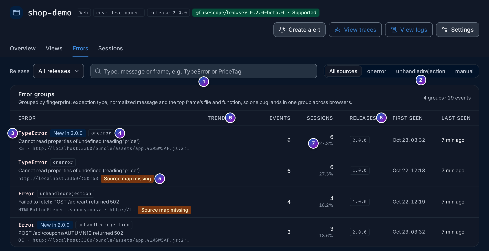
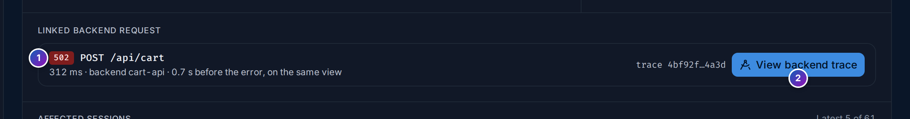
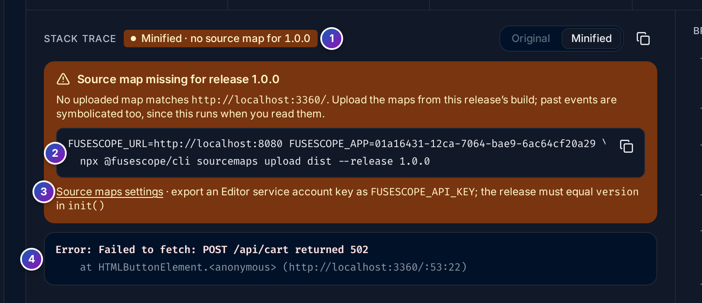

import { Aside, Steps } from "@astrojs/starlight/components";

The **Errors** tab of an application (`/frontend/applications/<id>/errors`) groups the
errors your users hit, so that one bug is one row however many times it
happened. Click a group to see its stack trace, what the user did before it, and the
backend request that may have caused it.

**Use it when** you want to know which errors affect the most users, whether a release
brought a new one, or why a particular error happens.

The browser SDK reports uncaught errors (`onerror`), unhandled promise rejections
(`unhandledrejection`), and errors you report yourself with
[`addError()`](/frontend/sdk-reference/#functions) (`manual`). For Android,
see [Crashes and ANRs](#crashes-and-anrs). All numbers follow the time range and the
**Release** filter.

## Error groups

1. **Search** by type, message or frame, such as `TypeError` or `PriceTag`.
2. **Source**: **All sources**, `onerror`, `unhandledrejection` or `manual`. When you
   come from a route, a chip shows the **route** filter, with a button to clear it.
3. **Error**: the exception type, then the message of the latest event and the top
   frame: the function and file where it was raised. Click the type to open the
   [detail](#error-detail).
4. **Badges**:
   - **New in 2.0.0**: the group first appeared in the newest release seen in the
     range, and an older release exists. These are the errors a deploy introduced.
     Their trend line is red.
   - the **source**, such as `onerror`.
5. **Source map missing**: the group's latest release has no uploaded source maps, so
   its stack trace is minified. See [Source maps](/frontend/source-maps/).
6. **Trend**: the number of events over the range.
7. **Events** and **Sessions**, with the share of all sessions in the range that hit the
   error, such as 27.3%. Sort your attention by sessions, not events: one user stuck in a
   loop can send hundreds of events.
8. **Releases** with events in the range: the latest one, then **+1** for each other.
   **First seen** and **Last seen** look back 30 days (or your log retention, if shorter),
   not only the range.

The tab lists the 200 groups with the most events.

### How errors are grouped

Each group has a **fingerprint**, 16 hexadecimal characters such as `786705ba6798eadc`,
computed from:

- the **exception type**, such as `TypeError`;
- the **message**, normalized: URLs become `<url>`, ids become `<id>` and numbers
  become `<n>`, so `Order 1234 failed` and `Order 98 failed` are one group;
- the **file and function of the top frame**. The file loses its origin, query string
  and content hash (`/assets/app.4GMSW5AF.js` counts as `/assets/app.js`); line and
  column are left out, since they move with every minified build.

The same bug in Chrome, Safari and Firefox therefore lands in one group, and stays in
that group from one deploy to the next.

Android errors are Java stack traces and group differently; see
[Grouping Android errors](#grouping-android-errors).

## Error detail

Click a group to open its detail (`…/errors/<fingerprint>`).

1. **Header**: the type, the source, the route, the message and the fingerprint.
2. **Event**: the group keeps its 10 latest events. The arrows move between them, such
   as **Event 1 of 3 latest**; the stack, breadcrumbs and linked request follow the
   selected event. **View in Logs** opens the events in the
   [Logs explorer](/explore/logs/).
3. **Alert on this error** opens the alert editor with the **JS errors above 10**
   template, filtered to this exception type and message. See
   [Frontend alerts](/frontend/alerts/).
4. **Session timeline** opens the
   [timeline](/frontend/sessions/#the-session-timeline) of the selected
   event's session.
5. **Key numbers**: **Events** in the range, **Sessions affected** and their share,
   **First seen** and **Last seen** with their release, and the **Top browser**.
6. **Stack trace**: **Symbolicated** with the source map that resolved it, such as
   `/bundle/assets/app.4GMSW5AF.js.map`, or **Minified** when no map matched.
7. **Original** shows your source files, functions and lines; **Minified** shows the
   stack as the browser sent it. The copy button copies the raw stack.
8. **Source context**: a few lines around each original frame, the failing line
   highlighted. Click a frame to open or close it.
9. **in app** marks frames from your code. Frames from `node_modules` and the browser
   are folded into a line such as **Show 3 frames from
   node_modules/@tanstack/query-core**.
10. **Breadcrumbs**: the views, clicks and requests of the same session in the 2 minutes
    before the error, timed relative to it (`-0:01.9`). **Full timeline** opens the whole
    session.
11. **Linked backend request**: the last request of the session that failed in the
    5 seconds before the error. See [below](#the-request-behind-an-error).
12. **Affected sessions**: the 5 sessions with the latest events, with their release,
    browser, views and how many times they hit the error. **Timeline** opens each one.

### The request behind an error

Many frontend errors are a backend failure in disguise: an API answers `502` and the page
throws `Failed to fetch`. When a request of the same session failed in the 5 seconds
before the error, the detail shows it:

*Sample data: this image is a Storybook story.*

1. The request's **status**, method and path, its duration, the backend service that
   answered and how long before the error it started.
2. **View backend trace** opens it in
   [Trace details](/explore/trace-details/), where the failing backend
   span is.

When there is none, the section reads **No failed request on this view shortly before
the error**, with a link to the requests in the timeline.

### When the source map is missing

Without a source map for the event's release, the stack stays minified and the detail
says what to upload:

1. **Minified · no source map for 1.0.0**: the release the event came from.
2. The **upload command**, with this FuseScope's URL, the application id and the
   release filled in. Export an Editor service account key as `FUSESCOPE_API_KEY` first.
3. **Source maps settings** opens the application's
   [Source maps](/frontend/source-maps/) tab.
4. The **minified stack**, as received.

Upload the maps of that release and reload the page: stack traces are symbolicated when
you read them, so past events are fixed too.

<Aside>
  An inline `<script>` in your HTML, such as `http://localhost:3360/:53:22` above, has no
  bundle and so no source map. Move the code into your bundle to get original frames.
</Aside>

## Crashes and ANRs

An Android application has three kinds of error, each in its own groups, since the same
exception crashing the app and caught by your code are different problems:

| Kind | Source | What it is | Badge |
|---|---|---|---|
| **Crash** | `crash` | An uncaught Java or Kotlin exception that killed the app. The SDK writes it out before the process dies. | **Crash**, red |
| **ANR** | `anr` | *Application Not Responding*: the main thread was blocked for about 10 seconds. The stack trace is the main thread's at that moment: what it was stuck on. | **ANR**, amber |
| **Handled** | `manual` | An exception your code passed to `FuseScope.addError()`. | none |

The source shows next to the type, as `fusescope.rum.error.source`, and the **Source**
filter offers **Crash**, **ANR** and **Manual** on Android. An ANR's type is `ANR`; the
gateway also stores the `ApplicationNotResponding` type of SDK `0.1.0-beta.1` as `ANR`
on new events. Native (NDK) crashes are not captured yet; they are planned.

### Retraced stack traces

Release builds minified with R8 report obfuscated frames, such as
`at a.b.c(SourceFile:12)`. With the release's
[R8 mapping](/frontend/r8-mappings/) uploaded, the stack trace shows
**Retraced** and **Original** gives your classes, methods, files and lines, including
inlined methods; **Obfuscated** shows it as the app sent it. Like source maps, retracing
runs when you read the error, so uploading a mapping later fixes past events.

- The **causes** of the exception (`Caused by:`, `Suppressed:`) are retraced and shown
  under it.
- **in app** marks your frames. Frames from the platform and common libraries, such as
  `java.`, `android.`, `androidx.`, `kotlin.`, `okhttp3.` and the SDK itself, are folded.
- Without a mapping, the group shows **R8 mapping missing** and the detail reads
  **Obfuscated · no R8 mapping for 1.8.0**, with the `curl` command to upload it. See
  [When a stack stays obfuscated](/frontend/r8-mappings/#when-a-stack-stays-obfuscated).

### Grouping Android errors

A Java stack trace keeps the same frames from one build to the next, so Android errors
group by **source**, not message. The fingerprint is computed from:

- the **source**: `crash`, `anr` or `manual`;
- the **exception type**, retraced, such as `java.lang.IllegalStateException`;
- the **class and method of the top three in-app frames**, retraced, looking at the
  thrown exception first, then its causes. Line numbers are left out, so a bug stays in
  one group when code around it moves.

With no in-app frame at all, the normalized message is used instead. A release without
its mapping groups on obfuscated names, so its errors may land in other groups until the
mapping is uploaded.

## Example: did the last release break something?

<Steps>

1. **Look for new errors.** Open **Errors**. Groups marked **New in 2.0.0** first appeared
   in the newest release.

2. **Read the original code.** Click the group. The stack shows `applyCoupon` in
   `src/cart/pricing.js` at line 13: the coupon request returned `502` and the code
   threw.

3. **See what the user did.** **Breadcrumbs** show the page load of `/bundle/`, a click on
   `button#checkout`, then `button#coupon` just before the error.

4. **Be told if it comes back.** Click **Alert on this error**, pick a notification
   channel and save.

</Steps>

## Related

- [Source maps](/frontend/source-maps/) and
  [R8 mappings](/frontend/r8-mappings/)
- [Sessions](/frontend/sessions/)
- [Exceptions](/apm/exceptions/): errors raised by your backend services.
