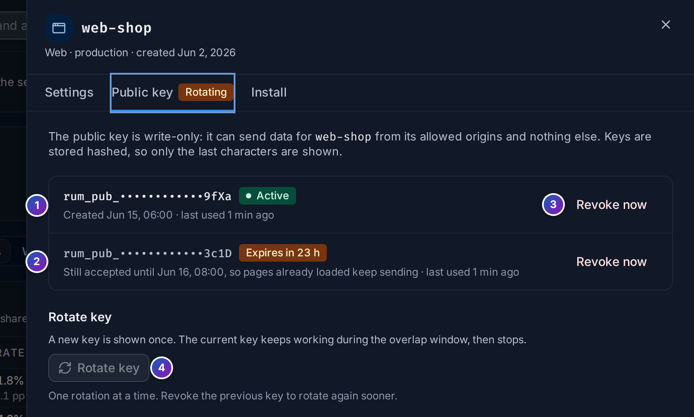
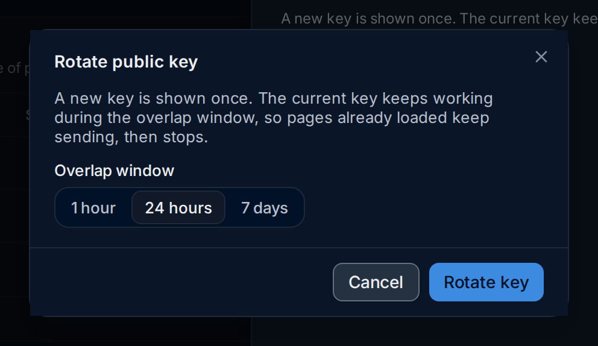

import { Aside, Steps } from "@astrojs/starlight/components";

Each RUM application has a **public key**, such as `rum_pub_…9fxa`, that your web app
sends with its data in the `FuseScope-RUM-Key` header. Manage it in the application's
**Settings** sheet, on the **Public key** tab. You need the **Admin** or **Editor**
role; viewers can open the application's settings but not its keys.

## What a public key can do

The key ships inside your JavaScript bundle, so anyone can read it. That's expected:

- it is **write-only**: it can send data, never read it;
- it only sends data **for its application**, whose name and platform the gateway sets
  on every request whatever the client claims;
- browser requests are only accepted from the application's **allowed origins**;
- it is **rate-limited** per key and per browser.

FuseScope stores only a SHA-256 hash of the key, so it shows the full key once, when it
is created or rotated, and then only its last four characters.

Rotate the key when it was copied somewhere it shouldn't be, when someone abuses it from
an allowed origin, or on a schedule if your policy asks for one.

## The Public key tab

*Sample data: this image is a Storybook story.*

1. **Active** key: the current one, with when it was created and last used. **Last
   used** is updated about once a minute.
2. **Expiring** key: the previous key during a rotation, with how long it still works,
   such as **Expires in 23 h**. The tab title shows **Rotating** meanwhile.
3. **Revoke now** stops a key at once.
4. **Rotate key** starts a rotation. Only one rotation runs at a time, so it is disabled
   until the previous key expires or you revoke it.

## Rotate a key

A rotation creates a new key and keeps the current one working for an **overlap
window**. Pages your users already have open still carry the old key in their bundle;
the window lets them keep sending until they reload with the new one.

<Steps>

1. Open **Frontend**, click **Settings** on the application's row, then the
   **Public key** tab.

2. Click **Rotate key** and choose the **Overlap window**: **1 hour**, **24 hours**
   (the default) or **7 days**. Pick a window longer than it takes you to deploy the
   new key, plus how long users keep a tab open.

   

3. Click **Rotate key**. The new key is shown **once**: copy it. The **Install** tab
   shows the snippet with the new key until you close the sheet.

4. Replace `publicKey` in your app's `init()` call and deploy.

5. When the overlap window ends, the old key stops working. Requests that still use it
   are rejected and show under the **Install** tab's status as
   *the key is not valid for this application*.

</Steps>

<Aside>
  Done deploying early? **Revoke now** on the expiring key ends the overlap at once and
  lets you rotate again.
</Aside>

## Revoke a key

**Revoke now** stops a key immediately: data sent with it is refused from then on. It
can't be undone. Use it when a key leaked and an overlap window would be too long.

Revoking the only active key leaves the application with no usable key, and all its data
is refused until you click **Create key** and deploy the new key.

<Aside type="caution">
  Each FuseScope server caches a key lookup for 30 seconds, so with several replicas a
  revoked key can still be accepted for up to 30 seconds.
</Aside>

## Related

- [Set up a web application](/frontend/set-up-web/#troubleshoot-rejected-requests):
  rejected requests.
- [SDK reference](/frontend/sdk-reference/): the `publicKey` option.
