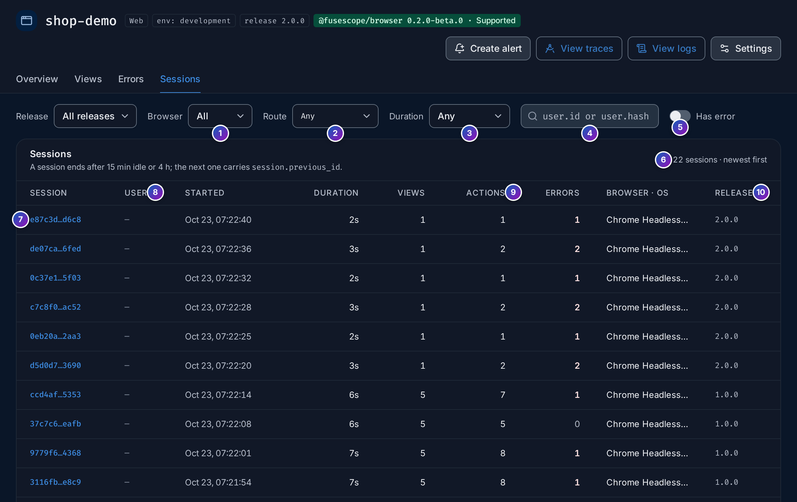

import { Aside, Steps } from "@astrojs/starlight/components";

The **Sessions** tab of an application (`/frontend/applications/<id>/sessions`) lists the
visits of your users, newest first. Click one to open its **timeline**: what the user saw
and did, in order, with every request linked to its backend trace.

**Use it when** a user reports a problem and you want to see what happened to them, or
when you want to see what visits with errors have in common.

A [session](/fusescope-docs/reference/glossary/#session) ends after 15 minutes without a
click, key press, scroll or touch, or after 4 hours. The next one carries the previous
one's id as `session.previous_id`, so you can follow a long visit across sessions. No
screen is recorded: there is no replay, and form inputs and page text are never captured.

## The session list



The filters next to **Release** narrow the list. They are kept in the URL, so a filtered
list can be shared.

1. **Browser**: **All**, or one browser such as **Chrome**, **Safari**, **Firefox** or
   **Edge**.
2. **Route**: only sessions that saw this [route](/fusescope-docs/frontend/views/).
3. **Duration**: **< 10 s**, **10 s – 1 min**, **≥ 1 min**, **≥ 5 min** or
   **≥ 15 min**. Very short sessions often mean users who left at once.
4. **User**: sessions of one user, by their `user.id`. Press Enter to apply. Users are
   only known when your app calls [`setUser()`](/fusescope-docs/frontend/sdk-reference/#setuser).
   By default the SDK sends a SHA-256 hash of the id, so search for the hash, not the
   raw id; see [User identity](/fusescope-docs/frontend/sdk-reference/#user-identity).
5. **Has error**: only sessions with at least one JavaScript error.
6. **Count**: how many sessions match. The list shows 50 per page by default (20, 50 or
   100).
7. **Session**: the short `session.id`. Click it to open the
   [timeline](#the-session-timeline). When the session continues an earlier one, a line
   **after** links to the previous session.
8. **User**: the short `user.id`, or **—** when the app set no user.
9. **Started**, **Duration**, **Views**, **Actions** (clicks and custom actions) and
   **Errors**.
10. **Browser · OS** and **Release**.

## The session timeline


1. **Session**: the full `session.id`, with the browser and OS, the release and the
   environment. With `setUser()`, a **user** tag shows the short `user.id`. A line
   **after** links to the previous session.
2. **Copy link** copies the timeline's URL. **Logs of this session** and **Traces of
   this session** open the [Logs](/fusescope-docs/explore/logs/) and
   [Traces](/fusescope-docs/explore/traces/) explorers filtered to its `session.id`.
3. **Key numbers**: when it **Started**, its **Duration**, **Views** (and how many were
   page loads), **Actions**, **Requests** (and how many failed) and **Errors**.
4. **Views**: the session as a bar, one segment per view, labelled with its route. Ticks
   under it are actions; a red dot is an error. Click a segment to jump to that view.
5. **Event types**: show **All** events, or only **Views**, **Actions**, **Requests**,
   **Errors** or **Vitals**, each with its count. **Expand all** and **Collapse all**
   open or close every view.
6. **A view**: the time it started since the beginning of the session, the route,
   **Page load** or **Route change**, the path, how many requests and actions it had,
   and how long the user stayed. Click it to expand it. A red badge counts its errors.
7. **Requests on this view**: a waterfall of the view's `fetch` and XHR calls, with
   their duration.
8. **Request** events show the method and URL, the backend service that answered, the
   status and the duration. **View backend trace** opens the trace in
   [Trace details](/fusescope-docs/explore/trace-details/): the browser's request and,
   under it, the backend spans it caused. **Trace** means the request reached no
   instrumented backend.
9. **Error** events show the type and message and how they were raised (`onerror`,
   `unhandledrejection` or `manual`). **View error** opens the
   [error group](/fusescope-docs/frontend/errors/#error-detail); **View in Logs** opens
   the event itself.

The other events are **Click**, with the element that was clicked such as
`button#order` (see [What a click records](#what-a-click-records)), and **Vital**, with
a Web Vital and its rating. Events recorded before the first view are listed under
**Before the first view**. When a session has more events than one page holds, a note
says the timeline stops early; its logs and traces have the rest.

<Aside>
  Browsers report LCP late, often after the user has already moved to the next route.
  The timeline shows a vital when it was reported, so a page load's LCP can appear on
  the following route change, as `/product/:id` above. The
  [Views](/fusescope-docs/frontend/views/) tab still counts it for the route the page was
  loaded on.
</Aside>

### What a click records

The SDK names what was clicked with a short, stable selector, sent as
`fusescope.rum.action.target`. It never records the element's text. In order, it uses:

1. the closest element with a `data-fusescope-action` attribute, such as
   `div[data-fusescope-action="checkout"]`;
2. else the closest button, link or form control by its `id`, such as
   `button#add-to-cart` (ids that look generated are skipped), its `aria-label`, such as
   `button[aria-label="Close"]`, or its first class, such as `a.nav-link`.

To get readable names, add `data-fusescope-action` to the elements that matter:

```html
<button data-fusescope-action="checkout">Pay now</button>
```

## Example: what happened to this user?

<Steps>

1. **Find their sessions.** If your app calls `setUser()`, hash the user's id with
   SHA-256 and paste it into the user search. Otherwise, filter by **Route** and turn on
   **Has error**.

2. **Open the session.** Click the session id. The view strip shows where the user went
   and where the error happened (the red dot).

3. **Read what led to the error.** Click the segment with the dot. The expanded view
   lists the clicks and requests before the error, in order.

4. **Follow the request to the backend.** On the request just before the error, click
   **View backend trace** to see which service answered and how long each span took.

</Steps>

## Related

- [Views](/fusescope-docs/frontend/views/)
- [Errors](/fusescope-docs/frontend/errors/)
- [Browser SDK reference](/fusescope-docs/frontend/sdk-reference/)
