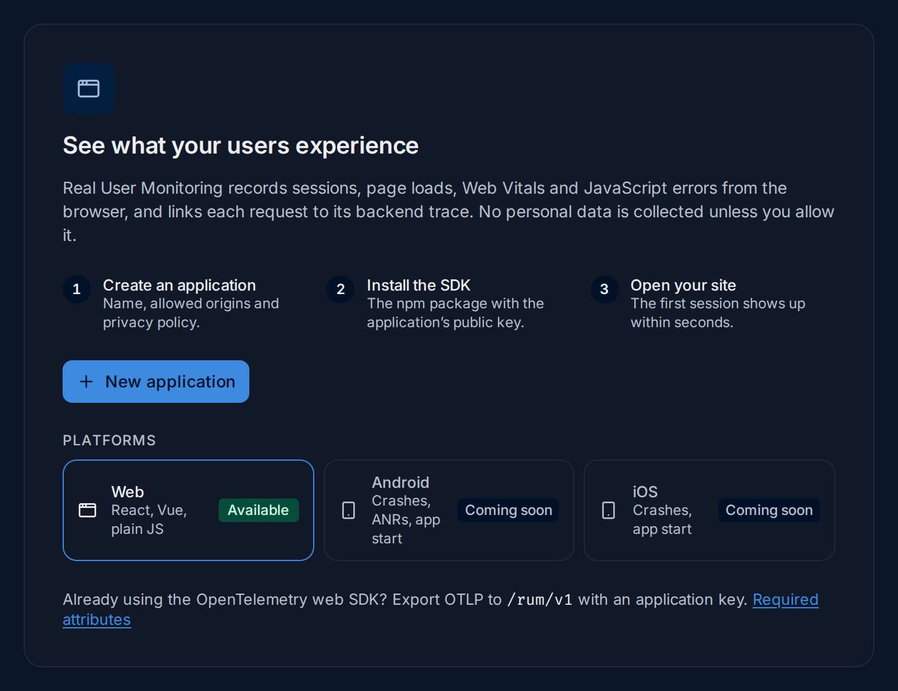

import { Aside, Steps, Tabs, TabItem } from "@astrojs/starlight/components";

This page takes a web application from nothing to its first session in FuseScope, in
about ten minutes. You need the **Admin** or **Editor** role, and a web app you can
change and deploy. It works with any framework that uses a bundler, such as React with
Vite, Vue, Angular or Next.js.

If you don't know what RUM records yet, start with
[Real User Monitoring](/fusescope-docs/frontend/real-user-monitoring/).

## The steps at a glance

<Steps>

1. [Create the application](#create-the-application) in FuseScope: its name, the
   origins allowed to send data, and its privacy policy.
2. [Copy the public key](#copy-the-public-key). It is shown once.
3. [Install the SDK](#install-the-sdk) with npm and paste the generated `init()` call.
4. [Allow `traceparent`](#allow-traceparent-in-your-apis-cors) in your API's CORS, if
   the API is on another origin.
5. [Open your site and watch the data arrive](#check-that-data-arrives).
6. [Upload your source maps](#upload-source-maps) with each release, so errors show your
   original code.

</Steps>

## Create the application

A RUM **application** is one web app in one environment, such as `web-shop` in
`production`. Open **Frontend** in the sidebar, then **New application**. When there is
no application yet, the page explains RUM and shows the same button:



*Sample data: this image is a Storybook story.*

The **New application** sheet has two steps, **Settings** and **Install**. Here it is
filled for a shop at `https://shop.example.com` whose API is at
`https://api.example.com`:


### 1. Application

1. **Name**: sent as `service.name`, so it is also how the app appears in
   [Services](/fusescope-docs/apm/services/) and the explorers. Use lowercase letters,
   digits and dashes, such as `web-shop`.
2. **Environment**: sent as `deployment.environment.name`, such as `production` or
   `staging`. Create one application per environment, so each has its own key, origins
   and numbers.
3. **Platform**: **Web**. For an Android app, see
   [Set up an Android application](/fusescope-docs/frontend/set-up-android/); iOS is
   coming soon.

### 2. Origins and tracing

4. **Allowed origins**: the sites allowed to send data with this application's key.
   Type an origin and press Enter. An origin is a scheme, host and optional port, with
   no path: `https://shop.example.com` or `http://localhost:5173`.
   - `https://*.example.com` allows every subdomain of `example.com`, but not
     `example.com` itself; add it separately.
   - `*` allows any origin. Avoid it in production: anyone who copies your key could
     send data from their own site.
   - A browser request from any other origin is rejected. Add your local development
     origin too if you test from there.
5. **Link requests to backend traces**: the URLs of your APIs on **another origin**,
   such as `https://api.example.com`. The SDK adds `traceparent` to requests sent to
   them, which links each browser request to its backend trace. Requests to your site's
   own origin are always linked. Your API must accept the header; see
   [Allow traceparent](#allow-traceparent-in-your-apis-cors).
6. **Session sample rate**: the share of sessions recorded, in steps of 5%. The choice
   is made once per session, so a session is recorded whole or not at all. Sessions
   left out send nothing and add no `traceparent`, so they don't affect how your
   backend samples its traces. Keep 100% unless you have a lot of traffic.

### 3. Privacy

The line under **Privacy** reminds you that form inputs and typed text are never
captured, whatever you choose here.

7. **Drop query strings and fragments**: on by default. Removes everything after `?`
   and `#` from URLs and span names: `/search?q=boots#top` becomes `/search`. Query
   strings often hold emails, tokens or search terms, so keep it on.
8. **Keep these query parameters**: parameter names kept despite 7, such as `page` or
   `utm_source`. Only the name is matched; its value is kept as sent.
9. **Look up country from client IP**: marked **Soon**, off and disabled. A country
   lookup from the client's IP comes in a later release. The IP is never stored.
10. **Wait for consent**: the SDK records nothing until your consent banner calls
    `setConsent(true)`. Turn it on if you need consent before analytics, as under GDPR
    or LGPD.
11. **Hash user IDs**: on by default. When your code calls `setUser({ id })`, `user.id`
    carries the SHA-256 hash of the id instead of the id itself. Users are anonymous when
    you don't call `setUser()`.
12. **Create application** saves it, creates its first public key and opens the
    **Install** step.

### Server or SDK

Each setting carries a tag that says where it is applied:

| Tag | Settings | Applied by | When you change it |
|---|---|---|---|
| **SERVER** | Allowed origins, Drop query strings, Keep these query parameters | The FuseScope RUM gateway, on every request | Takes effect when you save, for all users |
| **SDK** | Link requests to backend traces, Session sample rate, Wait for consent, Hash user IDs | The SDK, from the options in the `init()` snippet | Copy the new snippet into your app and redeploy it |

Because the gateway applies the server settings itself, they hold even for a client
that ignores them, such as an old build or a hand-configured OpenTelemetry SDK.

## Copy the public key

Right after **Create application**, the **Install** step shows the application's
**public key**. It is the only time FuseScope shows it in full:


*Sample data: this image is a Storybook story.*

1. **Copy your public key now. It is shown once.** FuseScope stores only a hash of
   it, so it can't show the key again. Keys start with `rum_pub_`.
2. **Copy** puts the key on the clipboard.
3. The `init()` **snippet** already contains the key until you close the sheet.

The key is **public** and **write-only**: it is safe to ship in your JavaScript bundle,
where anyone can read it. It can only send data for this application, from its allowed
origins, within its rate limit. It can't read anything.

<Aside type="tip">
  Lost the key? You can't read it again, but you can make a new one: open the
  application's **Settings**, then **Public key**, and
  [rotate it](/fusescope-docs/frontend/keys/#rotate-a-key). The old key keeps working
  for an overlap window while you deploy the new one.
</Aside>

## Install the SDK

For React Router views and caught rendering errors, also follow
[Set up React RUM](/fusescope-docs/frontend/set-up-react/).

Install [`@fusescope/browser`](https://www.npmjs.com/package/@fusescope/browser) from
npm, with the `next` tag, which has the current beta, `0.2.0-beta.1`:

```bash
npm install @fusescope/browser@next
```

The **Install** tab shows `npm install @fusescope/browser` without the tag, which installs
an older beta; add `@next`.

Then paste the snippet from the **Install** step **as early as possible** in your app's
entry point, before your app renders, such as `src/main.tsx` or `src/main.ts`. The
snippet is generated from the application's settings; for the example above it reads:

```ts title="src/main.ts"
import { init } from '@fusescope/browser';

init({
  applicationId: '01a16431-12ca-7064-bae9-6ac64cf20a29',
  publicKey: 'rum_pub_…',
  endpoint: 'https://fusescope.example.com',
  service: 'web-shop',
  version: '<your app version>', // your release, e.g. from package.json
  environment: 'production',
  sessionSampleRate: 0.5,
  propagateTraceHeaderCorsUrls: ['https://api.example.com'],
  privacy: { queryAllowlist: ['page'] },
});
```

- `applicationId` is the application's id, not its name.
- `endpoint` is the FuseScope URL the snippet was generated on. Your users' browsers
  must be able to reach it: if you opened FuseScope through `localhost` or an internal
  host name, replace it with FuseScope's public URL. See
  [Self-hosted FuseScope](#self-hosted-fusescope).
- Replace `<your app version>` with your app's release, such as the `version` in
  `package.json`. It is sent as `service.version`, fills the **Release** filter and
  badge, and must be the `--release` you [upload source maps](#upload-source-maps) for.
  A bundler can inject it at build time:

  ```ts
  version: import.meta.env.VITE_APP_VERSION, // Vite, with define in vite.config.ts
  ```
- Options left at the SDK's defaults are omitted, so the snippet only shows what this
  application changes. All options are in the
  [SDK reference](/fusescope-docs/frontend/sdk-reference/).

The SDK is published as ESM for bundlers.

### Install with a script tag

For a site without a bundler, choose **Script tag** on the **Install** tab. The SDK is
then a single file that defines a global `FuseScope`. Pick where browsers load it from:

| Source | URL | Use when |
|---|---|---|
| **This FuseScope** (default) | `https://<your FuseScope>/rum/v1/sdk/browser/<version>/fusescope.min.js` | Self-hosted or air-gapped installs; browsers need to reach FuseScope anyway. |
| **cdn.fuseone.io** | `https://cdn.fuseone.io/browser/<version>/fusescope.min.js` | A public CDN run by FuseOne. |
| **jsDelivr** | `https://cdn.jsdelivr.net/npm/@fusescope/browser@<version>/dist/fusescope.min.js` | The npm package served by jsDelivr. |

All three serve the same file. Your FuseScope serves the version it was built with; the
**Install** tab uses that version for every source. The snippet looks like this:

```html
<script
  src="https://fusescope.example.com/rum/v1/sdk/browser/0.2.0-beta.1/fusescope.min.js"
  integrity="sha384-W9beoX1Dd3K5Qeu+f2RfXYn3RF/Z5NSY/TUye/4XmIr7RUnT23UwZSqyiY3UWDAs"
  crossorigin="anonymous"
></script>
<script>
  FuseScope.init({
    applicationId: '01a16431-12ca-7064-bae9-6ac64cf20a29',
    publicKey: 'rum_pub_…',
    endpoint: 'https://fusescope.example.com',
    version: '<your app version>', // your release
  });
</script>
```

- Put both tags in the `<head>`, before your own scripts, so the first view and its
  Web Vitals are recorded.
- Keep `integrity` and `crossorigin="anonymous"`. The browser computes the file's hash
  and refuses to run it if it differs, so a tampered CDN copy never executes. Each
  release publishes its hash in `fusescope.min.js.sri` next to the file.
- The page's origin must be in the application's **Allowed origins**, as with npm.

### Allow traceparent in your API's CORS

If your site calls an API on **another origin**, such as `https://api.example.com` from
`https://shop.example.com`, the browser sends a CORS preflight before each request that
carries `traceparent`. The API must allow that header, or the browser blocks the request
itself, not only its trace. Same-origin APIs need nothing.

Add `traceparent` (and `tracestate`, if you use it) to the API's
`Access-Control-Allow-Headers`:

<Tabs>
  <TabItem label="Express">
    ```js
    import cors from 'cors';

    app.use(cors({
      origin: ['https://shop.example.com'],
      allowedHeaders: ['content-type', 'authorization', 'traceparent', 'tracestate'],
    }));
    ```
  </TabItem>
  <TabItem label="NGINX">
    ```nginx
    add_header Access-Control-Allow-Headers "content-type, authorization, traceparent, tracestate" always;
    ```
  </TabItem>
  <TabItem label="Go (rs/cors)">
    ```go
    handler := cors.New(cors.Options{
        AllowedOrigins: []string{"https://shop.example.com"},
        AllowedHeaders: []string{"Content-Type", "Authorization", "traceparent", "tracestate"},
    }).Handler(mux)
    ```
  </TabItem>
</Tabs>

The backend must also be instrumented with OpenTelemetry and send its traces to
FuseScope; see [Instrument applications](/fusescope-docs/sending-data/instrumentation/).
OpenTelemetry instrumentations read `traceparent` and continue the browser's trace.

<Aside type="caution">
  Add to **Link requests to backend traces** only APIs you control. Third-party APIs
  usually reject unknown headers in their CORS preflight, which would break those
  requests.
</Aside>

## Check that data arrives

Deploy your app and open it in a browser. The **Install** step updates by itself: it
reads **Waiting for first data…** until the gateway accepts the first request, then
**Receiving data**:


1. **Install method**: **npm**; the two script-tag methods are coming soon.
2. **Install command**, with a copy button.
3. **Snippet**, with a copy button.
4. When you come back later, the snippet shows the key masked, such as
   `rum_pub_…sqdu`: replace it with your key.
5. A reminder for apps that already use the OpenTelemetry web SDK; see
   [Use another OpenTelemetry client](/fusescope-docs/frontend/opentelemetry-clients/).
6. **Receiving data**, with when the first data arrived and what arrived in the last
   5 minutes: **Sessions**, **Views**, **Errors** and **Web Vitals**.
7. **The SDK seen** and whether this server supports its version: **Supported**,
   **Outdated** (data is still accepted), or **Other client** for any other OpenTelemetry
   SDK. See [Compatibility](/fusescope-docs/frontend/sdk-reference/#compatibility).
8. **Open shop-demo** opens the application's
   [overview](/fusescope-docs/frontend/applications/#the-overview).

The first session shows up within seconds. Some Web Vitals, such as CLS and INP, are
only final when the user hides or leaves the page, so switch tabs or close the page to
send them sooner.

### Troubleshoot rejected requests

Requests the gateway refuses are listed under the status with a warning icon and how
many were rejected in the last 5 minutes, such as
`2 requests rejected: origin http://localhost:5173 is not allowed.`

| Message | Cause | Fix |
|---|---|---|
| **origin … is not allowed** | The page's origin is not in **Allowed origins**. The browser shows a CORS error and the gateway answers `403`. | Click **Add origin** on the line, then save. Check the scheme and port: `http://localhost:5173` and `http://localhost:3000` are different origins. |
| **the key is not valid for this application** | The key was revoked, or its rotation overlap ended. The gateway answers `401`. | Deploy the current key; see [Keys](/fusescope-docs/frontend/keys/). |
| **with an unknown key from …** | The key matches no key FuseScope issued, such as a typo or a key from another application or workspace, and the page's origin is in **Allowed origins**. The gateway answers `401`. | Check the `publicKey` in your snippet against the last four characters on the **Public key** tab. |
| **rate limited** | More than 20 requests per second from one browser (bursts of 60), or 500 per second for the whole key (bursts of 1,000). The gateway answers `429`. | Usually a loop or a misbehaving page. Behind a proxy, check [the client IP setting](#self-hosted-fusescope): otherwise all users share one limit. |
| **payload too large** | A request body over 4 MiB, before or after gzip. The gateway answers `413`. | The SDK sends small batches; this comes from a custom client. Send smaller batches. |
| **not valid OTLP** | The body is not OTLP, or its `Content-Type` is not `application/json` or `application/x-protobuf`. | Check the exporter of a custom client. |

<Aside>
  An unknown key names no application, so it is counted on every application whose
  **Allowed origins** include the request's origin, and nowhere when none does, such as
  for a request without an `Origin` header. If nothing arrives and no rejection shows,
  open the browser's network panel: requests to `/rum/v1/` that fail with `401` mean a
  key FuseScope doesn't know.
</Aside>

Other things to check when nothing arrives:

- **No request to `/rum/v1/` at all**: `init()` is not called, the session was not
  sampled (check `sessionSampleRate`), or **Wait for consent** is on and
  `setConsent(true)` hasn't been called.
- **Requests fail without reaching FuseScope**: `endpoint` is wrong, or the `/rum/`
  path is not exposed; see the next section.
- The counts are kept in memory by each FuseScope server for 5 minutes. They start
  again after a restart and, with several replicas, cover only the replica that
  answers. The data itself is in the explorers either way.

## Upload source maps

Your production bundle is minified, so a JavaScript error's stack trace reads
`kS · app.4GMSW5AF.js:2:11056`. Upload the source maps of each release and the
[Errors](/fusescope-docs/frontend/errors/) tab shows `applyCoupon · src/cart/pricing.js:13:11`
instead. In short:

1. Build with hidden source maps (Vite `build.sourcemap: 'hidden'`, webpack
   `devtool: 'hidden-source-map'`).
2. Create a service account with the **Editor** role and a key for it.
3. After each build, upload with the same release as `version`:

   ```bash
   FUSESCOPE_URL=https://fusescope.example.com \
   FUSESCOPE_APP=01a16431-12ca-7064-bae9-6ac64cf20a29 \
   FUSESCOPE_API_KEY=… \
     npx @fusescope/cli@next sourcemaps upload ./dist --release 1.8.0 --delete-after
   ```

The application's **Source maps** tab has these commands filled in. See
[Source maps](/fusescope-docs/frontend/source-maps/) for the details.

## Self-hosted FuseScope

The RUM gateway runs inside the FuseScope backend, on its HTTP port (8080), under
`/rum/`. Users' browsers send data straight to it, so:

- **Expose `/rum/` publicly.** The `endpoint` in the snippet must reach the backend's
  `/rum/v1/traces` and `/rum/v1/logs` from the internet. The Helm chart's default
  ingress path `/` already does; if you route only some paths, add `/rum`. See
  [Expose FuseScope](/fusescope-docs/install/helm/#expose-fusescope).
- **Let the gateway answer CORS.** Your ingress or proxy must pass `OPTIONS` requests
  and the `Origin` header through and must not add CORS headers of its own. With
  ingress-nginx, don't set `enable-cors` on this ingress, and raise
  `proxy-body-size` (1 MB by default) to 4 MB.
- **Trust the client IP behind a proxy.** The per-browser rate limit keys on the client
  IP. Behind an ingress or load balancer every browser would share the proxy's IP, and
  one limit. Set the chart's `trustForwardedFor` value to `true`, or the backend
  environment variable `SIGNOZ_RUM_RATELIMIT_TRUST__FORWARDED__FOR=true`, so the
  gateway reads the first `X-Forwarded-For` address. Only do this behind a proxy that
  sets that header, since a browser could otherwise choose its own address.
- **Point the gateway at your collector.** It forwards to
  `http://localhost:4318` by default. Outside Helm, set
  `SIGNOZ_RUM_COLLECTOR__ENDPOINT` to your collector's OTLP/HTTP address, such as
  `http://otel-collector:4318`.

The gateway's settings are under `rum` in the
[configuration file](/fusescope-docs/configuration/config-file/), such as
`rum.max_body_size` and `rum.ratelimit.client.rate`. `rum.enabled: false` turns the
gateway off. See [Install with Helm](/fusescope-docs/install/helm/) for the chart.

## Related

- [Applications and Overview](/fusescope-docs/frontend/applications/): read what
  arrives.
- [Source maps](/fusescope-docs/frontend/source-maps/): original stack traces.
- [Keys](/fusescope-docs/frontend/keys/): rotate or revoke the public key.
- [SDK reference](/fusescope-docs/frontend/sdk-reference/): every `init()` option.
