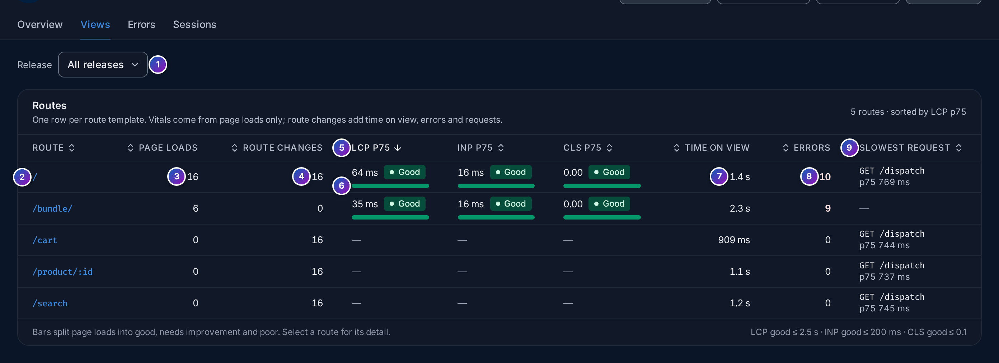

import { Aside, Steps } from "@astrojs/starlight/components";

The **Views** tab of an application (`/frontend/applications/<id>/views`) has one row per
**route**: a page of your app named by its
[route template](/fusescope-docs/reference/glossary/#route-template), such as
`/product/:id`. Click a route to open its detail.

**Use it when** you want to know which pages are slow, which pages users spend time on,
which pages raise errors, or which API call makes a page wait.

All numbers follow the time range at the top right and the **Release** filter. Any role,
**Viewer** included, can read this tab.

## Page loads and route changes

A single-page app loads its HTML once, then changes route without reloading. RUM tells
the two apart:

- a **page load** is the view the browser loaded the page on: the first view of a visit,
  or a reload;
- a **route change** is any later view, after a click on a link or a router navigation.

Only page loads have Web Vitals: the browser measures LCP, CLS, FCP and TTFB once per
loaded page. Route changes still count their time on view, errors and requests.

The SDK sends the kind as `fusescope.rum.view.loading_type` (`initial_load` or
`route_change`), from version 0.2.0. Views from older SDKs have no loading type: they are
counted in neither column, marked with `*`, and a note above the table asks you to
[update the SDK](/fusescope-docs/frontend/sdk-reference/).

## The routes table

1. **Release**: narrow the table to one release, the `version` your app passes to
   `init()`.
2. **Route**: the route template. Click it to open the [route detail](#route-detail).
3. **Page loads**: views that loaded the page on this route.
4. **Route changes**: views reached by navigating inside the app. In the example, users
   always enter on `/`, so `/cart`, `/product/:id` and `/search` only have route
   changes, and no vitals.
5. **LCP p75**, **INP p75** and **CLS p75**, each rated **Good**, **Needs work** or
   **Poor**. See
   [Web Vitals in plain words](/fusescope-docs/frontend/real-user-monitoring/#web-vitals-in-plain-words).
   The table is sorted by LCP p75, slowest first; click any heading to sort by it.
6. **Split bar**: the share of page loads rated good (green), needs improvement (amber)
   and poor (red). A p75 can look fine while one load in five is poor; the bar shows it.
7. **Time on view**: the median time users stayed on the route, from the moment it
   opened until the next navigation or until the tab was hidden.
8. **Errors**: JavaScript errors raised while the route was open, page loads and route
   changes together.
9. **Slowest request**: the `fetch` or `XMLHttpRequest` call with the highest p75 on the
   route, by method and URL template, such as `GET /dispatch`. A p75 of 800 ms or more
   is shown in amber.

The footer repeats the thresholds for **good**: LCP ≤ 2.5 s, INP ≤ 200 ms and
CLS ≤ 0.1. The table lists up to 200 routes, the most viewed first.

## Route detail

Click a route to open its detail sheet. The URL keeps it (`?route=/`), so you can share
the link.

1. **Route** and the attribute it comes from, `fusescope.rum.view.route`, with a few
   example paths, such as `/product/1234` for `/product/:id`.
2. **Create alert** opens the alert editor with the template **LCP p75 above 2.5 s**,
   filtered to this route. See [Frontend alerts](/fusescope-docs/frontend/alerts/).
3. **Key numbers**: **Views**, **Page loads**, **Route changes**, the median **Time on
   view** and **Errors**. Click the error count to open the
   [Errors](/fusescope-docs/frontend/errors/) tab filtered to this route.
4. **Vitals over time**: switch between **LCP**, **INP** and **CLS**; each button shows
   the p75 of the range. The chart draws the p75 per step, such as **per 1 min**, with the
   **good** (green) and **poor** (red) thresholds as dashed lines. Under the chart, the
   **FCP p75** and **TTFB p75** of the route.
5. **Release markers**: a dotted vertical line where a release was first seen, labelled
   with its version, such as `1.0.0`. If the line goes up right after a marker, that
   release made the page slower.
6. **Slowest requests**: the route's `fetch` and XHR calls by method and URL template,
   slowest p75 first, with the number of **Calls** and how many **Failed**. **Backend** is
   the first backend service in the slowest call's trace, such as `frontend` for the
   HotROD demo; **—** means the call reached no instrumented backend, as for a
   third-party API.
7. **Slowest trace** opens, in
   [Trace details](/fusescope-docs/explore/trace-details/), the trace of the slowest
   call: the browser's request and, under it, the backend spans it caused. Backend spans
   only appear for APIs that receive `traceparent`; see
   [Allow traceparent](/fusescope-docs/frontend/set-up-web/#allow-traceparent-in-your-apis-cors).
8. **Browsers and OS**: the share of page loads per browser and per operating system,
   with their LCP p75, to spot a browser that is slower than the rest.
9. **Recent sessions on this route**: the latest sessions that saw it, with **This
   view**: whether it was a page load (with its LCP) or a route change. Click a session to
   open its [timeline](/fusescope-docs/frontend/sessions/#the-session-timeline).
10. **All sessions on** the route opens the
    [Sessions](/fusescope-docs/frontend/sessions/) tab filtered to it.

## Android screens

On an Android application, a view is a **screen**, and the same tab lists them:

- **Route** is the screen's name. For Activities and Fragments it is the class name, or
  the name given with OpenTelemetry Android's `@RumScreenName` annotation. For Compose
  and Navigation screens it is the destination's route template, such as `orders/{id}`;
  see [Compose screens](/fusescope-docs/frontend/set-up-android/#compose-screens). A
  screen named with `FuseScope.startView()` uses that name.
- The screen is the last Activity or Fragment resumed, so a host Activity or a
  `NavHostFragment` gets no row of its own.
- **Page loads** are the first screen after the app process starts; **Route changes**
  are every later screen. A screen shown again, such as on returning from another app,
  counts as a route change.
- **Time on view** ends when the next screen starts or the app goes to the background.
- **Slowest request** covers OkHttp requests made through
  [`FuseScope.callFactory`](/fusescope-docs/frontend/set-up-android/#link-requests-to-backend-traces).
- **LCP**, **INP** and **CLS** stay empty: they are browser measures. App start p75 is on
  [the overview](/fusescope-docs/frontend/applications/#key-numbers).
- A route's detail shows **Devices and OS** instead of **Browsers and OS**: the share of
  views per device and per OS, without LCP.

## Example: is a page slow, and why?

<Steps>

1. **Find the slowest route.** Open the **Views** tab. The table is sorted by LCP p75,
   so the slowest route is on top. A red share in its split bar means some users wait
   more than 4 s.

2. **Check whether a release caused it.** Click the route. In **Vitals over time**, look
   for a jump right after a release marker. Set **Release** to the previous version to
   compare.

3. **Find the wait.** In **Slowest requests**, a call with a high p75, such as
   `GET /dispatch` at 725 ms, delays the page. Click **Slowest trace** to see which
   backend span took the time.

4. **Watch it.** Click **Create alert** to be notified when the route's LCP p75 goes
   above 2.5 s again.

</Steps>

<Aside type="tip">
  A p75 from a handful of page loads is noisy. Compare routes and releases once they have
  at least 50 page loads in the range.
</Aside>

## Related

- [Sessions](/fusescope-docs/frontend/sessions/)
- [Errors](/fusescope-docs/frontend/errors/)
- [Frontend alerts](/fusescope-docs/frontend/alerts/)
