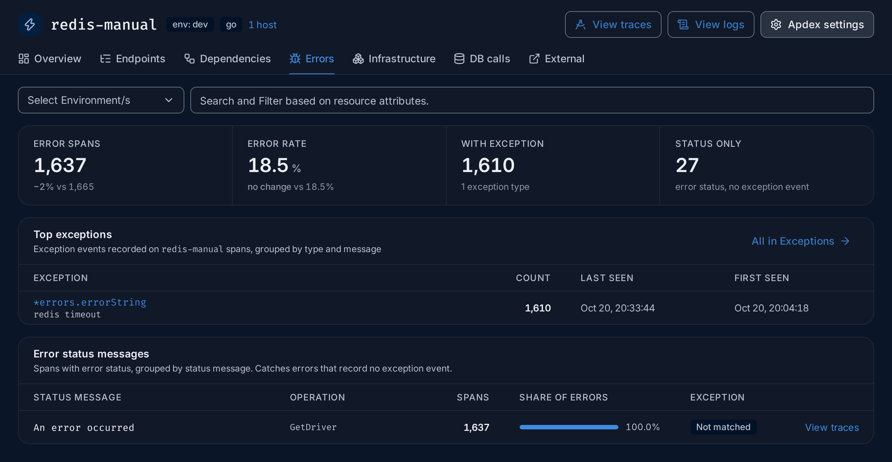

import { Aside, Steps } from "@astrojs/starlight/components";

**Use this guide when** a service shows a high error rate, users see errors, or an
error-rate alert fires.

You will find which service and which operation fail, then read the error itself. The
example uses the HotROD demo app, where the `redis-manual` service fails with
`redis timeout` on about one call in five.

## Steps

<Steps>

1. **Spot the failing service.** Open **Services**. Services with a red badge, such as
   **100% errors** or **errors ↑3×**, come first; their **Error %** is in red when it
   is 5% or more. In the demo, `payment` fails on every call (a synthetic test
   service) and `redis-manual` on about 18.5%. This guide follows `redis-manual`.

   The [error rate](/reference/glossary/#error-rate) counts
   [spans](/reference/glossary/#span) whose status is error, so one
   failed call in five gives 20%.

2. **Check whether it is new.** Click `redis-manual`. On the **Overview**, the
   **Error rate** KPI shows the change against the previous period (`no change` in the
   demo), and the **Error %** chart draws the previous period dashed. **Highlights**
   calls out a rate that doubled or reached 50%. Click a point on the **Error %** chart
   and choose **View traces** or **View logs** to see the failures of that moment.

3. **Find the failing operation and the error.** Open the **Errors** tab.
   **Top exceptions** lists what the code recorded, here `*errors.errorString` with
   the message `redis timeout`. **Error status messages** shows which operation fails:
   all errors are `GetDriver` calls, with the status message `An error occurred`.

   

   If **With exception** is `0`, the code sets an error status without recording an
   exception: rely on the status message and the span attributes. See
   [Errors](/apm/services/#errors).

4. **Open one failed request.** Click **View traces** on the `GetDriver` row. The
   Traces explorer opens on those failed spans. Click a row: the trace opens. Turn on
   **Highlight errors** at the top of the trace to see which spans failed, and where
   they sit in the request. See
   [Find spans in a trace](/explore/trace-details/#find-spans-in-a-trace).

5. **Read the error.** Click the failed span. In **Span details**, the **Events** tab
   lists the exception the code recorded, with its type and message, and its stack
   trace when the SDK sends one. The **Overview** tab shows the span's attributes, such
   as the status code or the query.

6. **Check who is affected.** Back on the service page, open **Dependencies**.
   **Upstream** lists the services that call `redis-manual`: here `driver`, which
   receives every failed call. Open `driver` to see whether its own latency or errors
   suffer.

7. **Compare across services (optional).** To count failures everywhere at once,
   open **Traces**, search for `has_error = true`, switch to the **Table** view and
   group by `service.name`.

   

</Steps>

## Expected result

You know the failing service, the operation, the error message and how long it has
been happening. In the demo: `redis-manual` times out on `GetDriver`, steadily, for the
whole time range.

<Aside>
  A service can look healthy while the services it calls fail. If the service that
  returns the error to the user shows few errors of its own, open its
  [Dependencies](/apm/services/#dependencies) tab: failing callees are
  outlined in amber or red, and one that fails half its calls also raises a highlight
  on the Overview.
</Aside>

## Next steps

- Read the logs written during the failed request: see
  [See the logs for one request](/guides/logs-for-a-request/).
- Get notified next time: see [Set up your first alert](/guides/first-alert/).

## Related

- [Search syntax](/querying/search-syntax/): more filters.
- [Query builder](/querying/query-builder/#group-by-having-order-by-and-limit):
  group by, order by and limit.
- [Errors tab](/apm/services/#errors) and [Exceptions](/apm/services/#exceptions).
- [Trace details](/explore/trace-details/): span details, events and logs.
