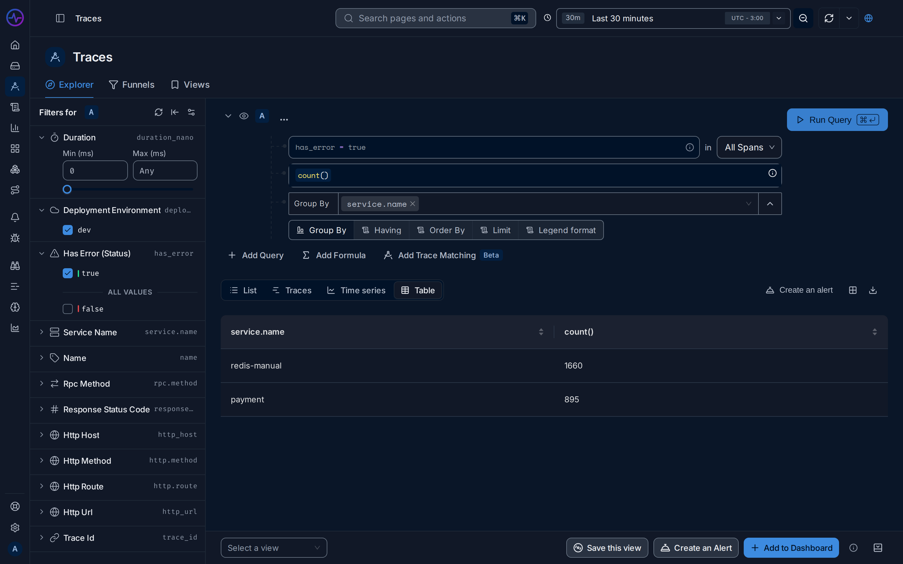

import { Aside, Steps } from "@astrojs/starlight/components";

**Use this guide when** a service shows a high error rate, users see errors, or an
error-rate alert fires.

You will find which service and which operation fail, then read the error itself. The
example uses the HotROD demo app, where the `redis-manual` service fails with
`redis timeout` on about one call in five.

## Steps

<Steps>

1. **Spot the failing service.** Open **Services**. Click the
   **Error Rate (% of total)** header to sort by it. Error rates are highlighted in red.
   In the demo, `payment` fails on every call (a synthetic test service) and
   `redis-manual` on about 18%. This guide follows `redis-manual`.

   The [error rate](/fusescope-docs/reference/glossary/#error-rate) counts
   [spans](/fusescope-docs/reference/glossary/#span) whose status is error, so one
   failed call in five gives 20%.

2. **Count errors per service.** Open **Traces** in the sidebar. In the search box,
   type:

   ```text
   has_error = true
   ```

   Switch to the **Table** view, click **Group By**, pick `service.name` and click
   **Run Query**. You get one row per service with its number of failed spans.

   

3. **Find the failing operation.** Narrow the filter to the service and group by
   `name` instead, the span name:

   ```text
   service.name = 'redis-manual' AND has_error = true
   ```

   In the demo, all failures are `GetDriver` calls.

4. **Open one failed request.** Switch back to the **List** view and click a row. The
   trace opens. Turn on **Highlight errors** at the top of the trace to see which
   spans failed, and where they sit in the request. See
   [Find spans in a trace](/fusescope-docs/explore/trace-details/#find-spans-in-a-trace).

5. **Read the error.** Click the failed span. In **Span details**, the **Events** tab
   lists the exception the code recorded, with its type and message, and its stack
   trace when the SDK sends one. The **Overview** tab shows the span's attributes, such
   as the status code or the query.

6. **Check how often it happens.** Open **Exceptions** in the sidebar. It groups the
   same error across all requests, with its **Count**, **First Seen** and
   **Last Seen**. In the demo, `*errors.errorString` with the message `redis timeout`
   comes from `redis-manual`.

   

</Steps>

## Expected result

You know the failing service, the operation, the error message and how long it has
been happening. In the demo: `redis-manual` times out on `GetDriver`, steadily, for the
whole time range.

<Aside>
  A service can look healthy while its callers fail. If the service that returns the
  error to the user shows few errors of its own, check the services it calls. The
  [Service Map](/fusescope-docs/apm/services/#service-map) colours services with errors
  red.
</Aside>

## Next steps

- Read the logs written during the failed request: see
  [See the logs for one request](/fusescope-docs/guides/logs-for-a-request/).
- Get notified next time: see [Set up your first alert](/fusescope-docs/guides/first-alert/).

## Related

- [Search syntax](/fusescope-docs/querying/search-syntax/): more filters.
- [Query builder](/fusescope-docs/querying/query-builder/#group-by-having-order-by-and-limit):
  group by, order by and limit.
- [Exceptions](/fusescope-docs/apm/services/#exceptions).
- [Trace details](/fusescope-docs/explore/trace-details/): span details, events and logs.
