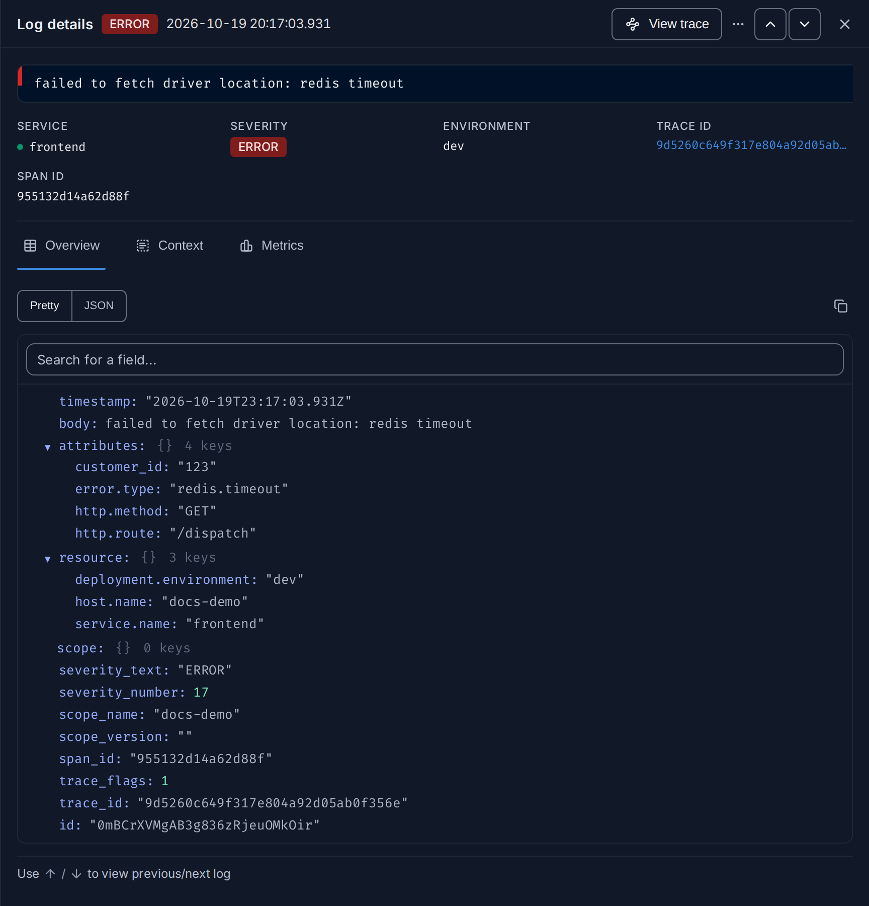

import { Aside, Steps, Tabs, TabItem } from "@astrojs/starlight/components";

**Use this guide when** you have found a slow or failed request and want to read what
the code printed while it handled it, or when you have an error log and want to see the
whole request around it.

## How logs and traces are linked

A [log](/reference/glossary/#log) belongs to a request when it carries
that request's [trace ID](/reference/glossary/#trace-id) and span ID, in
the `trace_id` and `span_id` fields. OpenTelemetry SDKs and logging bridges add them
for you when a log is written inside an active span. Logs without them can still be
searched, but FuseScope cannot tie them to a trace.

<Aside type="caution">
  If the steps below show no logs, your logs probably have no `trace_id`. Open any log
  in the Logs explorer and check the field. To add it, send logs through an
  OpenTelemetry logging bridge; see
  [Instrument applications](/sending-data/instrumentation/#logs).
</Aside>

## From a trace to its logs

<Steps>

1. **Open the trace.** From the Traces explorer, a service page or an exception, open
   the trace of the request you care about.

2. **Pick a span.** In the **Waterfall**, click the span you want to look at, for
   example the service's entry span or the one that failed. **Span details** opens on
   the right.

3. **Open the Logs tab.** It lists the logs written while that span ran, and other logs
   of the same trace around them for context, newest first. The stripe on each row is
   the log's [severity](/explore/logs/#severity-levels). Click a log to
   open it in the Logs explorer, in a new tab.

4. **Search further.** Click **Open in Logs Explorer**. The Logs explorer opens with a
   filter on the trace ID, where you can add filters, change the columns or save the
   view.

</Steps>


## From a log to its trace

<Steps>

1. **Find the log.** Open **Logs** in the sidebar and search, for example:

   ```text
   severity_text ILIKE 'error' AND service.name = 'frontend'
   ```

   `ILIKE` ignores case, so it matches `ERROR`, `Error` and `error`. You can also hover
   **ERROR** in the **Severity Text** filter and click **Only**, which matches every
   spelling of the level.

2. **Open it.** Click the log. **Log details** shows its service, severity, trace ID
   and span ID.

3. **Open the trace.** Click **View trace** at the top of the panel. The trace opens in
   a new tab with the log's span selected. The trace ID under **TRACE ID** is a link to
   the trace too.

</Steps>



If **View trace** is missing, the log has no `trace_id`; see
[How logs and traces are linked](#how-logs-and-traces-are-linked).

## Search by trace ID

If you already have a trace ID, from a support ticket or an error page, search for it
directly:

<Tabs>
<TabItem label="Logs">

In the Logs explorer:

```text
trace_id = '434bfdb4aeb5d5a3e198d3535b5b586f'
```

</TabItem>
<TabItem label="Traces">

In the Traces explorer, use the **Trace Id** quick filter on the left, or:

```text
trace_id = '434bfdb4aeb5d5a3e198d3535b5b586f'
```

</TabItem>
</Tabs>

## Expected result

You see the request's spans and its log lines side by side, in time order, and can
move between them in one click.

## Related

- [Logs explorer](/explore/logs/#log-details): log details and context.
- [Trace details](/explore/trace-details/#span-details): the span details tabs.
- [Find out why a service is failing](/guides/failing-service/).
