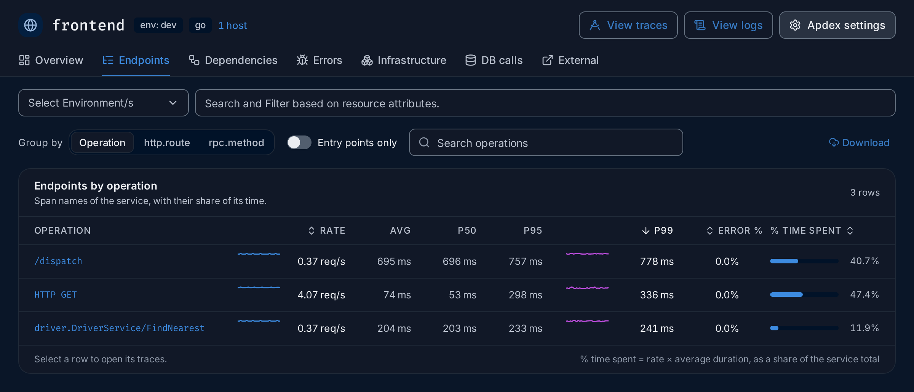

import { Aside, Steps } from "@astrojs/starlight/components";

**Use this guide when** users report that something is slow, or a latency alert fires,
and you need to find where the time goes.

You will start from the service, find its slowest operation, open the slowest requests
and read their [traces](/reference/glossary/#trace). The example uses the
HotROD demo app, where the `frontend` service answers `/dispatch` in about 700 ms.

## Steps

<Steps>

1. **Find the slow service.** Open **Services** in the sidebar. A service whose p99
   latency doubled against the previous period has an amber **p99 ↑2×** badge and sits
   at the top. Otherwise, click the **p99 latency** column header to sort the slowest
   first. [P99](/reference/glossary/#percentile) is the time 99 in 100
   requests stay under, so it shows the slow tail that averages hide.

   In the demo, `frontend` has the highest p99, about 780 ms.

2. **Open the service.** Click `frontend`. On the **Overview**, check the **Latency**
   chart: is it slow all the time, or did it jump at one moment? The dashed line is
   the previous period, so you can see whether this is new. To focus on a spike,
   drag across the chart to zoom into that time, or click the spike and choose
   **View traces** to jump straight to the requests of that moment.

3. **Find the slow operation.** Open the **Endpoints** tab. Each row is one kind of
   request or call the service makes, with its average, p50, p95 and p99 latency and
   its **% time spent**. Click the **p99** column header to sort the slowest first.

   

   For HTTP services, **Group by** › **http.route** shows the same numbers per route
   template, which is often closer to what users call "a page".

4. **See its requests.** Click the operation, here `/dispatch`. The Traces explorer
   opens with a filter for that service and operation, in the same time range.

5. **Sort by duration.** Next to the results, set **Order by** to
   `duration_nano (desc)`. The slowest [spans](/reference/glossary/#span)
   are now at the top.

   

6. **Open the slowest trace.** Click the first row. The trace opens with a
   **Flame graph** and a **Waterfall**; see
   [Trace details](/explore/trace-details/) for how to read them.

7. **Find the longest span.** In the **Waterfall**, each span is a bar on a time axis,
   indented under the span that called it. Look for the widest bar that has no wide
   children: that is where the time is actually spent. Click it to see its attributes
   in **Span details**, such as the SQL statement or the URL it called.

</Steps>

## Expected result

You know which service and which call make the request slow. In the demo, most of the
`/dispatch` time is spent waiting on `customer` and its `mysql` query, and on
`driver` lookups.

## If you don't find it

- **No slow spans in the list?** Widen the [time range](/reference/glossary/#time-range)
  in the top bar. Slow requests may be rare.
- **The trace stops at one service?** The next service is not instrumented, or does
  not pass the trace context on. See
  [Instrument applications](/sending-data/instrumentation/).
- **Only some requests are slow?** In step 5, add a filter on an attribute, such as
  `http.route` or `http.method`, to compare slow and fast ones. See
  [Search syntax](/querying/search-syntax/).

<Aside type="tip">
  Save the filtered, sorted list with **Save this view** at the bottom of the explorer,
  so you can come back to it next time. See
  [Saved views](/explore/traces/#saved-views).
</Aside>

## Related

- [Services](/apm/services/): every chart and column on the service page.
- [Endpoints](/apm/services/#endpoints): grouping, entry points and % time spent.
- [Traces explorer](/explore/traces/): views and ordering.
- [Trace details](/explore/trace-details/): flame graph, waterfall, span details and a worked example.
- [Set up your first alert](/guides/first-alert/): get notified next time.
