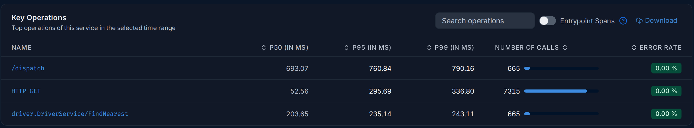
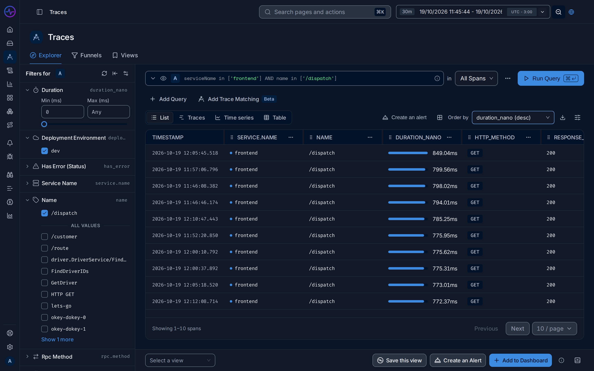

import { Aside, Steps } from "@astrojs/starlight/components";

**Use this guide when** users report that something is slow, or a latency alert fires,
and you need to find where the time goes.

You will start from the service, find its slowest operation, open the slowest requests
and read their [traces](/fusescope-docs/reference/glossary/#trace). The example uses the
HotROD demo app, where the `frontend` service answers `/dispatch` in about 700 ms.

## Steps

<Steps>

1. **Find the slow service.** Open **Services** in the sidebar. The list is sorted by
   **P99 latency (in ms)**, slowest first; click the column header to change the order.
   [P99](/fusescope-docs/reference/glossary/#percentile) is the time 99 in 100 requests
   stay under, so it shows the slow tail that averages hide.

   In the demo, `frontend` is at the top with a P99 of about 790 ms.

2. **Open the service.** Click `frontend`. Check the **Latency** chart: is it slow all
   the time, or did it jump at one moment? To focus on a spike, drag across the chart
   to zoom into that time.

3. **Find the slow operation.** Scroll to **Key Operations**. Each row is one kind of
   request the service handles, with its P50, P95 and P99 latency. Click the column
   header **P99 (in ms)** to sort it.

   

4. **See its requests.** Click the operation name, here `/dispatch`. The Traces
   explorer opens with a filter for that service and operation, in the same time range.

5. **Sort by duration.** Next to the results, set **Order by** to
   `duration_nano (desc)`. The slowest [spans](/fusescope-docs/reference/glossary/#span)
   are now at the top.

   

6. **Open the slowest trace.** Click the first row. The trace opens with a
   **Flame graph** and a **Waterfall**; see
   [Trace details](/fusescope-docs/explore/trace-details/) for how to read them.

7. **Find the longest span.** In the **Waterfall**, each span is a bar on a time axis,
   indented under the span that called it. Look for the widest bar that has no wide
   children: that is where the time is actually spent. Click it to see its attributes
   in **Span details**, such as the SQL statement or the URL it called.

</Steps>

## Expected result

You know which service and which call make the request slow. In the demo, most of the
`/dispatch` time is spent waiting on `customer` and its `mysql` query, and on
`driver` lookups.

## If you don't find it

- **No slow spans in the list?** Widen the [time range](/fusescope-docs/reference/glossary/#time-range)
  in the top bar. Slow requests may be rare.
- **The trace stops at one service?** The next service is not instrumented, or does
  not pass the trace context on. See
  [Instrument applications](/fusescope-docs/sending-data/instrumentation/).
- **Only some requests are slow?** In step 5, add a filter on an attribute, such as
  `http.route` or `http.method`, to compare slow and fast ones. See
  [Search syntax](/fusescope-docs/querying/search-syntax/).

<Aside type="tip">
  Save the filtered, sorted list with **Save this view** at the bottom of the explorer,
  so you can come back to it next time. See
  [Saved views](/fusescope-docs/explore/traces/#saved-views).
</Aside>

## Related

- [Services](/fusescope-docs/apm/services/): every chart and column on the service page.
- [Traces explorer](/fusescope-docs/explore/traces/): views and ordering.
- [Trace details](/fusescope-docs/explore/trace-details/): flame graph, waterfall, span details and a worked example.
- [Set up your first alert](/fusescope-docs/guides/first-alert/): get notified next time.
