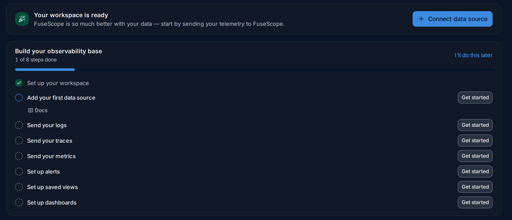
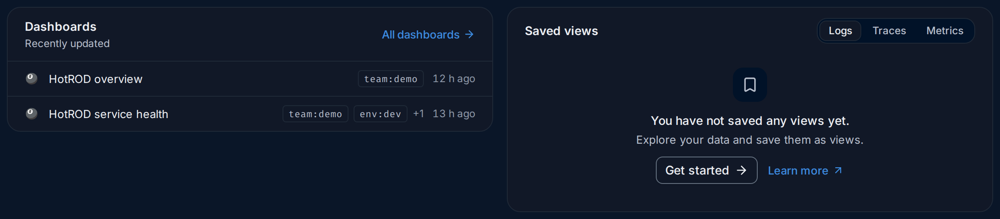

import { Aside, Steps } from "@astrojs/starlight/components";

**Home** (`/home`) is the page FuseScope opens after you log in. It answers two
questions at a glance: *is my data arriving?* and *is anything wrong right now?* Each
panel is a short summary with a link to the page that has the details.

**Use this page when** you start your day and want a quick check before digging in,
when you have just connected an application and want to see its data arrive, or when
you are new to a workspace and want to know what has already been set up.

## The page, part by part

1. **Greeting**: `Welcome back, <first name>` once data arrives, followed by the
   signals the workspace is receiving, such as
   `Your workspace is receiving logs, traces and metrics.` Before any data arrives it
   reads `You are not sending any data yet.`
2. **Connect data source**: opens
   [Instrument applications](/fusescope-docs/sending-data/instrumentation/), which
   explains how to send data to FuseScope. Viewers don't see this button.
3. **Data sources**: one row per signal received in the **last 30 minutes**, with the
   **Ingestion active** badge. Logs show how many log records arrived and traces how
   many spans. A signal that sent nothing in the last 30 minutes has no row.
4. **Explore logs**, **Explore traces** and **Explore metrics** open the
   [Logs](/fusescope-docs/explore/logs/), [Traces](/fusescope-docs/explore/traces/) or
   [Metrics](/fusescope-docs/explore/metrics/) explorer.
5. **Build your observability base**: the [setup checklist](#the-setup-checklist).
   **I'll do this later** hides it.
6. **Shortcuts**: **Logs explorer**, **Traces explorer**, **Metrics explorer**,
   **Create a dashboard** and **Create an alert**. Viewers, who can't create
   anything, don't see this row.
7. **Alerts**: a [summary of your alert rules](#alerts).
8. **Services**: the [services that need a look first](#services), over the time
   range you pick here.
9. **Highlight badges** on services, the same as on the
   [services list](/fusescope-docs/apm/services/#highlight-badges).

Below these, two more panels list your [dashboards and saved views](#dashboards-and-saved-views).

<Aside>
  Home has no time range in the top bar. **Data sources** always looks at the last
  30 minutes, and **Services** has its own time range picker.
</Aside>

## A new workspace

Until the first log, span or metric arrives, Home shows a short welcome instead of the
data panels:

*Sample data: this image is a Storybook story, not a live workspace.*

**Your workspace is ready** has the same **Connect data source** button. The data
panels (**Data sources**, **Alerts**, **Services**, **Dashboards** and **Saved views**)
appear as soon as any signal arrives; refresh the page after you send your first data.

## The setup checklist

**Build your observability base** lists eight steps and counts how many are done,
such as `1 of 8 steps done`:

| Step | Done when | **Get started** opens |
|---|---|---|
| **Set up your workspace** | Always done | |
| **Add your first data source** | Any logs, traces or metrics arrived | [Instrument applications](/fusescope-docs/sending-data/instrumentation/) |
| **Send your logs** | Logs arrived in the last 30 minutes | [Logs explorer](/fusescope-docs/explore/logs/) docs |
| **Send your traces** | Spans arrived in the last 30 minutes | [Traces explorer](/fusescope-docs/explore/traces/) docs |
| **Send your metrics** | The workspace has metrics | [Metrics explorer](/fusescope-docs/explore/metrics/) docs |
| **Set up alerts** | At least one alert rule exists | The new alert rule editor |
| **Set up saved views** | At least one saved view exists | The Logs explorer |
| **Set up dashboards** | At least one dashboard exists | The dashboards list |

The first step that isn't done is expanded: it shows a short description, a **Docs**
link to the matching page of this documentation and, for some steps, **Skip for now**.
The steps for alerts, saved views and dashboards are checked once data arrives and
their panels load.

**I'll do this later** hides the checklist for you. It then
moves behind a **Welcome checklist** button at the top right of Home, so you can still
open it and see what is left.

## Alerts

The **Alerts** panel shows up to five alert rules, the firing ones first, then the most
recently updated. Its subtitle counts them: `2 firing`, `1 pending`, or, when nothing
is wrong, `2 rules, none firing`. Each row shows the rule name, its severity, such as
`warning`, and its state, such as **Firing** or **Disabled**. Click a rule to open it,
or **All alert rules** for the [Alerts](/fusescope-docs/alerts/alert-rules/) page.

With no rules yet, the panel says **No Alert rules yet.** with a button to create one.

## Services

The **Services** panel lists five services, **Highlighted first, then by error rate**:
the ones with a [highlight badge](/fusescope-docs/apm/services/#highlight-badges) at
the top, then the ones that fail most. For each service it shows **P99** latency,
**Error rate** and **Rate**, each with its change against the previous period, as on
the [services list](/fusescope-docs/apm/services/#how-to-read-the-list).

The time range picker on the panel goes from **Last 5 minutes** to **Last 1 month**;
the default is **Last 30 minutes**. Click a service to open its page, or
**All services** for the full list.

## Dashboards and saved views

- **Dashboards** lists the five most recently updated dashboards, with up to two tags
  each (`+1` when there are more) and how long ago each changed, such as `12 h ago`.
  **All dashboards** opens the [dashboards list](/fusescope-docs/dashboards/dashboards/).
- **Saved views** lists up to five saved views for the signal you pick: **Logs**,
  **Traces** or **Metrics**. Click one to open the explorer with that view. With none,
  **Get started** opens the explorer and **Learn more** explains views for that
  signal.

## Example: a morning check on the demo

The numbers are from the HotROD demo.

<Steps>

1. **Is data arriving?** **Data sources** shows Logs, Traces and Metrics, all with
   **Ingestion active**; about 4,800 log records and 27,000 spans arrived in the last
   30 minutes. Nothing stopped sending overnight.

2. **Is anything firing?** **Alerts** reads `2 rules, none firing`. Both rules are
   **Disabled**, so they couldn't fire anyway: worth turning one on (see
   [Alert rules](/fusescope-docs/alerts/alert-rules/)).

3. **Which service needs a look?** **Services** puts `payment` at the top with a red
   **100% errors** badge: every request fails, at 0.17 req/s, with `no change` against
   the previous period, so it has been failing for a while. `redis-manual` comes next
   at 18.5% errors.

4. **Dig in.** Click `payment` to open its service page. The
   [Services](/fusescope-docs/apm/services/#example-why-is-payment-failing) page walks
   through this case.

</Steps>

**What you learn**: in a few seconds Home tells you the data is flowing, that no alert
watches the failing service, and where to start.

## Related

- [Tour of the interface](/fusescope-docs/start/tour/): the sidebar and the top bar.
- [Instrument applications](/fusescope-docs/sending-data/instrumentation/): send your
  first data.
- [Services](/fusescope-docs/apm/services/): the full services list and service pages.
