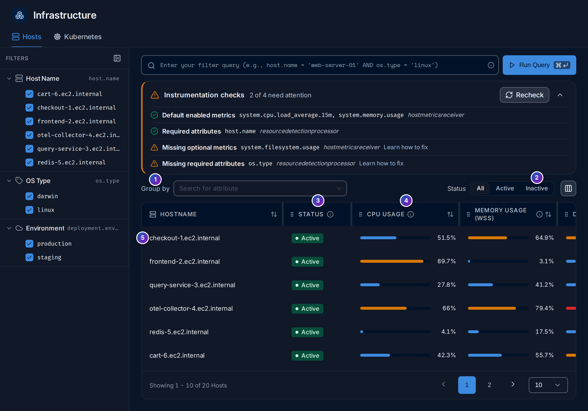
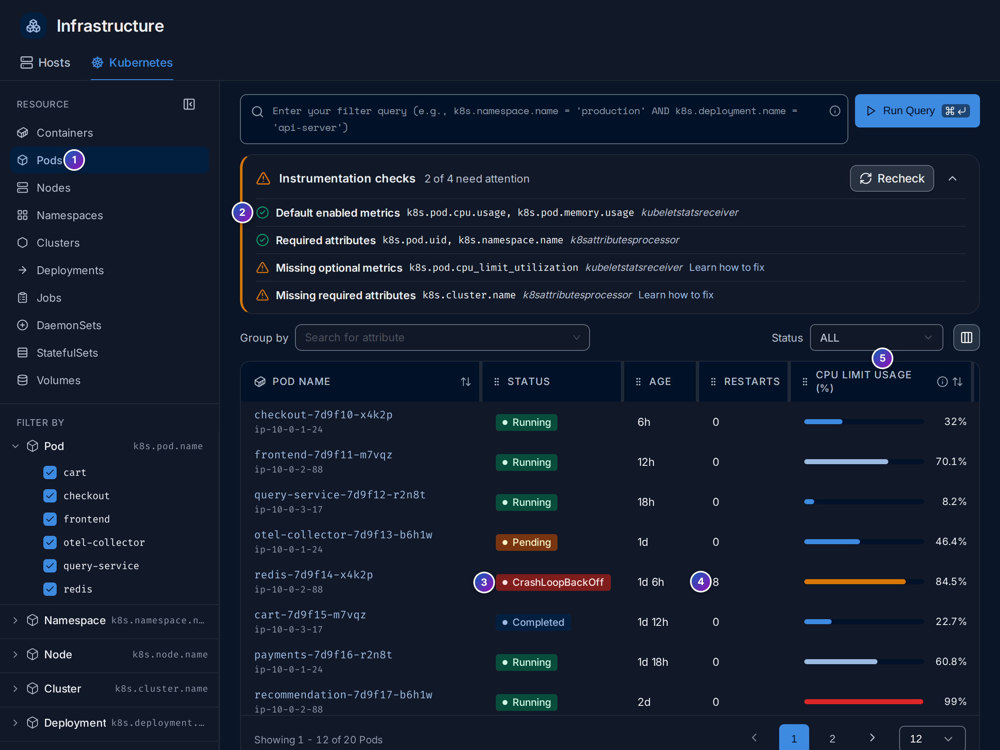
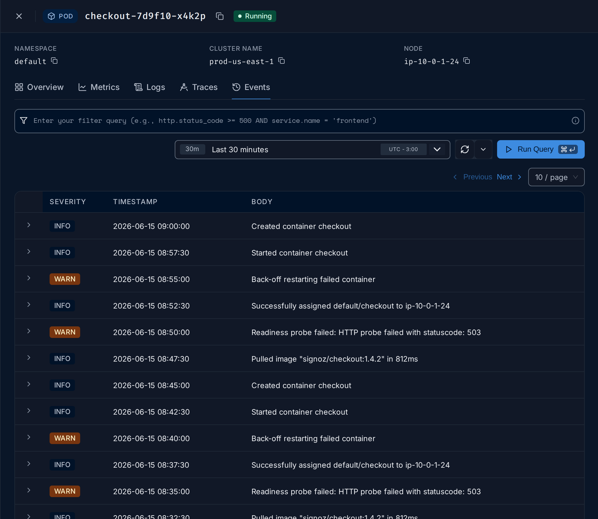

import { Aside, Steps } from "@astrojs/starlight/components";

**Infrastructure** (`/infrastructure-monitoring`, under **Observe** in the sidebar)
shows what your services run on: **Hosts** (servers and virtual machines) and
**Kubernetes** (containers, pods, nodes, namespaces, clusters, deployments, jobs,
daemon sets, stateful sets and volumes). Each object has its usage, its state and a
panel with its metrics, logs, traces and events.

**Use this page when** a service is slow and you want to know if its machine or pod
is out of CPU or memory, when pods restart or don't start, or when you want to see
how full your nodes are before adding more work to them.

## Infrastructure in plain words

- A **host** is one machine, physical or virtual, named by `host.name`.
- In Kubernetes, a **container** runs your program; a **pod** is one or more
  containers scheduled together; a **node** is the machine pods run on; a
  **namespace** groups objects; a **cluster** is the whole set of nodes. Deployments,
  stateful sets, daemon sets and jobs are the controllers that create pods.
- A container's **request** is the CPU and memory Kubernetes reserves for it; its
  **limit** is the most it may use. A container over its memory limit is killed; one
  over its CPU limit is slowed down. **Request utilization** and **limit
  utilization** say how much of each a pod or container uses. See
  [requests and limits](/reference/glossary/#requests-and-limits).
- **Restarts** count how often a container was restarted. A growing count, with a
  state such as `CrashLoopBackOff`, means the container keeps failing at start.

These numbers are **metrics** sent by the collector, not by your applications. They
need the [Kubernetes](/sending-data/kubernetes/) chart, or the
`hostmetrics` receiver on a host outside Kubernetes.

<Aside>
  The demo stack sends no host or Kubernetes metrics, so the populated images on this
  page are Storybook stories with sample data, marked as such. The setup screens are
  live.
</Aside>

## Instrumentation checks

Every tab starts with **Instrumentation checks**: what the tab needs, and whether it is
arriving.

4. **Instrumentation checks** counts the checks that need attention, such as
   `2 of 2 need attention`. Each line is one of:
   - **Default enabled metrics** / **Missing default metrics**: metrics the tab needs.
   - **Missing optional metrics**: metrics that fill extra columns, such as
     request and limit utilization.
   - **Required attributes** / **Missing required attributes**: attributes the tab
     groups by, such as `host.name` or `k8s.pod.uid`.
5. **Recheck** runs the checks again, for example after you change the collector.
6. Each line names the metrics or attributes, in code font, and the collector
   component that produces them, in italics, such as `hostmetricsreceiver`.
7. **Learn how to fix** opens the
   [Kubernetes](/sending-data/kubernetes/#what-each-component-sends) page,
   which explains each component.
8. and 9. With no data, the tab says **No host metrics yet** (or
   **No Kubernetes metrics yet**), with a link to set it up.

A check line with a green tick is satisfied. Click the arrow at the right to fold the
checks away once everything is green.

## Hosts

*Sample data: this image is a Storybook story, not the demo.*

The list has one row per host, with **Status**, **CPU usage**, **Memory usage (WSS)**
(working set: memory in use that can't be freed right away), **Disk usage**,
**Iowait** (time the CPU waits for the disk) and **Load avg (15min)**. The bars turn
amber, then red, as they fill up.

- **Filters** on the left: **Host Name**, **OS Type** and **Environment**. The query
  box above takes any attribute, such as `host.name = 'web-server-01'`.
1. **Group by**: one row per value of an attribute, such as `deployment.environment`,
   with the totals of its hosts.
2. **Status**: **All**, **Active** or **Inactive**.
3. A host is **Active** when it sent metrics in the last 10 minutes, **Inactive**
   otherwise, for example a machine that was shut down.
4. Click a column title to sort, such as **CPU usage** to find the busiest hosts.
5. Click a host to open its [details panel](#the-details-panel).

The column button at the right of the toolbar shows or hides columns.

## Kubernetes

1. **Resource**: choose what to list: **Containers**, **Pods**, **Nodes**,
   **Namespaces**, **Clusters**, **Deployments**, **Jobs**, **DaemonSets**,
   **StatefulSets** or **Volumes**. Each has its own checks and columns.
2. **Filter by**: quick filters such as **Pod**, **Namespace**, **Node**, **Cluster**,
   **Deployment** and **Environment**.
3. and 4. The checks for the chosen resource.
5. The empty state until metrics arrive, with **Set up Kubernetes monitoring**.

*Sample data: this image is a Storybook story, not the demo.*

For pods (1), the list shows each pod with its node, **Status** (3), **Age**,
**Restarts** (4), **CPU limit usage (%)** (5), **CPU usage (cores)**,
**Memory limit usage (%)** and **Memory usage (WSS)**. **CPU request usage (%)** and
**Memory request usage (%)** can be added with the column button. The **Status** filter
keeps one phase, such as **Running** or **Pending**. Nodes have **Node Readiness** and
**Pod Status** filters instead.

How to read the usage columns:

| Column | Near 100% means |
|---|---|
| **CPU request usage (%)** | The pod uses all the CPU it reserved; it may use more if the node has spare |
| **CPU limit usage (%)** | The pod is about to be slowed down (throttled) |
| **Memory request usage (%)** | The pod uses all the memory it reserved |
| **Memory limit usage (%)** | The pod is about to be killed for using too much memory (`OOMKilled`) |

A column without values means the pods don't set requests or limits, or the optional
metrics are off; the checks say which.

## The details panel

Click a host, pod, node or any other object to open its panel on the right.

*Sample data: this image is a Storybook story, not the demo.*

1. to 3. The header: name, status and the main facts, such as the operating system
   and the current CPU and memory use; for a pod, its namespace, cluster and node.
4. **Metrics**: charts over the panel's own time range, such as CPU, memory, disk,
   load and network for a host, or CPU and memory by container for a pod.
5. **Logs**: the object's logs, such as its pods' logs.
6. **Traces**: traces from services running there, matched by `host.name` or the
   Kubernetes attributes.

Pods, nodes and other Kubernetes objects also have **Overview** and **Events**:

*Sample data: this image is a Storybook story, not the demo.*

**Events** lists the Kubernetes events of the object, such as image pulls, probe
failures and restarts, with their severity. It needs `presets.k8sEvents` in the
chart; without it the tab explains how to turn it on.

A service's [Infrastructure](/apm/services/#infrastructure) tab links to
its hosts here with **Host**.

## Example: why does a pod keep restarting?

On the sample data of the Pods image:

<Steps>

1. **Spot it.** Open **Infrastructure › Kubernetes › Pods**. `redis-7d9f14-x4k2p` on
   node `ip-10-0-2-88` is in **CrashLoopBackOff** with **8** restarts, and its CPU
   limit usage is 84.5%.

2. **Open its panel.** Click the pod. **Metrics** shows whether memory climbs to the
   limit before each restart, the sign of an `OOMKilled` container, or whether usage
   stays low, which points at the program failing at start.

3. **Read the events.** **Events** shows entries such as
   `Back-off restarting failed container` and
   `Readiness probe failed: HTTP probe failed with statuscode: 503`: Kubernetes
   restarts the container because it doesn't answer its health check.

4. **Read the logs.** **Logs** shows what the container printed before it stopped,
   usually the real error, such as a missing configuration value.

</Steps>

**What you learn**: restarts, events and logs in one panel tell you whether a pod
dies from lack of memory, a failing health check, or its own error.

## Related

- [Kubernetes](/sending-data/kubernetes/): install the `k8s-infra`
  chart, and what each component sends.
- [Services](/apm/services/#infrastructure): the hosts behind a
  service.
- [Logs explorer](/explore/logs/): search the same logs with filters.
