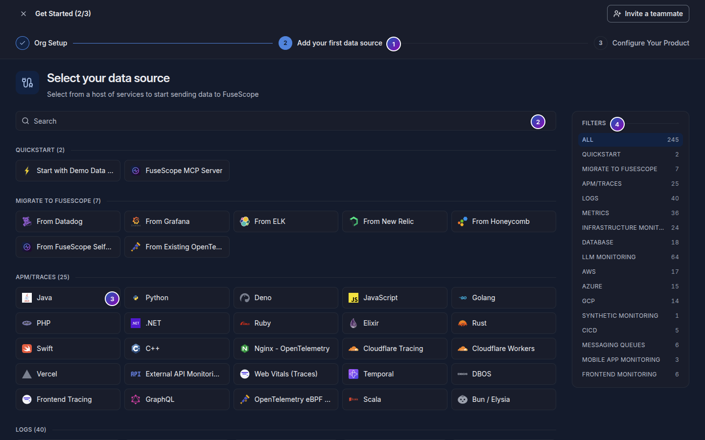

import { Aside } from "@astrojs/starlight/components";

**Use this page when** you opened **Get Started** to add a data source, or wonder where
the catalog of data sources went on your own FuseScope.

The data source catalog is the **Get Started** screen: a list of about 250 languages,
frameworks, services and clouds you can send telemetry from.

On a self-hosted FuseScope, the buttons that would open it (**Connect data source** on
**Home**, the empty states of **Logs**, **Traces** and **Metrics**, and the Messaging
Queues setup cards) open these docs instead. The catalog itself is still at
`/get-started-with-signoz-cloud`.

1. The catalog is step 2 of 3: **Org Setup**, **Add your first data source** and
   **Configure Your Product**.
2. **Search** narrows the tiles by name.
3. Click a tile. Some ask follow-up questions, such as the Java framework and where
   it runs (VM, Kubernetes, Docker or Windows). Then click
   **Next: Configure your product**.
4. **Filters** shows one category at a time, with the number of sources in each.

## Where the setup guides go

**Configure Your Product** shows the setup guide for your choice. The guides are the
per-technology pages FuseScope inherited from SigNoz and are served from signoz.io, not
from these docs:

- the guide panel can stay empty, because that site does not allow being embedded in
  other origins;
- the guides target the hosted SigNoz service: they send to its ingestion endpoint with
  an ingestion key. A self-hosted FuseScope has neither; you send OTLP to your own
  collector, without a key;
- the side panel looks for ingestion keys and shows an error on a self-hosted
  FuseScope. You can ignore it.

<Aside>
  Close **Get Started** with the **×** at the top left. Nothing in it is required:
  FuseScope shows data as soon as it reaches the collector.
</Aside>

## What to read instead

Every source in the catalog ends up sending OpenTelemetry data, so these pages cover
them:

| Catalog category | Read |
|---|---|
| APM/traces, LLM monitoring, frontend and mobile monitoring | [Instrument applications](/fusescope-docs/sending-data/instrumentation/), then the [OpenTelemetry guide for your language](https://opentelemetry.io/docs/languages/) |
| Logs | [Logs](/fusescope-docs/sending-data/instrumentation/#logs) from applications, [Kubernetes](/fusescope-docs/sending-data/kubernetes/) for pod logs, and [Log pipelines](/fusescope-docs/sending-data/log-pipelines/) to parse them |
| Metrics, infrastructure, databases, messaging queues, CI/CD | [Kubernetes](/fusescope-docs/sending-data/kubernetes/) for hosts and clusters; for a product such as PostgreSQL, Redis or Kafka, add its receiver from the [collector-contrib receivers](https://github.com/open-telemetry/opentelemetry-collector-contrib/tree/main/receiver) to a collector |
| AWS, Azure, GCP | Instrument the workloads as above, or run a collector with the cloud's receiver from collector-contrib. One-click cloud integrations are not part of FuseScope |
| Migrate: From Existing OpenTelemetry | [From another collector](/fusescope-docs/sending-data/otlp/#from-another-collector) |
| Quickstart: FuseScope MCP Server | Not available on a self-hosted FuseScope |

Whatever the source, the address to send to is in [OTLP](/fusescope-docs/sending-data/otlp/).

## Check that data arrives

Within a minute of sending, look for the service under **Services**, or for the data in
the [Traces](/fusescope-docs/explore/traces/), [Logs](/fusescope-docs/explore/logs/) or
[Metrics](/fusescope-docs/explore/metrics/) explorers.
