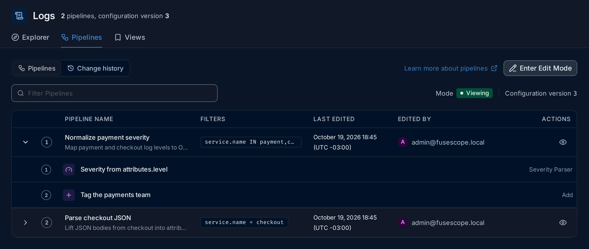
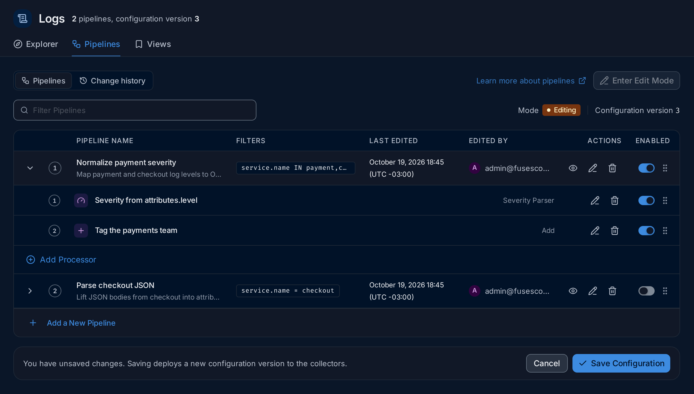
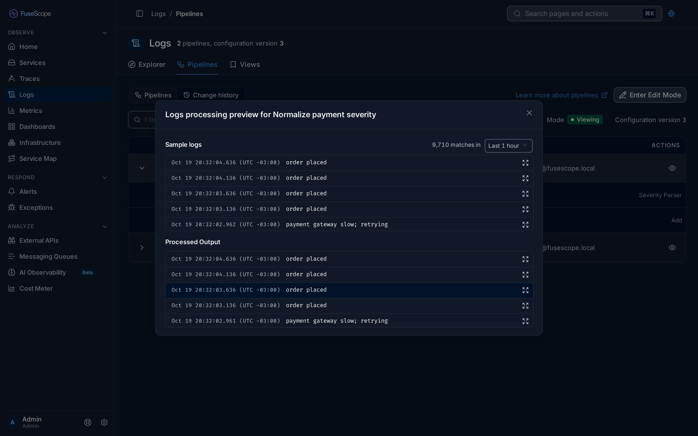
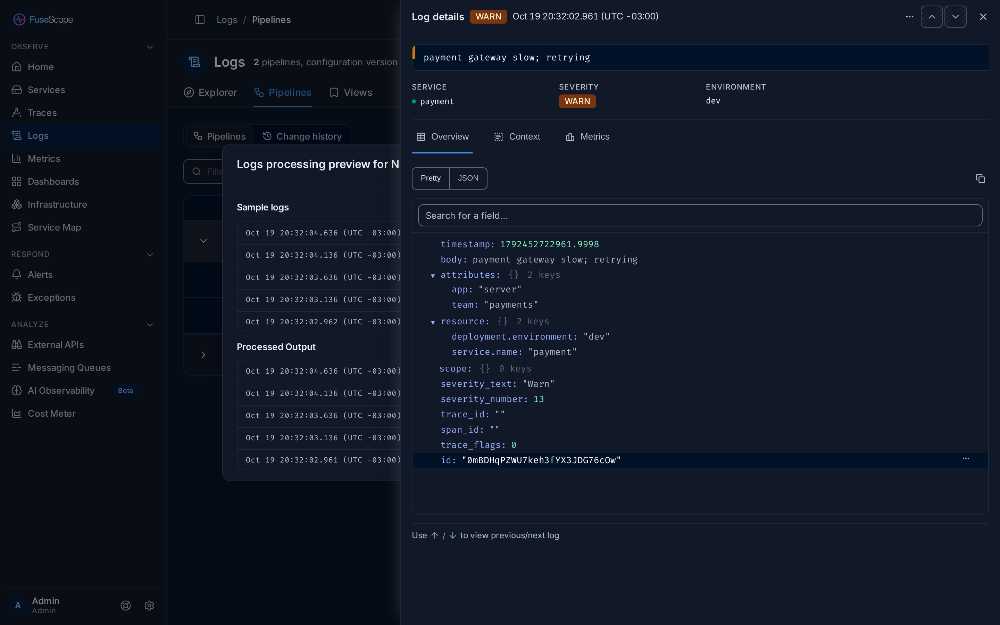
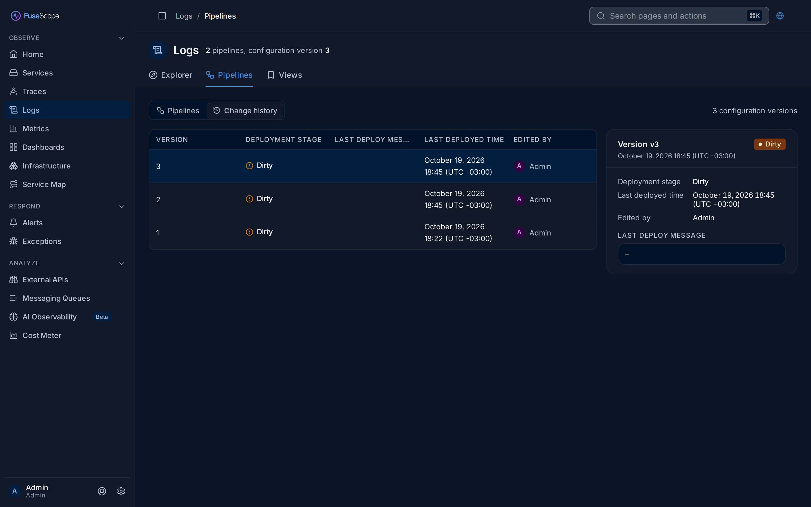
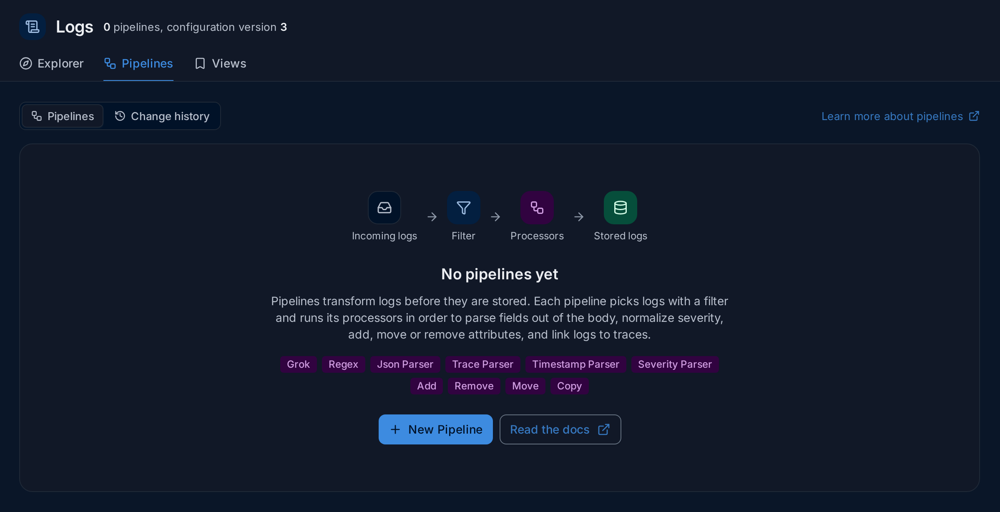

import { Aside, Steps } from "@astrojs/starlight/components";

A [log pipeline](/fusescope-docs/reference/glossary/#log-pipeline) changes logs on
their way in, before they are stored. Use one to turn a line of text into fields you
can filter on, to give every service the same severity spelling, or to add facts the
logs lack, such as which team owns them.

**Use this page when** your logs arrive as one long line of text and you want fields
you can filter and group by, such as a status code or a user ID, or when services
spell the same severity differently.

## How a pipeline works

Each pipeline has three parts:

1. **A filter** that picks the logs it handles, such as
   `service.name = checkout`. Other logs pass by untouched.
2. **Processors**, small steps that run in order on each matching log. Each one does
   one thing: parse JSON, set the severity, add an attribute. See
   [Processors](#processors).
3. **The stored log**: what comes out of the last processor is what FuseScope keeps
   and what you see in the [Logs explorer](/fusescope-docs/explore/logs/).

When there are several pipelines, a log goes through them in list order, so a later
pipeline sees the changes of an earlier one.

Pipelines run in the FuseScope [collector](/fusescope-docs/reference/glossary/#collector),
so they apply to every log it receives, whichever SDK or agent sent it. They change
only logs that arrive after you save; logs already stored stay as they are.

## The pipelines list

Open **Logs** in the sidebar and click the **Pipelines** tab. The line next to the
title gives the number of pipelines and the current configuration version, such as
`2 pipelines, configuration version 3`.

- Each row shows the pipeline's order, **Pipeline Name** and description,
  **Filters**, **Last Edited** and **Edited By**.
- Click the arrow on the left to expand a pipeline and see its processors, in order,
  each with its type on the right.
- The eye icon in **Actions** opens the [preview](#preview).
- **Filter Pipelines** searches the list.
- **Learn more about pipelines** opens this page.

The list opens in **Viewing** mode, where nothing can be changed by accident.

## Edit mode

Click **Enter Edit Mode** to make changes. The mode badge turns to **Editing**, and
each row gains actions: the pencil edits, the bin deletes, the switch in **Enabled**
turns a pipeline or processor on or off without deleting it, and the handle on the
right drags it to a new place in the order.

Nothing is applied while you edit. The bar at the bottom says what is pending:

- with no changes, it lists what you can do, and **Cancel** leaves edit mode;
- with changes, it reads *You have unsaved changes*, and **Save Configuration**
  deploys them as a new [configuration version](#change-history). **Cancel**
  throws them away.

Saving needs the Editor or Admin
[role](/fusescope-docs/administration/users-and-roles/#roles); viewers can read and
preview pipelines.

## Create a pipeline

<Steps>

1. Click **Enter Edit Mode**, then **Add a New Pipeline** under the list.
2. Enter a **Name**, an optional **Description** and a **Filter** that selects the
   logs to process. The form previews the logs that match, so you can check the filter
   before going on.
3. Expand the new pipeline and click **Add Processor** for each step. See
   [Processors](#processors).
4. Click **Save Configuration**.

</Steps>

## Processors

A [processor](/fusescope-docs/reference/glossary/#processor) is one step of a
pipeline. **Add Processor**, or the pencil on a processor, opens a sheet on the
right. Pick the type in **Select Processor Type**, give the step a name, fill in its
fields and click **Create** (or **Update**).

Fields are written as paths that start with `body`, `attributes` or `resource`, for
example `attributes.user_id`.

| Processor | What it does |
|---|---|
| **Grok** | Splits text into fields with a Grok pattern, such as `%{WORD:method} %{NUMBER:status}`. |
| **Regex** | Splits text into fields with a regular expression; each named group, `(?P<name>...)`, becomes a field. |
| **Json Parser** | Reads a JSON string, by default the body, and turns its keys into attributes. |
| **Trace Parser** | Sets the log's trace ID, span ID and trace flags from fields, so the log links to its trace. |
| **Timestamp Parser** | Sets the log's time from a field, as a Unix epoch or a `strptime` format. |
| **Severity Parser** | Sets the severity from a field, mapping your values to the standard levels. |
| **Add** | Sets a field to a fixed value. |
| **Remove** | Deletes a field. |
| **Move** | Renames a field, moving its value. |
| **Copy** | Copies a field's value into another field. |

The parsers have **Parse From** and **Parse To** fields (by default `body` and
`attributes`) and an **On Error** setting. With `send`, a log the processor cannot
parse is kept unchanged and goes on to the next step.

### Severity parser

The Severity Parser reads a field, such as `attributes.level`, and sets the log's
severity from its value. It has one **Values for level** field for each of TRACE,
DEBUG, INFO, WARN, ERROR and FATAL. Each takes a comma-separated list of the values
that mean that level, such as `error, err, 5xx` under ERROR.

It sets `severity_number` and, by default, rewrites `severity_text` to the level
name, so every service ends up with the same spelling in storage. The Logs explorer already groups spellings on screen (see
[Severity levels](/fusescope-docs/explore/logs/#severity-levels)); the parser makes
the stored data agree, which helps queries, alerts and exports that read the raw
fields.

## Example: normalise payment severity and tag the team

The payment and checkout services write their level in an attribute called `level`,
and the payments team wants every log from them tagged with its name. One pipeline
does both.

<Steps>

1. **Start a pipeline.** Click **Enter Edit Mode**, then **Add a New Pipeline**.
   Name it `Normalize payment severity`, describe it, and set the filter to the
   services `payment` and `checkout` (`service.name IN payment,checkout`).

2. **Add the severity step.** Expand the pipeline and click **Add Processor**.
   Choose **Severity Parser**, name it `Severity from attributes.level`, and set
   **Parse Severity Value From** to `attributes.level`. Under each level, list the
   spellings your services use, for example `warn, warning` under WARN.

3. **Add the team.** Click **Add Processor** again. Choose **Add**, name it
   `Tag the payments team`, set **Field** to `attributes.team` and **Value** to
   `payments`.

4. **Check the order.** The severity step is 1 and the tag is 2. Drag them if not.

5. **Preview.** Click the eye icon on the pipeline, then **Simulate Processing**
   (see [Preview](#preview)). Open a processed payment log: it now has
   `team: "payments"`.

6. **Save.** Click **Save Configuration**. A new version appears in
   [Change history](#change-history).

</Steps>

**What the preview tells you:** in this data, the processed payment log keeps
`severity_text` `Warn`. These sample logs have no `level` attribute, so the Severity
Parser has nothing to read and leaves them as they are, while the Add step still
tags them. That is what the preview is for: it shows what your logs really contain
before you rely on a step.

## Preview

The eye icon on a pipeline opens **Logs processing preview** for it, with real logs
and no risk:

- **Sample logs** loads recent logs that match the pipeline's filter, with the number
  of matches. The menu next to it changes the period (**Last 1 hour** by default).
- **Simulate Processing** runs the pipeline on those logs without saving or deploying
  anything, and shows the result under **Processed Output**.
- The expand icon at the end of a row opens that log in **Log details**, to compare
  fields before and after.

## Change history

Every **Save Configuration** creates a new configuration version. The
**Change history** tab lists them, newest first, with the **Deployment Stage**, the
**Last Deploy Message**, the **Last Deployed Time** and who edited it. Click a
version to see its details on the right.

The deployment stage says how far a version got:

| Stage | Means |
|---|---|
| **Dirty** | Saved, but no collector has taken it yet. |
| **In Progress** | Being sent to the collectors. |
| **Deployed** | The collectors run it. |
| **Failed** | A collector could not apply it; the deploy message says why. |
| **Unknown** | FuseScope has no status for it. |

### How a version reaches the collectors

The backend sends each version to the FuseScope collectors over
[OpAMP](https://opentelemetry.io/docs/specs/opamp/), and each enabled pipeline becomes
a processor in the collector's logs pipeline. Collectors connect to the backend's
OpAMP server on port 4320; the Helm chart configures this. If versions stay
**Dirty**, check that the collector can reach that port.

## Before the first pipeline

With no pipelines yet, the tab explains the idea instead of showing an empty table:
incoming logs go through a filter, then processors, then are stored. It lists the
processor types, and offers **New Pipeline** and **Read the docs**, which opens this
page.

## Related

- [Logs explorer](/fusescope-docs/explore/logs/): search the logs your pipelines
  produce.
- [Severity levels](/fusescope-docs/explore/logs/#severity-levels): how FuseScope
  groups severities on screen.
- [Instrument applications](/fusescope-docs/sending-data/instrumentation/#logs): send
  logs that already carry fields and trace IDs.
