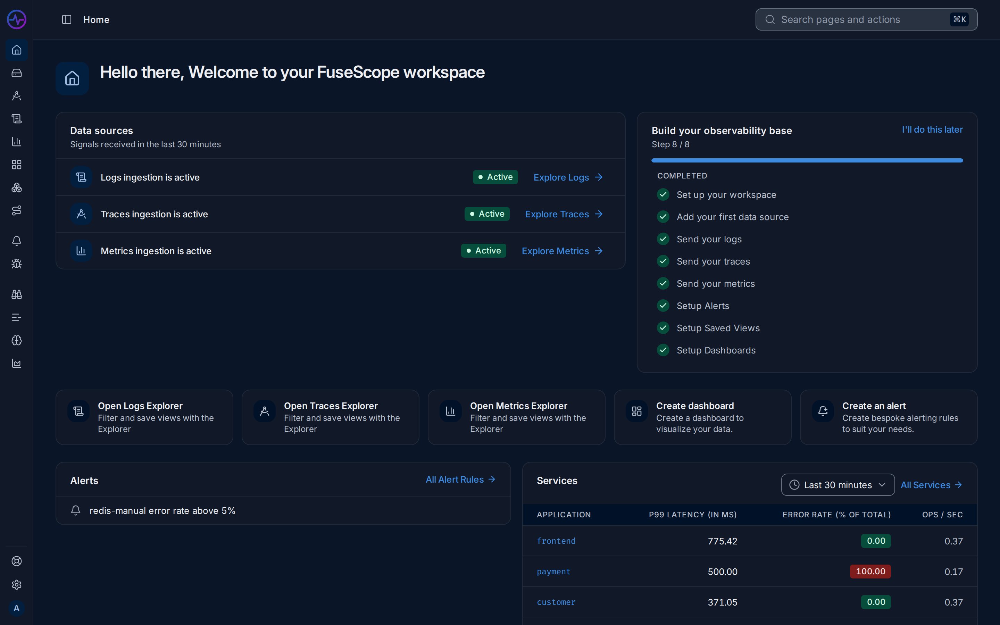

import { Aside } from "@astrojs/starlight/components";

This page is a map of the FuseScope app. It names each part of the screen, so the rest
of the documentation makes sense when it says "open **Traces** in the sidebar" or
"pick a time range in the top bar".

**Read this page when** you log in for the first time.

## The sidebar

The sidebar on the left lists every page, in three groups.

1. **Observe**: look at your systems.
   - **Home**: which signals are arriving, a setup checklist, shortcuts, and short
     summaries of alerts and services. See [Home](/fusescope-docs/observe/home/).
   - **Services**: latency, error rate and throughput of every service. Start here
     when something is slow or failing. See [Services](/fusescope-docs/apm/services/).
   - **Traces**, **Logs** and **Metrics**: the explorers, to search each signal. See
     [Traces explorer](/fusescope-docs/explore/traces/),
     [Logs explorer](/fusescope-docs/explore/logs/) and
     [Metrics explorer](/fusescope-docs/explore/metrics/).
   - **Dashboards**: pages of charts you build. See
     [Dashboards](/fusescope-docs/dashboards/dashboards/).
   - **Infrastructure**: hosts and Kubernetes resources.
   - **Service Map**: a graph of which service calls which, and where errors start.
     See [Service Map](/fusescope-docs/apm/service-map/).
2. **Respond**: act when something breaks.
   - **Alerts**: alert rules, the alerts firing now, and where notifications go. See
     [Alert rules](/fusescope-docs/alerts/alert-rules/).
   - **Exceptions**: errors recorded by your code, grouped by type and message. See
     [Exceptions](/fusescope-docs/apm/exceptions/).
3. **Analyze**: focused views for specific kinds of traffic.
   - **External APIs**: calls your services make to outside APIs. See
     [External APIs](/fusescope-docs/analyze/external-apis/).
   - **Messaging Queues**: Kafka and Celery producers and consumers.
   - **AI Observability**: calls to language models.
   - **Cost Meter**: how much telemetry you ingest, to keep costs in check. See
     [Cost Meter](/fusescope-docs/analyze/cost-meter/).

Click a group label to fold it.

## The top bar

4. **Sidebar toggle**: switch the sidebar between full labels and a narrow rail of
   icons. The shortcut is <kbd>Ctrl</kbd>+<kbd>B</kbd> (<kbd>⌘</kbd>+<kbd>B</kbd> on a Mac).
   The name next to it shows where you are; on deeper pages, such as one service, it
   shows the path back.
5. **Search pages and actions**: open a command palette with <kbd>⌘</kbd>+<kbd>K</kbd> or
   <kbd>Ctrl</kbd>+<kbd>K</kbd>. Type to jump to a page ("Go to Traces"), or to switch
   between dark and light themes.
6. **Time range**: the period every chart and list on the page covers, such as
   **Last 30 minutes**. Pick a preset, type a range, or choose
   **Custom Date Range**. The badge on the right shows the timezone.
7. **Zoom out**: widen the time range one step, for example from 15 minutes to
   45 minutes.
8. **Refresh**: reload the data now. The arrow next to it sets auto-refresh, so the
   page reloads on its own every few seconds or minutes.
9. **Share**: copy a link to the page as you see it, with its time range.

The time range controls appear only on pages that show data over time. A dashboard has
its own time range in its toolbar.

<Aside type="tip">
  The time range is kept in the page address. When you share a link, the person who
  opens it sees the same period you did.
</Aside>

## The bottom of the sidebar

10. **User menu**: your name and role. It has **Workspace Settings**,
    **Account Settings**, **Keyboard Shortcuts**, the FuseScope **Version** and
    **Sign out**.
11. **Help & Support**: links to this documentation, GitHub, **Report an issue** and
    what is new in the latest release.
12. **Settings**: workspace settings, for admins mostly:
    - **Workspace**: how long traces, logs and metrics are kept. See
      [Data retention](/fusescope-docs/administration/retention/).
    - **Account**: your name, password and preferences such as the timezone.
    - **Notification Channels**: where alerts are sent. See
      [Notification channels](/fusescope-docs/alerts/notification-channels/).
    - **Roles**, **Members** and **Service Accounts**: who can do what. See
      [Users and roles](/fusescope-docs/administration/users-and-roles/).
    - **Single Sign-on**: log in with your company account. See
      [Single sign-on](/fusescope-docs/configuration/sso/).
    - **Keyboard Shortcuts**.

## Where to go next

- Something is slow or failing: open **Services**, sort by **P99 latency** or
  **Error Rate**, and click the service at the top.
- You want to see one request end to end: open **Traces** and click a row.
- You don't know a word on screen: see the [Glossary](/fusescope-docs/reference/glossary/).
